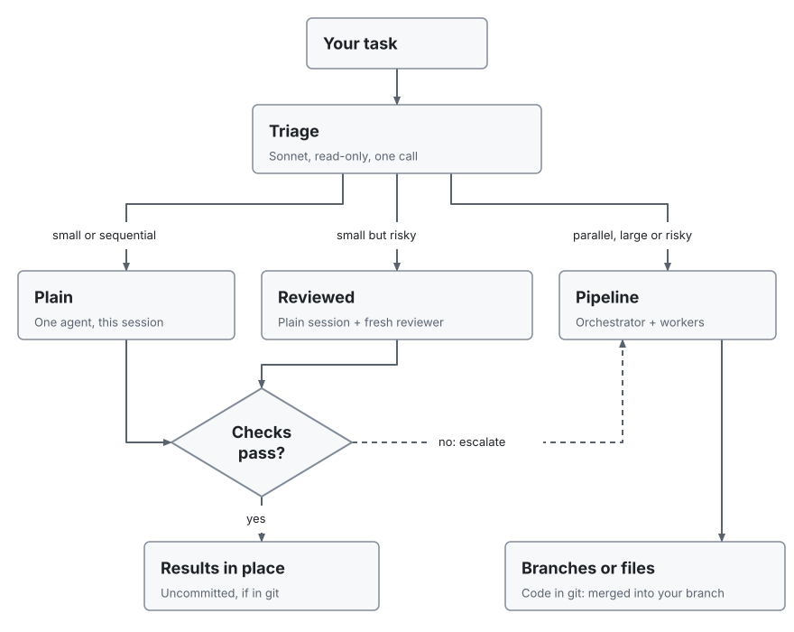

# Claude Code orchestrator

A Claude Code plugin that sizes each task and runs it the cheapest way that still checks the result. It takes code, research, writing, analysis or operations. A small task runs as a plain session. A large or risky task is split into slices that workers build and fresh reviewers check. Gates hold back the result until the checks pass.

Use it when a wrong result is costly or when a task splits into parallel parts. For a small task a plain Claude Code session is cheaper, and the plugin says so itself: its triage sends small work to a plain session. Terms are defined once, in the [glossary](docs/glossary.md). Every page is listed in [docs/README.md](docs/README.md).

## Install

1. Add the marketplace and install the plugin (inside a session, `/plugin` does the same):

   ```bash
   claude plugin marketplace add 0xcvaliente/claude-code-orchestration
   claude plugin install orchestration@claude-code-orchestration
   ```

2. Start a new chat. The plugin's nudge tells Claude to run `orchestration:route` before any non-trivial task.
3. A plugin installed or updated from your shell loads in the next session you start. In a session that is already open, run `/reload-plugins`.

You get a new copy only when a release changes the version. Added this way, the marketplace reads `main` and picks up each new release when you update. To stay on one release, add it at its tag (`0xcvaliente/claude-code-orchestration#v2.0.3`). Updates, release tags and what the plugin ships: [Sharing the plugin](docs/marketplace.md).

The plugin carries the agents, the gates, the `/route` skill, the gated workflow, the nudge and the pane. A plugin cannot set the two settings below. Add them to `.claude/settings.json` in your project or to `~/.claude/settings.json`:

- **`{ "worktree": { "baseRef": "head" } }`.** Parallel code slices then start from your local HEAD. Without it, Claude Code starts a worktree from the remote default branch, so the orchestrator runs code slices one after another in your folder and says so.
- **Permission denies.** This repo denies the seven built-in subagents in `BUILTIN_AGENTS` (`.claude/hooks/builtin-agents.mjs`), `Agent(fork)`, `git remote*`, `sudo*` and `rm -rf`. Copy the ones you want from its `.claude/settings.json`. Without them, the plan check still blocks fork and built-in launches while a run is open. See [Safety](docs/safety.md).

After a Claude Code update, run `npm run claude-update` in a checkout. It checks that nothing new gets around the gates ([details](docs/claude-code-updates.md#the-check)).

## First run

In any Claude Code chat with the plugin, type:

```
/route <task>          # triage, then run the route it picks
/orchestration on      # open the pane beside the chat; /orchestration off closes it
```

What you see:

- `/route` replies first with `Route: <mode> - <reason>`, then runs that route.
- On the orchestrate route the first line is `Path: light|full - <reason>`, then the plan, one line per slice.
- The final report has at most 15 lines, one `<id>: pass|fail - <evidence pointer>` line per slice. Ask for more detail when you want it.

From a checkout of this repo (`npm install` first):

```bash
claude                                      # in this repo: starts as the orchestrator
claude --agent orchestrator                 # the orchestrator, in any folder
npm start                                   # the orchestrator with the pane loaded (same as npm run orchestrate)
npm run plain                               # in this repo: claude --settings '{"agent":"","outputStyle":"Concise"}', a plain session
npm run auto -- "task" /path/to/folder      # headless: triage, then plain, reviewed or orchestrate
npm run native -- "task" /path/to/folder    # headless: always the orchestrator
npm run route -- --repo /path/to/folder --task "..."   # triage only; prints the decision as JSON
```

- <a id="the-gated-workflow"></a>The gated workflow fixes the order in code. Only you start it, never the model: `/orchestration:orchestrate {"task":"...","code":true,"baseRefHead":true}`. See [The gated workflow](docs/native-mode.md#the-gated-workflow).
- Headless runs, their output and their deny lists: [Headless runs](docs/native-mode.md#headless-runs).
- The pane: [docs/dashboard.md](docs/dashboard.md#opening-it).

## The three routes

<picture>
  <source media="(prefers-color-scheme: dark)" srcset="docs/diagrams/routes-dark.svg">
  
</picture>

- **Plain**: one session does the task in your folder.
- **Reviewed**: the same, then one fresh reviewer checks it.
- **Orchestrate**: the orchestrator plans slices; implementers build them, in parallel where they are independent; a fresh reviewer checks each one.

| Route | What runs | Where the result lands | What checks it |
|---|---|---|---|
| Plain | One session in your folder (`solo` in the SDK pipeline) | Your folder; uncommitted in git | Code: your tests. Other work: the session checks its work against the request |
| Reviewed | The same, then one fresh reviewer | Your folder; uncommitted in git | Code: the tests and the reviewer. Other work: the reviewer checks each requirement and each cited source |
| Orchestrate | The orchestrator, researchers, implementers and a reviewer per slice; for code in git also worktrees and the integrator | Code in git: the passed slices committed on a new hand-off branch, ready for your `/ship` (worktree branches are merged first into the run's branch, a new branch when you were on the default branch; a headless run cannot create that branch and reports the files it left uncommitted). SDK pipeline: `orch/<id>/result`. Other work: your folder, nothing committed | Tests for code, a reviewer per slice, the review gate, a merge check for isolated code slices |

Each route in detail: [How the native orchestrator works](docs/native-mode.md).

**Escalation.** When a plain or reviewed run fails its checks, the task runs again on the orchestrate route.

- The failed run's edits stay in your folder. Nothing reverts them and nothing commits them.
- In git, the new run's worktrees start from your last commit, so they do not see those edits.
- To turn escalation off, set `ORCH_NO_ESCALATE=1` (SDK pipeline: `--no-escalate`). A route you force never escalates.

<a id="sdk-pipeline"></a>**Two orchestrators.** The native orchestrator is the main toolkit, and `npm start` opens it. The [SDK pipeline](docs/sdk-pipeline.md) in `src/` is older and frozen (maintenance only). It runs code in git only, with `npm run sdk`.

## Choosing a route (triage)

Triage is one read-only Sonnet call. The triager reports five facts about the task:

1. **Files**: how many files it will create or change.
2. **Lines**: how many lines it will add or change, prose and data included.
3. **Independent slices**: parts that separate workers could do at the same time, with no shared output file.
4. **Risky**: security, authentication, payments, data migrations or deletion, public API changes, production operations, or content published outside the team.
5. **Code**: whether it changes source, tests, or build or CI configuration. A missing value counts as code.

Plain code, not the model, turns the facts into a route. So the decision can be tested without a model.

<picture>
  <source media="(prefers-color-scheme: dark)" srcset="docs/diagrams/triage-dark.svg">
  
</picture>

*Small* is at most 3 files, at most 200 lines and one slice. *Parallel* is 2 or more independent slices and either 10 or more files (4 or more when the task changes no code) or 1,500 or more lines. In full:

| Facts | Route |
|---|---|
| risky, at most 3 files, at most 200 lines, one slice | reviewed |
| risky, anything else | orchestrate: an independent review per slice |
| 12 or more files | orchestrate: too big for one context |
| 2 or more independent slices and (10 or more files for code, 4 or more for work that changes no code, or 1,500 or more lines) | orchestrate: parallel slices pay off |
| anything else | plain: a large but sequential change stays in one context |

- The thresholds are `TRIAGE` in `src/config.ts` (`bigLines` 1500 and `reviewedMaxLines` 200 are the line limits).
- <a id="why-a-router"></a>They were tuned on coding benchmarks only. Nothing is measured for research, writing, analysis or operations. Why the file count for code is 10: [Results: why a router](bench/RESULTS.md#results-why-a-router).
- The `code` fact also decides whether git machinery is used and, in `npm run auto`, whether web tools are allowed.
- A failed or malformed triage falls back to the orchestrate route.
- Without a checkout at `~/claude-code-orchestration` (or `$ORCH_HOME`), `/route` sizes the task in the session with the same rules.
- <a id="telemetry-and-the-read-log"></a>Every decision is logged to `routes.jsonl` ([Log files](docs/logs.md#log-files)).

## What the gates do

<a id="the-gates"></a><a id="what-040-adds-to-the-gates"></a><a id="how-a-worker-launch-is-shaped"></a>A gate is a hook that blocks a worker launch, a worker's stop or the final reply until a check holds. Gates read the tests and the reviews, never a worker's word.

- **Plan check**: blocks a worker launch that breaks the run's plan, and fork or built-in subagents while a run is open.
- **Test gate**: blocks an implementer's stop while the tests fail. It compares the failures with the base.
- **Review gate**: blocks the final reply until every slice has a passing review. A slice with a [doubt signal](docs/glossary.md#d), such as an earlier failed review, needs an opus review.
- **Guards**: narrow what a researcher or a reviewer may run or fetch.

Every gate, its reason codes and its limits: [Gates and guards](docs/gates.md). <a id="switches-and-plugin-settings"></a>Every plugin setting and environment variable: [Settings and switches](docs/settings.md). <a id="briefs-and-replies"></a>The exact brief and reply lines the hooks read: [Brief and reply grammar](docs/brief-grammar.md).

**What it adds to Claude Code.** Claude Code already runs subagents in the background, scripts workflows, forks helpers, reviews diffs with `/code-review` and weighs intent in auto mode. This plugin adds:

- **Verification**: a review gate per slice, a [constraints ledger](docs/glossary.md#c) (the task's hard rules, each checked by id), an opus review when in doubt, checked retries (a fresh reviewer confirms the gaps before a retry), and a test gate that compares failures with the base.
- **Routing cost**: a plain session when a task does not split. On small and medium coding tasks, the orchestrate route cost 1.2x to 2.1x the tokens of a plain session for the same 100% score (measured on 0.1.5, 2026-10-15; [results](bench/RESULTS.md#results-why-a-router)).
- **Safety**: role limits, guards, and denies for fork and built-in subagents.
- **Resumability**: a run journal that outlives the session.

It does not win on raw score: with the built-ins allowed, plain Opus scored 99.7% on the k2 task by delegating to them itself (measured on 0.1.5, 2026-10-15; [results](bench/RESULTS.md#results-built-in-subagents-blocked)). Area by area: [What Claude Code ships vs what this plugin adds](docs/native-vs-plugin.md).

## Limits and safety

- Everything this release does not do is listed on [docs/limits.md](docs/limits.md), each item with its reason.
- The guards and deny lists catch mistakes. They are not a security boundary. Run implementer and reviewer Bash in Claude Code's sandbox with a network allowlist.
- Worktrees isolate git state, not files. A shell write such as `cp` or `>` can still reach your main folder.
- The benchmarks are small (1 or 2 runs per setup). They show a direction, not a measurement.

<a id="known-limitations"></a>What protects what, and every page's limits: [docs/safety.md](docs/safety.md).

## Where to read more

- [Documentation index](docs/README.md): every page, with the question it answers.
- [How the native orchestrator works](docs/native-mode.md): roles, paths, retries, parallel slices, headless runs, the gated workflow, the plugin.
- [Benchmark](bench/README.md) and its [results](bench/RESULTS.md).
- [CHANGELOG](CHANGELOG.md): what changed in each release.

## Development

```bash
npm install
npm run check          # typecheck, tests, check-agents and check-plugin at the same time; CI runs it on push and pull request to main
npm run build-plugin   # rebuild dist/plugin and dist/dashboard after a change; npm run check fails while they are stale
npm run soak           # model-free soak of the gates: 10 minutes by default, --minutes N up to 60, --seed S to replay a round
```

- After `npm run check`, CI also runs the dashboard test.
- The soak drives random worker life cycles through the real hooks in temp projects and checks nine invariants. It exits 1 with a replayable sequence for each violation ([docs/data/probes-2.0.1-soak.md](docs/data/probes-2.0.1-soak.md)).
- Versions are tagged from `v1.1.0` onward. Scripts, layout and contributor rules: [docs/development.md](docs/development.md) and [CLAUDE.md](CLAUDE.md).

## License

MIT, see [LICENSE](LICENSE).
