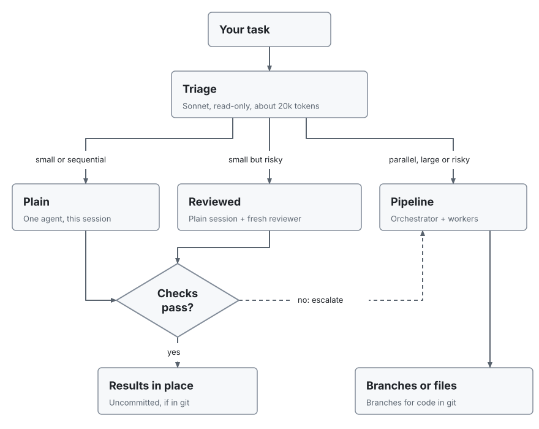
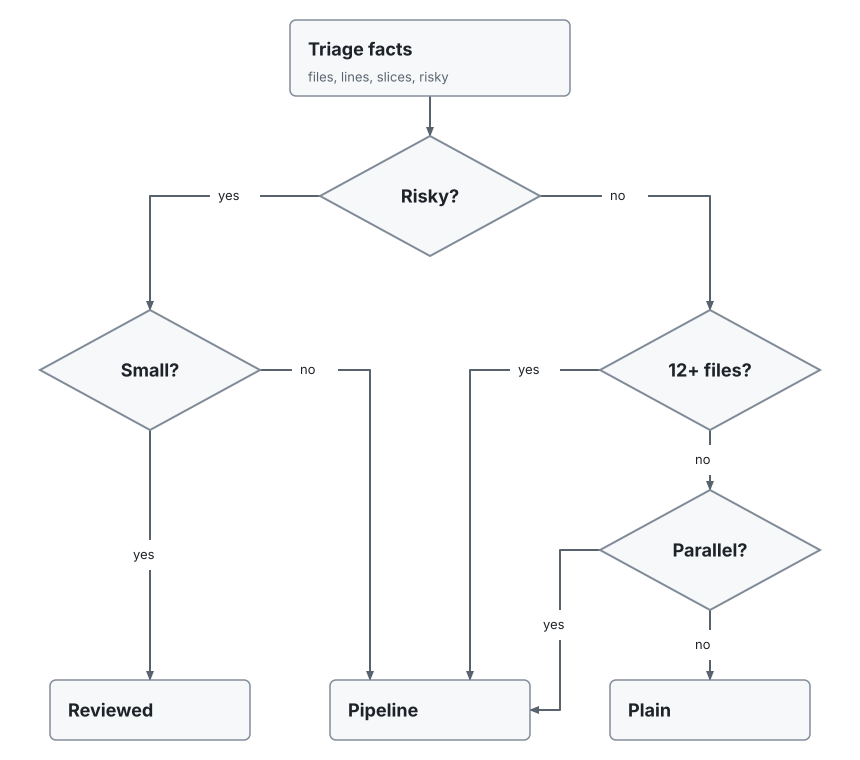
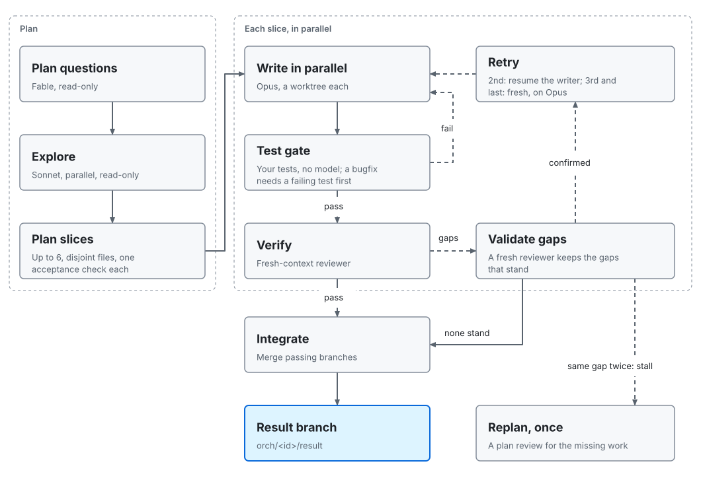
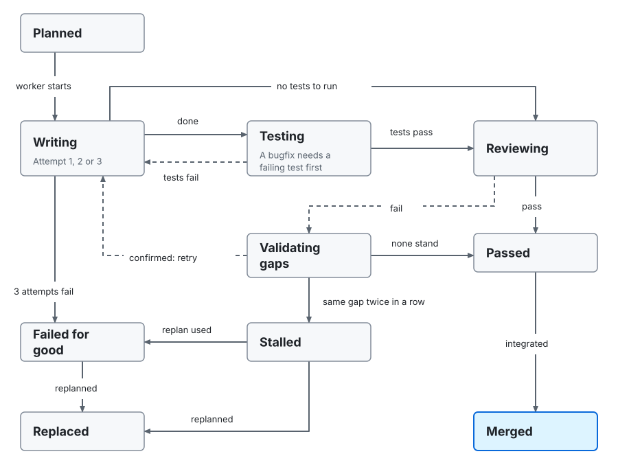
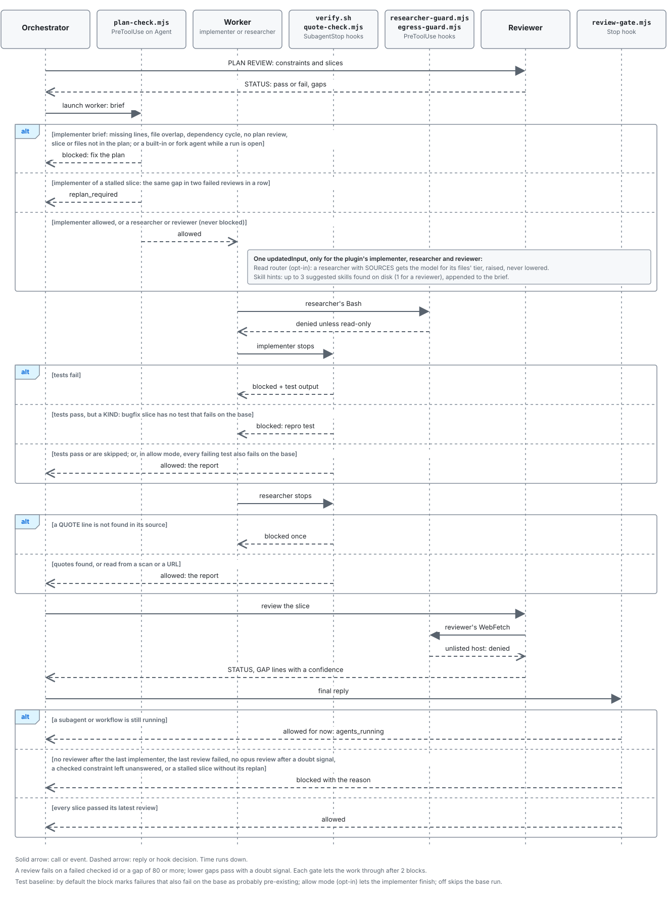
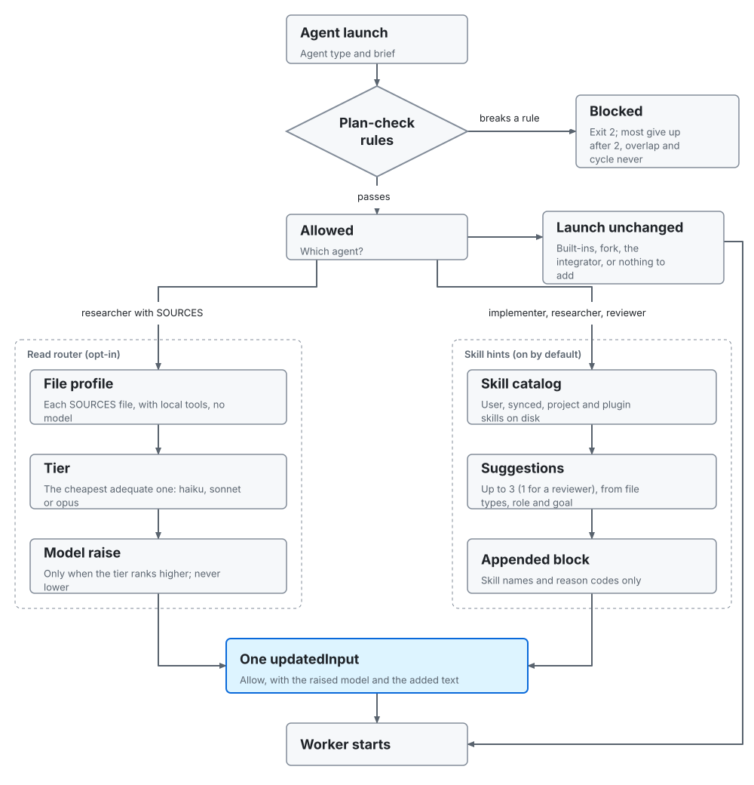
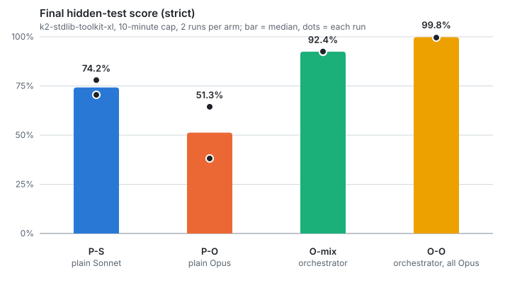
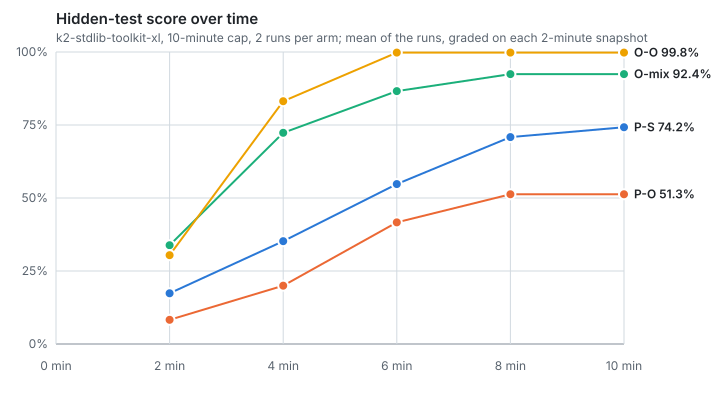

# Claude Code orchestrator

Split a task (code, research, writing, analysis or operations) across specialised agents when that pays off, and keep it in one plain session when it does not. A router sizes each task and picks the cheapest of three routes: a plain session, a plain session plus an independent reviewer, or a pipeline that plans the task, builds independent slices in parallel and has a fresh-context reviewer check each one, behind hooks that block a launch or a reply until the checks hold. It runs natively inside Claude Code (agents, hooks, skills and a workflow, shipped as a plugin), which takes any task, and as a TypeScript pipeline on the Claude Agent SDK, which takes code in a git repository only and has been frozen (maintenance only) since 0.3.0. This README describes version 1.1.0, the first stable release.

## Contents

- [Install and quick start](#install-and-quick-start) · [The three routes](#the-three-routes) · [Choosing a route (triage)](#choosing-a-route-triage)
- [The pipeline](#the-pipeline) · [The gates](#the-gates) · [How a worker launch is shaped](#how-a-worker-launch-is-shaped) · [Telemetry and the read log](#telemetry-and-the-read-log)
- [Briefs and replies](#briefs-and-replies) · [Switches and plugin settings](#switches-and-plugin-settings) · [The gated workflow](#the-gated-workflow)
- [The plugin](#the-plugin) · [Dashboard and status line](#dashboard-and-status-line) · [What Claude Code ships vs what this adds](#what-claude-code-ships-vs-what-this-adds)
- [Benchmarks](#benchmarks) · [Known limitations](#known-limitations) · [Safety](#safety) · [SDK pipeline](#sdk-pipeline) · [Reference](#reference) · [Development](#development)

## Install and quick start

**Releases.** Versions are tagged from `v1.1.0` onward, and the changes in each are listed in [CHANGELOG.md](CHANGELOG.md).

**Install the Claude Code plugin** (agents, gates, the `/route` skill, the gated workflow, the session nudge and the dashboard pane):

```
/plugin marketplace add 0xcvaliente/claude-code-orchestration
/plugin install orchestration --marketplace 0xcvaliente/claude-code-orchestration
```

Start a new chat afterwards. The plugin's `SessionStart` hook tells Claude to run `orchestration:route` before any non-trivial task and follow the result. `/route <task>` runs the same triage on demand, in any folder; it needs no checkout of this repo. After a plugin update, run `/reload-plugins`.

Two settings the plugin cannot set for you:

- **Parallel code slices need `baseRef: "head"`.** Claude Code starts a worktree from the remote default branch unless told otherwise, so a parallel slice would not see unpushed or feature-branch commits. Add `{ "worktree": { "baseRef": "head" } }` to your `.claude/settings.json` or `~/.claude/settings.json`. Without it the orchestrator runs code slices one after another in the shared tree and says so.
- **Permission denies.** A plugin cannot ship them. This repo denies Claude Code's built-in subagents (seven since Claude Code 2.1.325 added `web-fetch`; the list is `.claude/hooks/builtin-agents.mjs`), `Agent(fork)`, `git remote*`, `sudo*` and `rm -rf` in its own `.claude/settings.json`; add the ones you want to your settings. Without them the plan check still blocks fork and built-in launches while a run is open (`builtin_agent_in_run`).

Run implementer and reviewer Bash in Claude Code's sandbox with a network allowlist (the package registries and the hosts the task needs): the 0.4.0 guards narrow what a researcher or reviewer can reach, but Bash can still reach the network.

**From a checkout** (`npm install` first):

```bash
claude --agent orchestrator                      # interactive native orchestrator
npm run orchestrate                              # the same, with the dashboard pane loaded
npm run auto -- "task" /path/to/folder           # headless: triage, then a plain session, a reviewed one or the orchestrator
npm run native -- "task" /path/to/folder         # headless: always the orchestrator
npm run route -- --repo /path/to/folder --task "..."   # triage only, prints the decision as JSON
```

The gated workflow is started by you, never by the model: `/orchestration:orchestrate {"task":"...","code":true,"baseRefHead":true}` (project copy: `/orchestrate`). See [The gated workflow](#the-gated-workflow).

## The three routes

Every task goes through triage first. The kind of task (the triage fact `code`) changes the checks, the git machinery and, in `npm run auto`, the web tools; in routing it changes only the file count at which parallel slices go to the pipeline (10 for code, 4 otherwise).

<picture>
  <source media="(prefers-color-scheme: dark)" srcset="docs/diagrams/routes-dark.svg">
  
</picture>

| Route | What runs | Result lands in | Verified by |
|---|---|---|---|
| Plain | One agent in your folder: your own session natively, `solo` in the SDK | Your folder; uncommitted in git | Code: your tests. Other work: the session's own check against the request |
| Reviewed | The same, then one fresh-context reviewer | Your folder; uncommitted in git | Code: tests plus the reviewer. Other work: the reviewer checks every requirement and each claim against the source it cites |
| Pipeline | Planner, researchers, implementers and a reviewer per slice; for code in git, also worktrees and an integrator | Code in git: branches merged into your current branch (SDK: `orch/<id>/result`). Anything else: your folder, nothing committed | Tests for code, a reviewer per slice, the review gate, a merge check for isolated code slices |

The reviewer is read-only. It reads `git diff HEAD` for code in git, and otherwise the files or answer the work produced; for code it may run the folder's test command, for other work it checks every requirement and each cited source. Its verdict is its `STATUS:` line (the rule is in [Briefs and replies](#briefs-and-replies)).

The dashed arrow is **escalation**: if a triaged plain or reviewed run fails its checks, the task reruns through the pipeline. The failed attempt's edits stay in your folder, uncommitted in git, and are never reverted. For code in git the pipeline's worktrees only see committed work, so they do not see those edits. `ORCH_NO_ESCALATE=1` (SDK: `--no-escalate`) turns it off, and a forced mode never escalates.

## Choosing a route (triage)

The triager reports five facts about a task of any kind: how many files it will create or change, how many lines it will add or change (prose and data included), how many independent slices it has (parts separate workers could do at the same time with no shared output file), whether it is risky (security, authentication, payments, data migrations or deletion, public API changes, production operations, content published outside the team), and whether it changes code. Plain code turns the facts into a route, so the decision is testable without a model.

<picture>
  <source media="(prefers-color-scheme: dark)" srcset="docs/diagrams/triage-dark.svg">
  
</picture>

*Small* is at most 3 files, at most 200 lines and one slice. *Parallel* is 2 or more independent slices and either 10 or more files (4 or more when the task changes no code) or 1,500 or more lines. In full:

| Facts | Route |
|---|---|
| risky, at most 3 files, at most 200 lines, one slice | reviewed |
| risky, anything else | pipeline: independent review per slice |
| 12 or more files | pipeline: too big for one context |
| 2 or more independent slices and (10 or more files for code, 4 or more for work that changes no code, or 1,500 or more lines) | pipeline: parallel slices pay off |
| anything else | plain (a large but sequential change stays in one context) |

The thresholds are `TRIAGE` in `src/config.ts` (`bigLines` 1500 and `reviewedMaxLines` 200 are the line limits). They were tuned on coding benchmarks only; nothing has been measured for research, writing, analysis or operations. `minParallelFilesCode` was raised from 4 to 10 after the benchmark in [docs/benchmarks.md](docs/benchmarks.md) (2 runs per setup, so a direction rather than a measurement): triage had sent 5 of 14 small and medium runs to the pipeline, which used 1.1x to 2.8x the tokens of a plain Sonnet session that scored the same 100%. Work that changes no code keeps 4 (`minParallelFilesNonCode`), since the benchmark measured none. Without a checkout at `~/claude-code-orchestration` (or `$ORCH_HOME`), the `/route` skill sizes the task in-session with the same rules. A failed or malformed triage falls back to the pipeline. Every decision is appended to `routes.jsonl` (`.claude/state/` in a repo that registers the hooks itself, the plugin's per-user state dir otherwise, `runs/` for the SDK).

## The pipeline

The diagram shows the flow for code in a git repository in the native orchestrator. Work that changes no code follows the same plan and review steps in your folder, without worktrees or the merge.

<picture>
  <source media="(prefers-color-scheme: dark)" srcset="docs/diagrams/pipeline-dark.svg">
  
</picture>

Why each step is shaped this way:

- **Strongest model plans, cheap models read, mid-tier writes.** The expensive model only decides; Haiku answers narrow questions in parallel; Sonnet builds the slices.
- **Fresh contexts.** Workers start with no history. They get a brief and return a short report, so the orchestrator's context stays small.
- **A gate that does not trust the agent.** The test gate runs the tests in a hook, judged from `git status`, never from the agent's word.
- **A reviewer that did not write the work.** It sees the diff (the output files, for work that is not code) and the goal, not the implementer's reasoning.
- **Retries carry checked feedback.** A failing review's gaps are first sent to a fresh reviewer that keeps only those that stand; the second attempt resumes the same implementer with `SendMessage`, the third and last is a fresh implementer on Opus.
- **Disjoint files per slice.** Parallel slices never edit the same file, so merges are clean. Dependent slices run one after another.

Parallel slices: only code in a git repository runs them in worktrees (`isolation: "worktree"`, after a checkpoint commit by the integrator), and the integrator merges the passed branches into your current branch. Code outside git runs one slice at a time, because the test gate runs the whole suite on the shared tree. Work that changes no code runs in the shared folder, where slices with disjoint output files may run in parallel and nobody commits. Small tasks (one slice, at most 3 files, under about 1,500 lines, nothing risky) take a **light path**: one implementer and one reviewer, no plan review, exploration, worktrees or integrator.

One slice's life:

<picture>
  <source media="(prefers-color-scheme: dark)" srcset="docs/diagrams/slice-lifecycle-dark.svg">
  
</picture>

### The roles

| Role | Model, effort | Tools | Job |
|---|---|---|---|
| Orchestrator / planner | Opus, high | read-only; natively it can only delegate | Plans slices, writes briefs, sends reviews and retries |
| Researcher / explorer | Haiku, low | read-only, read-only `git`, `WebSearch`, `WebFetch`, `Skill` | Answers one narrow question with evidence: file paths, or URLs for web sources |
| Implementer / writer | Sonnet, medium | every tool except `Agent` | Builds one slice: code, a document, an analysis or an operation |
| Reviewer / verifier | Sonnet, medium | read, bash, `WebSearch`, `WebFetch`, `Skill`; never edits | Independent check of one slice or result |
| Integrator | Sonnet, low | read, bash | Code in git only: checkpoint commits, merges passing branches, runs the acceptance check, never resolves conflicts |
| Triager | Sonnet, low | read-only | Sizes a task for the router |

Models, effort, turn caps and the tool policy live in `src/config.ts`, the single source of truth; `npm run sync-agents` copies them into `.claude/agents/*.md`. No worker can start another agent. Claude Code's six built-in subagents and fork subagents are denied in this repo's settings (`DENIED_AGENTS`), and headless runs export `CLAUDE_AGENT_SDK_DISABLE_BUILTIN_AGENTS=1` and `CLAUDE_CODE_FORK_SUBAGENT=0`.

## The gates

The native order is the orchestrator's prompt; the gates are hooks that block a launch, a worker's stop or the final reply. Every gate is deny-only except the plan check, which may also rewrite a worker launch (next section).

<picture>
  <source media="(prefers-color-scheme: dark)" srcset="docs/diagrams/gates-sequence-dark.svg">
  
</picture>

| Gate | Hook | What it does |
|---|---|---|
| Plan check | `plan-check.mjs`, PreToolUse on `Agent` | Blocks an implementer brief without `SLICE:`/`FILES:` (`missing_lines`), with files another slice owns (`file_overlap`), a dependency cycle (`dependency_cycle`), a start before the plan review finished (`no_plan_review`) and, while a run is open, a slice or file outside the reviewed plan (`not_in_plan`), fork and built-in subagents (`builtin_agent_in_run`) and the next implementer of a stalled slice (`replan_required`) |
| Test gate | `verify.sh`, SubagentStop of an implementer | Runs the tests wherever there is a test command; blocks with the output while they fail. Test baseline and bugfix check below |
| Quote check | `quote-check.mjs`, a researcher's hand-back and SubagentStop | Blocks a researcher once when a `QUOTE:` line's text is not found in its source; in auto mode before the report is delivered |
| Report check | `handback-check.mjs`, PreToolUse on `SubagentHandback` | In auto mode, sends a worker's report back once, before it is delivered, when it has no `STATUS` line or a reviewer's pass leaves a checked id unanswered |
| Guards | `researcher-guard.mjs`, `egress-guard.mjs` | Deny a researcher's Bash command that is not read-only (read-only git, counting, and search with `grep`, `rg`, `find`, `head`, `tail`, `cat`), and a reviewer's `WebFetch` to a host its brief and its slice's planned files do not name |
| Review gate | `review-gate.mjs`, Stop | Blocks the final reply until every slice of the run has a passing review after its latest attempt, answers to its checked constraints, a passing opus review when a doubt signal fired, and a replan when it stalled. Waits while agents run |

**Review gate reasons**, in order: `agents_running` (allows the stop without counting a block while Stop's `background_tasks` lists a running subagent, workflow or teammate); `no_reviewer_after_last_implementer`, `last_reviewer_failed`, `last_reviewer_no_status` (per slice); `constraints_unchecked` (a passing review left a `CHECKS:` id unanswered); `opus_review_required` (a review on opus or a stronger model meets it); `replan_required`; `implementer_unfinished` (an implementer launched with the Agent tool started and never stopped, the mark of a turn-limit stop, which fires no SubagentStop; it blocks until the implementer is resumed and stops, or a later implementer stop takes the slice over; two blocks and one give-up per such implementer for the whole session); and `slice_failed_for_good` (allows: a slice whose latest review failed after 3 attempts is named in a `systemMessage` so the reply reports it as failed). The review gate only sees implementers: an orchestrator that writes the answer itself is told to send it to a reviewer first, and no hook checks that.

**Doubt signals** send a slice to an opus reviewer before it counts as passed: `RISKY: yes` (reviewed on opus from the start), a retry, a `(read)` constraint answer, a non-empty OPEN, an isolated test failure, and, since 0.4.0, a failing review whose gaps are all below the cutoff (`low_confidence_fail`: it counts as a pass with a doubt signal).

**Loop guards.** Most gates block twice per reason and scope, then let the launch or reply through and log `<reason>_gave_up` (or `max_blocks_reached`); the review gate's give-up carries a `systemMessage` saying the work is unverified. `file_overlap` and `dependency_cycle` block every time, the guards deny every time, and the quote check blocks once.

**Run scope.** A run belongs to one session. It opens at a `PLAN REVIEW` launch, or at a light-path implementer launch; a `PLAN REVIEW` with `REPLAN:` extends it; it closes when every slice is final. A slice is final when it failed for good (its latest review failed after 3 implementer attempts), or when its latest review passed and the escalation rule is met: no doubt signal, or a passing opus review after its latest attempt. A sonnet pass that still needs its opus review keeps the run open, so that review and any further launch of the slice join the same run instead of opening a new one ([docs/brief-grammar.md, Final slice](docs/brief-grammar.md#run-model)). A new user prompt does not close it. After `ORCH_RUN_STALE_MIN` minutes (default 30) with nothing running, the plan check treats it as closed, while the review gate still gates its unreviewed slices. A run waiting for an opus review that never comes, for example after the review gate gave up on it (`opus_review_required_gave_up`), stays open until it goes stale. Until then a new light task is blocked with `light_path_multi` and an unplanned implementer with `not_in_plan`, each at most twice. `foldRuns` in `.claude/hooks/brief.mjs` computes all of this from the log records alone.

### What 0.4.0 adds to the gates

- **Gap cutoff.** Reviewers write each gap as `GAP: <0-100> <text>`. A `STATUS: fail` review counts as a fail when it has a gap at or above the cutoff (default 80), a gap with no number, a failed checked id, or no gaps at all (an old-style reply). A fail whose gaps are all below the cutoff counts as a pass with the doubt signal `low_confidence_fail`.
- **Validation before a retry** (orchestrator prompt, not a hook). Before a retry the orchestrator sends the failing gaps with the diff to a fresh reviewer whose brief carries `VALIDATE: gaps`, and forwards only the gaps it confirms. That review replaces the earlier reviews of the same attempt in the count; if it confirms none, the slice counts as passed with a doubt signal.
- **Opus on the third attempt** (orchestrator prompt, not a hook). The second attempt resumes the same implementer with `SendMessage`; the third and last is a fresh implementer with `model: "opus"`.
- **Stall gate** (native only). Two failing reviews of a slice in a row that share a gap key stall it: the plan check blocks its next implementer and the review gate blocks the reply with `replan_required` until one REPLAN plan review runs. Three attempts whose latest review fails still end as `slice_failed_for_good`.
- **Test baseline.** When the tests fail at an implementer stop and the tree has changes against its base, `bugfix-check.mjs` runs the same command in a clean detached worktree of the base (limited to `ORCH_BASE_TIMEOUT_S`, default 300, cached per base commit and command). Three modes: `inform` (the default) still blocks and lists the qualified failing tests that also fail on the base as probably pre-existing; `allow` (opt-in, heuristic) lets the implementer finish with `tests_failed_baseline` when every failing test, qualified by its file or package, also fails on the base, while unqualified names, crash markers and a base run that timed out keep the block; `off` runs no base.
- **Bugfix check.** For a `KIND: bugfix` slice, after its tests pass, the test gate checks that a test file was changed or added and that it fails on the base. Otherwise it blocks and says what is missing; after two blocks it allows with `bugfix_unverified_gave_up`.
- **Quote check.** Each researcher `QUOTE: <locator> | <verbatim text>` is searched in the whole file the locator names (text as is; PDF, xlsx, docx and pptx through a cached text conversion). A quote not found blocks the researcher once; URLs, images and scans with no text layer are unverifiable and never block.
- **Guards.** `researcher-guard.mjs` allows only commands from the researcher's read-only Bash list, with no redirection, substitution or expansion. Since 1.2.0 the list includes search and paging (`grep`, `rg`, `find`, `head`, `tail`, `cat`) in forms that cannot write a file or start a program: `find` without `-exec`, `-ok`, `-delete` and `-fprint`, `grep` and `rg` with long options from a fixed list (and no `rg -z` or `grep -Q`), `head` and `tail` without follow in any spelling, none of them on a `/dev/` device, and a lone `--` never ends the check. On macOS and Linux Claude Code leaves the Grep and Glob tools out of an agent whose tools also name Bash, so without these the researcher could only read whole files. `egress-guard.mjs` allows a reviewer's fetch only to hosts named in its brief or its slice's planned files; an unreadable brief allows and logs `egress_unverified`. Both are deny-only and not a boundary.
- **Context after compaction.** `compact-context.mjs` (SessionStart, matcher `compact`) puts the open run's planned slices, their states and the constraint texts back in context.
- **Native Bash judge** (opt-in since 0.3.0, `ORCH_JUDGE=native`): since 0.4.0 the hook is registered with `onFailure: "block"` and a 120 s timeout, behind a wrapper that exits 0 when `node` is missing, so a crash or timeout refuses the command. Details in [docs/bash-judge.md](docs/bash-judge.md#native-hook-030).

The test gate skips the tests only in a git work tree when every changed path is prose (`.md`, `.markdown`, `.rst`, `.adoc`, `.txt`, with exceptions for build files and test-data folders); an explicit `ORCH_TEST_CMD` always runs, and it never reads the triage fact `code`. In isolated worktrees it runs the tests and only warns by default (`tests_failed_isolated`, a doubt signal), because sibling slices may not be merged yet. Every detail of the gates, with the live checks behind them, is in [docs/native-mode.md](docs/native-mode.md#gates) and [What 0.4.0 adds](docs/native-mode.md#what-040-adds).

### What 1.2.0 adds

1.2.0 follows Claude Code 2.1.317 to 2.1.322 ([docs/research-2026-11-10.md](docs/research-2026-11-10.md)).

- **Researcher search.** The researcher's Bash list gains read-only search and paging, checked by `researcher-guard.mjs`. Before it, a researcher launched from a plain session on macOS or Linux had no way to search.
- **Turn-limit stops are gated.** `implementer_unfinished` in the review gate: an implementer that ran out of turns no longer slips past the test gate and the review gate.
- **Opus or stronger.** A passing review on Fable (or any tier above opus) meets `opus_review_required`. Defaults are unchanged: escalations still launch on opus.
- **Reports checked before delivery.** In auto mode a worker's report passes `handback-check.mjs` and, for researchers, the quote check, before the orchestrator sees it. Each sends a report back at most once.
- **Cost in the report.** Estimated cost by role and model, one-hour cache writes and mid-run cache rewrites.
- **Subagent status line.** Shipped by the plugin ([Dashboard and status line](#dashboard-and-status-line)).
- **SDK pipeline.** Agent SDK 0.3.322 (0.3.325 since 1.2.2); the Bash judge's hook is registered with `onFailure: "block"`.

### After a Claude Code update

Claude Code updates itself, and an update can add something that goes around these gates. 2.1.325 added a built-in subagent, `web-fetch`, that the block list did not name. After an update, run this in a checkout:

```sh
npm run claude-update              # check; exit 1 when something needs attention
npm run claude-update -- --fix     # also repair this machine
```

It reads the built-in subagent types from the installed Claude Code and fails when one is not blocked, and it checks the headless switches, the options the scripts pass, the Agent SDK version, the plugin install and `dist/`. It calls no model. `--fix` blocks a newly found built-in on this machine at once and updates a stale plugin install; `--enable` installs and enables the plugin when it is off. [docs/claude-code-updates.md](docs/claude-code-updates.md) has every check and what to do when one fails.

## How a worker launch is shaped

<picture>
  <source media="(prefers-color-scheme: dark)" srcset="docs/diagrams/worker-launch-dark.svg">
  
</picture>

`plan-check.mjs` is the only hook that ever returns an allow. For two features it rewrites a launch with `permissionDecision: "allow"` and `updatedInput` (which takes effect only with allow or ask, and ask cannot be answered headless), combined into one `updatedInput` when both apply. It does so only for this plugin's or project's implementer (when its own checks allow the launch), researcher and reviewer: never for the integrator, a built-in, fork or a launch it blocks. A `permissions.deny` rule still wins.

- **Read router (opt-in, `ORCH_READ_ROUTER=on`).** For a researcher brief that names `SOURCES:`, it profiles each file with local tools (poppler, unzip, no model call) and picks the cheapest adequate tier: a PDF with a good text layer is haiku; scans, tables, multi-column pages or figures make it sonnet; a 50-page or longer PDF with `READ: judge` is one read on opus. The launch's model is raised to the tier, never lowered. Text conversions are cached under the state dir and listed in the brief. It was checked once live (a scanned PDF raised a researcher from haiku to sonnet) and benchmarked once on `d3-reader` ([route-040](#read-router-benchmark-route-040)): direction only, with the model raise and the converted-text notes confounded. It stays off until H14 is decided.
- **Skill suggestions (on by default, `ORCH_SKILL_HINTS=off` to drop).** The plan check appends one block naming at most 3 installed skills (1 for a reviewer), names and reason codes only, picked from the brief's `SKILLS:` names, the file types in FILES or SOURCES, the role and the goal's words. Installed skills are found on disk: `~/.claude/skills` (synced skills as `anthropic-skills:<name>`), the project's `.claude/skills` and enabled plugins' skills. A worker loads what fits with the Skill tool and reports a skipped suggestion in one line of its report, not under OPEN, because a non-empty OPEN is a doubt signal.

Workflow agents get neither: they make no Agent tool call, so they never reach the plan check. A live probe showed that a mod's `agent.spawn` hook runs under `claude -p`, fires for workflow agents, and can rewrite a workflow agent's model and prompt. Mod code can read files with `$.fs.read`, run scripts with `$.process.run` and import its own files, but cannot import `node:` modules or files outside the plugin. So routing workflow researchers there is feasible, but not built ([docs/data/live-checks-workflow.md](docs/data/live-checks-workflow.md)).

## Telemetry and the read log

- **Telemetry v2.** At SubagentStop `telemetry.mjs` reads the agent's transcript and records `tokens` (input, output, cache read, cache write, and since 1.2.0 `cache_write_1h`, the part written at the one-hour lifetime), `turns`, `models`, `max_turns_hit` and `cache_rewrites` (requests after the agent's first that wrote most of their context to the cache again: a cache that went cold in mid-run): numbers and model names only. A subagent that stops at its turn limit fires no SubagentStop, so `max_turns_hit` cannot see it; the report lists agents that started and never stopped instead. Headless runs pass `--no-session-persistence` by default and keep no subagent transcripts, so these fields are empty there. `ORCH_SESSION_PERSISTENCE=1` drops that flag, so headless runs (`npm run native`, `npm run auto`, the bench) write transcripts and the fields fill in ([docs/data/live-checks-telemetry.md](docs/data/live-checks-telemetry.md)). The cost is a session transcript under `~/.claude/projects/` per run.
- **File trail.** The journal's implementer stop record carries `files_touched`, taken from tool calls (plus git in an isolated worktree), never from the reply.
- **Read log.** `read-log.mjs` (PostToolUse on `Read|WebFetch`) writes one line per call to `reads.jsonl`: path, extension, size, pages and kind, or the host only for WebFetch. Never content.
- `npm run report -- /path/to/repo` renders the logs as `report.html` beside them, with a table per role (tokens by kind, turns, models, max-turn hits; one count per agent, from its last stop record, since each record is a running total), the agents that started and never stopped, an estimated cost by role and model at list prices (`scripts/prices.mjs`; an estimate for comparing roles and models, not a bill), and reads by kind and role.

The plugin's hooks log to `$CLAUDE_PLUGIN_DATA/state/<project path>` (a per-user dir), not to your project. In a repo that registers its own copy of the hooks, such as this one, they log to `.claude/state/` and the plugin's copies step aside so nothing runs twice.

## Briefs and replies

The orchestrator's briefs and the workers' replies follow one spec, [docs/brief-grammar.md](docs/brief-grammar.md), with one parser, `.claude/hooks/brief.mjs` (the dashboard mirrors it; a contract test over `src/fixtures/briefs` keeps them in step). Every line added after 0.1 is optional: old briefs parse to empty values and the checks that need them skip.

| Line | Where | Read by |
|---|---|---|
| `SLICE:`, `FILES:`, `DEPENDS:` | first lines of every implementer brief | plan check, journal, dashboard |
| `PATH: light`, `RISKY: yes`, `CHECKS: C1, C3` | implementer briefs | plan check, review gate (escalation, constraint answers) |
| `PLAN REVIEW`, `REPLAN: <n>`, `CONSTRAINTS:` block, per-slice `GOAL:` | the plan reviewer's brief | run model, `not_in_plan`, dashboard progress |
| `KIND: bugfix` | implementer briefs (0.4.0) | the implementer writes a failing reproduction test first; the bugfix check |
| `VALIDATE: gaps` | reviewer briefs (0.4.0) | review counting |
| `SOURCES:`, `READ: lookup\|extract\|judge` | researcher briefs (0.4.0) | read router |
| `SKILLS: <names>` | implementer, researcher and reviewer briefs, never the integrator's (0.4.0) | the worker; the skill suggestions |
| `STATUS:`, `C1: pass (cmd) ...`, `C1: pass (read) ...`, `C1: fail ...`, `OPEN:` | every reply | journal, review gate, dashboard |
| `GAP: <0-100> <text>` | reviewer replies (0.4.0) | review counting, stall gate |
| `QUOTE: <locator> \| <verbatim text>` | researcher replies (0.4.0) | quote check |

**STATUS rule** (one rule in `parseStatus`, the journal, telemetry, the review gate, the dashboard and `scripts/auto.sh`): a STATUS line starts with `STATUS: pass` or `STATUS: fail` after whitespace, emphasis or heading characters; any STATUS line that says fail fails the reply, otherwise the first one decides; blockquoted lines, a STATUS in mid-line and the template `STATUS: pass or fail` do not count. A reviewer with no STATUS line fails.

## Switches and plugin settings

The plugin declares 16 settings as `userConfig`, shown in `/config`. Claude Code passes each to hooks as `CLAUDE_PLUGIN_OPTION_<KEY>`; the hooks copy it to `ORCH_<KEY>` only when that variable is unset, so an environment variable wins over `/config`. The project copy of the hooks reads only the environment. Switches are named only in maintainer text, never in agent prompts, skills or the nudge (`src/contracts.test.ts` checks this).

| Key | Environment | Default | Effect |
|---|---|---|---|
| `test_cmd` | `ORCH_TEST_CMD` | detected | Test command for the test gate; set, it always runs |
| `escalation` | `ORCH_ESCALATION` | opus review on a doubt signal | `off` drops `opus_review_required`; `always` requires an opus review for every slice |
| `judge` | `ORCH_JUDGE` | off (native hook) | `native` turns on the deny-only native Bash judge hook |
| `judge_timeout_ms` | `ORCH_JUDGE_TIMEOUT_MS` | 40000 | The native judge's model-call timeout, capped at 45000 |
| `read_router` | `ORCH_READ_ROUTER` | off | `on` turns on the read router |
| `gap_min` | `ORCH_GAP_MIN` | 80 | Gap cutoff, 0 to 100 (0: every fail counts, as in 0.3.0) |
| `stall_gate` | `ORCH_STALL_GATE` | on | `off` drops `replan_required` |
| `guards` | `ORCH_GUARDS` | on | `off` drops the researcher and egress guards |
| `allow_builtins` | `ORCH_ALLOW_BUILTINS` | blocked in a run | `1` lets fork and built-in subagents launch while a run is open |
| `run_stale_min` | `ORCH_RUN_STALE_MIN` | 30 | Minutes with nothing running before an open run is stale |
| `baseline` | `ORCH_BASELINE` | `inform` | `inform`, `allow` or `off` (see the test baseline above) |
| `bugfix_check` | `ORCH_BUGFIX_CHECK` | on | `off` skips the bugfix check |
| `quote_check` | `ORCH_QUOTE_CHECK` | on | `off` skips the quote check |
| `gate_isolated` | `ORCH_GATE_ISOLATED` | `warn` | Test gate in isolated worktrees: `warn` (run, log, never block), `block` or `skip` |
| `skill_hints` | `ORCH_SKILL_HINTS` | on | `off` drops the suggested-skills block; an explicit `SKILLS:` line still reaches the worker |
| `handback_check` | `ORCH_HANDBACK_CHECK` | on | `off` skips the report check at a worker's hand-back |

The remaining environment variables (headless runs, the SDK, the nudge) are in [Reference](#environment).

## The gated workflow

`.claude/workflows/orchestrate.js` fixes the order in code instead of the orchestrator's prompt. The plugin ships it as `/orchestration:orchestrate`; in this repo it is `/orchestrate`. Claude Code runs a workflow only on the person's explicit request ([workflows](https://code.claude.com/docs/en/workflows.md)), so the route skill, the nudge and the orchestrator may suggest it but never start it.

What it does: plan with a CONSTRAINTS ledger (at most `maxSlices`, default 6), check the plan in code and have a reviewer check it, explore with researchers in parallel, build and review each slice (a RISKY slice gets an opus reviewer at once; others go to one on a doubt signal), retry with refuted gaps, replan once the slices that failed for good, and merge isolated code branches. Arguments: `task` (required), `code` (default `true`), `baseRefHead`, `plan` and `skip` (resume in a new session: pass the logged `plan: <JSON>` and the passed slice ids), `maxSlices`, `maxRetries`, and since 0.4.0 `gapMin` (80), `planCheck`, `planReview`, `refute` and `escalateLast` (all on by default).

How it differs from the native orchestrator:

- The order is fixed in code. In the native session it is advisory: the orchestrator once reviewed a branch before running the integrator, against its prompt.
- It makes no Agent tool call, so the plan check, the PostToolUse journal, the stall gate, the read router, the skill suggestions and the egress guard's host list from planned files never see its agents. Its agents do reach the test gate (baseline and bugfix check included), the quote check, the guards, telemetry and the review gate.
- A failing review whose gaps are all below `gapMin` passes the slice there without counting as a doubt signal; the native gates count it as `low_confidence_fail`.
- A workflow run resumes only within its session; pass `plan` and `skip` to resume in a new one.

In a plugin workflow `agentType` must be namespaced (`orchestration:<role>`; a probe showed bare names are "not found"), and `npm run build-plugin` rewrites it. Details: [docs/native-mode.md](docs/native-mode.md#scripted-flow-the-gated-workflow-030).

## The plugin

The marketplace manifest `.claude-plugin/marketplace.json` points at the committed `dist/plugin`. It carries the agents, the gate hooks, the session nudge, the worker contract, the `/route` skill, the gated workflow, the eval suite (`evals/`), the opt-in judge hooks, the dashboard mod and the 15 `userConfig` settings. It does not carry permission denies or the `worktree` setting: a plugin's own settings can set only `agent` and `subagentStatusLine` ([plugins reference](https://code.claude.com/docs/en/plugins-reference.md)).

- **Headless runs in any folder.** `npm run native` and `npm run auto` from a checkout run the folder's own `.claude/agents/<name>.md` or, without it, the plugin's agent (`orchestration:<name>`) when `claude plugin list --json` shows the plugin enabled there. With neither, the agent step exits 1 with the reason and calls no model. Details in [docs/native-mode.md](docs/native-mode.md#headless-ci-and-unattended).
- **The nudge.** A `SessionStart` hook (`nudge.mjs`) nudges every new main session to route non-trivial tasks. `ORCH_NO_NUDGE=1` silences it; headless runs set it.
- **Building.** After changing anything under `.claude/` or `dashboard/`, run `npm run build-plugin`; `npm run check-plugin` fails when the committed build is stale. Bump `version` in `package.json` for installed copies to pick up a change.

## Dashboard and status line

The plugin carries a function-hooks mod (`dashboard/`, built into `dist/plugin/hooks/dashboard.tsx`) that draws the run in a pane beside the chat. It opens on a prompt you type, in any folder, and when an orchestration agent starts or a route verdict is recorded; `/orchestration` opens it focused. In this repo, `npm run orchestrate` loads it. It shows progress through the plan (one line per slice with its goal, a `⚑` mark for RISKY, `⇧opus?`/`⇧opus✔` for the opus review and a tick per checked constraint), the triage fork of three routes, the stages a run uses, a flow diagram of the slices, retries and replans as loop-back connectors, tokens and results per task, a session log (a blocked launch shows as `⊘ blocked <reason>`) and what the session used. It follows the gates' run boundary and signs a run off only once no agent runs and the main turn has ended. It registers a model-callable tool, `mcp__orchestration__route`, which the `/route` skill calls once after sizing so the pane shows the triage. Headless runs do not draw it, and a task's tokens appear only when it finishes. Every rule: [docs/dashboard.md](docs/dashboard.md).

The plugin also ships a subagent status line (`subagent-statusline.mjs`, set through the plugin's `settings.json`; `subagentStatusLine` is one of the two settings keys a plugin may set). It rewrites the row Claude Code shows under the prompt for each of this plugin's workers as role, slice, attempt and flags, model, tokens with the share of the context window, and the progress line, for example `implementer s2 #2 risky · sonnet · 41.2k (21%) · Running the tests`. Other agents keep their default rows, and a `subagentStatusLine` in your own settings takes its place.

`statusline/statusline.sh` is the status line used with this repo: model, folder and git branch with changed files and lines, the 5-hour and weekly rate-limit windows, and the context fill as a bar (yellow at 70%, red at 90%). A plugin cannot set `statusLine`, so it takes two steps and needs `jq`:

```bash
npm run install-statusline        # copies it to ~/.claude/statusline.sh (refuses to overwrite a different file; --force replaces)
# then add to ~/.claude/settings.json:
{ "statusLine": { "type": "command", "command": "bash ~/.claude/statusline.sh" } }
```

Without a checkout: `curl -fsSL https://raw.githubusercontent.com/0xcvaliente/claude-code-orchestration/main/statusline/statusline.sh -o ~/.claude/statusline.sh`, then the same setting.

## What Claude Code ships vs what this adds

Claude Code already runs subagents in the background, scripts multi-agent workflows, forks the conversation into helpers, reviews diffs with `/code-review` and weighs intent in auto mode. This plugin does not beat that on raw score: with the built-ins allowed, plain Opus scored 99.7% on k2 by delegating to them itself. What it adds is verification (a review gate per slice that waits for running agents, a constraints ledger, opus escalation, validated retries, a test gate with a baseline), routing cost (a plain session when a task does not split), safety (role limits, guards, fork and built-in denies) and resumability (a run journal that outlives the session). [docs/native-vs-plugin.md](docs/native-vs-plugin.md) compares each area, with Claude Code's documentation as the source, and names the pre-registered hypotheses in [bench/HYPOTHESES.md](bench/HYPOTHESES.md) that are meant to measure each claim. What the 0.4.0 research recommended and what shipped is in [docs/research-2026-10-31.md, Implementation status](docs/research-2026-10-31.md#implementation-status-040).

## Benchmarks

All campaigns are headless, coding or document tasks only, with 1 or 2 runs per setup: they show direction, not measurements. Verdict rules are in [bench/HYPOTHESES.md](bench/HYPOTHESES.md); the harness is in [bench/README.md](bench/README.md).

### Read router benchmark (route-040)

`d3-reader` asks twelve questions over seven documents (text PDF, PDF table, scan, chart, xlsx formulas, docx table, 60-page PDF). A plain sonnet session launches one researcher per question, so the read router runs on every launch. There are 2 runs per arm at an 8-minute cap, seed 41, Claude Code 2.1.316, plugin 0.4.0, 2026-10-31. The six runs took about 2 minutes, against a 20-minute worst-case estimate. All 6 are valid (12 researcher launches each, and 12 route decisions per routed run). Full write-up: [docs/benchmark-route-040.md](docs/benchmark-route-040.md).

| Arm | n | Score (median; min, max) | Hard q3 to q11 (median) | Researcher tokens (median) | Total tokens (median) |
|---|---|---|---|---|---|
| `reader-routed` (router on) | 2 | 91.67% (83.33, 100) | 88.89% | 631,628.5 | 983,822 |
| `reader-sonnet` (all researchers sonnet) | 2 | 79.16% (75, 83.33) | 72.22% | 1,150,728 | 1,478,819.5 |
| `reader-haiku` (shipped) | 2 | 75% (75, 75) | 66.67% | 1,137,805 | 1,396,404 |

- The router raised 9 of 12 researchers to sonnet in each routed run. The three pre-registered predictions are each direction consistent: accuracy within a margin of sonnet, fewer researcher tokens than sonnet, and better than haiku on the hard kinds.
- Model and notes are confounded. Every arm answered the text, table, scan, chart and long-PDF questions right in every run, haiku included. The whole difference sits in the xlsx and docx questions, which unrouted researchers cannot open, while routed researchers got the converted text and sonnet together. The pattern suggests that the notes did more than the model.
- Status: direction only (n = 2, one task). H14 is not called supported.

### Comparison run for 0.4.0 (compare-040)

One `k2-stdlib-toolkit-xl` run per arm at a 10-minute cap, and two `d2-docs` runs per arm (seven questions over text, PDF, scan, xlsx and chart files) at a 6-minute cap. Claude Code 2.1.316, plugin 0.4.0, 2026-10-31. The eight runs took about 8 minutes of wall time against a 30-minute budget; every run exited on its own before its cap. Full write-up: [docs/benchmark-compare-040.md](docs/benchmark-compare-040.md).

| Task, cap | Arm | n | Strict score (median) | Tokens (median) | Wall (median) |
|---|---|---|---|---|---|
| k2, 10 min | `O-mix-plugin` (0.4.0) | 1 | 98.98% | 5,034,067 | 412 s |
| k2, 10 min | `O-mix-030` (0.3.0) | 1 | 99.72% | 5,225,511 | 453 s |
| d2-docs, 6 min | `all-haiku` | 2 | 100% | 2,059,608.5 | 162 s |
| d2-docs, 6 min | `all-sonnet` | 2 | 100% | 1,655,736 | 179 s |
| d2-docs, 6 min | `routed` (read router on) | 2 | 100% | 1,225,473.5 | 161 s |

- On k2, 0.4.0 scored 0.74 points below 0.3.0 with 3.7% fewer tokens and 41 s less wall time; neither claimed a false success. One run each cannot separate this from noise (the earlier 0.3.0 run on the same task scored 99.6%), and the pair changes everything between versions at once.
- On d2-docs every arm answered all seven questions in both runs, so the score gives no signal.
- **The read router was not exercised.** Every d2-docs run took the light path (one slice, no researcher), and the router changes only researcher launches, so it never fired. The token spread between the d2 arms comes from how each orchestrator ran the slice, not from routing. The router was verified separately by one live check (a scanned PDF raised a researcher from haiku to sonnet), which says nothing about scores or tokens.
- No slice stalled or failed for good, no `VALIDATE: gaps` review or replan ran, and no run applied the third-attempt rule, so H15 (opus on the last attempt), H16 (gap cutoff and validation) and H17 (stall replan) have no data from this run.
- Status: direction only. No hypothesis (H14 to H17 included) is called supported.

### Benchmark: orchestrator vs plain sessions, built-in subagents blocked

Claude Code's six built-in subagents are blocked in this repository, so a plain session cannot delegate. Benchmarked on `k2-stdlib-toolkit-xl` (twelve Python standard-library modules, 1,762 hidden tests) under a 10-minute cap, 2 runs per setup, tokens counted over every model. Full write-up and every chart: [docs/benchmark-builtins-blocked.md](docs/benchmark-builtins-blocked.md).

| Setup | Strict score (median) | Tokens | Wall time | Subagents per run |
|---|---|---|---|---|
| Plain Sonnet (P-S) | 74.2% | 2.20M | 8.2 min | 0 |
| Plain Opus (P-O) | 51.3% | 2.94M | 7.5 min | 0 |
| Orchestrator, shipped models (O-mix) | 92.4% (lenient 99.0%) | 5.66M | 5.8 min | 21 to 22 |
| Orchestrator, all Opus (O-O) | 99.8% | 6.34M | 6.1 min | 16 to 25 |

<picture>
  <source media="(prefers-color-scheme: dark)" srcset="docs/diagrams/bench-k2-cap10-score-dark.svg">
  
</picture>

<picture>
  <source media="(prefers-color-scheme: dark)" srcset="docs/diagrams/bench-k2-cap10-timeline-dark.svg">
  
</picture>

- Delegating through the orchestrator scored 18 points higher than plain Sonnet and 48.5 higher than plain Opus, at 2.2x to 2.6x the tokens and 1.4 to 2.4 minutes less wall time. Plain sessions stopped early with unfinished modules.
- Both O-mix runs lost the same module (`tomlparse` imports `re`, which the spec forbids) and claimed success: two false successes by the automatic classification. O-mix's reviewers missed it, while an O-O reviewer caught the same rule in four modules.
- With the built-ins allowed (an earlier campaign, different plugin version), plain Opus scored 99.7% on this task by delegating to `general-purpose` itself, so this benchmark does not show the orchestrator beating built-in delegation on raw score.

### 0.3.0 short run

Same task and 10-minute cap, one run per arm, Claude Code 2.1.314, plugin 0.3.0. Full write-up: [docs/benchmark-short-k2.md](docs/benchmark-short-k2.md).

| Setup | Strict score | Lenient | Tokens | Wall time | False success |
|---|---|---|---|---|---|
| Orchestrator 0.3.0, shipped models (O-mix) | 99.6% | 99.6% | 4.44M | 395 s | no |
| Native workflow orchestration, no plugin (N-UC) | 92.91% | 99.94% | 5.65M | 429 s | no |
| This repo's gated workflow (W-mix) | 66.91% | 91.54% | not measured | killed at 602 s | no (claimed nothing) |

W-mix was cut off at the deadline before it finished, so its tokens were not recorded. N-UC's strict gap is one module importing `re`.

### Why a router

Measured on seven coding tasks, five setups, with Claude Code's built-in subagents allowed (they are blocked now), 2 runs per cell; details in [docs/benchmarks.md](docs/benchmarks.md).

| | Plain session (Sonnet or Opus) | Pipeline (shipped or all-Opus orchestrator) |
|---|---|---|
| Small and medium tasks (t1, t2, h1, h2): correctness | 100% on every run | 100% on every run (never better) |
| Small and medium tasks: tokens | 126k to 490k | 166k to 1.09M: 1.2x to 2.1x a plain session of the same model family |
| Small and medium tasks: wall time | 15s to 3.5 min | 34s to 6.1 min |
| Large tasks (k1, h3, k2): correctness per run | k1 and h3: Opus 100%, Sonnet 98.6% to 99.9%. k2 (strict): Opus 100%, Sonnet 74.5% and 83.5% | k1 and h3: 99.0% to 100%. k2 (strict): 74.9% to 99.9%, never 100% |
| Large tasks: tokens | 1.3M to 13.4M | 2.7M to 12.9M: 0.7x to 2.0x on k1 and h3, 0.7x to 0.9x on k2 |
| Large tasks: time to full score | plain Opus 4 to 8 min | 6 to 12 min on k1 and h3, never on k2 |
| Self-delegation | on k1 and k2 every plain run spawned Claude Code's built-in subagents (3 on k1, 12 to 21 on k2) | its own researcher, implementers, reviewers, integrator |
| Verification | the agent's own word: 1 audited false success in 28 runs | test gate, independent reviewer, review gate: 0 in 28 runs |

On these tasks the pipeline did not raise correctness; what it adds is the gates, at 1.2x to 2.1x the tokens on small and medium work, and the router spends one cheap read-only call to decide whether a task needs them. Sweeps on k2 (limits of 10 and 60 minutes, 3M and 8M tokens) are in [docs/benchmarks.md](docs/benchmarks.md). Pre-registered hypotheses: H1, H2, H5, H6 and H7 not supported, H4 supported only by a one-run difference.

## Known limitations

The full list, with the evidence for each, is in [docs/native-mode.md](docs/native-mode.md#known-limitations).

- The benchmarks are small (1 or 2 runs per setup, few tasks) and show direction only. The gap cutoff with validation, the opus third attempt and the stall gate are unmeasured: compare-040 never exercised them (H15 to H17 untested). The read router has one direction-only benchmark ([route-040](#read-router-benchmark-route-040)).
- The read router is opt-in. It was checked by one live run and benchmarked once on `d3-reader` ([docs/benchmark-route-040.md](docs/benchmark-route-040.md)): direction only, n = 2, one task, with the model raise and the converted-text notes confounded. Its log can show `hard_pages: 0` next to a `pdf_hard_pages` reason code. Workflow researchers are not routed, and workflow agents get no skill suggestions. A probe showed that a mod's `agent.spawn` hook could do both under `claude -p`, but it is not implemented ([docs/data/live-checks-workflow.md](docs/data/live-checks-workflow.md)).
- Validation before a retry and opus on the third attempt are orchestrator prompt rules; no hook enforces them. The workflow enforces them in code.
- The stall gate is native-only, and the workflow does not treat a failing review whose gaps are all below the cutoff as a doubt signal.
- The test baseline's `allow` mode is heuristic (runner output cannot be parsed completely), which is why `inform` is the default.
- The quote check trusts any file whose real path is inside the read cache, and it cannot check a value read from a scan.
- The egress guard reads planned files from the shared tree, so hosts in a file that exists only on an isolated branch are denied (it fails safe). The guards are not a boundary.
- The skill catalog does not see plugins loaded with `--plugin-dir` or skills bundled with Claude Code; explicit `SKILLS:` names for them still reach the worker, marked as not found.
- Headless runs keep no subagent transcripts by default, so telemetry v2's token, turn and model fields are empty there unless `ORCH_SESSION_PERSISTENCE=1` is set.
- No WorktreeCreate hook ships; `worktree.baseRef: "head"` is the way to start worktrees from the local HEAD. Settings load from the folder a session started in.
- A long-lived agent-team teammate listed as running keeps the review gate deferring. `file_overlap` and `dependency_cycle` block with no give-up.
- The eval suite (`npm run eval`) has not been smoke-run.
- The dashboard counts a run as stale after 10 minutes with no agent running, not after `ORCH_RUN_STALE_MIN`.

## Safety

- **Pushes and deletes, native.** `scripts/orchestrate.sh` passes `UNSAFE_BASH` (`git push`, `git remote`, `sudo` and the `rm -rf` spellings) to every headless run as `--disallowedTools`, which beats any allow rule; the agents are told never to push; this repo's settings deny the same list except `git push`, so an interactive session can push as its permission mode allows. `ORCH_JUDGE=native` adds the deny-only native Bash judge hook ([docs/bash-judge.md](docs/bash-judge.md#native-hook-030)).
- **Pushes and deletes, SDK workers.** A Bash judge (`src/judge.ts`) denies `sudo`, catastrophic and unreadable commands outright, and sends `git push`, `git remote` and a plain recursive `rm` to an opus judge with the user's original task as the only authority; every failure is a deny, and `ORCH_JUDGE=off` restores the old denial. Best-effort defence in depth, not a sandbox: what it misses and over-blocks is in [docs/bash-judge.md](docs/bash-judge.md#11-limits).
- Worktrees isolate git state, not the filesystem: Claude Code blocks a worktree agent's edits and git commands into the main checkout, but not non-git shell writes such as `cp` or `>` ([worktrees](https://code.claude.com/docs/en/worktrees.md)). Run in a container or VM for untrusted repos.
- The deny lists guard against mistakes, not malice. Headless runs allow `Bash(npm *)` and `Bash(node *)` (and the Python interpreter for a Python test runner), which can run any code.
- Web search and fetch are read-only, and fetched pages are data, not instructions: that is a prompt rule plus the egress guard for reviewers, not a sandbox.
- An operations task acts with your permissions. The triager counts production work as risky, which buys an independent review, but the review comes after the commands have run.
- Model output is treated as untrusted input: plans, slice ids, verdicts and triage facts are validated before use, and a triage reply without `code` counts as code, the stricter side.

## SDK pipeline

The TypeScript pipeline in `src/` takes code in a git repository only, fixes the order in code and leaves its result on the branch `orch/<id>/result` without touching your checkout. It is frozen since 0.3.0: maintenance only, none of the 0.4.0 gates.

```bash
npm start -- --repo /path/to/git/repo --task "add rate limiting to the API" --test-cmd "npm test"
npm start -- --repo . --task "..." --plan-only     # plan only: the cheapest way to try it
npm start -- --repo . --task "..." --mode plain    # skip triage
npm start -- --repo . --resume <id>                # continue a run
```

It retries transient errors (rate limit, overload, 5xx, dropped stream) up to twice with backoff, writes `runs/<id>/journal.json` after each slice for `--resume`, replans failed slices with `--replans N` (0 to 3) and caps tokens only when `--budget` is set. A run writes `plan.json`, `findings.md`, `journal.json`, `judge-audit.jsonl`, `telemetry.jsonl` and `report.json` under `runs/<id>/`, and branches `orch/<id>/<slice>`; it never pushes on its own.

### Bash judge (SDK workers)

SDK workers with Bash (`solo`, `writer`, `verifier`) run every command through `src/judge.ts`. The `deny` class (the hard floor: `sudo`, catastrophic or non-plain recursive `rm`, commands the tokenizer cannot read) is refused at once; the `judge` class (`git push`, `git remote`, one plain `rm -r[f] <paths>`) goes to opus with the user's original `--task` as the only authority, so a resume without `--task` refuses them; everything else passes. It fails closed. Classes, prompt, audit log and limits: [docs/bash-judge.md](docs/bash-judge.md).

## Reference

### CLI flags (`npm start -- ...`)

| Flag | Meaning |
|---|---|
| `--repo DIR`, `--task TEXT` | The git repo and what to do (`--task` is not needed with `--resume`, but without it the Bash judge refuses pushes and recursive deletes: pass it again) |
| `--mode auto\|plain\|reviewed\|orchestrate` | Route. `auto` (default) lets triage decide; anything else skips triage |
| `--no-escalate` | Do not rerun a failed plain or reviewed run through the pipeline |
| `--test-cmd CMD` | The acceptance command, run by the harness after each worker |
| `--setup-cmd CMD` | Runs in each new worktree before its writer, for example `npm ci` |
| `--budget TOKENS` | Optional run cap in tokens (`500000`, `500k` or `2M`; at least 10k). Unset means no cap |
| `--concurrency N`, `--retries N` | Parallel workers (3) and retries per slice (2) |
| `--replans N` | Replanning rounds after failures, 0 to 3 (default 0) |
| `--plan-only` | Stop after planning (implies the pipeline) |
| `--resume ID` | Continue a run (implies the pipeline) |
| `--keep-worktrees` | Keep every worktree; by default passing slices' and the result worktree are removed and branches always stay |
| `--out DIR` | Where runs are written (`runs`) |

Invalid numbers exit 2; a failed plan exits 1.

### Environment

The gate switches with a plugin setting are in [Switches and plugin settings](#switches-and-plugin-settings). The others:

| Variable | Used by | Meaning |
|---|---|---|
| `ORCH_MODE` | `auto.sh` | `auto`, `plain`, `reviewed` or `orchestrate` |
| `ORCH_NO_ESCALATE` | `auto.sh` | Turn escalation off |
| `ORCH_BUDGET_TOKENS` | `orchestrate.sh` | Optional token cap for a headless run, same forms as `--budget`; approximate, converted at 1M tokens per list-price dollar |
| `ORCH_ALLOWED_TOOLS`, `ORCH_EXTRA_ALLOWED_TOOLS` | `orchestrate.sh`, `auto.sh` | Replace, or append to, the headless tool allowlist, one rule per line. `auto.sh` adds `WebSearch` and `WebFetch` when the task changes no code |
| `ORCH_AGENT`, `ORCH_AGENT_PREFIX` | `orchestrate.sh` | Agent to run (`none` is a plain session); `orchestration:` always runs the plugin's agents |
| `ORCH_ADD_DIR`, `ORCH_ADVISOR`, `ORCH_DRY_RUN` | `orchestrate.sh` | Extra readable dir, experimental advisor model, print arguments and exit |
| `ORCH_SESSION_PERSISTENCE` | `orchestrate.sh` (so also `auto.sh` and `npm run native`) | `1` omits `--no-session-persistence`, so session and subagent transcripts are written and telemetry v2 records per-agent tokens, turns and models. Unset (default): no transcripts, those fields empty |
| `ORCH_MODEL` | `orchestrate.sh` | Passes `--model`, for plain-model baselines |
| `ORCH_BASE_TIMEOUT_S` | `bugfix-check.mjs` | Time limit of a test-baseline base run, default 300 |
| `ORCH_READ_ROUTER_BUDGET_MS` | `plan-check.mjs` | The read router's profiling budget, default 15000 |
| `ORCH_JUDGE_MODEL`, `ORCH_JUDGE_CLAUDE_BIN` | `judge-hook.mjs` | The native judge's model (default `opus`) and binary |
| `ORCH_MODEL_PLANNER`, `_EXPLORER`, `_WRITER`, `_VERIFIER`, `_TRIAGER`, `_SOLO` | SDK | Override a role's model |
| `ORCH_MODEL_JUDGE`, `ORCH_JUDGE_AUDIT` | SDK | The Bash judge's model (default `claude-opus-5-5`) and audit file |
| `ORCH_SANDBOX`, `ORCH_SANDBOX_DOMAINS` | SDK | `on` runs Bash roles in the SDK's OS sandbox (opt-in; smoke-tested on macOS only), and the network domains it allows |
| `ORCH_NO_NUDGE` | `nudge.mjs` | Silence the session nudge |
| `ORCH_BUILTINS_FILE`, `ORCH_CLAUDE_BIN` | `plan-check.mjs`, `claude-update.mjs` | The file of built-in agent types learned on this machine (default `~/.claude/orchestration/builtin-agents.json`; empty means none), and the `claude` binary the update check runs |
| `ORCH_HOME` | `/route` skill | Where this repo lives (default `~/claude-code-orchestration`) |

The native test gate detects the runner in this order: `ORCH_TEST_CMD`; `npm test` when `package.json` has a test script; `pytest` (or `unittest`) only when `test_*.py` or `*_test.py` files exist; `cargo test`; `go test ./...`; `swift test`; `make test` when a `test:` target exists (`.claude/hooks/test-cmd.sh`). No runner means the gate allows (`no_test_command`).

### npm scripts

| Script | What it does |
|---|---|
| `npm run check` | Everything CI runs: typecheck, `npm test`, `check-agents` and `check-plugin` |
| `npm test`, `npm run typecheck` | Unit tests (fake model, no API calls) and type check |
| `npm run check-agents`, `npm run sync-agents` | Detect or fix drift between `src/config.ts` and `.claude/agents/*.md` |
| `npm run build-plugin`, `npm run check-plugin` | Build `dist/plugin` and `dist/dashboard`, or fail when the committed build is stale |
| `npm run auto`, `npm run native`, `npm run route` | Headless native run with or without triage; triage only |
| `npm run orchestrate`, `npm run test-dashboard` | Interactive orchestrator with the dashboard loaded; the dashboard's own test (needs the `claude` CLI) |
| `npm run report` | HTML timeline and per-role tables from the state dir |
| `npm run install-statusline` | Copy the status line script and print the setting |
| `npm run claude-update` | Check this repo against the installed Claude Code after an update; `-- --fix` repairs the machine, `-- --enable` turns the plugin on, `-- --write-source` updates the block list in the repo ([docs/claude-code-updates.md](docs/claude-code-updates.md)) |
| `npm run eval` | `claude plugin eval` on `dist/plugin` with the four cases in `evals/` (paid, `--max-cost-usd 10`); not smoke-run yet |
| `npm run bench`, `bench:validate`, `bench:grade`, `bench:analyze`, `bench:report` | The benchmark ([bench/README.md](bench/README.md)) |
| `npm start` | SDK pipeline with triage |

### Repository layout

```
.claude/
  agents/            orchestrator, researcher, implementer, integrator, reviewer
  hooks/             plan-check.mjs (plan check, read router, skill hints), verify.sh and bugfix-check.mjs (test gate,
                     baseline, bugfix check), review-gate.mjs, quote-check.mjs, researcher-guard.mjs, egress-guard.mjs,
                     compact-context.mjs, journal.mjs, telemetry.mjs, read-log.mjs, nudge.mjs, brief.mjs (the parser),
                     run.mjs, state.mjs, file-profile.mjs, skill-catalog.mjs, skill-hint.mjs, judge-hook.mjs,
                     judge-core.mjs, prompt-capture.mjs, test-cmd.sh, builtin-agents.mjs (the one list of Claude Code's
                     built-in subagent types)
  skills/            route, orchestration-conventions
  workflows/         orchestrate.js (the gated workflow)
  settings.json, rules/
.claude-plugin/      marketplace.json
dist/plugin/, dist/dashboard/   the built plugin and the dashboard mod alone (committed)
dashboard/           the live pane (source for both builds)
statusline/          statusline.sh
src/                 the SDK pipeline (config.ts is the source of truth for roles and thresholds) and the tests
scripts/             auto.sh, orchestrate.sh, build-plugin.mjs, report.mjs, test-dashboard.mjs, sandbox-smoke.mjs,
                     claude-update.mjs (the check to run after a Claude Code update),
                     run-result.mjs and log-run.mjs (a headless run's one result document and its row in runs.jsonl)
evals/               the plugin eval suite
bench/               the benchmark: run, grade, analyze, report, tasks/, matrix/
docs/                native-mode.md, brief-grammar.md, dashboard.md, native-vs-plugin.md, bash-judge.md,
                     claude-code-updates.md, benchmark pages,
                     research-2026-10-31.md, data/ (run data, live checks), diagrams/
```

## Development

```bash
npm install
npm run check            # typecheck, tests, check-agents, check-plugin; CI runs it on push and pull request to main
npm run build-plugin     # after any change under .claude/ or dashboard/
npm run test-dashboard   # the dashboard's own test (needs the claude CLI)
npm run bench -- --matrix bench/matrix/<name>.json   # a benchmark campaign (paid)
npm run eval -- --case t2-single --runs 1 --ablation none --max-cost-usd 2   # a bounded eval smoke run (paid)
```

Rules for contributors are in `CLAUDE.md` and `.claude/rules/agents.md`. In short: change models, effort and triage thresholds in `src/config.ts` and run `npm run sync-agents`; rebuild the plugin after touching agents, skills or hooks; the session nudge, the `route` skill and the orchestrator describe the same three routes, so change them together; name switches only in maintainer text.

The diagrams are SVGs in `docs/diagrams/`, in a light and a dark version. To change one, edit its `*.scene.json` (or the sequence in `build.py`) and run `python3 docs/diagrams/build.py`; it uses the diagram-craft skill's renderer.
