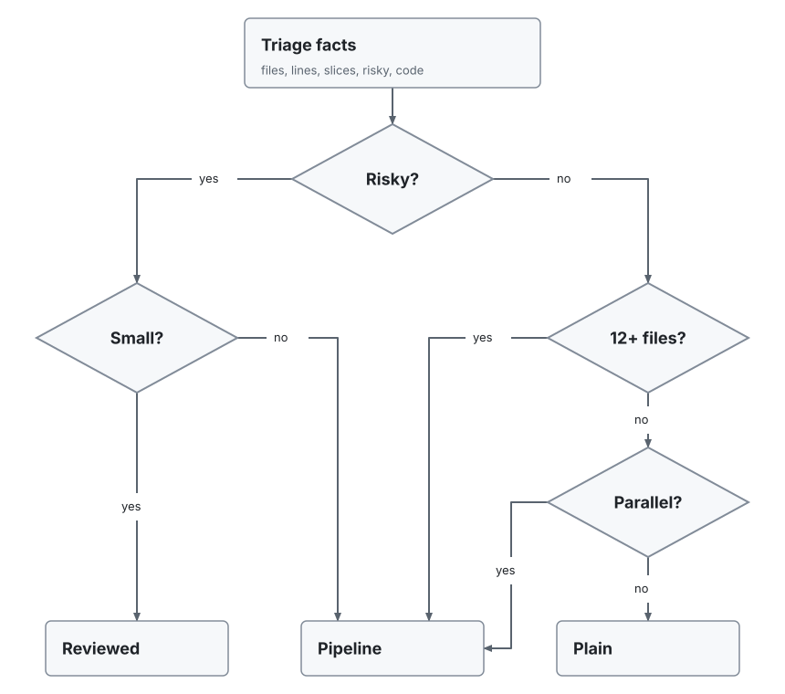

# Claude Code orchestrator

A Claude Code plugin that sizes each task, then runs it on one of three routes: a plain session, a plain session plus a fresh reviewer, or the orchestrator. It takes code, research, writing, analysis or operations.

On the orchestrate route the task is split into slices. Workers build the slices and fresh reviewers check them. Gates hold back the result until the checks pass.

Use it when a wrong result is costly, or when a task splits into parallel parts. A small task needs none of this, and triage sends it to a plain session.

Terms are defined once, in the [glossary](docs/glossary.md). Every page is listed in the [documentation index](docs/README.md). How a run works: [native-mode.md](docs/native-mode.md). The benchmark: [guide](bench/README.md) and [results](bench/RESULTS.md).

## Install

1. Add the marketplace and install the plugin (inside a session, `/plugin` does the same):

   ```bash
   claude plugin marketplace add 0xcvaliente/claude-code-orchestration
   claude plugin install orchestration@claude-code-orchestration
   ```

2. Start a new chat. At session start the plugin's nudge points Claude to the `orchestration:route` skill before any non-trivial task.
3. A plugin installed or updated from your shell loads in the next session. In a session that is already open, run `/reload-plugins`.

Added this way, the marketplace follows `main`. To stay on one release, add it at its tag, for example `0xcvaliente/claude-code-orchestration#v2.2.1` ([Stable or latest](docs/marketplace.md#stable-or-latest)).

A plugin cannot set the two settings below ([what the plugin ships](docs/marketplace.md#what-the-plugin-ships-and-why)). Add them to `.claude/settings.json` in your project or to `~/.claude/settings.json`:

- **`{ "worktree": { "baseRef": "head" } }`.** Parallel code slices then start from your local HEAD. Without it, Claude Code starts a worktree from the remote default branch, so the orchestrator runs code slices one at a time in your folder.
- **Permission denies.** Copy the ones you want from this repo's `.claude/settings.json`. Without them, the plan check still blocks fork and built-in subagent launches while a run is open. The list and what it covers: [Safety, Deny lists](docs/safety.md#deny-lists).

After a Claude Code update, run `npm run claude-update` in a checkout. It checks that nothing new gets around the gates ([details](docs/claude-code-updates.md#the-check)).

## First run

In any Claude Code chat with the plugin, type:

```
/route <task>          # triage, then run the route it picks
/orchestration on      # open the pane beside the chat; /orchestration off closes it
```

`/route` replies first with `Route: <mode> - <reason>`, then runs that route. For code in git, the orchestrator's final report ends with `Next: type /ship`, and only you start `/ship` ([What the orchestrator writes](docs/native-mode.md#what-the-orchestrator-writes)).

In a checkout of this repo (`npm install` first), `npm start` opens the orchestrator with the pane, and `claude --agent orchestrator` starts it in any folder. Headless runs (`npm run auto`, `npm run native`) and every other script: [Headless runs](docs/native-mode.md#headless-runs) and [npm scripts](docs/development.md#npm-scripts).

- <a id="the-gated-workflow"></a>The gated workflow fixes the order in code. Only you start it, never the model: `/orchestration:orchestrate {"task":"...","code":true,"baseRefHead":true}`. See [The gated workflow](docs/native-mode.md#the-gated-workflow).
- `npm run report` writes an HTML report of the runs, with tokens and estimated cost by role, by phase and per slice: [Run report](docs/logs.md#run-report).

## The three routes

<picture>
  <source media="(prefers-color-scheme: dark)" srcset="docs/diagrams/routes-dark.svg">
  
</picture>

| Route | What runs | Where the result lands | What checks it |
|---|---|---|---|
| Plain | One session in your folder | Your folder; uncommitted in git | Code: your tests. Other work: the session checks its work against the request |
| Reviewed | The same, then one fresh reviewer | Your folder; uncommitted in git | Code: the tests and the reviewer. Other work: the reviewer checks each requirement and each cited source |
| Orchestrate | The orchestrator plans slices; implementers build them, in parallel where they are independent; for code in git also worktrees and the integrator | Code in git: the passed slices committed on a new hand-off branch, ready for your `/ship` ([How a run ends](docs/native-mode.md#how-a-run-ends)). SDK pipeline: `orch/<id>/result`. Other work: your folder, nothing committed | Tests for code, a fresh reviewer per slice, the review gate, a merge check for isolated code slices |

**Escalation.** When a plain or reviewed run fails its checks, the task runs again on the orchestrate route. The failed run's edits stay in your folder, uncommitted. `ORCH_NO_ESCALATE=1` turns this off ([Escalation](docs/native-mode.md#escalation)).

<a id="sdk-pipeline"></a>**Two orchestrators.** The native orchestrator is the main toolkit. The [SDK pipeline](docs/sdk-pipeline.md) (`npm run sdk`, code in git only) is older and frozen.

## Choosing a route (triage)

Triage is one read-only Sonnet call. The triager reports five facts about the task:

1. **Files**: how many files it will create or change.
2. **Lines**: how many lines it will add or change, prose and data included.
3. **Independent slices**: parts that separate workers could do at the same time, with no shared output file.
4. **Risky**: security, authentication, payments, data migrations or deletion, public API changes, production operations, or content published outside the team.
5. **Code**: whether it changes source, tests, or build or CI configuration. A missing value counts as code.

Plain code, not the model, turns the facts into a route. So the decision can be tested without a model.

<picture>
  <source media="(prefers-color-scheme: dark)" srcset="docs/diagrams/triage-dark.svg">
  
</picture>

*Small* is at most 3 files, at most 200 lines and one slice. *Parallel* is 2 or more independent slices and either 10 or more files (4 or more when the task changes no code) or 1,500 or more lines. In full:

| Facts | Route |
|---|---|
| risky, at most 3 files, at most 200 lines, one slice | reviewed |
| risky, anything else | orchestrate: an independent review per slice |
| 12 or more files | orchestrate: too big for one context |
| 2 or more independent slices and (10 or more files for code, 4 or more for work that changes no code, or 1,500 or more lines) | orchestrate: parallel slices pay off |
| anything else | plain: a large but sequential change stays in one context |

- The thresholds are `TRIAGE` in `src/config.ts` (`bigLines` 1500 and `reviewedMaxLines` 200 are the line limits).
- <a id="why-a-router"></a>They were tuned on coding benchmarks only. Nothing is measured for research, writing, analysis or operations. Why the file count for code is 10: [Results: why a router](bench/RESULTS.md#results-why-a-router).
- The `code` fact also decides whether git machinery is used and, in `npm run auto`, whether web tools are allowed.
- A failed or malformed triage falls back to the orchestrate route.
- Without a checkout at `~/claude-code-orchestration` (or `$ORCH_HOME`), `/route` sizes the task in the session with the same rules.
- Every decision is logged to `routes.jsonl` ([Log files](docs/logs.md#log-files)).

## What the gates do

<a id="the-gates"></a>A gate is a hook that blocks a worker launch, a worker's stop or the final reply until a check holds. Gates read the tests and the reviews, never a worker's word.

- **Plan check**: blocks a worker launch that breaks the run's plan, and fork or built-in subagents while a run is open. It also holds an implementer launch while 4 implementers already run (the wave cap, in `.claude/hooks/limits.mjs`).
- **Test gate**: blocks an implementer's stop while the tests fail. It compares the failures with the base.
- **Review gate**: blocks the final reply until every slice has a passing review. A slice with a [doubt signal](docs/glossary.md#d), such as an earlier failed review, needs an opus review. A risky slice needs two passing reviews from two different reviewers.
- **Guards**: narrow what a researcher or a reviewer may run or fetch.

Every gate, its reason codes and its limits: [Gates and guards](docs/gates.md). <a id="switches-and-plugin-settings"></a>Every plugin setting and environment variable: [Settings and switches](docs/settings.md). <a id="briefs-and-replies"></a>The brief and reply lines the hooks read: [Brief and reply grammar](docs/brief-grammar.md).

**What the benchmark shows.** On small and medium coding tasks, the orchestrate route used 1.2x to 2.1x the tokens of a plain session for the same 100% score. These runs used an earlier plugin version, with 1 or 2 runs per setup: a direction, not a measurement ([Results](bench/RESULTS.md#results)). What the plugin adds to Claude Code, area by area: [native-vs-plugin.md](docs/native-vs-plugin.md).

## Limits and safety

- What the current release does not do, each item with its reason: [docs/limits.md](docs/limits.md).
- The guards and deny lists catch mistakes. They are not a security boundary. Run implementer and reviewer Bash in Claude Code's sandbox with a network allowlist.
- Worktrees isolate git state, not files. A shell write such as `cp` or `>` can still reach your main folder.
- <a id="known-limitations"></a>What protects what, and every page's limits: [docs/safety.md](docs/safety.md).

## Versions

**2.2** shows where a run's tokens go and trims what every session loads.

- `npm run report` adds tokens and estimated cost by phase, a table per slice whose latest review passed, and review outcomes by kind and model.
- The orchestrator answers a small read-only question itself. The session-start nudge points to the route skill and fits under Claude Code's 10,000-character cap on hook context.
- `CLAUDE.md` is about a third of its old size; its release-by-release rules moved to [docs/maintainer-notes.md](docs/maintainer-notes.md). The repo's own main status line script is gone.

**2.1** added room for bigger runs and a clean end to each run.

- The plan caps live in one module: 12 slices, 6 researcher questions, 4 implementers at once by default (8 at most). The plan check enforces the last with `wave_full`. A risky slice needs two passing reviews.
- A run of code in git ends with a hand-off branch for your `/ship`, which pushes and opens the pull request. The hand-off's rules are prompt rules ([Limits, K](docs/limits.md#k-the-hand-off-to-ship)).
- A slice's first review goes straight to opus only when it has checked constraints and no command can prove any of them.
- The suite passes on macOS, and headless runs wait up to an hour for background agents.

**Before 2.1.** Earlier releases built what this page describes: triage and the three routes, the gates and guards, the Bash judge, the pane, skills and the gated workflow. The native orchestrator became the main toolkit and the SDK pipeline was frozen. They also fixed two audits, added a soak of the gates, and made the repo an MIT-licensed plugin marketplace. The full history is in [CHANGELOG.md](CHANGELOG.md).

## Development

```bash
npm run check          # typecheck, tests, check-agents and check-plugin at the same time
npm run build-plugin   # rebuild dist/plugin and dist/dashboard after a change; npm run check fails while they are stale
npm run soak           # model-free soak of the gates through the real hooks
```

CI (`.github/workflows/ci.yml`), when enabled, runs `npm run check` and then the dashboard test. Setup, scripts, layout and release rules: [docs/development.md](docs/development.md). Standing rules: [CLAUDE.md](CLAUDE.md) and [docs/maintainer-notes.md](docs/maintainer-notes.md).

## License

MIT, see [LICENSE](LICENSE).
