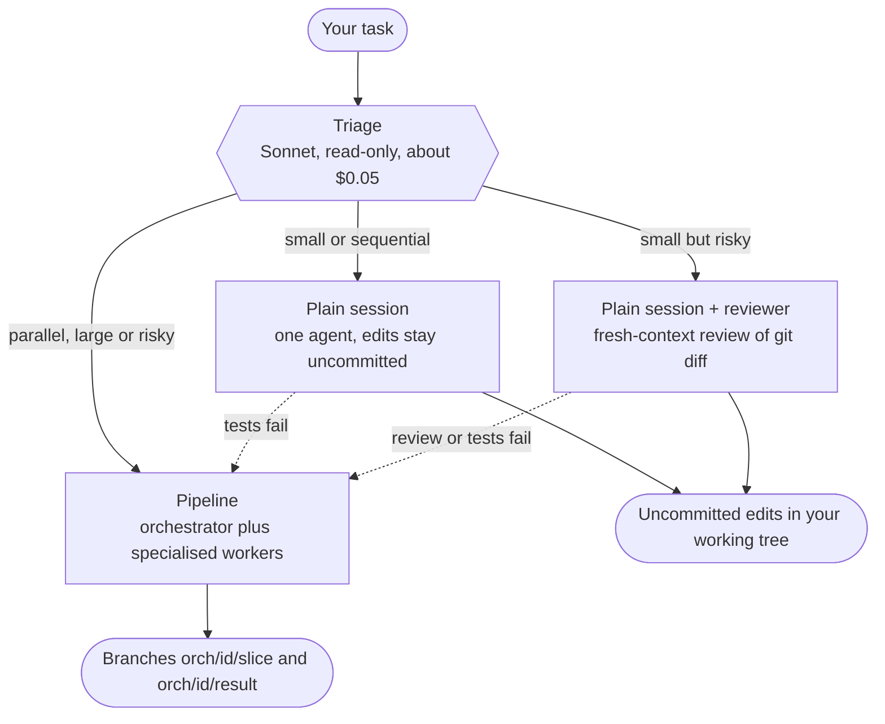
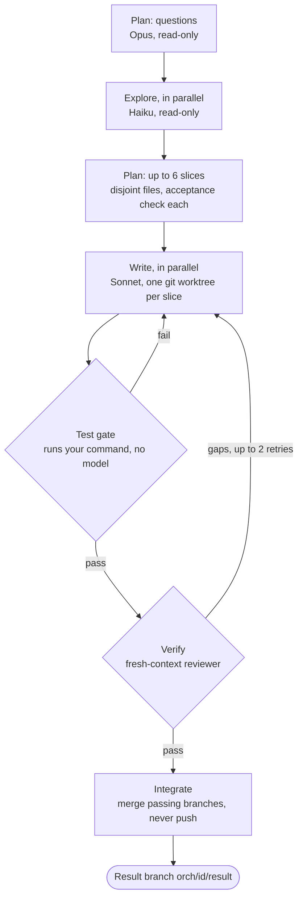
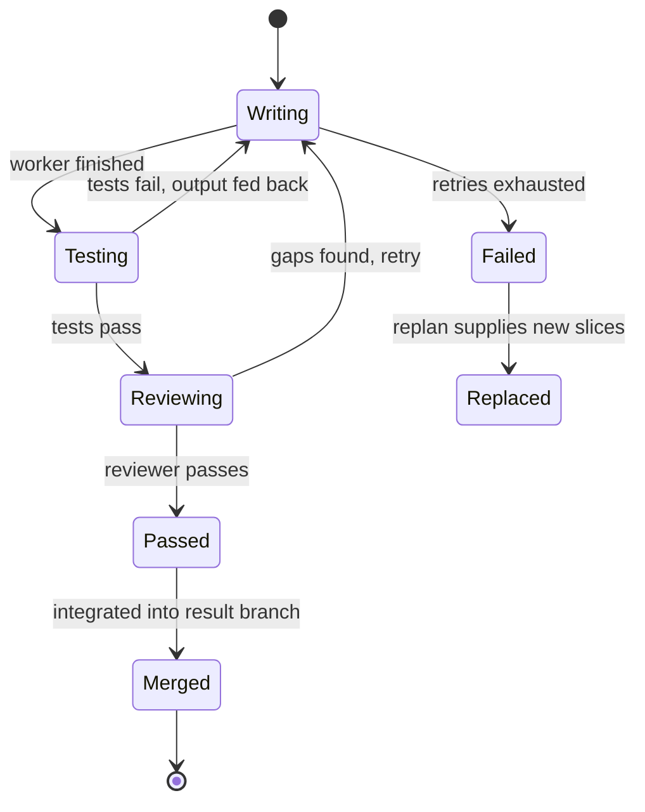
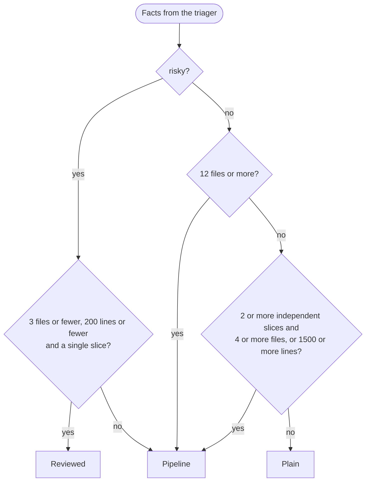
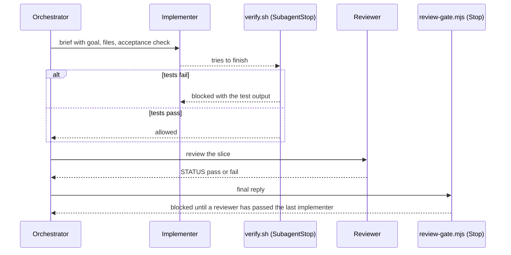

# Claude Code orchestrator

Split a coding task across specialised agents when that pays off, and keep it in one plain session when it does not.

It does two jobs:

1. **A pipeline** that plans a task, builds independent slices in parallel git worktrees, gates each slice on tests, has a fresh-context reviewer check it, retries with feedback, and merges what passes.
2. **A router** that sizes each task first and picks the cheapest route that fits: a plain session, a plain session plus an independent reviewer, or the full pipeline.

It runs two ways with the same roles: as a TypeScript pipeline on the Claude Agent SDK, and natively inside Claude Code (agents, hooks and a skill, also shipped as a plugin).

## Contents

- [Why a router](#why-a-router) · [Quick start](#quick-start) · [How it works](#how-it-works)
- [The pipeline](#the-pipeline) · [Choosing a route](#choosing-a-route-triage) · [Two ways to run it](#two-ways-to-run-it)
- [Resilience](#resilience-retry-resume-replan) · [Safety and limits](#safety-and-limits)
- [Reference](#reference) · [Repository layout](#repository-layout) · [Development](#development)

## Why a router

Measured on the same tasks (details in [docs/benchmarks.md](docs/benchmarks.md)):

| | Plain session | Pipeline |
|---|---|---|
| Hidden-test correctness | passed | passed (never better) |
| Cost | 1x | 1.1x to 2x |
| Small task | fastest (20s) | slower (60s+) |
| Parallel task | slower | faster (250s against 397s on a hard one) |
| Verification | you, or the agent's own word | test gate, independent reviewer, review gate |
| Unverified work | may be reported as done | reported as failed |

So the pipeline buys speed on parallel work and hard guarantees on risky work, and costs more everywhere else. The router spends one cheap read-only call (about $0.05) to decide which you need.

## Quick start

**Install as a Claude Code plugin** (agents, gates, the `/route` skill and a session nudge):

```
/plugin marketplace add 0xcvaliente/claude-code-orchestration
/plugin install orchestration --marketplace 0xcvaliente/claude-code-orchestration
```

Start a new chat afterwards. The plugin's `SessionStart` hook then tells Claude to run `orchestration:route` before any non-trivial coding task and follow the result. `/route <task>` runs the same triage on demand.

**Run the SDK pipeline from a checkout:**

```bash
npm install
npm start -- --repo /path/to/git/repo --task "add rate limiting to the API" --test-cmd "npm test"
```

`--mode auto` is the default: triage decides. Useful variations:

```bash
npm start -- --repo . --task "..." --plan-only            # plan only, the cheapest way to try it
npm start -- --repo . --task "..." --mode plain           # skip triage, one plain session
npm run route -- --repo . --task "..."                    # triage only: prints the decision as JSON
npm run auto -- "task" /path/to/repo                      # native headless: triage, then claude -p or the orchestrator agent
claude --agent orchestrator                               # native interactive orchestrator
```

## How it works

Every task goes through triage. The three routes differ in how much machinery they use.



| Route | What runs | Result lands in | Verified by |
|---|---|---|---|
| Plain | One `solo` agent in your repo | Uncommitted working tree | Your `--test-cmd`, run by the harness, not the agent |
| Reviewed | The same, then one fresh-context reviewer; its issues go back to the session (up to `--retries` times). In the headless `npm run auto` the reviewer is read-only but may run the repo's detected test command (pytest, cargo, go ...) | Uncommitted working tree | Tests plus the reviewer |
| Pipeline | Planner, researchers, implementers in worktrees, verifiers, integrator | Git branches; your checkout is untouched | Tests, a verifier per slice, merge check |

The dotted arrows are **escalation**: if a triaged plain or reviewed run fails, the task reruns through the pipeline. The failed attempt's edits stay uncommitted in your working tree and are never reverted, because they may sit beside your own changes; the pipeline works from `HEAD` in worktrees. `--no-escalate` (native: `ORCH_NO_ESCALATE=1`) turns it off, and a forced `--mode` never escalates.

## The pipeline



Why each step is shaped this way:

- **Strongest model plans, cheap models read, mid-tier writes.** The expensive model only decides; Haiku answers narrow questions in parallel; Sonnet does the edits.
- **Fresh contexts.** Workers start with no history. They get a brief and return a short report, so the orchestrator's context stays small.
- **A gate that does not trust the agent.** The test command runs in the harness, not inside the model, and a failing run costs no verifier call.
- **A verifier that did not write the code.** It sees the diff and the goal, not the implementer's reasoning.
- **Retries carry feedback.** A rejected slice goes back to a writer with the failing output or the reviewer's gaps.
- **Disjoint files per slice.** Parallel slices never edit the same file, so merges are clean. A slice that needs another's output lists it in `dependsOn` and starts from a worktree that already contains it.

One slice's life:



### The roles

| Role | Model, effort | Tools | Job |
|---|---|---|---|
| Orchestrator / planner | Opus, high | read-only | Plans slices; in native mode it can only delegate |
| Researcher / explorer | Haiku, low | read-only, read-only `git` | Answers one narrow question with file paths |
| Implementer / writer | Sonnet, medium | read, edit, write, bash | Builds one slice in its own worktree |
| Reviewer / verifier | Sonnet, medium | read, bash | Independent check of one slice; never edits |
| Integrator | Sonnet, low | read, bash | Merges passing branches, runs the acceptance check, never resolves conflicts |
| Triager | Sonnet, low | read-only | Sizes a task for the router |
| Solo | Sonnet, medium | read, edit, write, bash | The plain-session route |

Models, effort and turn caps live in `src/config.ts`, the single source of truth; `npm run sync-agents` copies them into the native agent files.

### What a run leaves behind

```
runs/<id>/
  plan.json          questions and slices
  findings.md        what the explorers found
  journal.json       state after every slice, for --resume
  telemetry.jsonl    cost, turns and model per worker
  report.json        slice results, merged and conflicted branches, cost by role
  worktrees/         kept only for failed slices, or with --keep-worktrees
runs/routes.jsonl    one line per triage decision
```

Branches `orch/<id>/<slice>` hold each slice and `orch/<id>/result` holds the merge. Nothing is ever pushed.

## Choosing a route (triage)

The triager only reports four facts about a task: how many files it will touch, how many lines it will change, how many parts could be built independently, and whether it is risky. The decision is then plain code, so it is testable and tunable without a model.



| Facts | Route |
|---|---|
| risky, at most 3 files, at most 200 lines, one slice | reviewed |
| risky, anything else | pipeline: independent review per slice |
| 12 or more files | pipeline: too big for one context |
| 2 or more independent slices and (4 or more files, or 1,500 or more lines) | pipeline: parallel worktrees pay off; an interface-first plan lets slices run in parallel even across few files |
| anything else | plain (a large but sequential change stays in one context) |

The thresholds are `TRIAGE` in `src/config.ts` (`bigLines` 1500 and `reviewedMaxLines` 200 are the line limits). The `/route` skill applies the same rules, so it also works without a checkout of this repo: with no `node_modules` at `$ORCH_HOME` it sizes the task in-session (skim the repo, estimate the four facts, apply the rules) instead of calling the triager. A failed or malformed triage falls back to the pipeline, the pre-triage behaviour. Every decision is appended to `routes.jsonl`, so you can tune thresholds against what happened: `runs/routes.jsonl` for the SDK; for native, `.claude/state/routes.jsonl` under `npm run auto` or in a repo that registers the hooks itself, and the plugin's per-user state dir when `/route` runs for a plugin install. In the one benchmark where triage chose the pipeline for a two-file-per-slice task, it cost twice a plain session for the same result, so `minParallelFiles` may deserve a raise once there is more data.

## Two ways to run it

| | SDK pipeline | Native Claude Code |
|---|---|---|
| Where | `src/` (TypeScript on the Agent SDK) | `.claude/` (agents, hooks, skill, workflow) |
| Run | `npm start -- --repo ...` | `claude --agent orchestrator`, `npm run auto`, or the plugin |
| Order is enforced by | Code | The orchestrator's prompt plus hook gates (the optional scripted workflow fixes order in code) |
| Test gate | The harness runs `--test-cmd` | `verify.sh` hook on `SubagentStop` |
| Review gate | Verifier per slice in code | `review-gate.mjs` hook on `Stop` |
| Isolation | One worktree per slice | `isolation: "worktree"` on parallel implementers (needs `worktree.baseRef: "head"`, see below) |
| Resume, replan, retry | Yes | Retry only: the orchestrator resumes the same implementer with `SendMessage`, so it keeps its worktree and branch |
| Needs | An API login for the Agent SDK | A logged-in `claude` |

Natively, the gates are hooks that block an agent from finishing:



The review gate reads the worker's `STATUS` from its last message or, when that is empty, from the `SubagentHandback` message or last text block in its transcript. A reviewer with no status at all blocks too (`last_reviewer_no_status`). The loop guard allows 2 blocks after each implementer run (a later implementer resets it); then the reply goes out with a `systemMessage` saying the work is unverified (`max_blocks_reached`), so the gate never gives up silently.

The interactive orchestrator cannot hand over to a plain session, because it has no Edit or Bash by design. So it has a **light path** for small tasks (one slice, at most 3 files and under about 1,500 lines): one implementer and one reviewer, with no exploration, worktrees or integrator. Large work with separable parts gets an interface-first plan: one slice writes the shared interfaces and stubs, a checkpoint commit follows, then the rest run in parallel. Everything native (agents, gates, headless runs, lessons from the first live runs) is in [docs/native-mode.md](docs/native-mode.md).

### The plugin

The marketplace manifest `.claude-plugin/marketplace.json` points at the committed `dist/plugin`. It carries the agents, the gate hooks, the worker contract and the `/route` skill, but not your permission denies (add `git push`, `sudo` and `rm -rf` denies to your own settings) and not this repo's `worktree` setting.

**Parallel slices need `baseRef: "head"`.** Claude Code starts a worktree from the remote default branch unless told otherwise, so a parallel slice would not see your unpushed or feature-branch commits. For parallel slices on that kind of work, add this to your own `.claude/settings.json` (or `~/.claude/settings.json`):

```json
{ "worktree": { "baseRef": "head" } }
```

The orchestrator reads those settings before a parallel wave; if `baseRef` is not `"head"` it runs the slices one after another in the shared tree and says so in its report. The scripted workflow takes the same fact as the argument `baseRefHead`.

**Logs stay out of your repo.** The plugin's hooks log to `$CLAUDE_PLUGIN_DATA/state/<project path>` (a per-user dir), not to `.claude/state/` in your project, and `/route` appends its decisions to `routes.jsonl` there. `npm run report -- /path/to/your/repo` in a checkout finds that dir and writes `report.html` beside the logs. In a repo that registers its own copy of the hooks, such as this one, the plugin's copies step aside so nothing runs twice. Details in [docs/native-mode.md](docs/native-mode.md#gates).

**No checkout needed for routing.** `/route` and the session nudge work in a plugin-only install: without this repo at `~/claude-code-orchestration` (or `$ORCH_HOME`, with `node_modules`) the skill sizes the task itself with the same thresholds.

A `SessionStart` hook (`.claude/hooks/nudge.mjs`) nudges every new main session to route non-trivial coding tasks. Headless runs started by `scripts/orchestrate.sh` set `ORCH_NO_NUDGE=1` and are skipped; `export ORCH_NO_NUDGE=1` silences it in one shell. The `/route` skill uses the triager when this repo is at `~/claude-code-orchestration` or `$ORCH_HOME`, and sizes the task in-session otherwise.

After changing anything under `.claude/`, run `npm run build-plugin`; `npm run check-plugin` fails when the committed build is stale. Bump the `version` in `package.json` for installed copies to pick up a change.

## Resilience: retry, resume, replan

- **Transient errors** (`src/retry.ts`): a rate limit, overload, 5xx or dropped stream is retried up to twice with exponential backoff (2s, 8s) on the same request. It is not counted as a task failure and its cost is added up. A turn cap, our own 15-minute timeout or a refusal is never retried.
- **Resume**: every pipeline run writes `runs/<id>/journal.json` after each slice. `npm start -- --repo . --resume <id>` skips planning and passed slices, restarts failed ones from scratch (old worktree and branch removed) and re-merges the result branch. An unknown id is an error, not a fresh run. Spend in the report covers the resumed session only.
- **Replan**: `--replans N` (0 to 3, default 0). When a pass leaves failed slices, the planner sees what finished and what failed and plans only the missing work; a new slice may depend on a finished one. Replaced slices stay in the report as `replaced` and their branches are never merged. It stops when the planner offers nothing usable.
- **Dollar caps are opt-in.** There is no default budget. Runs are bounded by turn caps, worker timeouts, and retry and slice limits. Set `--budget USD` (SDK) or `ORCH_BUDGET_USD` (native) to add a cap; spend is always reported either way.

## Safety and limits

- Nothing in either path pushes to a remote. Project settings deny `git push`, `git remote`, `sudo` and `rm -rf`, and workers have the same deny list (`UNSAFE_BASH`, kept equal to `permissions.deny` by `policy.test.ts`).
- Worktrees isolate git state, not the filesystem: a worker with Bash can still write outside its worktree. Run in a container or VM for untrusted repos.
- The deny lists guard against mistakes, not malice. Native headless mode allows `Bash(npm *)` and `Bash(node *)`, which can run any code, including a push.
- SDK workers branch from `HEAD`; uncommitted changes are not visible to them. Native isolated workers branch from the remote default branch unless `worktree.baseRef` is `"head"`; either way they only see committed work, so the orchestrator commits a checkpoint (only the named paths) before a parallel wave.
- The native test gate does not block isolated worktrees by default: sibling slices may not be merged yet, so a failure there is logged (`tests_failed_isolated`) and the integrator's run on the merged result is what counts. Set `ORCH_GATE_ISOLATED=block` to gate them anyway.
- Slices that edit the same file conflict at merge time; conflicting branches are reported, not auto-resolved.
- Model output is treated as untrusted input: plans, slice ids, verdicts and triage facts are validated and clamped before use.

## Reference

### CLI flags (`npm start -- ...`)

| Flag | Meaning |
|---|---|
| `--repo DIR`, `--task TEXT` | The git repo and what to do (`--task` is not needed with `--resume`) |
| `--mode auto\|plain\|reviewed\|orchestrate` | Route. `auto` (default) lets triage decide; anything else skips triage |
| `--no-escalate` | Do not rerun a failed plain or reviewed run through the pipeline |
| `--test-cmd CMD` | The acceptance command, run by the harness after each worker |
| `--setup-cmd CMD` | Runs in each new worktree before its writer, for example `npm ci` (worktrees have no `node_modules`) |
| `--budget USD` | Optional run cap; unset means no dollar cap |
| `--concurrency N`, `--retries N` | Parallel workers (3) and retries per slice (2) |
| `--replans N` | Replanning rounds after failures, 0 to 3 (default 0) |
| `--plan-only` | Stop after planning (implies the pipeline) |
| `--resume ID` | Continue a run (implies the pipeline) |
| `--keep-worktrees` | Keep every worktree; by default passing slices' and the result worktree are removed and branches always stay |
| `--out DIR` | Where runs are written (`runs`) |

Invalid numbers exit 2; a failed plan exits 1.

### Environment

| Variable | Used by | Meaning |
|---|---|---|
| `ORCH_MODEL_PLANNER`, `_EXPLORER`, `_WRITER`, `_VERIFIER`, `_TRIAGER`, `_SOLO` | SDK | Override a role's model |
| `ORCH_MODE` | `auto.sh` | `auto`, `plain`, `reviewed` or `orchestrate` |
| `ORCH_NO_ESCALATE` | `auto.sh` | Turn escalation off |
| `ORCH_BUDGET_USD` | `orchestrate.sh` | Optional spend cap for a headless run |
| `ORCH_ALLOWED_TOOLS` | `orchestrate.sh` | Replace the tool allowlist, one rule per line |
| `ORCH_AGENT` | `orchestrate.sh` | Agent to run; `none` is a plain session |
| `ORCH_ADD_DIR`, `ORCH_ADVISOR`, `ORCH_DRY_RUN` | `orchestrate.sh` | Extra readable dir, experimental advisor model, print arguments and exit |
| `ORCH_TEST_CMD` | `verify.sh`, `orchestrate.sh` | The test command. Unset, it is detected (see below); the headless run adds the permission rules it needs. Benchmark tasks declare theirs in `tasks/<id>/test-cmd.txt` and `compare.mjs` exports it |
| `ORCH_GATE_ISOLATED` | `verify.sh` | Test gate for agents in `.claude/worktrees/`: `warn` (default: run tests, log, never block), `block` or `skip` |
| `ORCH_MODEL` | `orchestrate.sh` | Passes `--model` (for example `sonnet` or `opus`), used for plain-model baselines |
| `ORCH_EXTRA_ALLOWED_TOOLS` | `orchestrate.sh` | Extra permission rules, one per line, appended to the default allowlist (`ORCH_ALLOWED_TOOLS` replaces it) |
| `ORCH_NO_NUDGE` | plugin hook | Silence the session nudge |
| `ORCH_HOME` | `/route` skill | Where this repo lives (default `~/claude-code-orchestration`) |

The native test gate detects the runner in this order: `ORCH_TEST_CMD`; `npm test` when `package.json` has a test script; `pytest` (or `unittest` when pytest is not installed) only when `test_*.py` or `*_test.py` files exist; `cargo test`; `go test ./...`; `swift test`; `make test` when a `test:` target exists (`.claude/hooks/test-cmd.sh`). No runner means the gate allows. pytest exit code 5 (nothing collected) counts as no tests.

### npm scripts

| Script | What it does |
|---|---|
| `npm start` | SDK pipeline with triage |
| `npm run route` | Triage only, prints JSON |
| `npm run auto`, `npm run native` | Headless native run, with or without triage |
| `npm test`, `npm run typecheck` | Unit tests (fake model, no API calls) and type check; both must pass before finishing |
| `npm run check-agents`, `npm run sync-agents` | Detect or fix drift between `src/config.ts` and `.claude/agents/*.md` |
| `npm run build-plugin`, `npm run check-plugin` | Build `dist/plugin`, or fail when the committed build is stale |
| `npm run report` | HTML timeline from `.claude/state/`, or from the plugin's per-user state dir for that repo |
| `npm run compare`, `compare:hard`, `compare:validate`, `compare:mutate` | The A/B benchmark ([docs/benchmarks.md](docs/benchmarks.md)); `compare` takes `--variants` (A to F, including C plain Sonnet and F plain Opus), `--tasks`, `--repeat N`, `--snapshot-every SEC` and `--timeout SEC`. Tasks may carry `setup/` and a `score.mjs` |

### Tuning cost

Models, effort and turn caps are in `src/config.ts`. Check `telemetry.jsonl`, then move each role to the cheapest model that still passes verification.

## Repository layout

```
src/
  triage.ts, auto.ts, solo.ts     router, route execution, the plain and reviewed sessions
  orchestrator.ts                 the pipeline: plan, explore, write, gate, verify, merge, replan, resume
  agent.ts, retry.ts, verdict.ts  one worker = one query(); transient retry; reviewer verdict schema
  config.ts                       roles, limits and triage thresholds (source of truth)
  cli.ts, route.ts                entry points
  git.ts, state.ts, args.ts       worktree and merge helpers, run directory and telemetry, number checks
.claude/
  agents/                         orchestrator, researcher, implementer, integrator, reviewer
  hooks/                          verify.sh, test-cmd.sh, review-gate.mjs, telemetry.mjs, state.mjs, nudge.mjs
  skills/                         route, orchestration-conventions
  workflows/orchestrate.js        the scripted flow
  settings.json, rules/           gates and permission denies, rules for editing the above
.claude-plugin/marketplace.json   makes the repo installable
dist/plugin/                      the built plugin (committed)
scripts/                          auto.sh, orchestrate.sh, build-plugin.mjs, report, compare/ benchmark
docs/                             benchmarks.md, native-mode.md
orchestration/                    the original architecture diagram
```

## Development

```bash
npm install
npm test               # unit tests against a scripted fake model in temp git repos
npm run typecheck
npm run check-agents   # agents in sync with src/config.ts
npm run check-plugin   # committed plugin build is current
```

Rules for contributors are in `CLAUDE.md` and `.claude/rules/agents.md`. In short: change models, effort and triage thresholds in `src/config.ts` and run `npm run sync-agents`; rebuild the plugin after touching agents, skills or hooks; the native orchestrator's "size the task first" step mirrors `TRIAGE`, so change both together.
