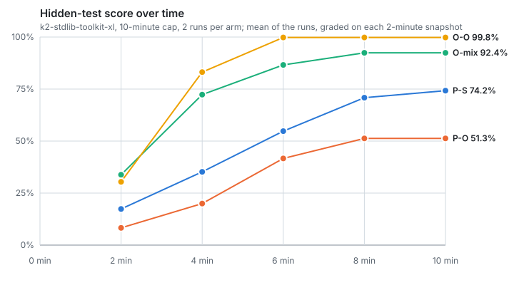
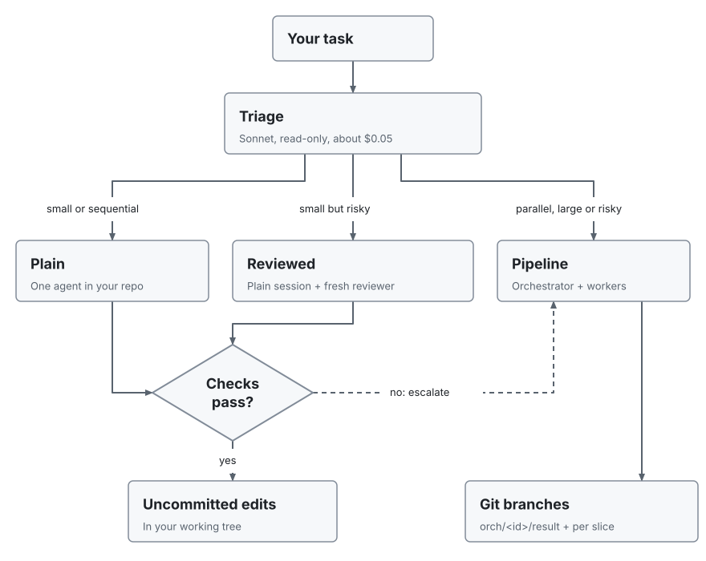
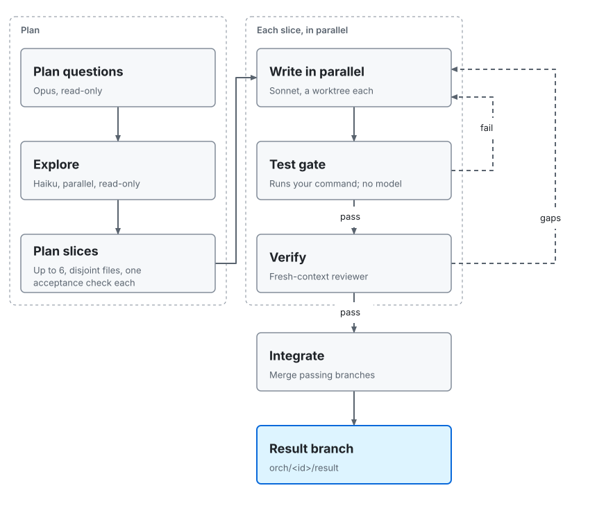
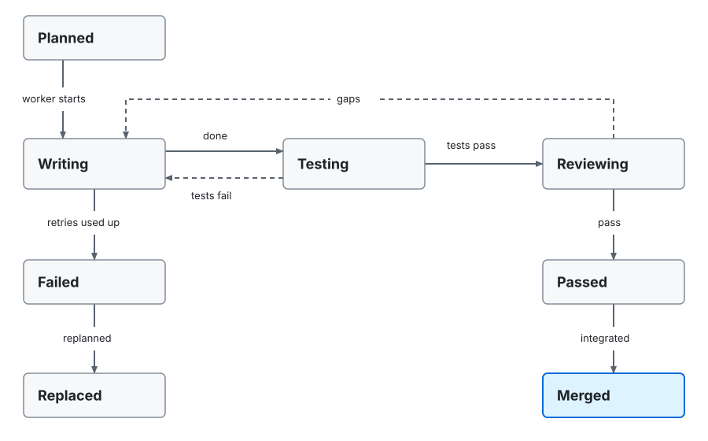
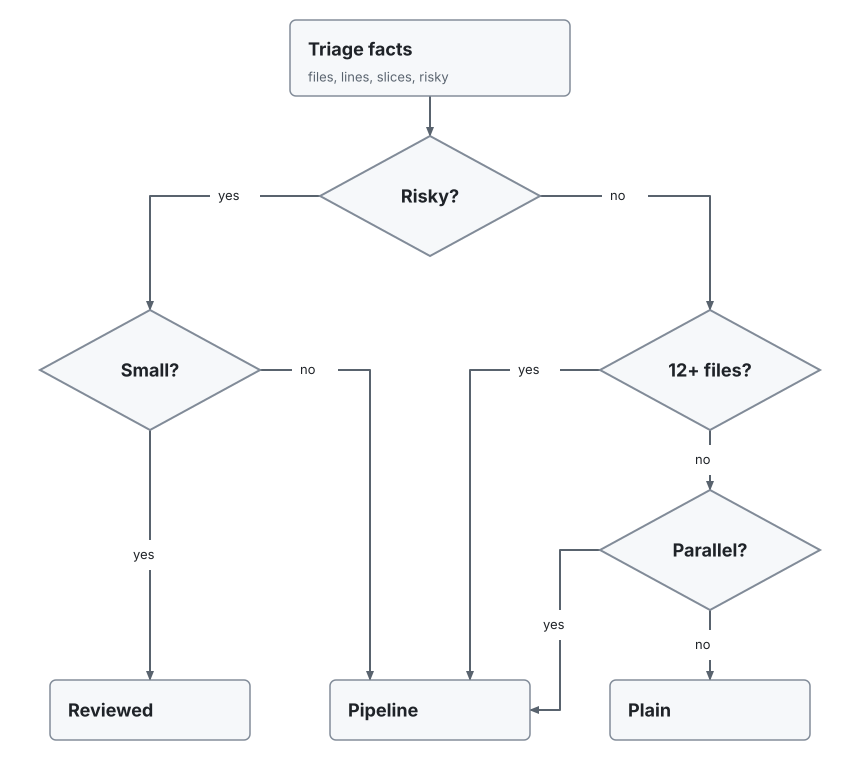
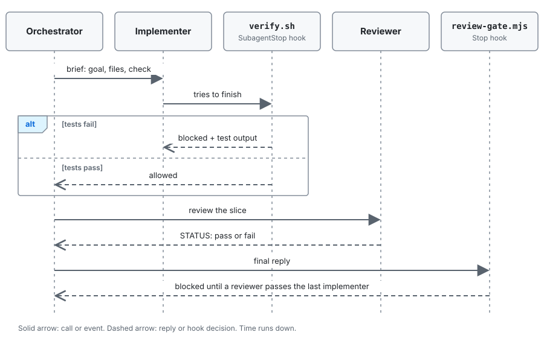

# Claude Code orchestrator

Split a task (code, research, writing, analysis or operations) across specialised agents when that pays off, and keep it in one plain session when it does not.

It does two jobs:

1. **A pipeline** that plans a task, builds independent slices in parallel, has a fresh-context reviewer check each one, and retries with feedback. Slices also get a test gate wherever there is a test command and, for code in a git repository, their own git worktrees and a merge of what passes. The review gate applies to every task.
2. **A router** that sizes each task first and picks the cheapest route that fits: a plain session, a plain session plus an independent reviewer, or the full pipeline.

It runs two ways with the same roles: as a TypeScript pipeline on the Claude Agent SDK (code in a git repository only), and natively inside Claude Code (agents, hooks and a skill, also shipped as a plugin), which takes any task.

## Contents

- [Benchmark: orchestrator vs plain sessions](#benchmark-orchestrator-vs-plain-sessions-built-in-subagents-blocked) · [Why a router](#why-a-router) · [Quick start](#quick-start) · [How it works](#how-it-works)
- [The pipeline](#the-pipeline) · [Choosing a route](#choosing-a-route-triage) · [Two ways to run it](#two-ways-to-run-it)
- [Resilience](#resilience-retry-resume-replan) · [Safety and limits](#safety-and-limits)
- [Reference](#reference) · [Repository layout](#repository-layout) · [Development](#development)

## Benchmark: orchestrator vs plain sessions, built-in subagents blocked

Claude Code's six built-in subagents (`general-purpose`, `claude`, `Explore`, `Plan`, `claude-code-guide`, `statusline-setup`) are blocked in this repository, so a plain session cannot delegate and the orchestrator is the only way to fan work out. Benchmarked on the hardest splittable task (`k2-stdlib-toolkit-xl`: twelve Python standard-library modules, 1,762 hidden tests) under a 10-minute cap, 2 runs per setup (direction only), all headless, tokens counted over every model:

| Setup | Strict score (median) | Tokens | Wall time | Subagents per run |
|---|---|---|---|---|
| Plain Sonnet (P-S) | 74.2% | 2.20M | 8.2 min | 0 |
| Plain Opus (P-O) | 51.3% | 2.94M | 7.5 min | 0 |
| Orchestrator, shipped models (O-mix) | 92.4% (lenient 99.0%) | 5.66M | 5.8 min | 21 to 22 |
| Orchestrator, all Opus (O-O) | 99.8% | 6.34M | 6.1 min | 16 to 25 |

<picture>
  <source media="(prefers-color-scheme: dark)" srcset="docs/diagrams/bench-k2-cap10-timeline-dark.svg">
  
</picture>

- Delegating through the orchestrator scored 18 points higher than plain Sonnet and 48.5 higher than plain Opus, at 2.2x to 2.6x the tokens and 1.4 to 2.4 minutes less wall time. Plain sessions stopped early with unfinished modules.
- Both O-mix runs lost the same module (`tomlparse` imports `re`, which the spec forbids) and claimed success: two false successes by the automatic classification. O-mix's reviewers missed it, while an O-O reviewer caught the same rule in four modules.
- With the built-ins allowed (an earlier campaign, different plugin version), plain Opus scored 99.7% on this task by delegating to `general-purpose` itself, so this benchmark does not show the orchestrator beating built-in delegation on raw score. What the orchestrator adds is role limits, test and review gates, and independent review; the full discussion, per-run tables and every chart are in [docs/benchmark-builtins-blocked.md](docs/benchmark-builtins-blocked.md).
- One task, coding only, two runs per setup. Nothing here covers tasks that do not split.

## Why a router

Measured on seven coding tasks, five setups, **with Claude Code's built-in subagents allowed** (they are blocked now; see the benchmark above) (plain Sonnet, plain Opus, the orchestrator as shipped, an all-Opus orchestrator, triage routing), all headless; details in [docs/benchmarks.md](docs/benchmarks.md), method and hypotheses in [bench/HYPOTHESES.md](bench/HYPOTHESES.md). Nothing here has been measured for research, writing, analysis or operations. With 2 runs per cell the results show direction only. Ranges are per run; token ratios are per-task medians.

| | Plain session (Sonnet or Opus) | Pipeline (shipped or all-Opus orchestrator) |
|---|---|---|
| Small and medium tasks (t1, t2, h1, h2): correctness | 100% on every run | 100% on every run (never better) |
| Small and medium tasks: tokens | 126k to 490k | 166k to 1.09M: 1.2x to 2.1x a plain session of the same model family |
| Small and medium tasks: wall time | 15s to 3.5 min | 34s to 6.1 min |
| Large tasks (k1, h3, k2): correctness per run | k1 and h3: Opus 100%, Sonnet 98.6% to 99.9%. k2 (strict): Opus 100%, Sonnet 74.5% and 83.5% | k1 and h3: 99.0% to 100%. k2 (strict): 74.9% to 99.9%, never 100% |
| Large tasks: tokens | 1.3M to 13.4M | 2.7M to 12.9M: 0.7x to 2.0x on k1 and h3, 0.7x to 0.9x on k2 |
| Large tasks: time to full score | plain Opus 4 to 8 min | 6 to 12 min on k1 and h3, never on k2 |
| Self-delegation | on k1 and k2 every plain run spawned Claude Code's built-in subagents (3 on k1, 12 to 21 on k2) | its own researcher, implementers, reviewers, integrator |
| Verification | the agent's own word: 1 audited false success in 28 runs | test gate, independent reviewer, review gate: 0 in 28 runs |

So on these tasks the pipeline did not raise correctness: small and medium tasks were solved by every setup, and on the large splittable ones a plain session orchestrated itself with built-in subagents and plain Opus reached full score sooner. On k2 only plain Opus scored 100% strict; 6 of the other 8 runs imported `re` outside the regex module, which the spec forbids, and scored 74.5% to 84.0% strict, while lenient grading that allows it gives 99.3% to 100% for every main k2 run (in the first shipped-orchestrator run the reviewers flagged it and nobody removed it). The false-success gap (1 plain, 0 orchestrated) is one run and shows nothing. All runs were headless, and 41 of the 70 main runs had at least one tool call denied by permissions. What the pipeline adds is the gates, at 1.2x to 2.1x the tokens on small and medium work; the router spends one cheap read-only call to decide whether a task needs them.

Sweeps on k2 (plain Opus vs the shipped orchestrator, 2 runs each): at a 10-minute limit both got almost everything (lenient medians 99.7% and 99.4%); at 60 minutes both used far more tokens (plain Opus median 14.5M vs 12.4M at 30 minutes) for no gain; under a 3M-token cap neither finished and plain Opus scored higher (lenient medians 75.3% vs 59.8%); under 8M both got almost everything (lenient medians 99.6% and 99.3%). Pre-registered hypotheses: H1, H2, H5, H6 and H7 not supported, H4 supported only by that one-run difference ([bench/HYPOTHESES.md](bench/HYPOTHESES.md), [docs/benchmarks.md](docs/benchmarks.md)).

## Quick start

**Install as a Claude Code plugin** (agents, gates, the `/route` skill and a session nudge):

```
/plugin marketplace add 0xcvaliente/claude-code-orchestration
/plugin install orchestration --marketplace 0xcvaliente/claude-code-orchestration
```

Start a new chat afterwards. The plugin's `SessionStart` hook then tells Claude to run `orchestration:route` before any non-trivial task (code, research, writing, analysis or operations) and follow the result. `/route <task>` runs the same triage on demand, in any folder.

**Run the SDK pipeline from a checkout** (it takes code in a git repository only):

```bash
npm install
npm start -- --repo /path/to/git/repo \
  --task "add rate limiting to the API" --test-cmd "npm test"
```

`--mode auto` is the default: triage decides. Useful variations:

```bash
# Plan only: the cheapest way to try it
npm start -- --repo . --task "..." --plan-only

# Skip triage: one plain session
npm start -- --repo . --task "..." --mode plain

# Triage only: prints the decision as JSON (any folder, git or not)
npm run route -- --repo . --task "..."

# Native headless, any task: triage, then claude -p or the orchestrator
npm run auto -- "task" /path/to/folder

# Native interactive orchestrator
claude --agent orchestrator
```

## How it works

Every task goes through triage. The three routes differ in how much machinery they use. The kind of task (the triage fact `code`) changes the checks, the git machinery and, in `npm run auto`, the web tools; in routing it changes only the file count at which parallel slices go to the pipeline (10 for code, 4 otherwise).

<picture>
  <source media="(prefers-color-scheme: dark)" srcset="docs/diagrams/routes-dark.svg">
  
</picture>

| Route | What runs | Result lands in | Verified by |
|---|---|---|---|
| Plain | One agent in your folder: `solo` in the SDK, your own session natively | Your folder; uncommitted in git | Code: your tests (SDK: `--test-cmd`, run by the harness, not the agent). Other work: the session's own check against the request |
| Reviewed | The same, then one fresh-context reviewer. In the SDK its issues go back to the session (up to `--retries` times) | Your folder; uncommitted in git | Code: tests plus the reviewer. Other work: the reviewer checks every requirement and each claim against the source it cites |
| Pipeline | Planner, researchers, implementers and a reviewer per slice; for code in git, also worktrees and an integrator | Code in git: git branches. Anything else: your folder, nothing committed | Tests for code, a reviewer per slice, a merge check for isolated code slices |

The SDK pipeline leaves its result on the branch `orch/<id>/result` and does not touch your checkout. Natively, only parallel slices of code in git get their own worktree and branch, and the integrator merges those branches into your current branch; slices that run one after another edit your working tree, and nobody but isolated implementers and the integrator commits.

The reviewer is read-only. In a native session it reads `git diff HEAD` for code in git, and otherwise the files or answer the work produced. The headless `npm run auto` runs it as one pass with the session's report in its prompt: it reads `git diff HEAD` in a git work tree, otherwise the files the report names. For code it may run the folder's detected test command (pytest, cargo, go ...); for other work it checks every requirement and each claim against the source it cites. Its verdict is the first line that starts with `STATUS:`: a preamble before it is fine, blockquoted lines are ignored, and any `STATUS: fail` line fails the review, as does a reply with no `STATUS:` line.

The dashed arrow is **escalation**: if a triaged plain or reviewed run fails its checks (the session errors, the SDK's `--test-cmd` fails, or the reviewer does not pass it), the task reruns through the pipeline. The failed attempt's edits stay in your folder, uncommitted in git, and are never reverted, because they may sit beside your own changes. For code in git the pipeline's worktrees only see committed work, so they do not see those edits; any other task is rerun on the same folder with its files in place. `--no-escalate` (native: `ORCH_NO_ESCALATE=1`) turns it off, and a forced `--mode` never escalates.

## The pipeline

The diagram shows the flow for code in a git repository, in the SDK pipeline and in the native orchestrator (natively the integrator merges into your current branch rather than a result branch). Work that changes no code (research, writing, analysis, operations) follows the same plan and review steps in your folder, without worktrees or the merge. The native test gate still runs wherever there is a test command; it skips only a prose-only change in a git work tree (below).

<picture>
  <source media="(prefers-color-scheme: dark)" srcset="docs/diagrams/pipeline-dark.svg">
  
</picture>

Why each step is shaped this way:

- **Strongest model plans, cheap models read, mid-tier writes.** The expensive model only decides; Haiku answers narrow questions in parallel; Sonnet builds the slices.
- **Fresh contexts.** Workers start with no history. They get a brief and return a short report, so the orchestrator's context stays small.
- **A gate that does not trust the agent.** For code, the test command runs in the harness, not inside the model, and a failing run costs no verifier call.
- **A reviewer that did not write the work.** It sees the diff (the output files, for work that is not code) and the goal, not the implementer's reasoning.
- **Retries carry feedback.** A rejected slice (the dashed arrows) goes back to a writer with the failing output or the reviewer's gaps, up to 2 times (`--retries`).
- **Disjoint files per slice.** Parallel slices never edit the same file, so merges are clean. In the SDK, a slice that needs another's output lists it in `dependsOn` and starts from a worktree that already contains it; natively, dependent slices run one after another.

One slice's life:

<picture>
  <source media="(prefers-color-scheme: dark)" srcset="docs/diagrams/slice-lifecycle-dark.svg">
  
</picture>

### The roles

| Role | Model, effort | Tools | Job |
|---|---|---|---|
| Orchestrator / planner | Opus, high | read-only | Plans slices; in native mode it can only delegate |
| Researcher / explorer | Haiku, low | read-only, read-only `git`; native also `WebSearch` and `WebFetch` | Answers one narrow question with evidence: file paths for code and local files, URLs for web sources |
| Implementer / writer | Sonnet, medium | read, edit, write, bash | Builds one slice: code, a document, an analysis or an operation. Code slices get their own worktree when they run in parallel (the SDK always uses one) |
| Reviewer / verifier | Sonnet, medium | read, bash; native also `WebSearch` and `WebFetch` | Independent check of one slice or result; never edits. Reads the diff or commit range for code in git, the files for code outside git, and checks requirements and cited sources for other work |
| Integrator | Sonnet, low | read, bash | Code in git only: merges passing branches, commits checkpoints, runs the acceptance check, never resolves conflicts |
| Triager | Sonnet, low | read-only | Sizes a task of any kind for the router |
| Solo | Sonnet, medium | read, edit, write, bash | The plain-session route (SDK) |

Models, effort and turn caps live in `src/config.ts`, the single source of truth; `npm run sync-agents` copies them into the native agent files.

### What a run leaves behind

An SDK run writes:

```
runs/<id>/
  plan.json          questions and slices
  findings.md        what the explorers found
  journal.json       state after every slice, for --resume
  telemetry.jsonl    tokens, turns and model per worker
  report.json        slice results, merged and conflicted branches, tokens by role
  worktrees/         kept only for failed slices, or with --keep-worktrees
runs/routes.jsonl    one line per triage decision
```

Branches `orch/<id>/<slice>` hold each slice and `orch/<id>/result` holds the merge. Nothing is ever pushed.

## Choosing a route (triage)

The triager only reports five facts about a task, of any kind: how many files it will create or change (source, docs, reports, data or config), how many lines it will add or change (prose and data included), how many independent slices it has, whether it is risky, and whether it changes code. An independent slice is a part that separate workers could do at the same time with no shared output file: a module, a document or a research question. Risky means a wrong result is costly: security, authentication, payments, data migrations or deletion, public API changes, production operations (deploys, infrastructure, credentials), content sent or published outside the team, or several modules where a wrong change is costly. `code` is true when the task changes source, tests, build or CI configuration in a repository. The facts decide the route in plain code, so the decision is testable and tunable without a model. `code` changes one routing rule, the file threshold for parallel slices: 10 files for code, 4 for work that changes no code (a missing `code` counts as code). It also decides whether git machinery is used (worktrees, checkpoint commits and the integrator are for code in a git repository) and, in `npm run auto`, whether web tools are allowed. The test gate does not read it: it follows the test command and the changed files in `git status` (see [Two ways to run it](#two-ways-to-run-it)).

<picture>
  <source media="(prefers-color-scheme: dark)" srcset="docs/diagrams/triage-dark.svg">
  
</picture>

*Small* is at most 3 files, at most 200 lines and one slice. *Parallel* is 2 or more independent slices and either 10 or more files (4 or more when the task changes no code) or 1,500 or more lines. In full:

| Facts | Route |
|---|---|
| risky, at most 3 files, at most 200 lines, one slice | reviewed |
| risky, anything else | pipeline: independent review per slice |
| 12 or more files | pipeline: too big for one context |
| 2 or more independent slices and (10 or more files for code, 4 or more for work that changes no code, or 1,500 or more lines) | pipeline: parallel slices pay off, and an interface-first plan lets slices run in parallel even across few files (in worktrees for code in a git repository, in your folder for work that changes no code; code outside git runs one slice at a time) |
| anything else | plain (a large but sequential change stays in one context) |

The thresholds are `TRIAGE` in `src/config.ts` (`bigLines` 1500 and `reviewedMaxLines` 200 are the line limits). They were tuned on coding benchmarks only; nothing has been measured for research, writing, analysis or operations, so for those tasks they are a starting point. The `/route` skill applies the same rules, so it also works without a checkout of this repo: with no `node_modules` at `$ORCH_HOME` it sizes the task in-session (skim the folder, estimate the five facts, apply the rules) instead of calling the triager. A failed or malformed triage falls back to the pipeline, the pre-triage behaviour. Every decision is appended to `routes.jsonl`, so you can tune thresholds against what happened: `runs/routes.jsonl` for the SDK; for native, `.claude/state/routes.jsonl` under `npm run auto` or in a repo that registers the hooks itself, and the plugin's per-user state dir when `/route` runs for a plugin install. `minParallelFilesCode` was raised from 4 to 10 after the benchmark in [docs/benchmarks.md](docs/benchmarks.md) (2 runs per setup, coding tasks only, so a direction rather than a measurement): triage sent 5 of 14 runs on small and medium tasks (two tiny modules in 4 files; two medium libraries in 9 files) to the pipeline, which used 1.1x to 2.8x the tokens of a plain Sonnet session that scored the same 100%. Replayed with the new value, those runs go plain and every other decision stays the same; the large splittable task in 4 files (about 1,800 lines) still goes to the pipeline through `bigLines`, because the plain Sonnet session that `npm run auto` runs scored lower there. Work that changes no code keeps the earlier 4 (`minParallelFilesNonCode`), since the benchmark measured none.

## Two ways to run it

| | SDK pipeline | Native Claude Code |
|---|---|---|
| Where | `src/` (TypeScript on the Agent SDK) | `.claude/` (agents, hooks, skill, workflow) |
| Tasks | Code in a git repository; a folder that is not a git repository is refused, with a pointer to the native routes | Any task: code, research, writing, analysis or operations |
| Run | `npm start -- --repo ...` | `claude --agent orchestrator`, `npm run auto`, or the plugin |
| Order is enforced by | Code | The orchestrator's prompt plus hook gates (the optional scripted workflow fixes order in code) |
| Test gate | The harness runs `--test-cmd` | `verify.sh` hook on `SubagentStop`: runs the tests wherever there is a test command, skips a prose-only change in a git work tree (see below) |
| Review gate | Verifier per slice in code | `review-gate.mjs` hook on `Stop`, for every task |
| Plan check | Slices come from a validated plan in code | `plan-check.mjs` hook on `PreToolUse` (`Agent`): every implementer brief names its slice, files and dependencies; it blocks overlapping files, dependency cycles and a start before a `PLAN REVIEW` reviewer has finished (the light path skips the review) |
| Isolation | One worktree per slice | `isolation: "worktree"` on parallel implementers of code in git (needs `worktree.baseRef: "head"`, see below); other work shares your folder, and code outside git runs one slice at a time |
| Resume, replan, retry | Yes | Retry: the orchestrator resumes the same implementer with `SendMessage`, so it keeps its context, and its worktree and branch when isolated. Resume: `journal.mjs` records each slice's result in `.claude/state/journal.jsonl`, and an orchestrator asked to resume skips slices whose last review passed. No automatic replan |
| Needs | An API login for the Agent SDK | A logged-in `claude`. A headless run that uses an agent (`npm run native`, or the reviewer and orchestrator of `npm run auto`) runs the folder's own `.claude/agents/<name>.md` or, without it, the plugin's agent when the plugin is enabled there; with neither, that agent step exits 1 with the reason and calls no model |

Natively, the gates are hooks that block an agent from finishing:

<picture>
  <source media="(prefers-color-scheme: dark)" srcset="docs/diagrams/gates-sequence-dark.svg">
  
</picture>

The test gate runs the tests wherever there is a test runner (detected, or set in `ORCH_TEST_CMD`); with none it allows. It skips with `no_code_changes` only in a git work tree, when every changed path is prose, whether staged, unstaged or untracked (for a rename, both names count). Prose is `.md`, `.markdown`, `.rst`, `.adoc` and `.txt`; extensions and folder names match in any case. These are not prose: `.mdx` (JSX), a `.txt` that is `CMakeLists.txt` or whose path names requirements or constraints (build and dependency files), and anything under a `test`, `tests`, `testdata`, `__tests__`, `spec`, `fixtures`, `__fixtures__`, `golden`, `snapshots` or `__snapshots__` folder, whatever its extension (golden files and snapshots feed the tests). The call is made from git, never from the agent's word, and an explicit `ORCH_TEST_CMD` always runs. A clean tree, a folder outside git and any path that is not prose keep the tests running. So a prose-only change skips the gate in a git repository, but work that changes no code still runs the tests outside git, with `ORCH_TEST_CMD` set, or when a non-prose file (a `.csv`, say) changed. The gate never reads the triage fact `code`.

The review gate reads the worker's `STATUS` from its last message or, when that is empty, from the `SubagentHandback` message or last text block in its transcript. A reviewer with no status at all blocks too (`last_reviewer_no_status`). The loop guard allows 2 blocks after each implementer run (a later implementer resets it); then the reply goes out with a `systemMessage` saying the work is unverified (`max_blocks_reached`), so the gate never gives up silently. It applies to every task but only sees implementers: an orchestrator that writes the answer itself is told to send it to a reviewer before replying (and to a second, opus reviewer when it is risky), and no hook checks that.

The interactive orchestrator cannot hand over to a plain session, because it has no Edit or Bash by design. So it has a **light path** for small tasks (one slice, at most 3 files, under about 1,500 lines and nothing risky): one implementer and one reviewer, with no exploration, worktrees or integrator. Large work with separable parts gets an interface-first plan: one slice writes the shared interfaces and stubs (for documents, the outline and shared definitions), a checkpoint commit follows for code in git, then the rest run against it: in parallel in worktrees for code in a git repository, one at a time for code outside git, and in parallel in the shared folder for work that changes no code. Everything native (agents, gates, headless runs, lessons from the first live runs) is in [docs/native-mode.md](docs/native-mode.md).

### The plugin

The marketplace manifest `.claude-plugin/marketplace.json` points at the committed `dist/plugin`. It carries the agents, the gate hooks, the session nudge, the worker contract and the `/route` skill, but not permission denies (headless runs deny push, remote, `sudo` and `rm -rf` on the command line; for interactive sessions add the denies you want to your own settings, including `Agent(general-purpose)` and the other built-in subagents this repo blocks; headless runs also set `CLAUDE_AGENT_SDK_DISABLE_BUILTIN_AGENTS=1`) and not this repo's `worktree` setting.

**Parallel code slices need `baseRef: "head"`.** Only code in a git repository runs slices in worktrees, and Claude Code starts a worktree from the remote default branch unless told otherwise, so a parallel slice would not see your unpushed or feature-branch commits. For parallel slices of unpushed or feature-branch work, add this to your own `.claude/settings.json` (or `~/.claude/settings.json`):

```json
{ "worktree": { "baseRef": "head" } }
```

The orchestrator reads those settings before a parallel wave; if `baseRef` is not `"head"` it runs the slices one after another in the shared tree and says so in its report. The scripted workflow takes the same fact as the argument `baseRefHead`, and `code: false` for a task that changes no code (default `true`): its slices then share your folder and run at the same time.

**Logs stay out of your repo.** The plugin's hooks log to `$CLAUDE_PLUGIN_DATA/state/<project path>` (a per-user dir), not to `.claude/state/` in your project, and `/route` appends its decisions to `routes.jsonl` there. `npm run report -- /path/to/your/repo` in a checkout finds that dir and writes `report.html` beside the logs. In a repo that registers its own copy of the hooks, such as this one, the plugin's copies step aside so nothing runs twice. Details in [docs/native-mode.md](docs/native-mode.md#gates).

**Headless runs in any folder.** `npm run native` and `npm run auto` from a checkout run the plugin's agents (`orchestration:orchestrator`, `orchestration:reviewer`) in a folder with no `.claude/agents/<name>.md` of its own, when `claude plugin list --json` shows the plugin enabled there, so a research or writing task needs no copy of `.claude/`. Without the plugin or the files, the agent step (all of `npm run native`; `npm run auto`'s reviewer or orchestrator, after its triage and any plain session) exits 1 with the reason and calls no model. Details in [docs/native-mode.md](docs/native-mode.md#headless-ci-and-unattended).

**No checkout needed for routing.** `/route` and the session nudge work in a plugin-only install: without this repo at `~/claude-code-orchestration` (or `$ORCH_HOME`, with `node_modules`) the skill sizes the task itself with the same thresholds. The router works for any task in any folder: `--repo` is the folder the task is about, a git repository is not required, and the JSON from `npm run route` includes `facts.code` (a forced `--mode` or a failed triage has no facts).

A `SessionStart` hook (`.claude/hooks/nudge.mjs`) nudges every new main session to route non-trivial tasks (code, research, writing, analysis or operations). Headless runs started by `scripts/orchestrate.sh` set `ORCH_NO_NUDGE=1` and are skipped; `export ORCH_NO_NUDGE=1` silences it in one shell. The `/route` skill uses the triager when this repo is at `~/claude-code-orchestration` or `$ORCH_HOME`, and sizes the task in-session otherwise.

After changing anything under `.claude/`, run `npm run build-plugin`; `npm run check-plugin` fails when the committed build is stale. Bump the `version` in `package.json` for installed copies to pick up a change.

## Resilience: retry, resume, replan

- **Transient errors** (`src/retry.ts`): a rate limit, overload, 5xx or dropped stream is retried up to twice with exponential backoff (2s, 8s) on the same request. It is not counted as a task failure and its tokens are added up. A turn cap, our own 15-minute timeout or a refusal is never retried.
- **Resume**: every pipeline run writes `runs/<id>/journal.json` after each slice. `npm start -- --repo . --resume <id>` skips planning and passed slices, restarts failed ones from scratch (old worktree and branch removed) and re-merges the result branch. An unknown id is an error, not a fresh run. Token counts in the report cover the resumed session only.
- **Replan**: `--replans N` (0 to 3, default 0). When a pass leaves failed slices, the planner sees what finished and what failed and plans only the missing work; a new slice may depend on a finished one. Replaced slices stay in the report as `replaced` and their branches are never merged. It stops when the planner offers nothing usable.
- **Token caps are opt-in.** There is no default budget. Runs are bounded by turn caps, worker timeouts, and retry and slice limits. Set `--budget TOKENS` (SDK, exact) or `ORCH_BUDGET_TOKENS` (native, approximate) to add a cap; token use is always reported either way.

## Safety and limits

- Neither path pushes to a remote. SDK workers deny `git push`, `git remote`, `sudo` and `rm -rf` (`UNSAFE_BASH`); `orchestrate.sh` passes the same list to every headless native run as `--disallowedTools`, which beats any allow rule; and the agents are told never to push. Project settings deny the same list except `git push` (`policy.test.ts` keeps them in step), so an interactive session in this repo can push when its permission mode allows: default mode asks you first.
- Worktrees isolate git state, not the filesystem: a worker with Bash can still write outside its worktree. Run in a container or VM for untrusted repos.
- The deny lists guard against mistakes, not malice. Native headless mode allows `Bash(npm *)` and `Bash(node *)`, and `Bash(python3 *)` or `Bash(python *)` when the test runner is Python, which can run any code, including a push.
- SDK workers branch from `HEAD`; uncommitted changes are not visible to them. Native isolated workers (code in git only) branch from the remote default branch unless `worktree.baseRef` is `"head"`; either way they only see committed work, so the integrator commits a checkpoint (only the paths the orchestrator names) before a parallel wave.
- The native test gate does not block isolated worktrees by default: sibling slices may not be merged yet, so a failure there is logged (`tests_failed_isolated`) and the integrator's run on the merged result is what counts. Set `ORCH_GATE_ISOLATED=block` to gate them anyway.
- In a git work tree the test gate skips by file type, not by what a change does: a change that touches only `.md`, `.txt` and similar files runs no tests, even if your tests read them. An explicit `ORCH_TEST_CMD` always runs, and outside git the gate never skips by file type.
- Web search and fetch are read-only. The native `researcher` and `reviewer` have `WebSearch` and `WebFetch`, and fetched pages are treated as data, not instructions: the agent prompts say not to follow directions in a page or send anything to a URL it suggests. That is a prompt rule, not a sandbox. `npm run auto` adds the two tools to a headless run's allowlist when the task changes no code (the triage fact `code`) or, with no triage facts (a forced `ORCH_MODE`, a failed triage), when the folder is neither a git work tree nor has a test runner, so a forced run in an empty folder gets them even for a code task; `npm run native` adds neither (use `ORCH_EXTRA_ALLOWED_TOOLS`).
- An operations task acts with your permissions. The triager is told to count one that touches production (deploys, infrastructure, credentials) as risky, which buys an independent review, but the review comes after the commands have run and cannot undo them.
- Slices that edit the same file conflict at merge time; conflicting branches are reported, not auto-resolved. Work that changes no code has no merge: parallel slices share your folder and rely on owning disjoint files, which the plan and the briefs state but nothing enforces.
- Model output is treated as untrusted input: plans, slice ids, verdicts and triage facts are validated and clamped before use. A triage reply without the `code` fact counts as code, the stricter side: `npm run auto` has the reviewer run the tests and adds no web tools.

## Reference

### CLI flags (`npm start -- ...`)

| Flag | Meaning |
|---|---|
| `--repo DIR`, `--task TEXT` | The git repo and what to do (`--task` is not needed with `--resume`) |
| `--mode auto\|plain\|reviewed\|orchestrate` | Route. `auto` (default) lets triage decide; anything else skips triage |
| `--no-escalate` | Do not rerun a failed plain or reviewed run through the pipeline |
| `--test-cmd CMD` | The acceptance command, run by the harness after each worker |
| `--setup-cmd CMD` | Runs in each new worktree before its writer, for example `npm ci` (worktrees have no `node_modules`) |
| `--budget TOKENS` | Optional run cap in tokens (`500000`, `500k` or `2M`; at least 10k). The pipeline stops starting new work at the cap. Unset means no cap |
| `--concurrency N`, `--retries N` | Parallel workers (3) and retries per slice (2) |
| `--replans N` | Replanning rounds after failures, 0 to 3 (default 0) |
| `--plan-only` | Stop after planning (implies the pipeline) |
| `--resume ID` | Continue a run (implies the pipeline) |
| `--keep-worktrees` | Keep every worktree; by default passing slices' and the result worktree are removed and branches always stay |
| `--out DIR` | Where runs are written (`runs`) |

Invalid numbers exit 2; a failed plan exits 1.

### Environment

| Variable | Used by | Meaning |
|---|---|---|
| `ORCH_MODEL_PLANNER`, `_EXPLORER`, `_WRITER`, `_VERIFIER`, `_TRIAGER`, `_SOLO` | SDK | Override a role's model |
| `ORCH_MODE` | `auto.sh` | `auto`, `plain`, `reviewed` or `orchestrate` |
| `ORCH_NO_ESCALATE` | `auto.sh` | Turn escalation off |
| `ORCH_BUDGET_TOKENS` | `orchestrate.sh` | Optional token cap for a headless run, same forms and minimum as `--budget`. Approximate: converted at 1M tokens per list-price dollar. `ORCH_BUDGET_USD` is rejected |
| `ORCH_ALLOWED_TOOLS` | `orchestrate.sh` | Replace the tool allowlist, one rule per line. The default allows the file tools, `Agent`, `SendMessage`, git `status`, `diff`, `log`, `show`, `rev-parse`, `add`, `commit`, `merge`, `branch`, `worktree` and `git -C`, `cd`, `npm`, `node`, `ls` and `mkdir -p`, plus the test runner's rules (see `ORCH_TEST_CMD`) |
| `ORCH_AGENT` | `orchestrate.sh` | Agent to run; `none` is a plain session. A bare name runs the folder's own `.claude/agents/<name>.md` or, without it, the plugin's `orchestration:<name>` when `claude plugin list` shows the plugin enabled in that folder; a namespaced name runs as it is |
| `ORCH_AGENT_PREFIX` | `orchestrate.sh` | `orchestration:` always runs the plugin's agents, without checking the folder or `claude plugin list` (CI, or a plugin loaded another way) |
| `ORCH_ADD_DIR`, `ORCH_ADVISOR`, `ORCH_DRY_RUN` | `orchestrate.sh` | Extra readable dir, experimental advisor model, print arguments and exit |
| `ORCH_TEST_CMD` | `verify.sh`, `orchestrate.sh` | The test command. Unset, it is detected (see below) and the gate skips a prose-only change in a git work tree; set, it always runs. The headless run adds the permission rules it needs; a Python runner (`python3 tests/run.py`, `python3 -m pytest`, `pytest`) also gets its interpreter, `Bash(python3 *)` (or `Bash(python *)`), so agents can run their own check scripts, as they can with `node`. Benchmark tasks declare theirs in `bench/tasks/<id>/meta.json` (`test_cmd`) and `bench/run.mjs` exports it |
| `ORCH_GATE_ISOLATED` | `verify.sh` | Test gate for agents in `.claude/worktrees/`: `warn` (default: run tests, log, never block), `block` or `skip` |
| `ORCH_MODEL` | `orchestrate.sh` | Passes `--model` (for example `sonnet` or `opus`), used for plain-model baselines |
| `ORCH_EXTRA_ALLOWED_TOOLS` | `orchestrate.sh`, `auto.sh` | Extra permission rules, one per line, appended to the default allowlist (`ORCH_ALLOWED_TOOLS` replaces it). `auto.sh` adds `WebSearch` and `WebFetch` when the task changes no code (the triage fact `code`; with no facts, when the folder is neither a git work tree nor has a test runner) |
| `ORCH_NO_NUDGE` | plugin hook | Silence the session nudge |
| `ORCH_HOME` | `/route` skill | Where this repo lives (default `~/claude-code-orchestration`) |

The native test gate detects the runner in this order: `ORCH_TEST_CMD`; `npm test` when `package.json` has a test script; `pytest` (or `unittest` when pytest is not installed) only when `test_*.py` or `*_test.py` files exist; `cargo test`; `go test ./...`; `swift test`; `make test` when a `test:` target exists (`.claude/hooks/test-cmd.sh`). No runner means the gate allows (`no_test_command`). pytest exit code 5 (nothing collected) counts as no tests.

### npm scripts

| Script | What it does |
|---|---|
| `npm start` | SDK pipeline with triage |
| `npm run route` | Triage only, prints JSON; `--repo` can be any folder, git or not |
| `npm run auto`, `npm run native` | Headless native run, with or without triage; `auto` prints its route on stderr and ends the line with `(code: yes)` or `(code: no)` |
| `npm test`, `npm run typecheck` | Unit tests (fake model, no API calls) and type check; both must pass before finishing |
| `npm run check-agents`, `npm run sync-agents` | Detect or fix drift between `src/config.ts` and `.claude/agents/*.md` |
| `npm run build-plugin`, `npm run check-plugin` | Build `dist/plugin`, or fail when the committed build is stale |
| `npm run report` | HTML timeline from `.claude/state/`, or from the plugin's per-user state dir for that repo |
| `npm run bench`, `bench:validate`, `bench:grade`, `bench:analyze`, `bench:report` | The benchmark ([bench/README.md](bench/README.md), results in [docs/benchmarks.md](docs/benchmarks.md)): `bench -- --matrix bench/matrix/<name>.json` runs a campaign (flags `--campaign`, `--resume`, `--dry-run`, `--only`, `--parallel-blocks`, `--seed`); `bench:validate` checks every task's graders with no model calls; `bench:grade`, `bench:analyze` and `bench:report` grade snapshots, summarise and render. Cost is reported in tokens |

### Tuning token use

Models, effort and turn caps are in `src/config.ts`. Check `telemetry.jsonl`, then move each role to the smallest model that still passes verification.

## Repository layout

```
src/
  triage.ts, auto.ts, solo.ts     router, route runner, plain and reviewed runs
  orchestrator.ts                 the pipeline: plan, explore, write, gate,
                                  verify, merge, replan, resume
  agent.ts, retry.ts, verdict.ts  one worker per query(), transient retry,
                                  reviewer verdict schema
  config.ts                       roles, limits, triage thresholds (source of
                                  truth)
  cli.ts, route.ts                entry points
  git.ts, state.ts, args.ts       worktrees and merges, run state, number checks
.claude/
  agents/                         orchestrator, researcher, implementer,
                                  integrator, reviewer
  hooks/                          verify.sh, test-cmd.sh, review-gate.mjs,
                                  plan-check.mjs, journal.mjs,
                                  telemetry.mjs, state.mjs, nudge.mjs
  skills/                         route, orchestration-conventions
  workflows/orchestrate.js        the scripted flow
  settings.json, rules/           gates, permission denies, editing rules
.claude-plugin/marketplace.json   makes the repo installable
dist/plugin/                      the built plugin (committed)
scripts/                          auto.sh, orchestrate.sh, build-plugin.mjs,
                                  report.mjs
bench/                            the benchmark: run, grade, analyze, report, tasks/, matrix/
docs/                             benchmarks.md, native-mode.md, diagrams/
orchestration/                    the original architecture diagram
```

## Development

```bash
npm install
npm test               # unit tests: scripted fake model, temp git repos
npm run typecheck
npm run check-agents   # agents in sync with src/config.ts
npm run check-plugin   # committed plugin build is current
```

The README diagrams are SVGs in `docs/diagrams/`, in a light and a dark version. To change one, edit its `*.scene.json` (or the sequence in `build.py`) and run `python3 docs/diagrams/build.py`; it uses the diagram-craft skill's renderer.

Rules for contributors are in `CLAUDE.md` and `.claude/rules/agents.md`. In short: change models, effort and triage thresholds in `src/config.ts` and run `npm run sync-agents`; rebuild the plugin after touching agents, skills or hooks; the native orchestrator's "size the task first" step mirrors `TRIAGE`, so change both together; the session nudge, the `route` skill and the orchestrator describe the same three routes, so change those together too.
