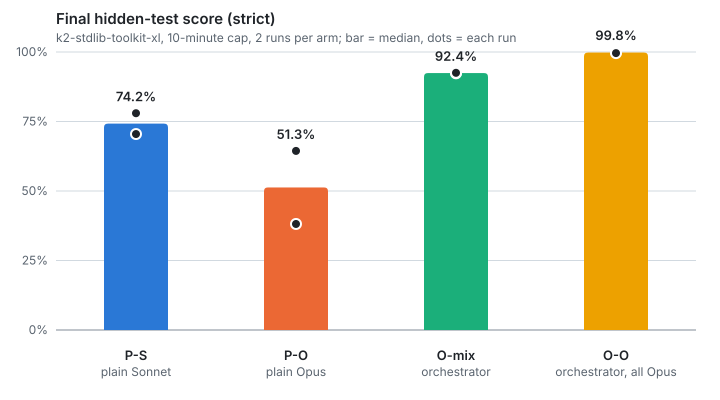
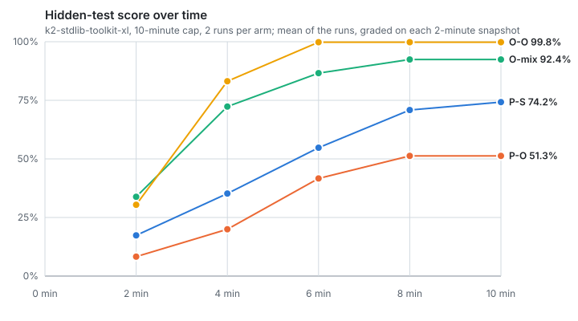

# Benchmark

The benchmark runs the same tasks under orchestrated and plain Claude Code sessions, with a hard wall-clock cap, and grades every run offline with hidden tests. This page covers the harness, the plugin [eval suite](../docs/glossary.md#e), and every campaign's result in short. For maintainers.

The main comparisons are model-matched [arms](../docs/glossary.md#a): the orchestrator with shipped models (`O-mix`) against plain Sonnet (`P-S`), and the orchestrator with every agent on Opus (`O-O`) against plain Opus (`P-O`). Cost is reported in tokens only, never in money.

Pre-registered hypotheses and verdict rules: [HYPOTHESES.md](HYPOTHESES.md). Results: "Results" below, and the dated write-ups it links.

## Arms

Defined in `bench/arms.mjs`. Every arm except `SDK` goes through the product scripts unmodified.

| Arm | What runs |
| --- | --- |
| `P-S` | Plain Sonnet session (`scripts/orchestrate.sh`, `ORCH_AGENT=none`, `ORCH_MODEL=sonnet`, no `.claude/` copied) |
| `P-O` | Plain Opus session (same, `ORCH_MODEL=opus`) |
| `O-mix` | Orchestrator with agents as shipped (this repo's `.claude/` copied in) |
| `O-O` | Orchestrator with every agent's `model:` line rewritten to Opus |
| `AUTO` | `scripts/auto.sh`: [triage](../docs/glossary.md#t) picks plain, reviewed or the orchestrator. `.claude/` copied in; the run repo's settings set the model to sonnet |
| `N-UC` | Native ultracode: Claude Code as shipped. No `.claude/` copied and every user-enabled plugin disabled, so the orchestration plugin and this repo's agents and hooks are not loaded. Built-in and fork subagents are allowed. Model Opus, as in `P-O`. The prompt is `ultracode Use a workflow (the Workflow tool) to orchestrate this task.` followed by the task prompt. `Workflow` is allowed. The row's `workflow_runs` records whether a workflow ran. Launched by `bench/lib/native-launch.sh` (see "Short documentation run") |
| `W-mix` | The shipped [gated workflow](../docs/glossary.md#g): this repo's `.claude/` copied in (as `O-mix`, so `.claude/workflows/orchestrate.js` is present). `scripts/orchestrate.sh` runs with `ORCH_AGENT=none` and the prompt `/orchestrate {"task":<task prompt>,"code":true,"baseRefHead":true}`. `Workflow` is allowed |
| `O-mix-plugin` | Orchestrator from this checkout's plugin build `dist/plugin`, loaded with `--plugin-dir` by `bench/lib/plugin-launch.sh`; `ORCH_AGENT_PREFIX=orchestration:`, no `.claude/` copied, shipped models. The launcher keeps the two exports that block built-in and fork subagents, and sets `ORCH_NO_NUDGE=1` |
| `O-mix-030` | The same with the 0.3.0 plugin: `dist/plugin` at `ef62288` (`BASELINE_030_REF`), extracted once with `git archive` into `<tmpdir>/orch-bench-plugin/ef62288/` |
| `all-haiku` | `O-mix` with the researcher's `model:` line rewritten to haiku and `ORCH_ALLOW_HAIKU=1` (without it the plan check raises a haiku launch to sonnet); the other agents keep their shipped models. The `d2-docs` reading comparison (H14) |
| `all-sonnet` | `O-mix` with `CLAUDE_CODE_SUBAGENT_MODEL_FORCE=1` and `CLAUDE_CODE_SUBAGENT_MODEL=sonnet`: forces every subagent to sonnet, so every [worker](../docs/glossary.md#w) (researcher, implementer, reviewer, integrator), not the researcher alone |
| `routed` | `O-mix` with `ORCH_READ_ROUTER=on` and shipped models, so the researcher runs on sonnet |
| `reader-haiku` | `d3-reader` arms (H14-d3). A plain sonnet session (`ORCH_AGENT=none`, `ORCH_MODEL=sonnet`, no orchestrator), with this repo's `.claude/` copied in, so the project researcher and the hooks are present. The researcher's `model:` line is rewritten to haiku, with `ORCH_ALLOW_HAIKU=1`. `ORCH_SESSION_PERSISTENCE=1` is set (`READER_ENV`). The task prompt has the session launch one researcher per question |
| `reader-sonnet` | The reader session with `CLAUDE_CODE_SUBAGENT_MODEL_FORCE=1` and `CLAUDE_CODE_SUBAGENT_MODEL=sonnet` (every worker here is a researcher) |
| `reader-routed` | The reader session with `ORCH_READ_ROUTER=on` and the researcher as shipped (sonnet). The router never lowers a model, so here it only adds converted-text notes to the brief |
| `SDK` | The [SDK pipeline](../docs/glossary.md#s): `npx tsx src/cli.ts --repo <run repo> --task <prompt> --mode orchestrate --no-escalate --out <run dir>/sdk [--test-cmd <task test_cmd>] [--budget <tokens>]`; no `.claude/` copied; no mid-run snapshots ("The SDK arm") |

**Plain sessions keep the default output style.** Every arm that starts a plain session through `scripts/orchestrate.sh` sets `ORCH_OUTPUT_STYLE=default`: `P-S`, `P-O`, `W-mix`, `N-UC`, the three reader arms, and `AUTO` (for its plain and reviewed routes). This matches the published runs; without it `scripts/orchestrate.sh` gives a plain session the Concise [output style](../docs/glossary.md#o).

**The haiku arms and the published runs.** The researcher shipped on haiku in 0.4.0, when the published `all-haiku`, `routed` and `reader-*` runs were made. It ships on sonnet since 1.3.0. Today:

- `all-haiku` and `reader-haiku` rewrite the researcher to haiku themselves (the `agentModels` field) and set `ORCH_ALLOW_HAIKU=1`, so a rerun runs a haiku researcher again. "Shipped" described them in 0.4.0 only.
- `routed` and `reader-routed` run the shipped researcher, now sonnet. So the pairs `all-haiku` → `routed` and `reader-haiku` → `reader-routed` now compare a haiku researcher with a sonnet researcher plus the router's notes. That is not the 0.4.0 comparison (haiku with and without the router).
- Arm ids are unchanged, so old results load. [HYPOTHESES.md](HYPOTHESES.md) and the dated write-ups describe the arms as they were when the runs were made.

## Tasks

In `bench/tasks/<id>/`. The cap is the task's own wall-clock limit (`cap_min`); a matrix cell can override it.

| Task | Tier | Shape | Cap | Language |
| --- | --- | --- | --- | --- |
| `t1-parallel` | small | parallel (two independent modules) | 10 min | node |
| `t2-single` | small | single (duration parser) | 10 min | node |
| `c1-unit-registry` | small | splittable (six unit-conversion modules behind one shared registry) | 5 min | node |
| `d1-handbook` | small | splittable (a security handbook from four policy sources) | 5 min | node |
| `h1-query-engine` | medium | splittable | 30 min | node |
| `h2-scheduler` | medium | splittable | 30 min | node |
| `k1-stdlib-toolkit` | large | splittable (4 modules: toml 124, shlex 68, regex 205, csv 106 hidden cases; 503 total) | 30 min | python |
| `h3-sql-engine` | large | monolithic (minisql, matched against SQLite) | 30 min | python |
| `k2-stdlib-toolkit-xl` | large | splittable (12 modules: k1's four plus ipaddr, fraction, urls, b64, diff, wrap, jsonx, cal; 1,762 hidden tests) | 30 min | python |
| `d2-docs` | small | parallel (seven questions over seven documents) | 8 min | python |
| `d3-reader` | small | parallel (twelve questions over seven documents, one researcher each) | 8 min | python |

`c1-unit-registry` and `d1-handbook` were built for the O-next comparison and have not been run ([docs/benchmark-onext.md](../docs/benchmark-onext.md)).

**`d2-docs`** asks seven questions, one per document kind (`docs/` in `setup/`, generated by `gen/make_docs.py`). The kinds are a `.txt` memo, a text PDF, a PDF table, an image-only scanned PDF, an xlsx whose formulas have no stored results, a bar chart PNG and a 60-page PDF.

- The run writes `answers.json`; `python3 tools/check.py` checks only its format.
- `score.mjs` grades each answer (exact, regex, or a number within a tolerance) and tags it with its category (`txt`, `pdf-text`, `pdf-table`, `pdf-scan`, `xlsx-formula`, `chart`, `pdf-long`), so analysis can split accuracy by kind.
- It was written to compare reading models (H14).

**`d3-reader`** was built so that the [read router](../docs/glossary.md#r) must run, after compare-040's d2-docs runs launched no researcher.

- It asks twelve questions over seven documents (`gen/make_docs.py`):
  - a text PDF (q1, q2) and a PDF table (q3, q4);
  - a scanned PDF with no text layer (q5, q6) and a bar chart PNG (q7, q8);
  - an xlsx whose formulas have no stored results (q9, q10);
  - a docx with the answer in a table (q11) and a 60-page PDF (q12).
- `task.md` tells the main session not to read the documents. The session launches the project researcher once per question, all twelve together. Each brief has `SLICE: q<n>`, `SOURCES: <document>`, `READ: extract`, the question, and "Answer with a QUOTE line". The session then writes `answers.json`.
- `score.mjs` checks each answer and tags its category. `HARD` (q3 to q11, the kinds the router profiles as sonnet) and the easy kinds (q1, q2, q12) give the hard and easy accuracy.
- `bench/analyze.mjs` keeps the same list as `READER_HARD`, and a test keeps the two equal.
- `d3-reader` is not in `analyze.mjs`'s `TASKS`, so the older hypothesis loops ignore it.

**`k1-stdlib-toolkit`** (test command `python3 tests/run_public.py`, graded path `toolkit`) is graded in a sandbox: the stdlib oracle modules are blocked, and using them in any way scores that module 0. It may arrive from another branch; `node bench/validate.mjs` lists what is present.

The graders `score.mjs` of k1, k2 and h3 run their command-line block through the real-path entry guard, so a grader called through a symlinked path still prints its grade.

The k1 and k2 graders grade against Python 3.13's standard library: `hidden/grade.py` re-runs itself under `python3.13` (or `K2_PYTHON`) when it finds one. Run under Python 3.14 or later instead, it grades the cases listed in that task's `hidden/py313.py` (two for k1, eight for k2) against the values recorded there, not the live oracle. Each file's docstring says what each value is and what is established about it: none could be reproduced on 3.13 here ([docs/limits.md](../docs/limits.md), G).

## Commands, in order

```bash
npm run bench:validate                                   # no model calls: stub fails, reference passes, every mutant is caught, meta.total matches
npm run bench -- --matrix bench/matrix/pilot.json        # 1 rep: t2 on all arms, k1 and h3 at 10 min (smoke test of the whole harness)
npm run bench -- --matrix bench/matrix/lite.json         # 2 reps, all six tasks, all five arms, main cell
npm run bench -- --matrix bench/matrix/pilot-k2.json     # 1 rep: k2, P-O and O-mix, main cell
npm run bench -- --matrix bench/matrix/lite-k2.json      # 2 reps: k2, all five arms, main cell (10 runs)
npm run bench -- --matrix bench/matrix/sweeps.json       # k2 only, P-O vs O-mix, caps 10 and 60 min, budgets 3M and 8M tokens (16 runs)
npm run bench -- --matrix bench/matrix/k2-cap10.json     # 2 reps: k2 at cap10, P-S, P-O, O-mix and O-O
npm run bench -- --matrix bench/matrix/sdk-vs-native.json   # NOT RUN: k2 at cap10, O-mix vs SDK, 4 reps (8 runs); H8 in HYPOTHESES.md
npm run bench -- --matrix bench/matrix/short-k2.json     # 1 rep: k2 at cap10, O-mix vs N-UC vs W-mix in one block (~10-15 min); direction only
npm run bench -- --matrix bench/matrix/compare-040.json  # 0.4.0 vs 0.3.0 on k2 (1 rep) and the d2-docs reading arms (2 reps); direction only
npm run bench -- --matrix bench/matrix/route-040.json    # d3-reader, reader-haiku vs reader-sonnet vs reader-routed, 2 reps (~2 min run, 20 min worst case); direction only
npm run bench:grade -- runs/bench/<campaign>             # offline grading of snapshots into grades.jsonl
npm run bench:analyze -- runs/bench/<campaign>           # summary.json: token metrics, comparisons, hypothesis verdicts
npm run bench:report -- runs/bench/<campaign>/summary.json   # report.html, plus benchmarks.md for docs/benchmarks.md
```

Every `npm run bench` line starts paid model runs; only `bench:validate` and the three offline steps call no model.

`bench:validate` runs several tasks at once: half the CPUs (`availableParallelism`), at least 2 and at most the number of tasks, `--parallel N` to set it. The three known slow tasks (h3, k2, k1) start first, and each task's lines print together when it ends. It stops at a deadline of 270 s (`--deadline-s S`, 0 for none): it prints the tasks that finished, a `NOT DONE <id>` line for each unfinished one (still running, or not reached), ends the graders it started and exits 3. Exit codes: 0 every task valid, 1 a task failed or no task matched, 3 the deadline, 130 on SIGINT or SIGTERM. `--task <id>` validates one task. `bench/eval-graders.test.mjs` checks the deadline: the caller survives, no grader is left running, no scratch folder is left. `bench/matrix/k2-cap10-onext.json` is data only: `run.mjs` rejects its `O-next` arm, which no longer exists.

The pilot showed that k1 and h3 saturate within minutes. So the splittable-task hypothesis (H1) and both sweeps (H7) moved to `k2-stdlib-toolkit-xl`, which has its own main campaign (`lite-k2`) and the sweeps. `lite.json` stays unchanged and keeps k1 as a saturated large task. See the amendment in [HYPOTHESES.md](HYPOTHESES.md).

**Flags.**

- `bench:analyze` accepts several campaign folders (pooled) and `--out`. `bench:report` takes `--html` and `--md`.
- `bench/run.mjs`: `--matrix <file>`, `--campaign <name>`, `--resume <campaign dir>`, `--dry-run` (prints each run's command and environment additions), `--only <substring of run_id>`, `--parallel-blocks N`, `--seed N`, `--tasks-dir <dir>`, `--check-isolation`.
- `bench/grade.mjs`: `--jobs N`, `--only <substring>`, `--final-only`, `--tasks-dir <dir>`. Identical (task, content hash) pairs are graded once (`grades-cache.json`), and finished (run, snapshot) pairs are skipped, so grading can be rerun.
- `bench/validate.mjs`: `--task <id>`, `--tasks-dir <dir>`, `--parallel N`, `--deadline-s S`.

**Matrix files.** A [matrix](../docs/glossary.md#m) file has `name`, `seed` and `groups`. Each group lists `tasks`, `arms`, `cells` (`id`, plus `cap_min` or `budget_tokens`) and `reps`. It may also set `parallel_blocks` (`--parallel-blocks` overrides it).

**Claims.** `bench/lib/claims.mjs` reads each run's final message and classifies its claim (success, partial, failure, unclear or none); a [false success](../docs/glossary.md#f) is a claimed success whose hidden grade fails. The template line `STATUS: pass or fail` (also with `/` or `|`) is not a claim. An optional `<campaign>/claims-audit.json` of `{"<run_id>": {"claim": "success|partial|failure|unclear|none", "note": "..."}}` overrides the rules-based claim for false-success counts and H4. The automatic claim stays as `claim_auto`, and the report shows both.

**Lenient variant** (k2 only). `node bench/grade.mjs <campaign> --variant lenient` grades `final/` only into `grades-lenient.jsonl`; other tasks are skipped with a note.

- In that grade `re` may be imported by any toolkit module except `toolkit/regex.py`. Task rule 2 otherwise zeroes a module that imports it.
- Regex cases stay watched as in the strict grade, and flags carry a `lenient:` prefix.
- `analyze.mjs` then adds `score_pct_lenient`, `pass_lenient` and `score_median_lenient`, and the report adds a lenient column for k2.
- The strict score stays official, and hypotheses use it.

**Triage tokens counted before 1.5.1.** `analyze.mjs` adds each logged route's tokens to a run's total as `by_model.triage`. Before release 1.5.1 the triage call also carried the MCP tools of the account's claude.ai connectors (437,331 tokens instead of 14,030 for the same triage in [docs/data/live-checks-2026-11-16.md](../docs/data/live-checks-2026-11-16.md), Check 10), so `AUTO` rows of older campaigns overstate what a triage uses now. A campaign is dated by `plugin_version` in its `manifest.json`: when it is below 1.5.1 or missing, every run with triage tokens gets `triage_pre_fix: true`, and `summary.json` gets a footnote in `notes` that `analyze.mjs` prints and the report lists under Caveats. The tokens themselves are left as logged. To compare `AUTO` with other arms on the current triage, run a new campaign.

**Paired differences and pass^k.** `analyze.mjs` adds two sections to `summary.json`, and prints both after the cells:

- `paired`: for each pair in `PAIRS` (`O-mix-030` → `O-mix-plugin`, `all-haiku` → `all-sonnet`, `all-haiku` → `routed`, `all-sonnet` → `routed`) and each metric (`score_pct`, `pass`, `tokens`), the runs of the two arms that share (task, cell, rep) are paired. The difference B − A is taken, and it reports:
  - the mean difference;
  - its standard error clustered by task (CR1: pairs on one task share documents and tests, so they are not independent);
  - a normal 95% interval;
  - the mean per task.

  With fewer than 2 tasks the SE is null. Below 3 tasks or 3 pairs the comparison is marked `direction_only`.
- `pass_k`: per (task, arm, cell), the reps `n`, passes `c`, pass@1 = c/n, and pass^k. pass^k is the unbiased estimate C(c,k)/C(n,k) that all k attempts pass, for k = n and, when n ≥ 2, k = 2. pass^k measures how reliably an arm gets every run right, not its average.

**Reader metrics and run validity (`d3-reader`).** For every run of a `reader-*` arm or of `d3-reader`, `analyze.mjs` (`readerOf`) adds a `reader` object to the run:

- `researcher_launches`: distinct researcher agent ids from [telemetry](../docs/glossary.md#t)'s SubagentStart records, else from SubagentStop. `researcher_stops`.
- `researcher_tokens` and `researcher_output_tokens`: input + output + cache read + cache write (and output alone), from the `tokens` field of the last SubagentStop per researcher. A stop that the quote check blocks is followed by a second stop, whose usage already includes the first. Both are null when no researcher stop carries tokens.
- `researchers_with_tokens` and `researcher_models`: models counted from those stops.
- `route_decisions`, `routed_launches` and `raised`, from the run's `state/reads-route.jsonl`.
- `hard_pct` and `easy_pct`, from the final grade's `by_cat`.

A run is invalid when it has fewer researcher launches than questions, or when it is a `reader-routed` run with no route decision. An invalid run is excluded like a rate-limited one, and listed in the summary's `reader.invalid` with its reasons.

- `reader.cells` holds per-cell medians over valid runs: researcher tokens, researcher output tokens, score, hard and easy accuracy, launches and route decisions.
- `paired` also gets the `READER_PAIRS` (`reader-haiku` → `reader-routed`, `reader-sonnet` → `reader-routed`, `reader-haiku` → `reader-sonnet`), with `researcher_tokens` and `hard_pct` added to the metrics.

**Per-agent tokens need `ORCH_SESSION_PERSISTENCE=1`.** `scripts/orchestrate.sh` passes `--no-session-persistence` by default, so no subagent transcript is written, and telemetry's per-agent `tokens`, `turns` and `models` stay empty. With `ORCH_SESSION_PERSISTENCE=1` the flag is dropped and the fields fill in ([docs/data/live-checks-telemetry.md](../docs/data/live-checks-telemetry.md)). The `reader-*` arms set it. The other arms do not, so their per-role tokens stay empty. The cost is one session transcript per run under `~/.claude/projects/`.

## The SDK arm

Compares the SDK pipeline (`src/cli.ts`) with the native orchestrator (`O-mix`) on the same task, cap and grading. **This campaign has not been run, and nothing here claims a result.** H8 in [HYPOTHESES.md](HYPOTHESES.md) pre-registers the comparison and lists the known differences between the arms. The SDK-specific code is `bench/lib/sdk.mjs`; run-exec makes one call into it.

- **Result location.** The SDK pipeline merges passing slices onto branch `orch/<runId>/result` in a worktree, and leaves the run repo's working tree at the init commit. After the launch and before anything is read, the harness merges that branch into the working tree (fast-forward, else merge). `sdk-adapter.json` in the run folder records what was merged.
- **Capped runs.** If the cap kills the run, step 7 never ran: no result branch, no `report.json`. The harness reads the SDK run folder's `journal.json` and merges the `orch/<runId>/<slice>` branch of each slice recorded as passed. A conflicting or missing branch is skipped and listed in `sdk-adapter.json`. It grades that: passed, verified slices only. Native keeps whatever is in its tree. This asymmetry is documented in H8.
- **No snapshots.** The working tree is empty mid-run, so the row has `snapshots: "none"`, no snapshot is taken, and `analyze` sets t90, t100 and AUC to null for the arm.
- **Tokens.** The row's result document is built from the SDK run folder: `report.json` `spentTokens` when present, else the sum of `tokens` in `telemetry.jsonl`. That file has one line per worker, written as it finishes. So a killed run keeps only the spend of workers that finished. The tokens of workers still running when the cap kills the run are lost, and a capped SDK run's total is an undercount. Basis as in `scripts/tokens.mjs`: input + output + cache read + cache write.
- **Errors.** `report.error`, failed slices, failed workers' text and the tail of stderr are scanned for rate-limit and authentication wording. A match sets the same `rate_limited` / `auth_error` end reason as the other arms, so the run pauses and is requeued instead of being scored as a quality failure.
- **Authentication.** The SDK starts the Claude Code executable, so it uses `ANTHROPIC_API_KEY` (or `CLAUDE_CODE_OAUTH_TOKEN`) when set in the environment, and otherwise the `claude` login. In a campaign with the SDK arm the preflight therefore passes when one of those variables is set (its value is never printed), and otherwise falls back to `claude auth status`. `runEnv` strips `ORCH_*` only, so `ANTHROPIC_*` passes through. Not checked live.
- **Test gate.** A task may set `sdk_test_cmd` in `meta.json`. The SDK arm uses it instead of `test_cmd`, because the SDK pipeline runs the gate in each slice's worktree, where other slices' modules are still stubs (k2 runs only the changed modules' public tests). Other arms ignore it.
- **Cost.** O-mix medians were about 4.7M tokens per run, so the 8 runs of `sdk-vs-native.json` are roughly 40M tokens plus the SDK's own spend. `ORCH_BUDGET_TOKENS` (a cell's `budget_tokens`) becomes `--budget` for the SDK; this campaign sets none.
- **No claims.** The SDK prints no result claim, so its false-success rate is not meaningful.

## Results

All campaigns are headless, on coding or document tasks only, with 1 or 2 runs per setup. They show direction, not measurements. Verdict rules are in [HYPOTHESES.md](HYPOTHESES.md).

The gap cutoff with validation, the opus third attempt and the stall gate are unmeasured: compare-040 never exercised them (H15 to H17 untested). The read router has one direction-only benchmark ("Read router benchmark (route-040)" below).

| Campaign | Date | Claude Code | Plugin | Section |
|---|---|---|---|---|
| lite, lite-k2, sweeps | 2026-10-15 | 2.1.299 | 0.1.5 | "Results: why a router" |
| k2-cap10-nobuiltins | 2026-10-15 | 2.1.299 | 0.1.6 | "Results: built-in subagents blocked" |
| short-k2 | 2026-10-31 | 2.1.314 | 0.3.0 | "Short documentation run" |
| compare-040 | 2026-10-31 | 2.1.316 | 0.4.0 | "Comparison run for 0.4.0 (compare-040)" |
| route-040 | 2026-10-31 | 2.1.316 | 0.4.0 | "Read router benchmark (route-040)" |

One more dated record, the O-next campaign of 2026-10-16 (4 runs per arm on k2), is in [docs/benchmark-onext.md](../docs/benchmark-onext.md).

### Results: why a router

Measured on seven coding tasks, five setups, with Claude Code's built-in subagents allowed (they are blocked now), 2 runs per cell. Campaigns lite, lite-k2 and sweeps, 2026-10-15, Claude Code 2.1.299, plugin 0.1.5. Details: [docs/benchmarks.md](../docs/benchmarks.md).

| | Plain session (Sonnet or Opus) | Orchestrate route (shipped or all-Opus orchestrator) |
|---|---|---|
| Small and medium tasks (t1, t2, h1, h2): correctness | 100% on every run | 100% on every run (never better) |
| Small and medium tasks: tokens | 126k to 490k | 166k to 1.09M: 1.2x to 2.1x a plain session of the same model family |
| Small and medium tasks: wall time | 15s to 3.5 min | 34s to 6.1 min |
| Large tasks (k1, h3, k2): correctness per run | k1 and h3: Opus 100%, Sonnet 98.6% to 99.9%. k2 (strict): Opus 100%, Sonnet 74.5% and 83.5% | k1 and h3: 99.0% to 100%. k2 (strict): 74.9% to 99.9%, never 100% |
| Large tasks: tokens | 1.3M to 13.4M | 2.7M to 12.9M: 0.7x to 2.0x on k1 and h3, 0.7x to 0.9x on k2 |
| Large tasks: time to full score | plain Opus 4 to 8 min | 6 to 12 min on k1 and h3, never on k2 |
| Self-delegation | on k1 and k2 every plain run spawned Claude Code's built-in subagents (3 on k1, 12 to 21 on k2) | its own researcher, implementers, reviewers, integrator |
| Verification | the agent's own word: 1 audited false success in 28 runs | test gate, independent reviewer, review gate: 0 in 28 runs |

- On these tasks the orchestrate route did not raise correctness. What it adds is the gates, at 1.2x to 2.1x the tokens on small and medium work. The router spends one cheap read-only call to decide whether a task needs them.
- Sweeps on k2 (limits of 10 and 60 minutes, 3M and 8M tokens) are in [docs/benchmarks.md](../docs/benchmarks.md).
- Pre-registered hypotheses: H1, H2, H5, H6 and H7 not supported, H4 supported only by a one-run difference.
- **Why the parallel threshold for code is 10 files.** `minParallelFilesCode` was raised from 4 to 10 after this benchmark (2 runs per setup, so a direction rather than a measurement). Triage had sent 5 of 14 small and medium runs to the orchestrate route, which used 1.1x to 2.8x the tokens of a plain Sonnet session that scored the same 100%. Work that changes no code keeps 4 (`minParallelFilesNonCode`), since the benchmark measured none. See the README's [Choosing a route (triage)](../README.md#choosing-a-route-triage).

### Results: built-in subagents blocked

Claude Code's built-in subagents were blocked in every arm, so a plain session could not delegate. Six built-in subagents were blocked at the time of the campaign; the list today is `BUILTIN_AGENTS` in `.claude/hooks/builtin-agents.mjs`. Campaign k2-cap10-nobuiltins, 2026-10-15, Claude Code 2.1.299, plugin 0.1.6.

Benchmarked on `k2-stdlib-toolkit-xl` (twelve Python standard-library modules, 1,762 hidden tests) under a 10-minute cap, 2 runs per setup, tokens counted over every model. Full write-up and every chart: [docs/benchmark-builtins-blocked.md](../docs/benchmark-builtins-blocked.md).

| Setup | Strict score (median) | Tokens | Wall time | Subagents per run |
|---|---|---|---|---|
| Plain Sonnet (P-S) | 74.2% | 2.20M | 8.2 min | 0 |
| Plain Opus (P-O) | 51.3% | 2.94M | 7.5 min | 0 |
| Orchestrator, shipped models (O-mix) | 92.4% (lenient 99.0%) | 5.66M | 5.8 min | 21 to 22 |
| Orchestrator, all Opus (O-O) | 99.8% | 6.34M | 6.1 min | 16 to 25 |

<picture>
  <source media="(prefers-color-scheme: dark)" srcset="../docs/diagrams/bench-k2-cap10-score-dark.svg">
  
</picture>

<picture>
  <source media="(prefers-color-scheme: dark)" srcset="../docs/diagrams/bench-k2-cap10-timeline-dark.svg">
  
</picture>

- Delegating through the orchestrator scored 18 points higher than plain Sonnet and 48.5 higher than plain Opus, at 2.2x to 2.6x the tokens and 1.4 to 2.4 minutes less wall time. Plain sessions stopped early with unfinished modules.
- Both O-mix runs lost the same module (`tomlparse` imports `re`, which the spec forbids) and claimed success: two false successes by the automatic classification. O-mix's reviewers missed it, while an O-O reviewer caught the same rule in four modules.
- With the built-ins allowed (an earlier campaign, different plugin version), plain Opus scored 99.7% on this task by delegating to a built-in subagent itself. So this benchmark does not show the orchestrator beating built-in delegation on raw score.

## Short documentation run

`npm run bench -- --matrix bench/matrix/short-k2.json` runs k2-stdlib-toolkit-xl at a 10-minute cap (as `k2-cap10`), one rep each of `O-mix`, `N-UC` and `W-mix`. All three are one block, so they start together: about 10 to 15 minutes of wall time, plus grading. It is for documentation (Plan C, H12 in [HYPOTHESES.md](HYPOTHESES.md)). One rep per arm shows direction only; it decides no hypothesis.

**Result.** 2026-10-31, Claude Code 2.1.314, plugin 0.3.0, one run per arm. Full write-up: [docs/benchmark-short-k2.md](../docs/benchmark-short-k2.md).

| Setup | Strict score | Lenient | Tokens | Wall time | False success |
|---|---|---|---|---|---|
| Orchestrator 0.3.0, shipped models (O-mix) | 99.6% | 99.6% | 4.44M | 395 s | no |
| Native workflow orchestration, no plugin (N-UC) | 92.91% | 99.94% | 5.65M | 429 s | no |
| This repo's gated workflow (W-mix) | 66.91% | 91.54% | not measured | killed at 602 s | no (claimed nothing) |

W-mix was cut off at the deadline before it finished, so its tokens were not recorded. N-UC's strict gap is one module importing `re`.

**How the arms were run.**

- **`N-UC` launcher.** `scripts/orchestrate.sh` exports `CLAUDE_AGENT_SDK_DISABLE_BUILTIN_AGENTS=1` and `CLAUDE_CODE_FORK_SUBAGENT=0` for every run, and those would block native subagents. So `bench/lib/native-launch.sh` gets orchestrate.sh's claude arguments with `ORCH_DRY_RUN=1` and the same `ORCH_*` environment (model, permission rules, test-command rules, unsafe-Bash deny list, budget). It then runs `claude` itself in the run repo with those arguments and without the two variables. Tokens come from claude's JSON on stdout, per model, as for every other arm. orchestrate.sh's per-repo `runs.jsonl` log is not written.
- **`ultracode` in `-p`.** The workflows doc (code.claude.com/docs/en/workflows.md) says the keyword opts in only "in a prompt you type yourself". It also says: "It doesn't start a workflow when it reaches the session another way: a prompt passed with `-p`". And it says "Claude treats a direct request as the same opt-in". So `N-UC` prefixes the task with `ultracode Use a workflow (the Workflow tool) to orchestrate this task.` (`NUC_PREFIX` in `bench/arms.mjs`).
  - A probe on 2.1.314 checked that a plain request works under `-p`: `claude -p 'ultracode Use a workflow with two agents to list the files in this folder.' --model haiku --max-turns 3 --max-budget-usd 0.10 --permission-mode dontAsk --allowedTools Workflow Read Glob 'Bash(ls*)'`, with `CLAUDE_CODE_SUBAGENT_MODEL=haiku`.
  - The model loaded the workflow-authoring skill, called `Workflow` with a two-agent script, and `-p` waited for both agents.
- **Workflow use is recorded per run.** For `N-UC` and `W-mix` the row's `workflow_runs` lists the ids of the Workflow runs Claude Code recorded for sessions started in the run repo, under `~/.claude/projects/<repo path with non-alphanumerics as "-">/<session>/`:
  - `workflows/wf_*.json` (written even with `--no-session-persistence`);
  - for a workflow cut off before that file exists, its script `workflows/scripts/<name>-wf_<id>.js` or its agents folder `subagents/workflows/wf_<id>/`.

  Each id counts once. A requeued run passes the launch time and the ids present before it, so a stale workflow from an earlier attempt is not reported. The cut-off case is real: the 2026-10-31 W-mix run was killed at the deadline before `wf_*.json` was written, recorded an empty list, and is listed (`wf_512226a5-9f0`) after this fix ([docs/benchmark-short-k2.md](../docs/benchmark-short-k2.md)). An empty list means no workflow ran; that run is then native plain Opus with built-in subagents, not native workflow orchestration. `workflowRunsIn` is in `bench/lib/run-exec.mjs`.
- **`W-mix` feasibility.** On Claude Code 2.1.314 a probe (haiku, `--max-budget-usd 0.05`, 2 turns) ran `claude -p '/hello {"task":"toy"}' --permission-mode dontAsk --allowedTools Workflow` in a scratch folder with a toy `.claude/workflows/hello.js`. The model called `Workflow {"name":"hello","args":{"task":"toy"}}`, the workflow ran in the background, and `-p` waited for it and returned `{"echoed":{"task":"toy"}}`. So a project workflow can be started headless with the task as its argument.
  - The plugin ships the workflow too (`dist/plugin/workflows/orchestrate.js`, with `agentType` namespaced as `orchestration:<role>`). The arm copies the repo's `.claude/` into the run repo, so it starts the project copy with `/orchestrate`, not `/orchestration:orchestrate`. The k2 prompt itself was not probed.
  - Hook reach is checked ([docs/data/live-checks-2026-10-31.md](../docs/data/live-checks-2026-10-31.md)): SubagentStart and SubagentStop fire for workflow agents, with `agent_type` equal to the `agentType` the script gave, so the test gate and the review gate see them (in the 2026-10-31 run: `test:warn` 8, `review:allow` 2).
  - No PreToolUse(Agent) fires, because the script launches agents directly. So the plan check and the journal's launch records do not see them.
- **Analysis.** `bench/analyze.mjs` lists `N-UC` and `W-mix` in its `ARMS`. It adds no comparison between them. Read the per-arm cells and `workflow_runs` in `runs.jsonl`.

## Comparison run for 0.4.0 (compare-040)

`npm run bench -- --matrix bench/matrix/compare-040.json` runs two groups with `parallel_blocks: 2` (at most 5 sessions live). Hypotheses H14 to H17 were written before it ran ([HYPOTHESES.md](HYPOTHESES.md)); all four are direction only at this size.

- k2-stdlib-toolkit-xl at a 10-minute cap, `O-mix-plugin` against `O-mix-030`, 1 rep each.
- `d2-docs` at a 6-minute cap (the cell overrides the task's 8), `all-haiku`, `all-sonnet` and `routed`, 2 reps each.

**Result.** Campaign `runs/bench/compare-040-20261031T1722`, 2026-10-31, Claude Code 2.1.316, plugin 0.4.0. The matrix note planned about 25 minutes of wall time in a 30-minute budget. The eight runs took about 8 minutes; every run exited on its own before its cap. Full write-up: [docs/benchmark-compare-040.md](../docs/benchmark-compare-040.md).

| Task, cap | Arm | n | Strict score (median) | Tokens (median) | Wall (median) |
|---|---|---|---|---|---|
| k2, 10 min | `O-mix-plugin` (0.4.0) | 1 | 98.98% | 5,034,067 | 412 s |
| k2, 10 min | `O-mix-030` (0.3.0) | 1 | 99.72% | 5,225,511 | 453 s |
| d2-docs, 6 min | `all-haiku` | 2 | 100% | 2,059,608.5 | 162 s |
| d2-docs, 6 min | `all-sonnet` | 2 | 100% | 1,655,736 | 179 s |
| d2-docs, 6 min | `routed` (read router on) | 2 | 100% | 1,225,473.5 | 161 s |

The researcher shipped on haiku when these runs were made, so `routed` ran a haiku researcher with the router on ("Arms" above says what each arm runs today).

What it does and does not show:

- **Direction only.** One k2 run per arm and two d2-docs runs per arm decide nothing under the verdict rules. A cell with n < 2 is inconclusive, and with one or two tasks the clustered SE is null or meaningless. No hypothesis (H14 to H17 included) is called supported.
- **k2.** 0.4.0 scored 0.74 points below 0.3.0 with 3.7% fewer tokens and 41 s less wall time; neither claimed a false success. One run each cannot separate this from noise (the earlier 0.3.0 run on the same task scored 99.6%), and the pair changes everything between versions at once.
- **d2-docs.** Every arm answered all seven questions in both runs, so the score gives no signal.
- **The read router was not exercised.** Every d2-docs run took the [light path](../docs/glossary.md#l): the orchestrator ran it as a single light-path slice (one or two implementer launches per run) and launched no researcher. The router changes only researcher launches, so it never fired, and H14 is untested. The token spread between the d2 arms comes from how each orchestrator ran the slice, not from routing.
- The router was checked separately by one live run: a researcher brief naming a scanned PDF was raised from haiku to sonnet, and telemetry recorded `claude-sonnet-5-5`. That says nothing about scores or tokens.
- **No per-role tokens.** These arms ran with the default `--no-session-persistence`, so they kept no subagent transcripts, and telemetry's per-agent token fields are empty. H14's "reading tokens" cannot be read from these runs. `ORCH_SESSION_PERSISTENCE=1` fills them in (see route-040 below).
- **H15 to H17 have no data.** No slice stalled or failed for good, no `VALIDATE: gaps` review or replan ran, and no run applied the third-attempt rule. So H15 (opus on the last attempt), H16 (gap cutoff and validation) and H17 (replan of a stalled slice) have no data from this run. They also need journal counts (slices failed for good, retries, stalled slices) that this page does not report.

Plugin arms and isolation:

- Each run repo still disables every user-enabled plugin ("Isolation" below). The plugin arms load their plugin with `--plugin-dir`, which is not an installed plugin, so the isolation check does not see it.
- A plugin loaded with `--plugin-dir` gets Claude Code's plugin data folder `~/.claude/plugins/data/orchestration-inline` (observed on one machine). So the plugin arms' hook logs (`telemetry.jsonl`, `gates.jsonl`, the journal) land in a per-project folder there, not in the run repo. `npm run report` finds them, since it reads every `~/.claude/plugins/data/orchestration-*` folder.
- `O-mix-030` loads the 0.3.0 plugin's own hooks and agents, so its runs have none of the 0.4.0 gates.

## Read router benchmark (route-040)

`npm run bench -- --matrix bench/matrix/route-040.json` runs `d3-reader` at an 8-minute cap (cell `cap8`) with `reader-haiku`, `reader-sonnet` and `reader-routed`, 2 reps each, seed 41. With `parallel_blocks: 1` the three arms of a rep start together (up to 36 researchers live), and the 2 blocks run one after the other. The predictions H14-d3 (a) to (c) were written before it ran ([HYPOTHESES.md](HYPOTHESES.md), "H14 operationalised for d3-reader").

A plain sonnet session launches one researcher per question, so the read router runs on every launch of the routed arm.

**Result.** Campaign `runs/bench/route-040-20261031T2204`, 2026-10-31, 21:04:18 to 21:06:27 UTC, Claude Code 2.1.316, plugin 0.4.0. The matrix estimated 20 minutes in the worst case; the six runs took about 2 minutes. All 6 are valid (12 researcher launches each, and 12 route decisions per routed run). Full write-up: [docs/benchmark-route-040.md](../docs/benchmark-route-040.md).

| Arm | n | Score (median; min, max) | Hard q3 to q11 (median) | Researcher tokens (median) | Total tokens (median) |
|---|---|---|---|---|---|
| `reader-routed` (router on) | 2 | 91.67% (83.33, 100) | 88.89% | 631,628.5 | 983,822 |
| `reader-sonnet` (all researchers sonnet) | 2 | 79.16% (75, 83.33) | 72.22% | 1,150,728 | 1,478,819.5 |
| `reader-haiku` (shipped in 0.4.0) | 2 | 75% (75, 75) | 66.67% | 1,137,805 | 1,396,404 |

The researcher shipped on haiku when these runs were made, so `reader-routed` started its researchers on haiku and the router raised them ("Arms" above says what each arm runs today).

- **Direction only:** n = 2, one task, a null task-clustered SE. The three pre-registered predictions are each direction consistent: accuracy within a margin of sonnet, fewer researcher tokens than sonnet, and better than haiku on the hard kinds. None is called supported, and H14 is not called supported.
- The router raised 9 of 12 researchers to sonnet in each routed run, and gave the PDF, xlsx and docx researchers converted text.
- **Model and notes are confounded.** Every arm answered q1 to q8 and q12 (the text, table, scan, chart and long-PDF questions) right in every run, haiku included. The whole difference sits in the xlsx and docx questions (q9 to q11), which unrouted researchers cannot open with their read-only tools. Routed researchers got the converted text and sonnet together. The pattern suggests that the notes did more than the model.

## Plugin eval suite

`npm run eval` runs `claude plugin eval` on the built plugin, `dist/plugin`, with the cases in `evals/`. It compares sessions with and without the plugin. It is paid.

```sh
npm run eval                                                                 # every case; capped by --max-cost-usd 10
npm run eval -- --case t2-single --runs 1 --ablation none --max-cost-usd 2   # a bounded smoke run of one case
```

- **The script** is `claude plugin eval dist/plugin --scaffold --trust-plugin --no-publish --max-cost-usd 10 --threshold 0 --json evals-result.json --allow-tools Bash Write Edit` (`package.json`).
- **Cases.** `evals/` holds eight cases. Four come from bench tasks: `t2-single`, `t1-parallel`, `c1-unit-registry` and `d1-handbook`. Four come from project failures: `e1-shared-file` (a shared file), `e2-research-notes` (a researcher's notes), `e3-constraint-answered` (an unanswered constraint) and `e4-plan-before-build` (a plan before the build). Each has a `case.yaml`, a `prompt.md`, a `scaffold.sh` and a `graders/` folder.
- **Graders** call no model: `regex`, `file_exists` and `tool_used`.
- **The copy it runs.** `npm run build-plugin` copies `evals/` into `dist/plugin/evals/`, and the eval reads that copy. After a change to a case or grader, rebuild before you run it.

**Smoke run, 2026-11-10.** The bounded command above was run twice, at about $0.37 each. It runs end to end, and 4 of 7 graders passed; the three that failed were not understood then ([docs/research-2026-11-10.md](../docs/research-2026-11-10.md), "Open"). Since then:

- The test-result graders (`results-nonempty`, `results-pass`, in every case that has them) also match a coloured `node:test` summary, which starts with an escape sequence (`bench/eval-graders.test.mjs` runs both graders on real `node:test` output, coloured and plain). Whether colour caused the failures seen on `t2-single` is unproven.
- `orch-agent-used` was removed from `t2-single`. That case expects the plugin to stay light, so the grader counted against a correct light route in a one-arm (`--ablation none`) run. The same grader stays in `c1-unit-registry`, `d1-handbook`, `e1-shared-file` and `t1-parallel`, where an orchestration agent is expected.
- No eval has been run since these changes.

## Outputs

- `runs/bench/<campaign>/`: `manifest.json`, `runs.jsonl`, one folder per run (snapshots and final), later `grades.jsonl`, `grades-cache.json`, `summary.json` and the reports.
- Run repos: `~/orch-bench/<campaign>/<run_id>` (override the base with `BENCH_REPOS_DIR`).

## Isolation

- Every user-enabled plugin is disabled in each run repo's `.claude/settings.json` (`enabledPlugins` set to false).
- The runner checks the result with `claude plugin list --json` before launching. A run whose repo still shows an enabled plugin is not launched; it ends with `end_reason` `error`, error `isolation`.
- `--check-isolation` runs the check alone.
- Inherited `ORCH_*` variables are stripped from each run's environment. An arm's own `ORCH_*` settings are applied after that.

## Pacing and interruption

- Runs that share (task, cell, rep) form a block. Its arms start together, so they share rate-limit conditions. Block order is shuffled with the seeded random generator.
- Create `<campaign dir>/PAUSE` to hold before the next block; remove it to continue.
- A rate-limited run creates `PAUSE` itself and is requeued. It is excluded from statistics until it finishes.
- SIGINT, SIGTERM or a crash ends every live run's process group (kill after 8 s) and exits non-zero. An interrupted run writes no row.
- `--resume runs/bench/<campaign>` reruns what has no finished row, keeping the campaign's seed and block order.

## Task contract

A task is a folder `bench/tasks/<id>/`:

- `task.md`: the prompt the run receives.
- `meta.json`: `id` (equals the folder name), `title`, `tier` (small, medium, large), `shape` (parallel, single, dependent, monolithic, splittable), `lang` (node, python), `cap_min`, `total` (number of hidden checks, optional but expected), `test_cmd` (exported as `ORCH_TEST_CMD`, or `null`), `graded_paths` (what a snapshot hash covers), `snapshot_every_s`. Optional: `sdk_test_cmd` ("The SDK arm").
- `setup/`: the starting repo contents (stub code, public tests).
- `ref/`: a reference solution, copied over `setup/`.
- `score.mjs`: exports `score(dir)` returning `{pass, passed, total, ...}`. Node tasks with a `hidden.test.js` can reuse `scoreNodeHidden` from `bench/lib/score.mjs`. The hidden tests live outside `setup/`, so a run never sees them.
- `mutants.json`: a list of `{name, file, from, to}` edits. Each must occur exactly once in `file` of the reference and make `score` fail.

## Adding a task

1. Create the folder with the files above. Write `task.md` so the stub, public tests and cap make the task solvable but not trivial.
2. Add the id to the arrays in `bench/analyze.mjs` and `bench/report.mjs`, and to the matrices that should run it.
3. Run `npm run bench:validate -- --task <id>` until it passes, then `npm test`.

## Cost is reported in tokens only

- Token totals come from each run's result JSON (`scripts/tokens.mjs`), per model.
- No money figures appear in any benchmark output or write-up; dollar fields in raw inputs are ignored. (The eval suite's `--max-cost-usd` caps are `claude plugin eval` options, not benchmark results.)
- Budget cells set `ORCH_BUDGET_TOKENS`, which claude enforces through its dollar limit at 1M tokens per dollar, so the runs report their actual token use.
