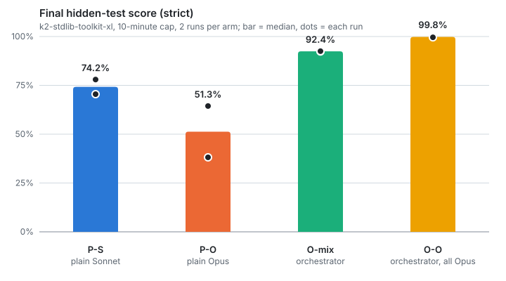
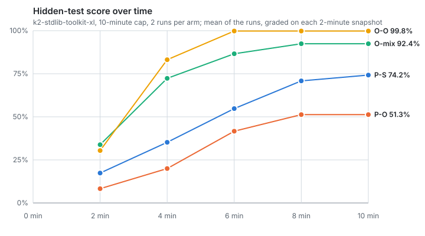

# Benchmark results

Every benchmark campaign of this repository, with its date, Claude Code version and plugin version. These are dated records: each section describes the arms and the plugin as they were when the runs were made. How the benchmark works, how to run it and how to read a result: [README.md](README.md). Where a section below says "Arms" above or "Isolation" below, it means that section of [README.md](README.md#arms) ([Isolation](README.md#isolation)).

## Results

All campaigns are headless, on coding or document tasks only, with 1 or 2 runs per setup. They show direction, not measurements. Verdict rules are in [HYPOTHESES.md](HYPOTHESES.md).

The gap cutoff with validation, the opus third attempt and the stall gate are unmeasured: compare-040 never exercised them (H15 to H17 untested). The read router has one direction-only benchmark ("Read router benchmark (route-040)" below).

| Campaign | Date | Claude Code | Plugin | Section |
|---|---|---|---|---|
| lite, lite-k2, sweeps | 2026-10-15 | 2.1.299 | 0.1.5 | "Results: why a router" |
| k2-cap10-nobuiltins | 2026-10-15 | 2.1.299 | 0.1.6 | "Results: built-in subagents blocked" |
| short-k2 | 2026-10-31 | 2.1.314 | 0.3.0 | "Short documentation run" |
| compare-040 | 2026-10-31 | 2.1.316 | 0.4.0 | "Comparison run for 0.4.0 (compare-040)" |
| route-040 | 2026-10-31 | 2.1.316 | 0.4.0 | "Read router benchmark (route-040)" |

One more dated record, the O-next campaign of 2026-10-16 (4 runs per arm on k2), is in [docs/benchmark-onext.md](../docs/benchmark-onext.md).

### Results: why a router

Measured on seven coding tasks, five setups, with Claude Code's built-in subagents allowed (they are blocked now), 2 runs per cell. Campaigns lite, lite-k2 and sweeps, 2026-10-15, Claude Code 2.1.299, plugin 0.1.5. Details: [docs/benchmarks.md](../docs/benchmarks.md).

| | Plain session (Sonnet or Opus) | Orchestrate route (shipped or all-Opus orchestrator) |
|---|---|---|
| Small and medium tasks (t1, t2, h1, h2): correctness | 100% on every run | 100% on every run (never better) |
| Small and medium tasks: tokens | 126k to 490k | 166k to 1.09M: 1.2x to 2.1x a plain session of the same model family |
| Small and medium tasks: wall time | 15s to 3.5 min | 34s to 6.1 min |
| Large tasks (k1, h3, k2): correctness per run | k1 and h3: Opus 100%, Sonnet 98.6% to 99.9%. k2 (strict): Opus 100%, Sonnet 74.5% and 83.5% | k1 and h3: 99.0% to 100%. k2 (strict): 74.9% to 99.9%, never 100% |
| Large tasks: tokens | 1.3M to 13.4M | 2.7M to 12.9M: 0.7x to 2.0x on k1 and h3, 0.7x to 0.9x on k2 |
| Large tasks: time to full score | plain Opus 4 to 8 min | 6 to 12 min on k1 and h3, never on k2 |
| Self-delegation | on k1 and k2 every plain run spawned Claude Code's built-in subagents (3 on k1, 12 to 21 on k2) | its own researcher, implementers, reviewers, integrator |
| Verification | the agent's own word: 1 audited false success in 28 runs | test gate, independent reviewer, review gate: 0 in 28 runs |

- On these tasks the orchestrate route did not raise correctness. What it adds is the gates, at 1.2x to 2.1x the tokens on small and medium work. The router spends one cheap read-only call to decide whether a task needs them.
- Sweeps on k2 (limits of 10 and 60 minutes, 3M and 8M tokens) are in [docs/benchmarks.md](../docs/benchmarks.md).
- Pre-registered hypotheses: H1, H2, H5, H6 and H7 not supported, H4 supported only by a one-run difference.
- **Why the parallel threshold for code is 10 files.** `minParallelFilesCode` was raised from 4 to 10 after this benchmark (2 runs per setup, so a direction rather than a measurement). Triage had sent 5 of 14 small and medium runs to the orchestrate route, which used 1.1x to 2.8x the tokens of a plain Sonnet session that scored the same 100%. Work that changes no code keeps 4 (`minParallelFilesNonCode`), since the benchmark measured none. See the README's [Choosing a route (triage)](../README.md#choosing-a-route-triage).

### Results: built-in subagents blocked

Claude Code's built-in subagents were blocked in every arm, so a plain session could not delegate. Six built-in subagents were blocked at the time of the campaign; the list today is `BUILTIN_AGENTS` in `.claude/hooks/builtin-agents.mjs`. Campaign k2-cap10-nobuiltins, 2026-10-15, Claude Code 2.1.299, plugin 0.1.6.

Benchmarked on `k2-stdlib-toolkit-xl` (twelve Python standard-library modules, 1,762 hidden tests) under a 10-minute cap, 2 runs per setup, tokens counted over every model. Full write-up and every chart: [docs/benchmark-builtins-blocked.md](../docs/benchmark-builtins-blocked.md).

| Setup | Strict score (median) | Tokens | Wall time | Subagents per run |
|---|---|---|---|---|
| Plain Sonnet (P-S) | 74.2% | 2.20M | 8.2 min | 0 |
| Plain Opus (P-O) | 51.3% | 2.94M | 7.5 min | 0 |
| Orchestrator, shipped models (O-mix) | 92.4% (lenient 99.0%) | 5.66M | 5.8 min | 21 to 22 |
| Orchestrator, all Opus (O-O) | 99.8% | 6.34M | 6.1 min | 16 to 25 |

<picture>
  <source media="(prefers-color-scheme: dark)" srcset="../docs/diagrams/bench-k2-cap10-score-dark.svg">
  
</picture>

<picture>
  <source media="(prefers-color-scheme: dark)" srcset="../docs/diagrams/bench-k2-cap10-timeline-dark.svg">
  
</picture>

- Delegating through the orchestrator scored 18 points higher than plain Sonnet and 48.5 higher than plain Opus, at 2.2x to 2.6x the tokens and 1.4 to 2.4 minutes less wall time. Plain sessions stopped early with unfinished modules.
- Both O-mix runs lost the same module (`tomlparse` imports `re`, which the spec forbids) and claimed success: two false successes by the automatic classification. O-mix's reviewers missed it, while an O-O reviewer caught the same rule in four modules.
- With the built-ins allowed (an earlier campaign, different plugin version), plain Opus scored 99.7% on this task by delegating to a built-in subagent itself. So this benchmark does not show the orchestrator beating built-in delegation on raw score.

## Short documentation run

`npm run bench -- --matrix bench/matrix/short-k2.json` runs k2-stdlib-toolkit-xl at a 10-minute cap (as `k2-cap10`), one rep each of `O-mix`, `N-UC` and `W-mix`. All three are one block, so they start together: about 10 to 15 minutes of wall time, plus grading. It is for documentation (Plan C, H12 in [HYPOTHESES.md](HYPOTHESES.md)). One rep per arm shows direction only; it decides no hypothesis.

**Result.** 2026-10-31, Claude Code 2.1.314, plugin 0.3.0, one run per arm. Full write-up: [docs/benchmark-short-k2.md](../docs/benchmark-short-k2.md).

| Setup | Strict score | Lenient | Tokens | Wall time | False success |
|---|---|---|---|---|---|
| Orchestrator 0.3.0, shipped models (O-mix) | 99.6% | 99.6% | 4.44M | 395 s | no |
| Native workflow orchestration, no plugin (N-UC) | 92.91% | 99.94% | 5.65M | 429 s | no |
| This repo's gated workflow (W-mix) | 66.91% | 91.54% | not measured | killed at 602 s | no (claimed nothing) |

W-mix was cut off at the deadline before it finished, so its tokens were not recorded. N-UC's strict gap is one module importing `re`.

**How the arms were run.**

- **`N-UC` launcher.** `scripts/orchestrate.sh` exports `CLAUDE_AGENT_SDK_DISABLE_BUILTIN_AGENTS=1` and `CLAUDE_CODE_FORK_SUBAGENT=0` for every run, and those would block native subagents. So `bench/lib/native-launch.sh` gets orchestrate.sh's claude arguments with `ORCH_DRY_RUN=1` and the same `ORCH_*` environment (model, permission rules, test-command rules, unsafe-Bash deny list, budget). It then runs `claude` itself in the run repo with those arguments and without the two variables. Tokens come from claude's JSON on stdout, per model, as for every other arm. orchestrate.sh's per-repo `runs.jsonl` log is not written.
- **`ultracode` in `-p`.** The workflows doc (code.claude.com/docs/en/workflows.md) says the keyword opts in only "in a prompt you type yourself". It also says: "It doesn't start a workflow when it reaches the session another way: a prompt passed with `-p`". And it says "Claude treats a direct request as the same opt-in". So `N-UC` prefixes the task with `ultracode Use a workflow (the Workflow tool) to orchestrate this task.` (`NUC_PREFIX` in `bench/arms.mjs`).
  - A probe on 2.1.314 checked that a plain request works under `-p`: `claude -p 'ultracode Use a workflow with two agents to list the files in this folder.' --model haiku --max-turns 3 --max-budget-usd 0.10 --permission-mode dontAsk --allowedTools Workflow Read Glob 'Bash(ls*)'`, with `CLAUDE_CODE_SUBAGENT_MODEL=haiku`.
  - The model loaded the workflow-authoring skill, called `Workflow` with a two-agent script, and `-p` waited for both agents.
- **Workflow use is recorded per run.** For `N-UC` and `W-mix` the row's `workflow_runs` lists the ids of the Workflow runs Claude Code recorded for sessions started in the run repo, under `~/.claude/projects/<repo path with non-alphanumerics as "-">/<session>/`:
  - `workflows/wf_*.json` (written even with `--no-session-persistence`);
  - for a workflow cut off before that file exists, its script `workflows/scripts/<name>-wf_<id>.js` or its agents folder `subagents/workflows/wf_<id>/`.

  Each id counts once. A requeued run passes the launch time and the ids present before it, so a stale workflow from an earlier attempt is not reported. The cut-off case is real: the 2026-10-31 W-mix run was killed at the deadline before `wf_*.json` was written, recorded an empty list, and is listed (`wf_512226a5-9f0`) after this fix ([docs/benchmark-short-k2.md](../docs/benchmark-short-k2.md)). An empty list means no workflow ran; that run is then native plain Opus with built-in subagents, not native workflow orchestration. `workflowRunsIn` is in `bench/lib/run-exec.mjs`.
- **`W-mix` feasibility.** On Claude Code 2.1.314 a probe (haiku, `--max-budget-usd 0.05`, 2 turns) ran `claude -p '/hello {"task":"toy"}' --permission-mode dontAsk --allowedTools Workflow` in a scratch folder with a toy `.claude/workflows/hello.js`. The model called `Workflow {"name":"hello","args":{"task":"toy"}}`, the workflow ran in the background, and `-p` waited for it and returned `{"echoed":{"task":"toy"}}`. So a project workflow can be started headless with the task as its argument.
  - The plugin ships the workflow too (`dist/plugin/workflows/orchestrate.js`, with `agentType` namespaced as `orchestration:<role>`). The arm copies the repo's `.claude/` into the run repo, so it starts the project copy with `/orchestrate`, not `/orchestration:orchestrate`. The k2 prompt itself was not probed.
  - Hook reach is checked ([docs/data/live-checks-2026-10-31.md](../docs/data/live-checks-2026-10-31.md)): SubagentStart and SubagentStop fire for workflow agents, with `agent_type` equal to the `agentType` the script gave, so the test gate and the review gate see them (in the 2026-10-31 run: `test:warn` 8, `review:allow` 2).
  - No PreToolUse(Agent) fires, because the script launches agents directly. So the plan check and the journal's launch records do not see them.
- **Analysis.** `bench/analyze.mjs` lists `N-UC` and `W-mix` in its `ARMS`. It adds no comparison between them. Read the per-arm cells and `workflow_runs` in `runs.jsonl`.

## Comparison run for 0.4.0 (compare-040)

`npm run bench -- --matrix bench/matrix/compare-040.json` runs two groups with `parallel_blocks: 2` (at most 5 sessions live). Hypotheses H14 to H17 were written before it ran ([HYPOTHESES.md](HYPOTHESES.md)); all four are direction only at this size.

- k2-stdlib-toolkit-xl at a 10-minute cap, `O-mix-plugin` against `O-mix-030`, 1 rep each.
- `d2-docs` at a 6-minute cap (the cell overrides the task's 8), `all-haiku`, `all-sonnet` and `routed`, 2 reps each.

**Result.** Campaign `runs/bench/compare-040-20261031T1722`, 2026-10-31, Claude Code 2.1.316, plugin 0.4.0. The matrix note planned about 25 minutes of wall time in a 30-minute budget. The eight runs took about 8 minutes; every run exited on its own before its cap. Full write-up: [docs/benchmark-compare-040.md](../docs/benchmark-compare-040.md).

| Task, cap | Arm | n | Strict score (median) | Tokens (median) | Wall (median) |
|---|---|---|---|---|---|
| k2, 10 min | `O-mix-plugin` (0.4.0) | 1 | 98.98% | 5,034,067 | 412 s |
| k2, 10 min | `O-mix-030` (0.3.0) | 1 | 99.72% | 5,225,511 | 453 s |
| d2-docs, 6 min | `all-haiku` | 2 | 100% | 2,059,608.5 | 162 s |
| d2-docs, 6 min | `all-sonnet` | 2 | 100% | 1,655,736 | 179 s |
| d2-docs, 6 min | `routed` (read router on) | 2 | 100% | 1,225,473.5 | 161 s |

The researcher shipped on haiku when these runs were made, so `routed` ran a haiku researcher with the router on ("Arms" above says what each arm runs today).

What it does and does not show:

- **Direction only.** One k2 run per arm and two d2-docs runs per arm decide nothing under the verdict rules. A cell with n < 2 is inconclusive, and with one or two tasks the clustered SE is null or meaningless. No hypothesis (H14 to H17 included) is called supported.
- **k2.** 0.4.0 scored 0.74 points below 0.3.0 with 3.7% fewer tokens and 41 s less wall time; neither claimed a false success. One run each cannot separate this from noise (the earlier 0.3.0 run on the same task scored 99.6%), and the pair changes everything between versions at once.
- **d2-docs.** Every arm answered all seven questions in both runs, so the score gives no signal.
- **The read router was not exercised.** Every d2-docs run took the [light path](../docs/glossary.md#l): the orchestrator ran it as a single light-path slice (one or two implementer launches per run) and launched no researcher. The router changes only researcher launches, so it never fired, and H14 is untested. The token spread between the d2 arms comes from how each orchestrator ran the slice, not from routing.
- The router was checked separately by one live run: a researcher brief naming a scanned PDF was raised from haiku to sonnet, and telemetry recorded `claude-sonnet-5-5`. That says nothing about scores or tokens.
- **No per-role tokens.** These arms ran with the default `--no-session-persistence`, so they kept no subagent transcripts, and telemetry's per-agent token fields are empty. H14's "reading tokens" cannot be read from these runs. `ORCH_SESSION_PERSISTENCE=1` fills them in (see route-040 below).
- **H15 to H17 have no data.** No slice stalled or failed for good, no `VALIDATE: gaps` review or replan ran, and no run applied the third-attempt rule. So H15 (opus on the last attempt), H16 (gap cutoff and validation) and H17 (replan of a stalled slice) have no data from this run. They also need journal counts (slices failed for good, retries, stalled slices) that this page does not report.

Plugin arms and isolation:

- Each run repo still disables every user-enabled plugin ("Isolation" below). The plugin arms load their plugin with `--plugin-dir`, which is not an installed plugin, so the isolation check does not see it.
- A plugin loaded with `--plugin-dir` gets Claude Code's plugin data folder `~/.claude/plugins/data/orchestration-inline` (observed on one machine). So the plugin arms' hook logs (`telemetry.jsonl`, `gates.jsonl`, the journal) land in a per-project folder there, not in the run repo. `npm run report` finds them, since it reads every `~/.claude/plugins/data/orchestration-*` folder.
- `O-mix-030` loads the 0.3.0 plugin's own hooks and agents, so its runs have none of the 0.4.0 gates.

## Read router benchmark (route-040)

`npm run bench -- --matrix bench/matrix/route-040.json` runs `d3-reader` at an 8-minute cap (cell `cap8`) with `reader-haiku`, `reader-sonnet` and `reader-routed`, 2 reps each, seed 41. With `parallel_blocks: 1` the three arms of a rep start together (up to 36 researchers live), and the 2 blocks run one after the other. The predictions H14-d3 (a) to (c) were written before it ran ([HYPOTHESES.md](HYPOTHESES.md), "H14 operationalised for d3-reader").

A plain sonnet session launches one researcher per question, so the read router runs on every launch of the routed arm.

**Result.** Campaign `runs/bench/route-040-20261031T2204`, 2026-10-31, 21:04:18 to 21:06:27 UTC, Claude Code 2.1.316, plugin 0.4.0. The matrix estimated 20 minutes in the worst case; the six runs took about 2 minutes. All 6 are valid (12 researcher launches each, and 12 route decisions per routed run). Full write-up: [docs/benchmark-route-040.md](../docs/benchmark-route-040.md).

| Arm | n | Score (median; min, max) | Hard q3 to q11 (median) | Researcher tokens (median) | Total tokens (median) |
|---|---|---|---|---|---|
| `reader-routed` (router on) | 2 | 91.67% (83.33, 100) | 88.89% | 631,628.5 | 983,822 |
| `reader-sonnet` (all researchers sonnet) | 2 | 79.16% (75, 83.33) | 72.22% | 1,150,728 | 1,478,819.5 |
| `reader-haiku` (shipped in 0.4.0) | 2 | 75% (75, 75) | 66.67% | 1,137,805 | 1,396,404 |

The researcher shipped on haiku when these runs were made, so `reader-routed` started its researchers on haiku and the router raised them ("Arms" above says what each arm runs today).

- **Direction only:** n = 2, one task, a null task-clustered SE. The three pre-registered predictions are each direction consistent: accuracy within a margin of sonnet, fewer researcher tokens than sonnet, and better than haiku on the hard kinds. None is called supported, and H14 is not called supported.
- The router raised 9 of 12 researchers to sonnet in each routed run, and gave the PDF, xlsx and docx researchers converted text.
- **Model and notes are confounded.** Every arm answered q1 to q8 and q12 (the text, table, scan, chart and long-PDF questions) right in every run, haiku included. The whole difference sits in the xlsx and docx questions (q9 to q11), which unrouted researchers cannot open with their read-only tools. Routed researchers got the converted text and sonnet together. The pattern suggests that the notes did more than the model.
