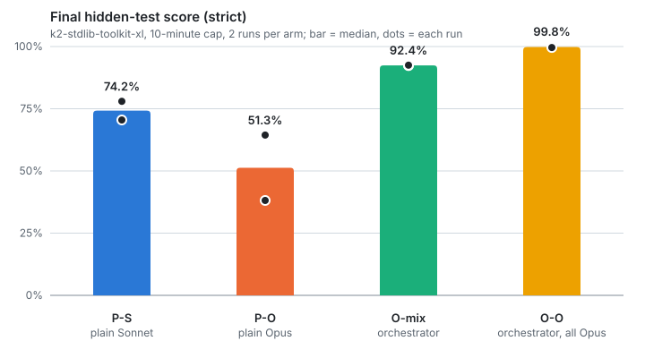
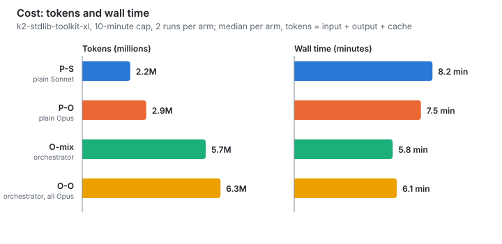
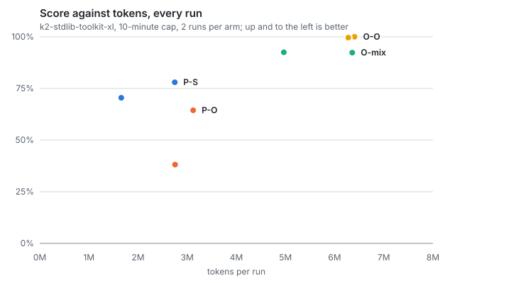
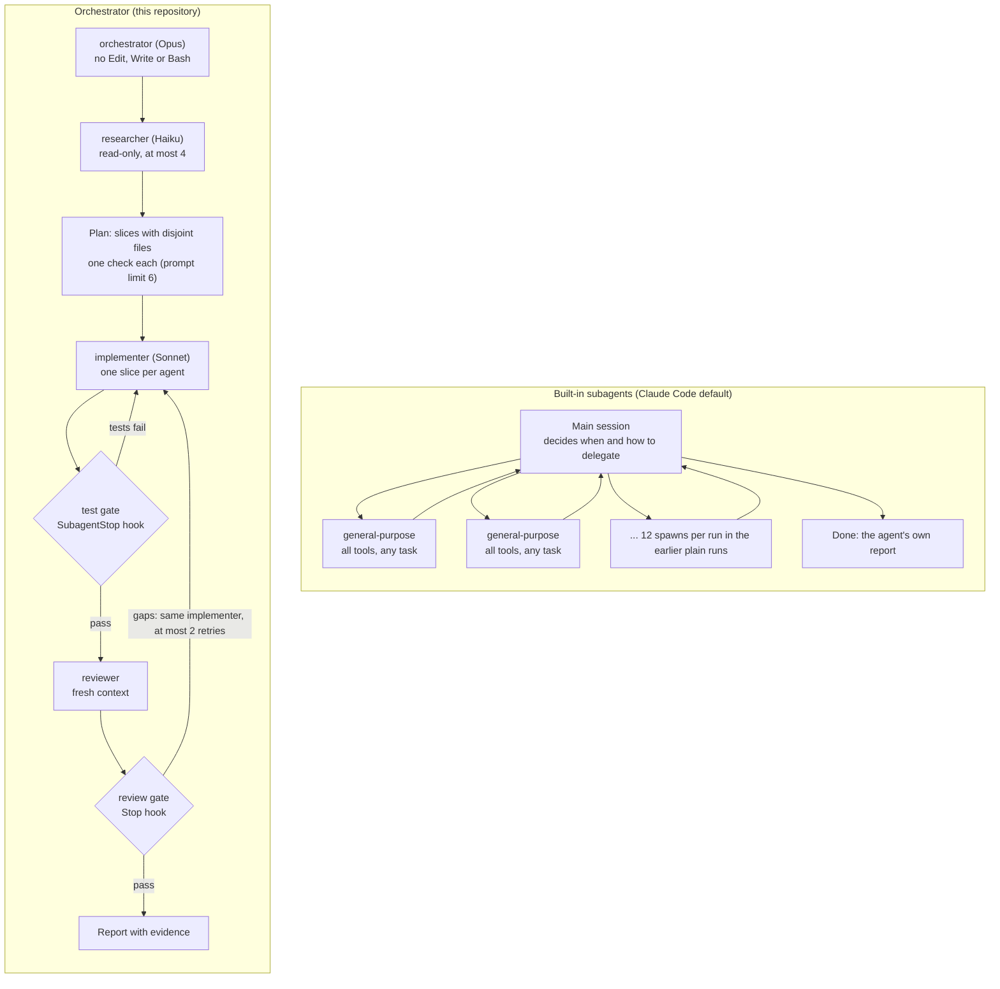

# Benchmark: orchestrator vs plain sessions, built-in subagents blocked

Date: 2026-10-15. Campaign `k2-cap10-nobuiltins`, repository commit `6f5bbcc`, Claude Code 2.1.299, plugin 0.1.6.

One hard, splittable task (twelve modules, 1,762 hidden tests) under a 10-minute wall-clock cap, four setups, two runs each. **Claude Code's six built-in subagents (`general-purpose`, `claude`, `Explore`, `Plan`, `claude-code-guide`, `statusline-setup`) were blocked in every arm**, so a plain session could not delegate and the orchestrator could only use this repository's own agents.

With two runs per arm this shows direction, not significance. Cost is in tokens (input, output, cache read and cache write, over every model), never money.

## Summary

| Setup | Strict score (median, runs) | Lenient score | Tokens | Wall time | Subagents per run |
|---|---|---|---|---|---|
| **P-S** plain Sonnet | 74.2% (78.0, 70.5) | 74.2% | 2.20M | 8.2 min | 0 |
| **P-O** plain Opus | 51.3% (64.4, 38.1) | 64.7% | 2.94M | 7.5 min | 0 |
| **O-mix** orchestrator, shipped models | 92.4% (92.3, 92.5) | 99.0% | 5.66M | 5.8 min | 21 to 22 |
| **O-O** orchestrator, all Opus | 99.8% (100, 99.6) | 99.8% | 6.34M | 6.1 min | 16 to 25 |

- Orchestrated against plain on the same models: **+18.2 points** for Sonnet (O-mix vs P-S, 2.57x the tokens, 2.4 min faster) and **+48.5 points** for Opus (O-O vs P-O, 2.16x the tokens, 1.4 min faster).
- No run hit the cap. The orchestrators finished in 4.8 to 7.4 minutes. The plain sessions ended on their own after 7.4 to 8.4 minutes with modules unfinished, and said so.
- Only O-O reached 100%, in one of its two runs.
- Both O-mix runs were classified as false successes (details in [Claims against results](#claims-against-results)).

<picture>
  <source media="(prefers-color-scheme: dark)" srcset="diagrams/bench-k2-cap10-score-dark.svg">
  
</picture>

<picture>
  <source media="(prefers-color-scheme: dark)" srcset="diagrams/bench-k2-cap10-timeline-dark.svg">
  
</picture>

## What was run

| | |
|---|---|
| Task | `k2-stdlib-toolkit-xl`: re-implement twelve Python standard-library modules (tomllib, shlex, re, csv, ipaddress, fractions, urllib.parse, base64, difflib, textwrap, json, calendar) from a spec, graded differentially against the real library by about 1,760 hidden tests the agent never sees |
| Cap | 10 minutes of wall-clock time per run (`cap10`), enforced by the runner |
| Arms | **P-S** plain Sonnet, **P-O** plain Opus (both `ORCH_AGENT=none`, no `.claude/` copied); **O-mix** the orchestrator as shipped (Opus orchestrator, Sonnet implementers, reviewers and integrator, Haiku researchers); **O-O** the same agents with every model set to Opus |
| Reps | 2 per arm, 8 runs in 2 blocks; the four arms of a block start together so they share rate-limit conditions |
| Built-ins | Blocked three ways: `permissions.deny` in `.claude/settings.json`, `CLAUDE_AGENT_SDK_DISABLE_BUILTIN_AGENTS=1` exported by `scripts/orchestrate.sh`, and the same deny rules in the user settings |
| Isolation | Every user-enabled plugin disabled in each run repo; the runner verifies it with `claude plugin list --json` before launching |
| Grading | Offline, on a snapshot every 2 minutes and on the final tree. The **strict** score is official: the task forbids importing `re` outside the regex module, and a module that does scores 0. The **lenient** score lets every module except `regex` import `re`, and shows capability without that one rule |
| Data | [summary.json](data/k2-cap10-nobuiltins.summary.json) (paths removed), [generated report](benchmark-builtins-blocked-report.html) ([markdown](benchmark-builtins-blocked-report.md)) |

## Results

### Cost

<picture>
  <source media="(prefers-color-scheme: dark)" srcset="diagrams/bench-k2-cap10-cost-dark.svg">
  
</picture>

<picture>
  <source media="(prefers-color-scheme: dark)" srcset="diagrams/bench-k2-cap10-tokens-score-dark.svg">
  
</picture>

The orchestrators spent about twice the tokens of a plain session of the same model family and bought 18 to 48 points for it. The shipped mix put most of its tokens on the cheaper model: in O-mix, 4.2M to 5.0M of the 5.0M to 6.4M tokens were Sonnet and 0.75M to 1.35M Opus.

### Every run

| Run | Strict | Lenient | Tokens by model | Wall | Subagents (max at once) | Modules fully passing | Modules scoring 0 | Gates: test block / review block |
|---|---|---|---|---|---|---|---|---|
| P-S r1 | 78.0% | 78.0% | 2.75M Sonnet | 504 s | 0 | 6 of 12 | regex, diff | none |
| P-S r2 | 70.5% | 70.5% | 1.66M Sonnet | 481 s | 0 | 7 of 12 | regex, ipaddr, diff | none |
| P-O r1 | 64.4% | 64.4% | 3.12M Opus | 442 s | 0 | 3 of 12 | toml, regex, ipaddr | none |
| P-O r2 | 38.1% | 65.0% | 2.75M Opus | 461 s | 0 | 3 of 12 | toml, regex, csv, ipaddr, fraction, wrap, jsonx | none |
| O-mix r1 | 92.3% | 98.7% | 5.01M Sonnet, 1.35M Opus | 417 s | 22 (12) | 8 of 12 | toml | 14 / 11 |
| O-mix r2 | 92.5% | 99.3% | 4.22M Sonnet, 0.75M Opus | 285 s | 21 (12) | 8 of 12 | toml | 14 / 9 |
| O-O r1 | **100%** | 100% | 6.41M Opus | 442 s | 16 (13) | **12 of 12** | none | 22 / 2 |
| O-O r2 | 99.6% | 99.6% | 6.28M Opus | 289 s | 25 (12) | 10 of 12 | none | 8 / 11 |

Subagent mix per orchestrated run: O-mix 12 implementers and 9 to 10 reviewers; O-O 12 to 16 implementers and 4 to 9 reviewers. No run used a worktree or the integrator. The orchestrators ran their twelve slices in parallel in the shared folder and said there was no time to merge worktree branches within the cap, so the worktree path was not exercised. They also used twelve slices where the prompt sets a limit of six.

### Why O-mix lost its points

In both O-mix runs the same module, `tomlparse`, scored 0 of 124 strict: it contains `import re` (checked in each run's final tree), which the spec forbids outside the regex module. Everything else passed or nearly passed, which is why the lenient score is 98.7% to 99.3%. The final messages of both runs list `re` among its imports without flagging it. No O-O module scored 0.

## Claims against results

A false success is a run whose final message claims success while the hidden grade fails (`bench/lib/claims.mjs`, automatic classification, no manual audit for this campaign).

| Setup | Runs | Claimed success but failed | Notes |
|---|---|---|---|
| P-S, P-O | 4 | 0 | Every plain run reported partial work. |
| O-mix | 2 | **2** | r2's final message says no module imports a forbidden module and lists `re` among the imports, while `tomlparse` imports it. r1's message is more careful: it says nobody ran the whole suite and that only one module was checked beyond the public examples. |
| O-O | 2 | 0 | Both reported partial work. |

The gates did not prevent this: the O-mix reviewers passed `tomlparse` with `import re` in it, and r2's message says the reviews checked imports for forbidden modules. In O-O r2 a reviewer did catch the same rule (`SPEC.md` rule 6) in four modules (`tomlparse`, `fraction`, `jsonx`, `urls`), and four fresh implementers removed the imports. Whether the difference is the reviewer's model (Sonnet in O-mix, Opus in O-O) or luck cannot be told from two runs; the briefs the orchestrators wrote were not examined.

## The same task with built-in subagents allowed

The earlier `cap10` cell in [benchmarks.md](benchmarks.md) used the same task and cap, with the built-ins allowed (campaign `sweeps`, commit `2863d1c`, plugin 0.1.5, 2 runs per arm).

| Condition | Setup | Strict score (median) | Tokens | Wall time | Subagents |
|---|---|---|---|---|---|
| A. Plain session, built-ins allowed | P-O | **99.7%** | 5.70M | 4.2 min | 12 `general-purpose` per run (median) |
| B. Plain session, built-ins blocked | P-O | 51.3% | 2.94M | 7.5 min | 0 |
| A. Orchestrator, built-ins allowed | O-mix | 85.1% | 4.98M | 3.6 min | implementer and reviewer only |
| C. Orchestrator, built-ins blocked | O-mix | 92.4% | 5.66M | 5.8 min | 21 to 22 |
| C. Orchestrator, built-ins blocked | O-O | 99.8% | 6.34M | 6.1 min | 16 to 25 |

Read across conditions with care: different campaigns, two runs each, a different plugin version.

- **Delegation is associated with the score.** The plain session scored 99.7% when it delegated to `general-purpose` by itself (A) and 51.3% when it could not (B). In this campaign the orchestrators, which always delegate, scored 92 to 100%, though the earlier orchestrator scored 85.1% (A), so delegation alone does not decide it. Two runs per arm across two campaigns cannot separate the causes.
- **Built-ins held their own here.** A plain Opus session that spawned built-ins freely matched the orchestrator's score and was faster (4.2 min against 6.1 min for O-O). This benchmark does not show the orchestrator beating built-in delegation on raw score.

## Why an orchestrator rather than the built-in subagents

The case for the orchestrator is control and verification, not a measured score win on this task. The built-in agents are generic workers the main session spawns as it sees fit. This repository's agents are role-limited, bounded and gated.



| Property | Built-in subagents | This orchestrator | Evidence from the benchmark |
|---|---|---|---|
| Roles and tool limits | `general-purpose` and `claude` are listed with all tools in Claude Code's agent list, whatever the job | The researcher is read-only; the orchestrator has no Edit, Write or Bash; the implementer owns one slice; the reviewer has no Edit or Write | Agent definitions in `.claude/agents/`. The reviewer still has Bash, so its "never modify files" rule is a prompt rule, not a tool limit |
| Fan-out limits | No prompt-level limit; the main session decides | A prompt rule: at most 4 researchers, 6 slices and 2 retries per slice. Tooling does not enforce it | Orchestrated runs spawned 16 to 25 subagents, 12 to 13 at once, and used 12 slices (one per module), twice the prompt's limit of 6. The earlier `cap10` plain runs spawned 12 `general-purpose` agents each |
| File ownership | No plan-level rule; workers share the folder | The plan gives each slice its own files, and no two slices own the same file | Not measured: all slices ran in the shared folder, and no collision analysis was done |
| Enforced gates | None: the agent's word is the only check | A test gate blocks an implementer that has failing tests; a review gate blocks the final reply until a reviewer has passed the last slice | The test gate blocked 8 to 22 times and the review gate 2 to 11 times per orchestrated run, and each block forced another pass |
| Independent review | None | A fresh-context reviewer that did not write the code | 3 to 10 reviewer rounds per orchestrated run. O-mix's reviewers missed the `re` rule; an O-O reviewer caught it in four modules (see above) |
| Model per role | One generic worker type | Opus plans, Sonnet builds and reviews, Haiku researches (`src/config.ts`) | O-mix put 79 to 85% of its tokens on Sonnet |

What the orchestrator costs:

- Roughly twice the tokens of a plain session of the same model family on this task (2.2x to 2.6x).
- A fixed overhead on small tasks. The earlier benchmark found 1.2x to 2.1x the tokens at the same 100% score, which is why the router sends small tasks to a plain session.
- Gates and reviewers are only as good as what they check: O-mix's passed a forbidden `import re` that an O-O reviewer caught.

What follows for routing, now that the built-ins are blocked: a plain session cannot fan out, so on a large splittable task it finishes few modules (3 to 7 of 12 fully passing here). That strengthens the router's rule to send large splittable work to the orchestrator and keep the plain route for small tasks. It does not show the orchestrator is the better choice on small ones.

## Limits of this benchmark

- One task, Python, 12 independent modules: the best case for fan-out. Nothing here covers research, writing, analysis or operations, or tasks that do not split.
- Two runs per arm. The hypotheses defined in [bench/HYPOTHESES.md](../bench/HYPOTHESES.md) are all reported as inconclusive in the generated report, because they need other tasks and cells.
- All runs were headless. The plain runs had 1 to 2 tool calls each denied by permissions; the orchestrated runs had none.
- Plain Opus scored below plain Sonnet (51.3% against 74.2%). With two runs each, treat that as direction only; it was not investigated.
- The claim classification is automatic and was not audited by hand.
- The comparison with built-ins allowed (condition A) is across campaigns.

## Reproduce

```bash
npm run bench -- --matrix bench/matrix/k2-cap10.json --campaign k2-cap10-nobuiltins
npm run bench:grade -- runs/bench/k2-cap10-nobuiltins
npm run bench:grade -- runs/bench/k2-cap10-nobuiltins --variant lenient
npm run bench:analyze -- runs/bench/k2-cap10-nobuiltins
npm run bench:report -- runs/bench/k2-cap10-nobuiltins/summary.json
node bench/charts.mjs runs/bench/k2-cap10-nobuiltins/summary.json   # the SVG charts in docs/diagrams
```

The charts also rebuild from the committed `docs/data/k2-cap10-nobuiltins.summary.json`.
