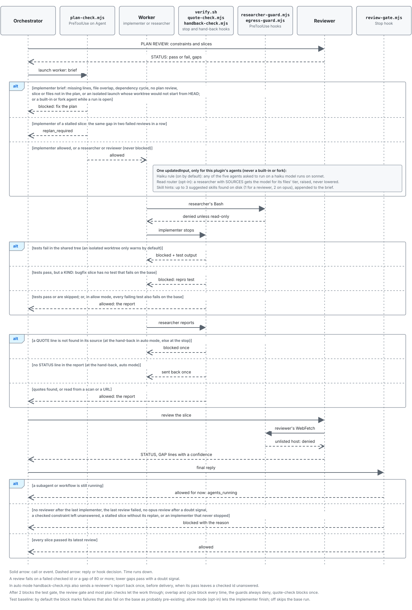
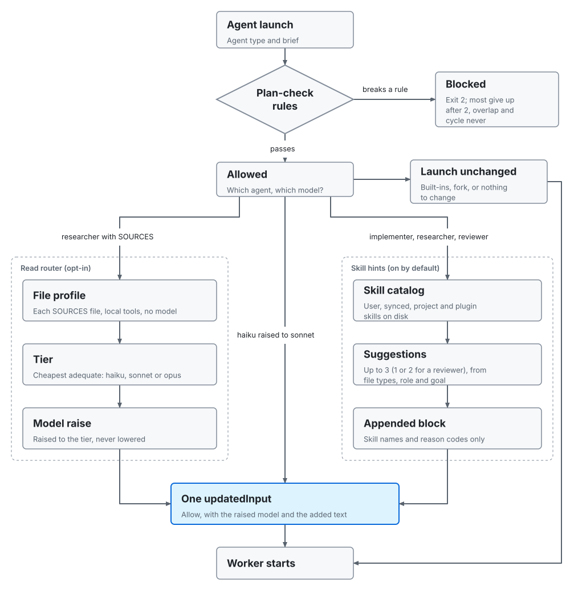

# Gates and guards

This page lists every gate and guard of the native orchestrator: what each one blocks, its reason codes, its loop guard, its switch and its limits. It is for maintainers who change a hook or need the exact rule. Terms are defined in the [glossary](glossary.md); switches and their defaults are in [settings.md](settings.md); the logs the gates write are in [logs.md](logs.md).

## Gates at a glance

A [gate](glossary.md#g) is a hook that blocks a worker launch, a worker's stop or the final reply until a check holds. A [guard](glossary.md#g) is a hook that narrows what one role may do. The order of the work is the orchestrator's prompt; the gates are what the code enforces.

- A hook blocks by exiting with code 2. Any other non-zero code only warns. Every hook exits 0 on malformed input.
- Every gate and guard only denies, with one exception: the [plan check](#plan-check) may also allow a launch and change it ([Plan check: how it changes a launch](#plan-check-how-it-changes-a-launch)).
- A `permissions.deny` rule always wins over any hook.

<picture>
  <source media="(prefers-color-scheme: dark)" srcset="diagrams/gates-sequence-dark.svg">
  
</picture>

| Gate or guard | Hook file | When it runs | What it blocks | Switch |
|---|---|---|---|---|
| [Plan check](#plan-check) | `plan-check.mjs` | PreToolUse on `Agent\|Task` (timeout 60 s) | An implementer launch that breaks the run's plan; a fork or built-in subagent while a run is open; a reviewer of a slice whose implementer has failing tests it never saw (1.6.1) | see the reasons |
| [Test gate](#test-gate) | `verify.sh` | SubagentStop of an implementer (timeout 900 s); with `--handback`, PreToolUse on `SubagentHandback` of an implementer ([Hand-back gate](#hand-back-gate), timeout 900 s) | The implementer's stop while the tests fail, or a `KIND: bugfix` slice without a reproduction test; at a hand-back, a report while the tests fail | `ORCH_TEST_CMD`, `ORCH_GATE_ISOLATED`, `ORCH_BASELINE`, `ORCH_BUGFIX_CHECK`, `ORCH_HANDBACK_GATE` |
| [Review gate](#review-gate) | `review-gate.mjs` | Stop of the main session | The final reply until every slice of the run has a passing review | `ORCH_ESCALATION`, `ORCH_STALL_GATE`, `ORCH_GAP_MIN` |
| [Report check](#report-check) | `handback-check.mjs` | PreToolUse on `SubagentHandback` (auto mode) | A [reply](glossary.md#r) with no STATUS line, or a reviewer's pass that leaves a checked id unanswered (once) | `ORCH_HANDBACK_CHECK` |
| [Quote check](#quote-check) | `quote-check.mjs` | PreToolUse on `SubagentHandback`, and SubagentStop of a researcher | A researcher reply whose `QUOTE:` text is not in its source (once) | `ORCH_QUOTE_CHECK` |
| [Researcher guard](#researcher-guard) | `researcher-guard.mjs` | PreToolUse on `Bash`, researcher only | Any researcher command outside its read-only list | `ORCH_GUARDS` |
| [Egress guard](#egress-guard) | `egress-guard.mjs` | PreToolUse on `WebFetch`, reviewer only | A reviewer fetch to a host its own work does not name | `ORCH_GUARDS` |
| [Workflow guard](#workflow-guard) | `workflow-guard.mjs` | PreToolUse on `Workflow`, every session | Every Workflow launch except this repo's saved `orchestrate` workflow, matched by content (a resume of it included): a script written on the spot (the `ultracode` keyword), any other script path, any other name | `ORCH_WORKFLOW_GUARD` |
| Skill gate | `skill-gate.mjs` | SubagentStop of an implementer (timeout 120 s) | The stop of a skill slice whose draft fails its checks; see [skills.md, The skill gate](skills.md#the-skill-gate) | `ORCH_SKILL_CREATE` |
| Native Bash judge | `judge-hook.mjs`, `prompt-capture.mjs` | PreToolUse on `Bash`, UserPromptSubmit | Pushes, remote changes and recursive deletes the person did not ask for (opt-in); see [bash-judge.md, Native hook](bash-judge.md#native-hook) | `ORCH_JUDGE` |
| [Turn warning](#turn-warning) | `turn-budget.mjs` | PostToolUse, no matcher | Nothing: advice at 80% of a worker's turns | `ORCH_TURN_WARNING` |
| [Context after compaction](#context-after-compaction) | `compact-context.mjs` | SessionStart, matcher `compact` | Nothing: puts the open run back in context | none |
| [Nudge](#nudge) | `nudge.mjs` | SessionStart (plugin only); UserPromptSubmit | A typed prompt holding the word `ultracode` (refused before any model turn); otherwise nothing: tells a new session to route its task | `ORCH_NO_NUDGE` (SessionStart text only); `ORCH_WORKFLOW_GUARD` (the refusal) |

Two more hooks write logs and never block: `journal.mjs` and `telemetry.mjs` ([logs.md](logs.md)). The gates read those logs, so a gate decides from records, never from what a worker says.

## Plan check

The plan check (`.claude/hooks/plan-check.mjs`) runs before every `Agent` or `Task` launch. It checks each implementer launch against the open [run](glossary.md#r) and its reviewed plan. It reads the first lines of the [brief](glossary.md#b): `SLICE: <id>`, `FILES: <owned files>` and `DEPENDS: <slice ids or none>` (parsed by `brief.mjs`).

- It checks implementer launches, and fork or built-in launches. A researcher or integrator launch is never blocked; a reviewer launch only by `tests_failed_after_report` (below).
- A brief with an `ORCHESTRATION: workflow` line (the [gated workflow](glossary.md#g)) is not checked.
- Every check is scoped to a run, not to the session ([Run scope](#run-scope)).
- Every decision goes to `plan-check.jsonl` with the run it was scoped to.
- A wave of launches sent in one message arrives at once. The read, decide and write steps run under a lock (an exclusive `mkdir`), so no launch misses its siblings. A lock older than 10 s is taken over; after 5 s without it the hook decides unlocked.
- No block message names a switch.
- A block is made only when the earlier records of `plan-check.jsonl` could be read and the block's own record reads back (2.0.1): the loop guard counts blocks from that log, so a block it cannot count would be made at every try. Otherwise the launch goes through and is logged as `<reason>_unrecorded`.

Reasons, in the order the code checks them:

| Reason | Blocks when | Loop guard |
|---|---|---|
| `builtin_agent_in_run` | A run is open (not stale) and the launch is a fork or a Claude Code built-in subagent: the names in `BUILTIN_AGENTS` in `.claude/hooks/builtin-agents.mjs` (seven since Claude Code 2.1.325), plus any learned on this machine. A launch with no `subagent_type` counts as the default built-in subagent. Plugin-namespaced and project agents pass. Outside a run it allows with `builtin_outside_run`. | 2 blocks per `subagent_type` and run |
| `missing_lines` | The implementer brief has no `SLICE:` or no `FILES:` line. | 2 blocks per run |
| `skill_create_off`, `skill_name_invalid`, `skill_repo_missing`, `skill_exists`, `skill_limit` | A `KIND: skill` brief fails one of the skill-slice checks. See [skills.md, What the plan check does](skills.md#what-the-plan-check-does). | 2 blocks per reason and slice |
| `no_plan_review` | No reviewer of this run's PLAN REVIEW brief has stopped yet. `PATH: light` skips this wait, but only for a run's single slice. | 2 blocks per slice (counted with `light_path_multi`); the give-up opens the gate for the run |
| `light_path_multi` | A `PATH: light` brief while another slice already ran in scope, or while the open run is a planned run with more than one planned slice. The message names those slices. | as `no_plan_review` |
| `replan_required` | The slice is a [stalled slice](glossary.md#s) and no REPLAN plan review has finished since ([Stall gate](#stall-gate)). | 2 blocks per slice since the slice stalled |
| `not_in_plan` | In a planned run whose plan has slice lines: the SLICE is not planned (or added by a REPLAN), or its FILES are not inside its planned FILES. Without plan slice lines, or for a planned slice without FILES, the check is skipped and the skip is logged. | 2 blocks per slice |
| `file_overlap` | A FILES entry overlaps a file another slice of the run owns, and the two slices are in no order in the run's DEPENDS graph, either way. Also when a retry's DEPENDS line drops the only order between two other slices that share a file. | blocks every time |
| `dependency_cycle` | DEPENDS closes a cycle in the run's order graph. | blocks every time |
| `worktree_base_not_head` | The launch has `isolation: "worktree"`, the effective `worktree.baseRef` is not `"head"`, and HEAD differs from `refs/remotes/origin/HEAD`. The worktree would start from the remote default branch and miss the checked-out work. | 2 blocks per slice |
| `tests_failed_after_report` (1.6.1) | A launch of this plugin's reviewer whose brief names `SLICE:` and is not a PLAN REVIEW, while the test-gate record of the latest stop of the slice's latest implementer is a block for failed tests (`tests_failed`, or a record with no reason) and that implementer has not started since (a `SendMessage` resume is a start). The message gives the gate's reason, the failing-test counts its record holds, and the agent id to resume. A `bugfix_` block never refuses. Only the implementers of the run the review lands in count: the latest run that holds the slice, as the run model places a review; a slice carried whole into a new plan keeps its implementers, one that starts clean has none. The latest stop's test-gate record is matched to it by key and count since the agent's latest start, not by time, since the stop hooks run side by side and a fast gate record can carry an earlier time than telemetry's stop; since 2.0.0 the match follows the four rules under [The report comes first](#test-gate) (`stopGateOf` in `run.mjs`). A refusal is made only when its record in `review-hold.jsonl` was written and reads back, and (2.0.1) only when the earlier records of that log could be read; otherwise the launch goes through (an unreadable log is logged as `tests_failed_after_report_unrecorded`). Switch `ORCH_REVIEW_HOLD=off` (plugin setting `review_hold`). Records in `review-hold.jsonl`, never in `plan-check.jsonl`. | 2 blocks per slice, agent and block |

A launch that passes every check is allowed with `ok`, or `light_path` for a light launch before any plan review. A give-up is allowed and logged as `<reason>_gave_up`.

**The order graph.** `file_overlap` and `dependency_cycle` read one graph, built by `planOrder` from the scope's allowed launches in log order.
- Each slice's edges are the DEPENDS of its latest launch. A retry's line replaces its earlier one.
- Two slices are ordered when one reaches the other through DEPENDS, directly or through other slices.
- On a retry, an entry naming a slice that already depends on the retried slice is dropped, so it is not a cycle.
- So a fresh retry of a slice that a later slice DEPENDS on is allowed.

**FILES entries.** `*` matches within one path segment, `**` across segments, `?` one character.
- An entry without glob characters stands for itself and everything under it, unless it exists on disk as a regular file.
- A `**` glob beside a name that does not exist yet counts as an overlap, since that name could become a folder.
- Two entries overlap when some path could match both.
- In `not_in_plan` a planned folder covers what is under it; a planned glob covers only what it matches.

**Path identity.** Entries are normalised against the project folder, so `./x`, `src/../x` and `/abs/proj/x` are one path.
- Each entry's fixed leading folders are resolved through symlinks as far as they exist.
- On a case-insensitive file system they are case-folded.
- A glob whose first wildcard segment is neither `**` nor the last also stands for each symlinked folder that segment matches, up to 32 (`ALIAS_CAP`).
- More links, or a folder that cannot be listed, cannot be decided and count as an overlap.
- Since 2.0.0 `file_overlap`, not `not_in_plan`, also reads a symlink reached through `**` or a wildcard segment after the first, a hard link, and the NFC and NFD forms of one name.
- What this does not see is under [Limits](#limits).

**`worktree.baseRef`.** The effective value is the first of these that sets it: `<project>/.claude/settings.local.json`, `<project>/.claude/settings.json`, the user `settings.json` (`<CLAUDE_CONFIG_DIR or ~/.claude>/settings.json`). An unreadable settings file or commits it cannot resolve let the launch through.

### Plan check: how it changes a launch

<picture>
  <source media="(prefers-color-scheme: dark)" srcset="diagrams/worker-launch-dark.svg">
  
</picture>

The plan check is the only hook that ever returns an allow. It returns `permissionDecision: "allow"` with `updatedInput`, because `updatedInput` takes effect only with allow or ask, and ask cannot be answered in a [headless run](glossary.md#h). All the changes below go into that one `updatedInput`:

| Change | What it does | Who gets it | Switch |
|---|---|---|---|
| No-haiku rule | A model in the haiku family is raised to sonnet | Any of this plugin's or project's five agents, on every allow | `ORCH_ALLOW_HAIKU=1` turns it off |
| [Read router](#read-router) | Raises a researcher's model to the tier its sources need, and adds a note listing the converted text files | Our researcher, when the brief names `SOURCES:` | `ORCH_READ_ROUTER=on` turns it on |
| Coverage note | Asks the researcher to read every file in full and end its reply with a `FILES-READ:` line, listing a file not read under OPEN | Our researcher, when `SOURCES:` names two or more local regular files | `ORCH_SOURCES_NOTE=off` turns it off |
| Skill suggestions | Appends a block naming installed skills; see [skills.md, Suggestions](skills.md#suggestions). Bug words in the goal do not suggest the bugfix skill when every FILES entry is prose or the brief has a KIND other than `bugfix`. | Our implementer (only on `ok` or `light_path`), researcher and reviewer | `ORCH_SKILL_HINTS=off` turns it off |
| Test gate pending note (1.6.1) | Appends one line: the test gate has not reported yet on the slice's latest implementer stop, so the reviewer must not rest a pass on the tests having passed and says so in its report. Nothing is added once the gate has reported. | Our reviewer, when its brief names `SLICE:` (not a PLAN REVIEW) and the slice's latest implementer of that run stopped and no test-gate record is paired with that stop yet: the gate has not logged one, or since 2.0.0 the pairing cannot tie one to it (pending, below), and (2.0.1) the stop is younger than the gate's window (`stopGateWindowMs`, 600 s by default). Past the window, or when the stop's record is `test_gate_error` (a gate ended by a TERM at its hook timeout logs it since 2.0.1), the no-result note replaces it: the gate left no result and is no longer running, with the same instruction (`test_gate_no_result`). A gate killed with SIGKILL leaves no record and gets the no-result note once the window has passed. | `ORCH_REVIEW_HOLD=off` turns it off |
| Skill facts and DRAFTS lines | Appends the draft worktree facts to a skill slice, and one line per draft named on `DRAFTS:`; see [skills.md, What the plan check does](skills.md#what-the-plan-check-does) | Our implementer, researcher and reviewer | `ORCH_SKILL_CREATE=off` blocks skill slices |

Rules that hold for every change:
- Never for a built-in subagent, fork, the integrator (except the no-haiku rule), or another plugin's agent.
- Never for a launch it blocks.
- It may raise a model the orchestrator chose. It never lowers one.
- A text block in which any line would parse as a brief or reply line is dropped.

**No-haiku rule.** The model looked at is the call's `model`, else the agent file's `model:` line. An agent file copied from an older version may still name haiku.
- Any id with the word `haiku` between non-letters counts, so older and provider-prefixed ids are raised too (for example `claude-3-5-haiku-20241022`).
- `CLAUDE_CODE_SUBAGENT_MODEL` is the person's own setting and is left alone.
- Each raise is logged to `model-floor.jsonl`.

### Read router

Off unless `ORCH_READ_ROUTER=on`. For a launch of our researcher whose brief names `SOURCES:`, the router profiles each file and picks the cheapest model tier that reads it well (`READ_TIERS`, re-exported by `src/config.ts`).

- **How it profiles.** `file-profile.mjs` uses local tools only (poppler and unzip) and calls no model.
- **PDF.** A good text layer is haiku. A scanned or thin text layer, tables, multi-column pages, figures or empty pages make it sonnet. A PDF of 50 or more pages with `READ: judge` is one whole-document read on opus.
- **Office files.** An xlsx with formulas or merged cells, a docx with tables, or an image-heavy docx or pptx is sonnet. Plain ones are haiku. An xlsx cell beyond column XFD (16,384) is skipped.
- **Brief lines.** `READ: lookup` and `extract` ask for haiku at least, `judge` for sonnet. A `RISKY: yes` brief makes it opus. The overall tier is the highest of these.
- **Which model it compares.** The launch's `model`, else the agent file's `model:` line, else `CLAUDE_CODE_SUBAGENT_MODEL`. When the tier ranks above it, the launch gets the tier's alias. An `inherit`, missing or unrankable model is left alone, and fable is never chosen or changed.
- **Effect today.** The researcher starts on sonnet, so a haiku tier changes nothing.
- **Cache.** Text conversions are cached under `<state dir>/read-cache`, keyed by path, size and mtime. A note listing them, with each PDF's hard pages, is appended to the brief.
- **Time.** Profiling runs in a child process with a 15 s budget (`ORCH_READ_ROUTER_BUDGET_MS`, at most 40000, so the hook decides before its 60 s timeout). An error or a timeout skips routing.
- **Symlinks.** A `SOURCES:` path inside the project whose real path is outside it is tiered by its extension and never read or cached.
- **Log.** Each decision goes to `reads-route.jsonl`: tier, models, reason codes, counts and paths, never brief or file text.

Checked live once: a researcher brief naming a scanned PDF was raised from haiku to sonnet. Its one benchmark is in [bench/README.md, Read router benchmark (route-040)](../bench/README.md#read-router-benchmark-route-040).

## Test gate

The [test gate](glossary.md#t) (`.claude/hooks/verify.sh`) runs the project's tests when an implementer stops, and blocks the stop while they fail. It runs in the implementer's own folder (its worktree, when it has one). The same script also runs when an implementer hands its report back ([Hand-back gate](#hand-back-gate)).

What it does at a stop:
1. Finds the test command ([Runner detection](#runner-detection)). No command: it allows with `no_test_command`.
2. Skips the tests when only prose changed (below).
3. Waits for the project's suite lock ([Time budget and suite lock](#time-budget-and-suite-lock)).
4. Runs the tests.
5. Tests fail: it compares the failures with the base ([Test baseline](#test-baseline)) and blocks with the last 40 lines of output.
6. Tests pass: for a `KIND: bugfix` slice it checks the reproduction test ([Bugfix check](#bugfix-check)), else it allows with `tests_passed`.

**The event (2.0.1).** node parses the hook event once and the gate reads its top-level string fields (`agent_type`, `agent_id`, `session_id`, `cwd`, `tool_name`, `tool_use_id`). Until 2.0.1 a text match read the last `"agent_type"` in the event, and at SubagentStop Claude Code lists the session's running agents in `background_tasks` after the agent's own fields, so a stop whose list ended with a reviewer was read as the reviewer's and left with no record ([probes stop-gate](data/probes-2.0.1-stop-gate.md)). Input that node refuses (not a JSON object: `null`, an array, a string, broken JSON, nothing) exits 0 before anything runs; without node the old text match is used. Once the event is an implementer's the gate is armed, and any exit with no decision (a crash, an error exit, a failed `cd` into the agent's folder, a TERM, INT or HUP such as Claude Code's hook timeout) logs allow `test_gate_error`, with `"interrupted":1` after a signal. A SIGKILL writes nothing ([Limits](limits.md), I).

**Prose-only skip.** It skips the tests and logs `no_code_changes` only when all of these hold:
- `ORCH_TEST_CMD` is unset. An explicit test command always runs.
- The implementer's folder is in a git work tree.
- Every changed path in `git status` (staged, unstaged or untracked) is prose: `.md`, `.markdown`, `.rst`, `.adoc` or `.txt`, in any case.
- In an [isolated worktree](glossary.md#i), every path the slice committed since its fork point is prose too. A fork point it cannot find keeps the tests.

These are not prose, so the tests run:
- `.mdx` (it is JSX).
- `CMakeLists.txt`, and any `.txt` whose path names `requirements` or `constraints` (build and dependency files).
- Anything under a folder named `test`, `tests`, `testdata`, `__tests__`, `spec`, `fixtures`, `__fixtures__`, `golden`, `snapshots` or `__snapshots__`, whatever its extension.

A rename or copy is judged by both its old and new path. Any doubt keeps the tests: a clean tree, a folder outside git, a failing `git`. The gate never reads the triage fact `code` and never reads what the worker says. So work that changes no code still runs the tests outside git, with `ORCH_TEST_CMD` set, or when a non-prose file (a `.csv`, say) changed.

**Blocks.** A failing run blocks with `tests_failed`. After 2 such blocks for one implementer, counted since its latest SubagentStart, it allows with `max_blocks_reached`. A `SendMessage` resume starts the implementer again, so each attempt gets its own two blocks. With no start recorded, every block counts. A stop with no agent id (2.0.1) counts its `tests_failed` blocks over the whole session, as one agent's. The count is read by `countBlocks` in `bugfix-check.mjs`; when `gates.jsonl` exists and cannot be read it returns `null` (2.0.1) and `verify.sh` counts with `grep -a` instead (`-a`, since a NUL byte from a torn write makes grep call the log binary), so the cap holds whenever either reader can read the log. pytest exit code 5 (no tests collected) allows with `no_tests_collected`.

**The report comes first (1.6.1).** The journal records the implementer's stop, and its report reaches the orchestrator, when SubagentStop starts; this gate then runs the suite for minutes, so a block lands after the worker has ended. The worker never sees that block until it is resumed. (Where the worker hands its report back with `SubagentHandback`, the [hand-back gate](#hand-back-gate) runs the suite first and can send a failing run back while the worker still runs; the SubagentStop gate still decides.) The [plan check](#plan-check) therefore refuses the slice's reviewer while such a block stands (`tests_failed_after_report`) and adds a note to a reviewer launched while the gate is still running; the [review gate](#review-gate) still holds the final reply (`implementer_unfinished`), as before. The two hooks match a block to a stop differently: the plan check pairs a gate record with its stop (`stopGate`, `stopGateOf` in `run.mjs`), while the review gate keeps comparing times (`testBlocked`). Since 2.0.0 the pairing has four rules: a record belongs to a stop for certain only when both carry the same hand-back id (`after_handback`); otherwise any failed-tests block since the agent's latest start holds the review, except a record that carries the hand-back id of another of the agent's stops; a pass stands only when it is the only candidate; anything else is pending (the reviewer gets the note). Since 2.0.1 the pending note (`test_gate_pending`) is given only while the gate may still be running: the stop is younger than `stopGateWindowMs` in `run.mjs` (the gate's budget as `verify.sh` computes it, 540 s by default, plus 60 s for its worst overrun and the log write). Past that window with no paired record, or when the stop's record is `test_gate_error` (`NO_RESULT_REASONS`), the reviewer gets the no-result note instead: the gate left no result that can be tied to the stop and is no longer running (`test_gate_no_result` in `review-hold.jsonl`). Both notes tell the reviewer not to rest a pass on the tests. Records of the hand-back gate and records from before the agent's latest start are never a stop's record. What the two hooks share, in `run.mjs`, is the reading of the logs (`implementerTestStates`) and the classification of block reasons (`notTestFailure`; the review gate also `environmentBlock`). The choice of the slice's implementers (`implementersOfRun`, `latestImplementerOf`) is the plan check's alone.

**Block records (2.0.0).** A failed run's records carry `failed_count`, up to 10 `failed_tests`, `failed_crash` and `output`: a file under `<state dir>/test-output/` that keeps the last 64 KiB of the run's output. The newest 10 such files are kept; the folder is 0700 and each file 0600, also when an older run left them open. A test suite that prints a secret leaves it there ([Limits](limits.md)).

**Whole suite once per stop.** The test gate runs the whole suite at every implementer stop (or, at a stop right after a hand-back, may reuse the hand-back gate's run of the same unchanged tree), and the integrator runs it once more after the merge. So a slice's [acceptance check](glossary.md#a) is the narrowest command that proves the slice, and a brief never also asks a worker to run the whole suite.

### Runner detection

`.claude/hooks/test-cmd.sh` picks the test command. The first match wins:

| Order | Condition | Command |
|---|---|---|
| 1 | `ORCH_TEST_CMD` is set | that command |
| 2 | `package.json` has a test script other than npm's placeholder (`echo "Error: no test specified" && exit 1`) | `npm test --silent` |
| 3 | `test_*.py` or `*_test.py` files exist (up to 4 folders deep) | `python3 -m pytest -q`, or `python3 -m unittest discover -q` when pytest is not installed |
| 4 | `Cargo.toml` exists | `cargo test --quiet` |
| 5 | `go.mod` exists | `go test ./...` |
| 6 | `Package.swift` exists | `swift test` |
| 7 | `Makefile` or `makefile` has a `test:` target | `make test` |

None found: the gate allows with `no_test_command`.

### Test gate in worktrees

An isolated worktree is `<project>/.claude/worktrees/<x>` and nothing else. A session started with `claude --worktree` runs in a folder under `.claude/worktrees/`, but it is its own project folder: the gate treats it as the [shared folder](glossary.md#s). Its implementers get `tests_failed` blocks, and their base is that session's HEAD.

In an isolated worktree, sibling slices may not be merged yet, so the tests can fail for reasons the slice does not own. `ORCH_GATE_ISOLATED` decides:

| Value | Effect |
|---|---|
| `warn` (default) | Runs the tests, logs `tests_failed_isolated` on failure and never blocks. That record is a [doubt signal](#doubt-signals). |
| `block` | Gates the worktree like the shared folder. |
| `skip` | Does not run the tests; logs `isolated_skipped`. |

The base of an isolated worktree is its fork point from the main worktree's HEAD. The integrator's run of the whole suite on the merged result is the real gate.

### Time budget and suite lock

**Why.** Claude Code fails a subagent that makes no progress for its stall limit, and time in a stop hook counts. The limit is `CLAUDE_ASYNC_AGENT_STALL_TIMEOUT_MS`, default 600000 ms (600 s). A hook killed at its own 900 s timeout does not block. So the gate must finish before both.

**The budget.** The whole hook ends within `ORCH_HOOK_BUDGET_S` seconds.
- Its default and its maximum are min(870, stall limit in seconds − 60), at least 1.
- With the stall limit unset that is 540 s.
- A larger setting is cut to the maximum; a smaller one is kept.
- The stall limit is read when it is a positive whole number of milliseconds; otherwise it counts as 600 s.

**The suite lock.** One suite runs at a time per project.
- The gate takes `test-gate.lock` in its [state dir](glossary.md#s) before the test run. It holds it through the base run or bugfix check until the hook ends.
- The state dir comes from `CLAUDE_PROJECT_DIR`, never from the worker's folder, so every worktree of a project shares one lock.
- A waiting gate sleeps one second between tries. The wait counts against the budget.
- The lock is stale when its holder process is gone or it is older than 900 s. A holder killed with SIGKILL leaves its lock standing while its suite's process group still runs (2.0.0). One waiter at a time takes a stale lock over (`lock_takeover` in the record). Since 2.0.0 it never frees the lock's name: it hard-links the lock under a private name, checks that this snapshot is still the lock it judged stale, and then renames its own lock, written whole beforehand, over the name in one step and holds it. A takeover whose read of the lock is empty or fails (the name was free, or the file went before the read), or whose snapshot is another lock (the holder released and another gate linked its own), changes nothing and waits like any other round.
- The lock is released on every way out of the hook, and only while it still holds this hook's own token.
- A state dir where no lock can be made (missing, not writable, or no hard links) lets the gate run its suite without one.

**The floor.** A suite run must still have min(120 s, budget / 4, the test run's own limit), at least 1 s, after the wait. 120 s is about what this repository's suite takes on an idle machine. When the time left falls to the floor while another gate still holds the lock:

| Where | What happens |
|---|---|
| Isolated worktree, `warn` mode | Logs `tests_failed_isolated` with `not_run: 1` and `lock_wait_s`, and exits 0. The run model counts it as an isolated test failure, so the slice needs an [opus review](glossary.md#o). |
| Shared folder, or isolated worktree in `block` mode | Runs the suite anyway, without the lock. It never skips. |

**The test run.** It gets min(`ORCH_TEST_TIMEOUT_S`, time left). `ORCH_TEST_TIMEOUT_S` defaults to 600, so with the default budget the time left (at most 540 s) decides.
- At the limit the test command and its children (its own process group) get SIGTERM, and SIGKILL 5 s later.
- The stop then blocks as `tests_failed` with `timed_out: 1` and `limit_s`, whatever status the suite exits with (`tests_failed_isolated` in an isolated worktree in `warn` mode).
- No base run follows a suite that timed out.

**The base run or bugfix check.** Each base run gets min(`ORCH_BASE_TIMEOUT_S` (default 300), its share of the time left less 10 s). A baseline that cannot run only loses its note; the block stays. A bugfix check that has no time left, or is stopped, blocks with `bugfix_timeout`. Its message names where the time went: the wait for another gate's suite when that wait took at least as long as the test run and the check together, else the run and the check.

**Worst cases**, for a budget B. A timed-out test run ends by B + 8 s (548 s by default, 878 s at most). A timed-out bugfix check ends by B + 20 s (560 s by default, 890 s at most). Both stay under the 600 s stall limit by default and under the 900 s hook timeout at most.

**A signal to the hook** (TERM, INT or HUP) ends the running test command or helper the same way (SIGTERM, then SIGKILL after 5 s), then exits. The lock is released only after the suite is gone.

### Test baseline

When the tests fail at an implementer stop and the tree has changes against its base, `bugfix-check.mjs` runs the same command on a clean copy of the base.
- The base is HEAD in the shared folder, and the fork point from the main worktree's HEAD in an isolated worktree.
- The copy is a detached worktree in the OS temp dir (prefix `orch-base-`), always removed afterwards.
- `node_modules` is linked in from the main worktree only when the lock files match; otherwise there is no base run.
- It runs under the project's suite lock and inside the gate's budget.
- Results are cached per base commit, command and run folder in `baseline-cache.json`, only when the run finished in time and passed or failed with names it could read.

`ORCH_BASELINE` picks the mode:

| Mode | Effect |
|---|---|
| `inform` (default) | The gate still blocks with `tests_failed`. The block message lists the qualified failing tests that also fail on the base as probably pre-existing. The record logs the counts `failing` and `on_base`. |
| `allow` (opt-in, heuristic) | The gate warns with `tests_failed_baseline` instead of blocking, when every failing test, qualified by its file or package, also fails on the base. In an isolated worktree it logs `tests_failed_isolated` instead (with `failing` and `base_failing`), so the doubt signal stays. |
| `off` | No base run. |

`allow` never allows, and the block stays, when:
- a failing test has no file or package (unqualified);
- a runner-level crash shows (suite failed to run, collection or import error, build failure, go `FAIL <pkg>` with no named test, a panic, vitest unhandled errors, a cargo binary crash or signal, a jest coverage threshold);
- the command is a unittest run with failfast (`-f`, `--failfast`, or `f` among combined short flags such as `-qf`);
- cargo stopped at a failing target: its last line is a rerun hint with no `error: N target(s) failed:` line after it;
- the base run timed out, could not use the main worktree's dependencies, or failed without names it could read.

Failing tests are read from the output of node `--test`, jest, vitest, pytest, unittest, go and cargo (also `cargo test --quiet`).

### Bugfix check

For an implementer whose brief says `KIND: bugfix`, after its tests pass, the test gate checks the reproduction test. It passes (`bugfix_verified`) when both hold:
1. At least one test file was changed or added against the base.
2. The base run with those files copied in shows at least one new qualified failing test that lives in a copied file, compared with the base run without them.

A test that fails on the base only as a whole file that does not load (an import or syntax error) does not count: the test body has to run and fail. A unittest reproduction test is verified at the first stop.

| Reason | Decision | When |
|---|---|---|
| `bugfix_verified` | allow | the reproduction test fails on the base |
| `bugfix_no_test` | block | no test file was changed or added |
| `bugfix_test_passes_on_base` | block | no new failing test on the base, or only a whole-file failure |
| `bugfix_base_unusable` | block | the base run could not be used |
| `bugfix_no_base` | block | no git base commit was found, or the test run there could not run |
| `bugfix_timeout` | block | the check had no time left in the budget, or was stopped |
| `bugfix_tmp_lost` | block | the gate's temp folder was removed while it ran, and the check's input or result was lost with it |
| `bugfix_unverified_gave_up` | allow | 2 `bugfix_` blocks for this implementer since its latest start |

When a base run cannot be used, the gate record carries a `cause`: `lock_mismatch` (naming the lock file), `worktree_add_failed`, `base_timeout` or `no_test_names`.

A lock file that differs from the base's is something no worker can fix, so since 1.6.1 `lock_mismatch` never blocks: the gate logs an allow with `bugfix_unverified_gave_up` and `"cause":"lock_mismatch"` at once. That is a doubt signal, so the slice needs a passing opus review.

The four environment blocks (`bugfix_base_unusable`, `bugfix_no_base`, `bugfix_timeout`, `bugfix_tmp_lost`) leave the implementer looking unfinished to the review gate. A later passing opus review of the slice clears that for the review gate only; the skip is logged as `implementer_unfinished:<slice>:<reason>_cleared_by_review`. `tests_failed`, `bugfix_no_test`, `bugfix_test_passes_on_base`, and a missing or unknown reason are never cleared that way.

- The check may make two base runs. They share what is left of the budget after the test run.
- Stopped at its limit, the helper gets SIGTERM (SIGKILL 5 s later) and removes its base worktree first.
- The bugfix cap and the `tests_failed` cap are counted separately.
- When the check has no time, only a `KIND: bugfix` implementer blocks; any other implementer passes.
- `ORCH_BUGFIX_CHECK=off` turns the check off.

### Hand-back gate

`verify.sh --handback` runs at PreToolUse on `SubagentHandback`, after the report checks (timeout 900 s), so a test failure goes back to the worker while it still runs. It acts only for this plugin's or project's implementer (the project copy takes the bare type, the plugin copy the namespaced one); every other hand-back, and one with no agent id, is left alone with no record.

- It runs the same steps as at a stop (prose-only skip, suite lock, test run, base run), except the bugfix check, which stays at the SubagentStop gate. Its test run keeps 30 s of the budget (`HB_RESERVE_S`) for the result cache.
- It refuses (exit 2, `tests_failed`) only for failing tests in the shared folder or in `block` mode, within the `tests_failed` cap it shares with the SubagentStop gate, and only while the agent has had fewer than two other hand-backs refused by any gate since its latest start (Claude Code asks a worker to resend a refused report at most three times). A refusal is made only when its record reads back, and it is marked in `handback-refusals.jsonl` (gate `test`), so the stop never takes that report's capture.
- Every other outcome lets the report through, logged, and the SubagentStop gate still runs and decides. Besides the allows and warns a stop can log (`tests_passed`, `tests_failed_isolated`, `max_blocks_reached` and the others below), these are its own: `handback_resend_cap` (the resend cap above); `handback_timed_out` (the suite ran out of time; stored as a timed-out block for the stop); `handback_lock_wait` (the time left fell to the floor while another gate held the lock; the stop then does not wait again); `handback_no_cwd` (the event's `cwd` is missing or not a folder); `handback_gate_off`; `handback_gate_error` (the hook ended with no decision: a crash, an error exit, a TERM at the hook timeout).
- Its records carry `"at":"handback"` and `handback_id` (the call's `tool_use_id`). The records of a stop that follows a hand-back carry `after_handback`, the same id.
- **Result cache.** The hand-back gate stores its outcome in `test-gate-cache.json` only when a listing of every entry of the work tree (and of the main checkout, for a linked worktree) taken right after the run equals the one taken right before it; the record's `store` says `stored` or why not. The SubagentStop gate that follows takes the outcome, once, only when its own listing equals the stored one, the tree key is the same, it belongs to the agent's latest hand-back since its latest start and it is at most 30 s old (`REUSE_MAX_S`). A reused pass logs `tests_passed_cached`; a reused fail or timeout blocks as `tests_failed` with `reused` and `reused_from`; a stop that takes nothing says why in `reuse`. The rule and its limits are in the header of `.claude/hooks/test-gate-cache.mjs`.
- `ORCH_HANDBACK_GATE=off` turns the hand-back gate off (environment only; logged as `handback_gate_off`).

### Test gate reasons

Every decision goes to `gates.jsonl` with gate `test`, `agent_id` and `session_id`. A failed run's records also carry, since 2.0.0, `failed_count`, `failed_tests` (up to 10), `failed_crash` and `output` ([Block records](#test-gate)), and a gate that took over a stale suite lock adds `lock_takeover`.

| Reason | Decision |
|---|---|
| `tests_passed`, `tests_passed_cached`, `no_test_command`, `no_code_changes`, `no_tests_collected`, `isolated_skipped`, `bugfix_verified` | allow |
| `test_gate_error` (2.0.1) | allow, at a stop only: the gate ended with no decision (`"interrupted":1` after a signal). Not a doubt signal; the plan check gives the reviewer the no-result note |
| `handback_resend_cap`, `handback_timed_out`, `handback_lock_wait`, `handback_no_cwd`, `handback_gate_off`, `handback_gate_error` | allow, at a hand-back only ([Hand-back gate](#hand-back-gate)) |
| `max_blocks_reached`, `bugfix_unverified_gave_up` | allow (give-up; a [doubt signal](#doubt-signals)) |
| `tests_failed_isolated`, `tests_failed_baseline` | warn (never blocks) |
| `tests_failed`, `bugfix_no_test`, `bugfix_test_passes_on_base`, `bugfix_base_unusable`, `bugfix_no_base`, `bugfix_timeout`, `bugfix_tmp_lost` | block |

### Checked live

On 2026-11-16, in this repository, four isolated implementers of one wave stopped within two minutes (11:16:08 to 11:17:52 UTC). Each gate ran the whole suite and a base run at the same time as the other three. Three gate records came 554 to 590 s after their stops instead of about 120 s, each `tests_failed_isolated`. Two of them carry one failing test that also failed on the base under that load; the third has the reason only. Claude Code ended the fourth implementer as stalled after 600 s while its gate still ran, and no gate record exists for it. The suite lock and the budget under the stall limit come from this run ([fix-notes-gate-load.md](data/audit-2026-11-16/fix-notes-gate-load.md)).

## Review gate

The [review gate](glossary.md#r) (`.claude/hooks/review-gate.mjs`) runs at Stop of the main session. It blocks the final reply until every slice of the run has a passing review after its latest attempt, its checked ids answered, and any needed opus review and replan done.

It checks in this order and blocks on the first problem that still has blocks left. The block message lists every open problem.

| Order | Reason | Decision | When |
|---|---|---|---|
| 0 | `unparseable_input` | allow | the hook input is not JSON |
| 1 | `agents_running` | allow, not counted as a block | Stop's `background_tasks` lists a subagent, workflow or teammate that is running, pending or queued. Without `background_tasks` (older Claude Code), an agent with a SubagentStart and no later SubagentStop, younger than `ORCH_RUN_STALE_MIN`, does the same. The next Stop gates. |
| 2 | `no_telemetry` | allow | the state dir has no `telemetry.jsonl` |
| 3 | `no_implementer_in_session` | allow | no implementer stopped in this session and none is unfinished |
| 4 | `run_state_unreadable` | block | the run state cannot be folded from the logs |
| 5 | `implementer_unfinished` | block | an implementer launched with the Agent tool started and never stopped (a turn-limit stop fires no SubagentStop), or its latest test-gate record is a block with no later SubagentStop. It blocks until the implementer is resumed and stops, or a later implementer stop of the same slice takes over. The message names the test gate's reason (the text for `tests_failed` is unchanged); after one of the four environment blocks of the [bugfix check](#bugfix-check), a later passing opus review of the slice also clears it. |
| 6 | `no_reviewer_after_last_implementer` | block | per slice: no review after its latest attempt |
| 7 | `replan_required` | block | per slice: its latest counted review failed and it is a stalled slice ([Stall gate](#stall-gate)) |
| 8 | `last_reviewer_failed` | block | per slice: its latest counted review failed |
| 9 | `last_reviewer_no_status` | block | per slice: its latest reviewer returned no STATUS line. Such a reply does not pass; it is neither a pass nor a fail. |
| 10 | `constraints_unchecked` | block | per slice: a passing review left a `CHECKS:` id unanswered, or answered it fail. A brief without CHECKS skips this (logged). |
| 11 | `opus_review_required` | block | per slice: a doubt signal fired and no opus reviewer passed the slice after its latest attempt |
| — | `slice_failed_for_good` | allow | a slice whose latest review failed after 3 attempts is named in a `systemMessage`, so the reply reports it as failed |
| — | `reviewer_passed` | allow | every gated slice passed |

**Its own log (2.0.1).** A block is made only when `gates.jsonl` could be read and the block's record reads back from it. Otherwise the reply goes out with the same `systemMessage` as a give-up (the work is unverified) and the gate tries to log allow `<reason>_unrecorded`, so a log it cannot count never blocks every Stop.

**Which slices it gates.** Every slice of the latest run with an implementer attempt, plus the slice of the session's last implementer. A review counts by its counted status ([Gap cutoff](#gap-cutoff); [brief-grammar.md, Review counting](brief-grammar.md#review-counting)).

**Old rule as fallback.** When the session's last implementer has no slice in the run model (a [workflow agent](glossary.md#w), an old brief, a launch outside a run), the gate falls back to the old rule. A reviewer must have finished after that implementer with `STATUS: pass`. The same three reasons apply (`no_reviewer_after_last_implementer`, `last_reviewer_failed`, `last_reviewer_no_status`).

**A carried slice.** A slice that was final and passed in an earlier run and then fails a review in the new run has no attempt in the new run. The review gate therefore still allows with `reviewer_passed`. The plan check blocks an implementer of it that the new plan does not name (`not_in_plan`).

**What it does not see.** The review gate only sees implementers. When the orchestrator writes the result itself, no implementer runs; the orchestrator's prompt tells it to send that result to a reviewer first, and no hook checks that.

## Doubt signals

A [doubt signal](glossary.md#d) means a passing slice needs a second look. Any one of them makes the slice final only after an opus review passes after its latest implementer launch or stop. The review gate blocks with `opus_review_required` until then. The exact rule is [brief-grammar.md, Doubt signals](brief-grammar.md#doubt-signals); `doubtSignals` in `.claude/hooks/brief.mjs` computes them.

| Signal | When |
|---|---|
| `risky` | `RISKY: yes` on its planned slice or its implementer brief. Such a slice is reviewed on opus from the start. |
| `retry` | an earlier review of the slice counted as a fail |
| `read_answer` | its latest passing review answered a constraint with `(read)` |
| `open_items` | its latest passing review has a non-empty OPEN |
| `tests_failed_isolated` | a test-gate record `tests_failed_isolated` (including `not_run: 1`) belongs to its latest attempt |
| `test_gate_gave_up` | a test-gate record `max_blocks_reached` or `bugfix_unverified_gave_up` is later than the review its latest attempt followed: the attempt's tests were not shown to pass |
| `low_confidence_fail` | a review after its latest implementer said fail, but every gap was below the [gap cutoff](#gap-cutoff), so it counts as a pass |
| `always` | `ORCH_ESCALATION=always`: every slice carries this one signal |

- `ORCH_ESCALATION=off` turns every signal off.
- A review counts as opus when its model name contains `opus`, `fable` or `mythos`.
- One review recorded twice (a forced hand-back stop, `stop_hook_active` true) counts once: the second stop record carries `continues: true` and replaces the first, where it stands and with its attempt when an implementer stop of the slice came between (2.0.1). A reviewer woken after its delivered report that stops with no STATUS line adds no review ([brief-grammar.md, Continued stops](brief-grammar.md#continued-stops)).

## Gap cutoff

Reviewers write each gap as `GAP: <0-100> <text>`. The number is the reviewer's confidence that the gap is real. A gap with no number counts as 100.

A `STATUS: fail` review counts as a fail when it has any of:
- a gap at or above the cutoff (`ORCH_GAP_MIN`, default 80);
- a gap with no number;
- a failed checked id;
- no gaps at all (an old-style reply).

Otherwise every gap is below the cutoff, and the review counts as a pass with the doubt signal `low_confidence_fail`. `ORCH_GAP_MIN=0` makes every fail count. The validation step before a retry is in [native-mode.md, Retries](native-mode.md#retries).

## Stall gate

The stall gate works in native sessions only. A slice is stalled when a retry failed on the same gap again. The exact rule is [brief-grammar.md, Stall](brief-grammar.md#stall). In short:
- its latest counted review is a fail;
- the latest counted review of an earlier attempt is a fail too, with only fails between them;
- the two share a [gap key](glossary.md#g);
- no REPLAN plan review has finished since.

Then:
- The plan check blocks the slice's next implementer with `replan_required`.
- The review gate blocks the reply with `replan_required` instead of `last_reviewer_failed`.
- Both block until a REPLAN plan review runs, and both give up after 2 blocks (`replan_required_gave_up`).
- A slice whose third attempt fails still ends as `slice_failed_for_good`.
- `ORCH_STALL_GATE=off` turns the gate off.

## Run scope

Every gate check is scoped to a run, within one session. This is a short version; the exact rule is [brief-grammar.md, Run model](brief-grammar.md#run-model), computed by `foldRuns` in `.claude/hooks/brief.mjs` from the log records alone.

- **Opens.** A PLAN REVIEW launch without `REPLAN:` opens a planned run and closes any open run. A light-path implementer launch opens a light run when none is open. A PLAN REVIEW with `REPLAN:` extends the open run.
- **Closes.** When every slice is final. A slice is final when it failed for good, or its latest review passed and either no doubt signal fired or an opus review passed after its latest attempt. A closed run never reopens.
- **Waits for the opus review.** A sonnet pass that still needs its opus review keeps the run open. The opus review and any further launch of that slice join the same run.
- **Carried slices.** A new PLAN REVIEW that names a slice of the open run again hands it on:
  - not final, with implementer work and no later review that counts as a fail: it moves whole into the new run;
  - final and passed: it stays final in the new run until an implementer of it works there or a review of it there counts as a fail;
  - latest review counts as a fail, or failed for good: it starts clean.
- **Not closed by a prompt.** A new user prompt does not close a run.
- **Stale.** After `ORCH_RUN_STALE_MIN` minutes (default 30) with nothing running and no launch, stop or agent start, the run is stale. The plan check treats it as closed; the review gate still gates its unreviewed slices.
- **A missed opus review.** A run waiting for an opus review that never comes (for example after `opus_review_required_gave_up`) stays open until it goes stale. Until then a new light task is blocked with `light_path_multi` and an unplanned implementer with `not_in_plan`, each at most twice.

## Loop guards

A [loop guard](glossary.md#l) keeps a gate from blocking forever. After its limit the gate gives up: it lets the launch or reply through and logs the give-up.

| Gate | Limit | Give-up logged as |
|---|---|---|
| Plan check | 2 blocks per reason and scope (scopes in the [reason table](#plan-check)) | `<reason>_gave_up` |
| Plan check: `file_overlap`, `dependency_cycle` | none: blocks every time | — |
| Test gate | 2 `tests_failed` blocks per implementer since its latest start (a stop with no agent id: per session) | `max_blocks_reached` |
| Bugfix check | 2 `bugfix_` blocks per implementer since its latest start | `bugfix_unverified_gave_up` |
| Review gate | 2 blocks per reason since the last implementer stopped (a record with no reason counts for every reason) | `max_blocks_reached` for `no_reviewer_after_last_implementer`, `last_reviewer_failed`, `last_reviewer_no_status` and `run_state_unreadable`; `<reason>_gave_up` for `constraints_unchecked`, `opus_review_required`, `replan_required` and `implementer_unfinished`. The record is named after the first open problem. |
| Review gate: `implementer_unfinished` | 2 blocks and 1 give-up per implementer for the whole session, then it is left alone | `implementer_unfinished_gave_up` |
| Report check | 1 refusal per worker; none when its log cannot be read | — |
| Hand-back gate | the `tests_failed` cap above, and no refusal once two other hand-backs of the agent were refused since its latest start | `max_blocks_reached`, `handback_resend_cap` |
| Quote check | 1 block per researcher; the next stop always passes | — |
| Skill gate | 3 blocks | `skill_gate_gave_up` |
| Researcher guard, egress guard | none: deny every time | — |

The review gate's give-up carries a `systemMessage` saying the work is unverified, so giving up is never silent. Since 2.0.1 the plan check, the reviewer hold and the review gate make a block only when they could read their earlier records and the block's record reads back; otherwise they let it through as `<reason>_unrecorded` (the review gate with the same `systemMessage`). A give-up of the test gate is a doubt signal (`test_gate_gave_up`).

## Report check

The report check (`.claude/hooks/handback-check.mjs`) runs at PreToolUse on `SubagentHandback`. In auto mode a worker delivers its reply through that tool, so the check reads the reply before it is delivered.

| Reason | Sends the reply back when |
|---|---|
| `no_status` | the reply has no STATUS line (`parseStatus` in `brief.mjs`), for any of our four workers |
| `checks_unanswered` | a reviewer's passing reply leaves an id of its brief's CHECKS line without an answer line. The ids come from the reviewer's launch record, which a foreground launch does not have yet, so the check skips there. |

- It refuses a worker at most once, only with an agent id, and only when the record of the refusal was written and can be read back.
- Since 2.0.1 an earlier denial that cannot be ruled out counts as one: when `gates.jsonl` exists and cannot be read in full, the check does not refuse: it logs allow `<reason>_gave_up` with `log_unreadable`. When the tail read that confirms a deny record fails, the full read confirms it; a deny record that still does not read back is not returned, and an allow `<reason>_unconfirmed` with `voids` (the `ts` of that deny record) follows it in the log.
- The second reply always goes through, and the gates judge it as usual. A worker refused three times would end with no reply delivered; the check never refuses twice.
- Deny-only: it never changes the reply and never prints an allow or ask decision.
- It acts only for the bare worker types `researcher`, `implementer`, `reviewer` and `integrator`. A session in another permission mode has no `SubagentHandback` tool, and the gates read the reply at SubagentStop.
- It is not registered with `onFailure`: a crash must never hold a reply back.
- Decisions go to `gates.jsonl` as gate `handback`.
- A refused hand-back is marked in `handback-refusals.jsonl`, since 2.0.0 with the report's `report_key`. Such a capture is never taken as the stop's reply; when no other report follows, the stop record says the report was refused ([logs.md, Hand-back capture](logs.md#hand-back-capture)).
- `ORCH_HANDBACK_CHECK=off` turns the check off. The capture is written either way.

## Quote check

The [quote check](glossary.md#q) (`.claude/hooks/quote-check.mjs`) runs at a researcher's SubagentStop, and at PreToolUse on `SubagentHandback` before the reply is delivered. Records written there carry `at: "handback"`, and the SubagentStop that follows exits at once.

**What it does.**
1. It takes each `QUOTE: <locator> | <verbatim text>` line of the researcher's reply.
2. It searches the whole file the locator names, so a wrong line or page number does not fail a quote that is there. Locators: `path:line`, `path:line-line`, `path#L12`, `path p.N` (also `p. N`, `pp.`, `page`) or a bare path; a relative path is resolved against the project folder.
3. Text and code are read as they are. PDF, xlsx, docx and pptx are read through the read router's cached text conversion.
4. Text is compared after Unicode NFKC, lower-casing, straight quotes and dashes, dropping `*`, `_` and backticks, and collapsing whitespace. An ellipsis splits a quote into parts that must appear in order.
5. A quote not found is unverified. The check blocks the researcher once, asking it to correct the quote from the source or drop it and list the claim under OPEN. The next stop always passes. Since 2.0.1 it blocks only when its earlier records in `quotes.jsonl` could be read (an unreadable log counts as an earlier refusal) and, at a stop as at a hand-back, only once the refusal's record reads back.

**Unverifiable, never unverified** (these never block):
- URLs, images and other binary files;
- missing or unreadable files, and files over 64 MB;
- a PDF with no usable text layer (a scan), and a quote whose page has no text;
- a path whose real path is outside the project folder and the read cache.

A quote that cites a page the PDF does not have, with text not in the PDF, is unverified, not unverifiable. Counts and paths go to `quotes.jsonl`. `ORCH_QUOTE_CHECK=off` turns the check off.

## Researcher guard

The [researcher guard](glossary.md#r) (`.claude/hooks/researcher-guard.mjs`) runs at PreToolUse on `Bash` for the bare agent type `researcher`. It holds the researcher to its read-only command list.

**Why search runs through Bash.** On macOS and Linux Claude Code leaves the Grep and Glob tools out of an agent whose tools also name Bash. Without search in Bash the researcher could only read whole files.

**Allowed commands.** Every simple command (split on `;`, `&&`, `||`, `|`, `&` and newlines by the tokenizer of `judge-core.mjs`) must start with one of these:

| Command | Allowed form |
|---|---|
| `git log`, `ls-files`, `rev-list`, `rev-parse`, `status`, `show`, `branch --show-current` | as listed, each also as `git -C <dir> <one of those>` |
| `wc`, `ls`, `du` | plain |
| `grep`, `egrep`, `fgrep`, `rg` | long options from a fixed list only (`SEARCH_LONG`), so no `--filter`, `--pager`, `--pre` or config file; no `rg` short option containing `z`; no `grep` short option containing `Q` |
| `find` | no `-exec`, `-execdir`, `-ok`, `-okdir`, `-delete`, `-rm`, `-fprint`, `-fprint0`, `-fprintf` or `-fls` |
| `head`, `tail`, `cat` | long options from a short list (`PAGE_LONG`); no `tail` short option containing `f` or `F`, so no follow in any spelling |
| `sed -n` | only `sed -n '<N>p' <file>` or `sed -n '<N>,<M>p' <file>`: one line or one line range. `sed -i`, `sed -n '1w x'`, `sed -e` and a glob operand are refused, with a message naming the allowed form |
| `cut` | only `-b`, `-c`, `-f`, `-d`, `-s`, `--complement` and `--output-delimiter` (so no `-z`) |
| `stat` | long options from a fixed list (`STAT_LONG`) |
| `echo` | plain (redirection stays refused) |
| `cd` | `cd <one literal path>` (rules below) |

**Refused in every command:**
- any redirection, heredoc, command or process substitution, backtick, variable expansion, assignment or function definition;
- the one exception: a stderr redirection written exactly `2>/dev/null` or `2>&1`, as a word of its own, outside quotes (`2> /dev/null` with a space is refused);
- a glob in an option's name (`tail -?`, `rg -g*.md x`, `find . -delet[e]`), because the shell may expand it into another option. Quote the glob (`rg -g '*.md' x`) or use the long form (`--glob=*.md`); a glob in a long option's value (`--include=*.ts`) passes;
- anything the tokenizer cannot read.

A lone `--` never ends the option check, because it can be the value of an option (`rg -e -- --pre=sh x`). A pattern that starts with a dash is refused as the price of that.

**The `cd` rule.** `cd` passes only as a command of its own with exactly one literal path:
- The path starts with `./`, `../` or `/`.
- From every folder the shell may be in at that point, its physical location is the project folder or a folder inside it. The project folder is `CLAUDE_PROJECT_DIR`, compared by device and inode. The path exists from at least one of those folders.
- Both the logical reading (`..` removed as text) and the physical one (symlinks first) are judged, so no symlink and no `..` leads out.
- Later commands' relative paths, the device rule included, are judged from every folder the `cd` may leave the shell in.
- Refused: `cd src` (write `cd ./src`), `cd /`, `cd ~`, `cd ..` from the project root, a link leading out, a missing path, two words, an option, `-`, `+1`, a variable, a glob, a control character. Without `CLAUDE_PROJECT_DIR` every `cd` is refused.

**The device rule.** A command may not read `/dev` or anything under it, except `/dev/null` (nor, since 2.0.0, `/proc` or `/sys`). It covers the search and paging commands, `wc`, and the `sed -n` and `cut` forms.
- Each argument is judged: the word itself, a long option's value (`--file=x`), and every suffix of a short-option cluster (`-f/dev/zero`).
- A bare word counts as a path. `grep` and `rg` also judge `.`, which they search when given no path.
- The path is judged as text (with `.`, `..` and repeated slashes collapsed) and as the system resolves it, walked with lstat and readlink.
- A path whose walk passes through `/dev` is refused, whether or not its last part exists (except `/dev/null`).
- `/dev/null` passes, also through a link.
- Since 2.0.0 `/proc` and `/sys` are judged like `/dev`, a FIFO, socket or device operand is refused wherever it lies, and a word with a glob is judged on every path it may expand to (`cat /de?/zero` is refused), as well as on the literal path it spells.

**Always a decision.** A word over 4096 characters is refused. A walk over 20000 lstat calls is refused as too complex to judge. A decision never throws.

**Deadline and caps (2.0.0).** One decision has `DEADLINE_MS`, 10000 ms from the start of the hook process, checked at each segment, each listed name and each expanded path; Claude Code sets this hook no timeout, and a hook cancelled for time would not block, so the guard refuses first. Before the tokenizer runs, a command over `MAX_COMMAND` (65,536 characters) or with more than `MAX_BRACKETS` (256) of `[` and `{` is refused. Globs are expanded within 20,000 names per segment (`GLOB_ENTRIES`), 200,000 for the wide reading (`WIDE_ENTRIES`) and 400,000 names per decision (`TOTAL_NAMES`); past any of these, or past the deadline, the command is refused with the way around it (name the files, or quote the glob for the command). A `--files0-from` value of `du` and `-files0-from` of `find` is judged like an operand. The matcher reads bracket expressions as POSIX defines them (classes, collating symbols, equivalence classes, ranges, negation, a leading `]`); what it cannot parse exactly matches wider, and every glob word is also judged as the literal path it spells (`[a/b]`).

Deny-only: it exits 2 with the reason, or 0 with no output; the session's own permission rules then decide. Decisions go to `gates.jsonl` as gate `researcher`, with the first word of the refused command only. `ORCH_GUARDS=off` turns it off. It is not a boundary ([Limits](#limits)); run Bash in Claude Code's sandbox ([safety.md, Sandbox](safety.md#sandbox)).

**Checked live** on 2026-11-16, after the merge at commit d401009: a researcher ran `cd ./src && ls | head -3` (it listed `src`). Its next call `ls | head -3` listed the project folder again, because a worker's folder is reset between calls. `cd ../docs && ls | head -3` was refused with the `cd` message; `cd ./docs && ls | head -3` ran.

## Egress guard

The [egress guard](glossary.md#e) (`.claude/hooks/egress-guard.mjs`) runs at PreToolUse on `WebFetch` for the bare agent type `reviewer`. A reviewer holds untrusted input and an outward channel, so its fetches are kept to the hosts its own work names.

**Allowed hosts:**
1. Hosts of URLs in the reviewer's brief.
2. Hosts of URLs in the planned FILES of the brief's slice, from the session's open run (at most 1 MB read per file).
3. Hosts in the coordinator's message that resumed the reviewer (`SendMessage`): a later user record with `isMeta` true, `origin.kind` `"coordinator"` and string content. No other later record adds a host: not tool results, fetched pages, system reminders, skill bodies, task notifications, hook feedback or compaction summaries.

A host is compared lower-cased, without a leading `www.`, with its port when the URL names one that is not the scheme's default.

**Where the brief comes from.** The brief is the first user message in the reviewer's own transcript. With no readable brief (a headless run without session persistence keeps no subagent transcript), the reviewer's latest launch record in `journal-launches.jsonl` stands in. Its hosts are the `urls`, the host-shaped `sources` entries that are not existing paths, and its slice's planned FILES.

| Decision | When |
|---|---|
| allow (`host_in_brief`) | the host is in the allowed list |
| deny (`host_not_in_brief`) | any other host |
| allow, logged `egress_unverified` | no readable brief and no launch record of the reviewer either |

WebSearch is not gated. Decisions go to `gates.jsonl` as gate `egress`, with the host only. `ORCH_GUARDS=off` turns it off.

## Workflow guard

The workflow guard (`.claude/hooks/workflow-guard.mjs`, 1.6.0) runs at PreToolUse on `Workflow`, in the project's settings and in the plugin, for every session. Claude Code's keyword `ultracode` in a typed prompt, or a plain request for a workflow, makes the model write a workflow script on the spot and run it with Claude Code's own agents, outside the plan check, the run journal and the review rules. Claude Code's own off switches (the `disableWorkflows` setting, `CLAUDE_CODE_DISABLE_WORKFLOWS=1`) would also remove the saved workflows, and with them the [gated workflow](native-mode.md#the-gated-workflow). A plugin cannot ship `permissions.deny`. So the guard narrows the tool instead.

**Identity by content (1.6.1).** A saved name passes only when the file Claude Code loads for it matches one of two stored SHA-256 hashes in `.claude/hooks/workflow-hash.mjs` (CRLF read as LF): `PROJECT_WORKFLOW_SHA256` for `.claude/workflows/orchestrate.js`, `PLUGIN_WORKFLOW_SHA256` for the plugin's copy in `dist/plugin/workflows/`. After any edit of the workflow, run `npm run build-plugin`, then `node --test src/workflow-guard.test.mjs`, and paste the two hashes the test prints into `workflow-hash.mjs`.

**It stays silent (exit 0, no output) only for these shapes:**
1. A launch or a resume by name: `name` and optional `args` and `resumeFromRunId` (a run id of Claude Code's form, `wf_` then at least six of `[a-z0-9-]`), no other key, and
   - `name` exactly `orchestrate`: every one of `<CLAUDE_PROJECT_DIR>/.claude/workflows/orchestrate.js` and `<cwd>/.claude/workflows/orchestrate.js` that exists matches the project hash, and at least one exists;
   - `name` exactly `orchestration:orchestrate`, plugin copy of the hook: the plugin's own `workflows/orchestrate.js` matches the plugin hash;
   - `name` exactly `orchestration:orchestrate`, project copy: it cannot see where the plugin is installed, so it passes only in this repository's layout, where a project root holds both `.claude/workflows/orchestrate.js` with the project hash and `dist/plugin/workflows/orchestrate.js` with the plugin hash, and no root holds either file with other content. With the plugin on, the plugin copy steps aside (`duplicate()`), so here the project copy alone decides.
2. A resume by Claude Code's saved script copy: exactly `scriptPath`, `resumeFromRunId` and optional `args`, with an absolute `scriptPath` ending in `.../workflows/scripts/<anything>-<resumeFromRunId>.js`, a run id of Claude Code's form, and a file there that matches either hash.

Everything else is refused with exit 2:

| Reason | When |
|---|---|
| `inline_script` | the input has `script`: a script written on the spot (what the `ultracode` keyword produces) |
| `script_path` | the input has `scriptPath` in any other shape, or its file does not match |
| `name_not_allowed` | another name, Claude Code's bundled workflows included; names are compared exactly |
| `workflow_file_missing` | the name is allowed but its saved file is not there |
| `workflow_content_mismatch` | the saved file is there but matches neither stored hash |
| `workflow_unreadable` | a file at the path exists but cannot be hashed (unreadable, not a regular file, over 4 MB) |
| `plugin_not_located` | the project copy got `orchestration:orchestrate` outside this repository's layout |
| `unknown_shape` | no `tool_input` object, no string `name`, a key the guard does not know, a `resumeFromRunId` not of Claude Code's form beside `name`, or a crash while deciding (fail closed) |

**Observed shapes** (Claude Code 2.1.326; [live checks 2026-11-17](data/live-checks-2026-11-17.md), Check 5, and [live checks for 1.6.1](data/live-checks-2026-11-17-b.md), K9): a script written on the spot reaches PreToolUse as `{"script": "<the whole script>"}`; a saved launch as `{"name": "orchestrate", "args": {...}}`, and through a plugin as `{"name": "orchestration:orchestrate", "args": {...}}`; a resume by name as `{name, args, resumeFromRunId}`, which runs the saved file as it is now; a resume by file as `{args, scriptPath, resumeFromRunId}`, where `scriptPath` is Claude Code's saved copy, byte for byte the saved file.

- The block message says, in plain words, that workflows started by a keyword or written on the spot are off in this project and that the task goes through the orchestrator (the orchestrator agent, or the saved workflow, which the person starts). It names no switch.
- Deny-only: it never prints an allow. Input that is not JSON, another tool's event and another hook event exit 0. The plugin copy exits on `duplicate()` where the project registers its own.
- One record per decision in `workflow-guard.jsonl` in the state dir: `gate: "workflow"`, `decision`, `reason`, the workflow `name` (at most 80 characters) and the input's key names. Never the script or the arguments.
- `ORCH_WORKFLOW_GUARD=off` (plugin setting `workflow_guard`) turns it off.
- The [nudge](#nudge) refuses a typed prompt that holds the word `ultracode` before any model turn (1.6.1), so the keyword never reaches the model.

## Turn warning

`turn-budget.mjs` runs at PostToolUse with no matcher. A worker that reaches its maxTurns stops with no reply and fires no SubagentStop, so nothing tests or reviews its work. The turn warning tries to prevent that.

- It counts the turns of our researcher, implementer, reviewer or integrator from its own transcript, the same way telemetry counts them.
- The first time a worker has used 80% of its maxTurns, it adds this as context: "You have used N of your M turns. Commit your work and report now; list what is unfinished under OPEN."
- Once per worker: a marker under `turn-warnings/` in the state dir, keyed by session and agent id.
- It never blocks. Any failure exits 0 with no output.
- An sh pre-filter starts node only when the payload holds `agent_id`, so a main-session tool call starts no node process.
- `ORCH_TURN_WARNING=off` turns it off (environment only).

## Context after compaction

`compact-context.mjs` runs at SessionStart with matcher `compact` (PostCompact cannot add context). After a compaction it puts the open run back in context:
- the run's planned slices and their FILES;
- each slice's state: `passed`, `passed, opus review due`, `failed for good`, `retry due`, `review failed, replan required (n attempts)`, `reviewing` or `pending`, with its attempts;
- the constraint texts.

It is capped at about 1,500 characters. Over the cap the slice lines give way first. With no open run it prints nothing. It writes nothing.

## Nudge

The plugin's SessionStart hook `nudge.mjs` tells a new main session to route a non-trivial task first. That text blocks nothing. Details: [native-mode.md, The plugin](native-mode.md#the-plugin).

Since 1.6.0 the same file also runs at UserPromptSubmit, in the project and the plugin (the plugin copy exits on `duplicate()` where the project registers its own). 1.6.0 added one line of context to a typed prompt holding the word `ultracode` (a whole word, any case). Since 1.6.1 it refuses such a prompt instead (`{"decision":"block"}`): the prompt never reaches the model, and the message says to type the request again without the word or to use the orchestrator. A question that only names the word ("what is ultracode?") is refused too. `ORCH_WORKFLOW_GUARD=off` turns this refusal off along with the guard. `ORCH_NO_NUDGE` does not.

The event also fires for a subagent's report, a task notification and another session's message, with no field that says so. `typedPrompt` in `state.mjs` decides by how the text opens, and the refusal applies only to a typed prompt. A prompt is not typed when it opens with one of these, whatever follows:
- a header line: `Another Claude session sent a message:`, `Another session ...`, `A peer session sent a message ...` (with or without `while you were working`), `The <name> plugin sent a message:` and its `while you were working:` form, `The coordinator sent a message while you were working:`, `Your background observer (<x>) sent a report`, `A message arrived in the bound thread while you were working:`;
- a tag: `<task-notification>`, `<system-reminder>`, or any `<...-message>` tag (`agent-message`, `peer-message`, `teammate-message`, `channel-message`, `cross-session-message`).

An origin-like field naming a non-person source counts too, in case Claude Code adds one. A person who types such an opening is skipped as well. A prompt that only mentions one further down is typed. The transcript is not read: a probe showed the prompt's own record is written after the hook fires ([live checks for 1.6.1](data/live-checks-2026-11-17-b.md), K3). Such a message is never refused, and gets no context line.

## Limits

What each gate and guard does not catch. [safety.md](safety.md) links here.

**Guards in general**
- The guards narrow what a researcher or reviewer can do. They are not a security boundary: Bash can still reach the network. Run implementer and reviewer Bash in Claude Code's sandbox with a network allowlist.

**Workflow guard**
- A typed prompt with `ultracode` is refused before the model sees it (1.6.1). A plain request for a workflow still reaches the model, and a refused model may do the task another way: in probe (b) of Check 5 it fell back to launching subagents itself, which the plan check blocks only while a run is open and the project's `permissions.deny` blocks only where it is copied.
- A hook that does not load guards nothing: a session with neither this project's `.claude/settings.json` nor the plugin, or with hooks turned off.
- A file changed between the guard's check and Claude Code's read of it is not seen.
- When the project copy decides the plugin name, it checks the built copy in `dist/plugin`, not the installed plugin's file: an installed plugin of another version is trusted as installed. Any project that holds both matching files meets that rule.
- The refusal tells a typed prompt from a report or notification by its opening text only (Claude Code documents no field for it): a new kind of message, or a changed opening, counts as typed until `typedPrompt` learns it, and a person who types such an opening is skipped.

**Plan check**
- `file_overlap` and `dependency_cycle` block every time, with no give-up. A plan that cannot be fixed stalls those launches until the orchestrator changes the plan. A retry of a planned slice is judged against the run's DEPENDS order, so a sound retry passes; a broken plan still blocks every time.
- Path identity does not see every name of one file. Since 2.0.0 `file_overlap` reads a symlink reached through a `**` segment or a wildcard segment after the first (`**/link/a.ts` or `t*/l*/a.ts` beside `src/a.ts`, where `link` points to `src`), a hard link, and two Unicode normal forms (NFC, NFD) of one name (`src/plan-check-paths.test.mjs`, the `w3 item 4` tests). Still out of reach (the comment on `canon()` in `plan-check.mjs`): a link or hard link made after the launch, a hard link whose other name lies outside every entry's walk, and, in `not_in_plan`, every name that reading adds; a launch naming such a name is refused there as before.
- An `Agent` call without `subagent_type` counts as a built-in subagent, so it is blocked while a run is open.
- Gated workflow agents make no Agent tool call, so the plan check never sees them: no plan checks, no read router, no skill suggestions. A probe showed a mod's `agent.spawn` hook could route them under `claude -p`; that is not built ([live-checks-workflow.md](data/live-checks-workflow.md)).

**Read router**
- It is opt-in. It was checked by one live run and benchmarked once, on one task with 2 runs per setup: direction only, with the model raise and the converted-text notes confounded.

**Test gate**
- An isolated failure in `warn` mode still pays for a base run, although it never blocks.
- With `gates.jsonl` unreadable by both node and grep (replaced by a folder), the test gate keeps blocking failing tests with no cap; a gate killed with SIGKILL leaves no record ([Limits](limits.md), I).
- Since 2.0.0 the `allow` baseline sees a unittest failfast set inside a script by searching the tree: any `.py`, `.cfg`, `.toml` or `.ini` file that holds the word `failfast`, or a search that cannot run, makes it treat the run as failfast and keep the block (`failFastInTree` in `bugfix-check.mjs`). A tree that only mentions the word loses the allow.
- A gate killed with SIGKILL runs no cleanup. Since 2.0.0 its lock stands while a process of its suite's process group is left, and is then taken over at once (`lock_takeover`). A reused pid keeps a dead holder's lock until it is 900 s old.
- In 1.6.1 the takeover read a stale lock twice, removed it with `rm -f` when the two reads matched, and counted an empty read as stale. A lock another gate linked between the second read and the removal was removed, so two suites could run at once: when both reads were empty, when a holder still alive with a lock over 900 s old released it, or when a second taker got in after a guard over 2 minutes old was removed. Since 2.0.0 the takeover never frees the name: an empty or failed read changes nothing; otherwise it snapshots the lock with a hard link, compares the snapshot with what it judged stale, leaves a lock that differs in place, and renames its own lock over the name and holds it; it never moves, puts back or removes a lock (`src/test-gate-lock.test.mjs`: "a fresh lock made between the stale check and the removal is never removed: the taker waits for it" and "a takeover that reads the lock while its name is free never moves the fresh lock that appears there", both failing on 1.6.1's `verify.sh`; "a lock released and replaced by another gate's between a waiter's read and its takeover is left in place"). A holder that is alive and whose lock is under 900 s old is never judged stale, also between `release_lock`'s removal of the companion file and of the lock (the holder's pid answers first). Four cases stay open:
  - A holder still alive when its lock is more than 900 s old (a machine suspended mid-run, a stopped hook). Its lock is stale by age and is replaced while its suite may still run. If it releases its lock between a taker's snapshot and rename, a gate that links its own lock in that moment has it replaced. And after its lock was replaced it can remove the successor's lock (or companion file): `release_lock` removes them only while they hold the hook's own token, but the check and the removal are two steps.
  - Two gates in the takeover at once. A guard folder left by a gate killed or stopped inside its takeover is removed by a waiter once it is 2 minutes old; the age test and the removal are two steps, so a waiter can remove a newer taker's guard and let a second taker in. Both can snapshot the stale lock, and the second rename then replaces the first taker's new lock.
  - A new lock with the very content judged stale: the departed holder's pid reused by a gate that takes the lock within the same second. The comparison is by content, so the snapshot passes and that lock is replaced.
  - A lock file that is empty for good. A gate never makes one (`take_lock` links a whole file, `take_over` renames a whole file), but if one is there it is never stale: every gate waits until its floor and then gets `not_run` (isolated) or runs without the lock (shared tree), as for a live holder.
- The lock is per project. Suites of different projects still run at once on one machine.
- Waiting runs the suites one after another: with many siblings, later stops wait longer, and the last ones may reach the floor and get `not_run` (isolated) or run without the lock (shared). The stall limit, not the gate, bounds how long a stop can wait.
- The floor of 120 s is a fixed guess for this repository. A project whose suite takes longer than the time left still gets a timed-out run, logged as such.
- A `KIND: bugfix` slice that waited long for the lock may get `bugfix_timeout`, since the bugfix check shares the budget.
- The `allow` baseline is heuristic: runner output cannot be parsed completely, so a failure that never shows as a named test can slip through. That is why `inform` is the default.

**Review gate**
- A long-lived agent-team teammate listed as running in `background_tasks` keeps the review gate deferring (`agents_running`) for as long as it runs.
- Without `background_tasks` (older Claude Code), the gate pairs SubagentStart and SubagentStop records. A lost SubagentStop defers it only until the start is older than `ORCH_RUN_STALE_MIN`.
- On a Claude Code without `background_tasks`, an implementer still fixing its tests after a test-gate block can be gated (`implementer_unfinished`) before it stops again.

**Stall gate**
- It is native-only. The gated workflow makes no Agent call, so it never sees this gate, and it does not count a failing review whose gaps are all below the cutoff as a doubt signal.

**Report check and quote check**
- A refusal without a `tool_use_id` in the payload is tied by its `report_key` to the capture with that key nearest in time (2.0.0; `deliverableCaptures` in `state.mjs`, `handbackState` in `journal.mjs`): a match by key and time, not by identity, so of two hand-backs with the same report text the nearer one is marked. A refusal with no `report_key` marks the agent's latest capture written at or before it, in both. They differ for a refusal whose key matches no capture: `state.mjs` falls back to that latest capture, `journal.mjs` marks nothing.
- Since 2.0.0 the quote check never reads a read-cache entry that is a symlink, or a cache folder that is one; a quote whose source is such an entry passes as unverifiable.
- It cannot check a value read from a scan.

**Researcher guard**
- Since 2.0.0 a glob is judged on every path it may expand to (`cat /de?/zero` is refused), and `/proc` and `/sys` like `/dev`. Not judged: a FIFO a command opens on its own (an ignore file rg or ugrep reads while searching, git's own files), a file created or swapped between the check and the run, and zsh's extendedglob operators (`^`, `#`, `~`), which are off in a non-interactive shell.
- A shell function or alias named `cd` is not seen.
- Its over-blocks and caps are on [Limits](limits.md), C.

**Egress guard**
- It reads planned FILES from the shared folder. Hosts in a planned file that exists only on an isolated branch are denied (it fails safe).
