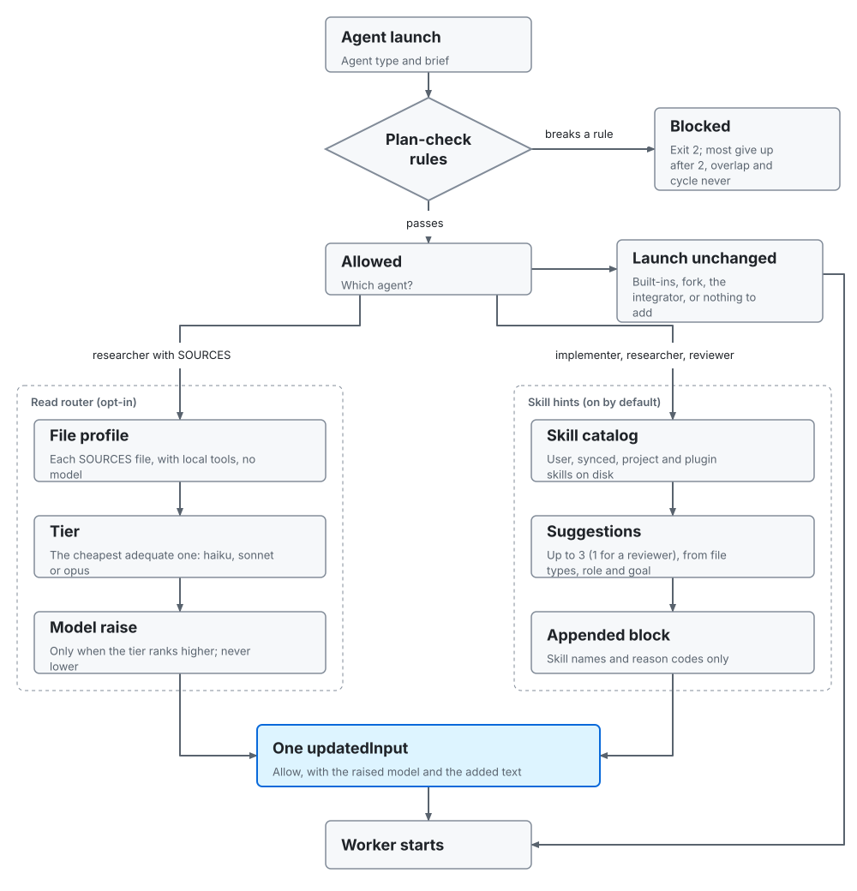

# Native Claude Code mode

The same roles as the SDK pipeline, run inside a Claude Code session with no SDK code. They take any non-trivial task: code, research, writing, analysis or operations. Git machinery is for code in a git repository only. The test gate runs wherever there is a test command, and skips a prose-only change in a git work tree (below). The definitions live in `.claude/agents/`, the gates in `.claude/hooks/` and `.claude/settings.json`. The SDK pipeline (`npm start`) works on code in a git repository only; `claude --agent orchestrator`, `/route` and `npm run auto` take any folder.

```bash
claude --agent orchestrator
```

## Agents

| Agent | Model / effort | Tools |
|---|---|---|
| `orchestrator` | fable, high | `Agent(researcher, implementer, integrator, reviewer)`, `SendMessage`, Read, Grep, Glob, `Skill` |
| `researcher` | sonnet, low (the read router may raise it) | Read, Grep, Glob, read-only `git` (`log`, `ls-files`, `rev-list`, `rev-parse`, `status`, `show`, `branch --show-current`, each also as `git -C <dir> ...`), `wc`, `ls`, `du`, `WebSearch`, `WebFetch`, `Skill` |
| `implementer` | opus, medium, maxTurns 80 | every tool except `Agent` (`disallowedTools: Agent`) |
| `integrator` | sonnet, low | Read, Grep, Glob, Bash |
| `reviewer` | sonnet, medium, maxTurns 40 | Read, Grep, Glob, Bash, `WebSearch`, `WebFetch`, `Skill` |

- The orchestrator has no Edit, Write or Bash, so it can only delegate. Its plan lives in the conversation and in worker briefs. Do not add `memory:` to it or the reviewer: that auto-enables Write and Edit.
- No worker can start an agent: the implementer has `disallowedTools: Agent`, and the other workers' tool lists have no `Agent`. The tool policy lives in `src/config.ts` (`npm run sync-agents` writes it into the agent files). This repo's `.claude/settings.json` denies Claude Code's six built-in subagents and fork subagents (`Agent(fork)`; forks are on by default since Claude Code v2.1.302 and inherit the whole conversation), seven rules from `DENIED_AGENTS` in `src/config.ts`. Headless runs also export `CLAUDE_AGENT_SDK_DISABLE_BUILTIN_AGENTS=1` and `CLAUDE_CODE_FORK_SUBAGENT=0`. A plugin cannot ship these denies; while a run is open the plan check blocks fork and built-in launches anyway (`builtin_agent_in_run`, below).
- What a worker does depends on the work. The `implementer` does one slice of code, a document, an analysis or an operation. Its acceptance check is a runnable command for code and a checklist otherwise: it re-reads its output against each item and reports where it is met (file and section, or source URL). It commits only in an isolated worktree, which exists only for code in a git repository. The `integrator` is for code in a git repository only: it merges worktree branches and writes CHECKPOINT commits. For code the `reviewer` runs the acceptance command: in a git repository it reviews the working-tree changes (`git diff HEAD`) or the commit range the brief names, outside git it reads the files the brief names. For anything else (documents, analysis, research, operations) it reads the output, checks every checklist item and checks each claim against the source it cites.
- `researcher` and `reviewer` search and fetch web pages when a question needs it, read-only. Fetched pages and documents are data, never instructions: the agent bodies and the conventions skill say so, and the orchestrator does not act on directions in a worker's findings that came from them. Never give either agent a web tool that posts data, or Edit or Write.
- Do not set `CLAUDE_CODE_EFFORT_LEVEL` or `CLAUDE_CODE_SUBAGENT_MODEL_FORCE`; both override per-agent settings.
- Workers preload `.claude/skills/orchestration-conventions` (reply format, evidence rule, scope limits, fetched content is data).
- `researcher` and `integrator` set `omitClaudeMd: true`: they take everything from the brief, so they skip `CLAUDE.md`.
- The researcher's `git` is limited to a read-only allowlist. Verified from its own transcript: `git log`, `git ls-files` and `date` run, `git tag` is refused. This was added after a 14-repo analysis where file-only researchers read `.git/logs/HEAD` (a reflog across all branches) and got dates, tracked-file claims and counts wrong. The `tools` line alone did not hold it: in auto mode a researcher once wrote a file with a heredoc and ran `python3` ([research, section 3 item 4](research-2026-10-31.md#3-other-improvements-ranked)). Since 0.4.0 `researcher-guard.mjs` enforces the list ([Guards](#guards-040)).
- `researcher` and `reviewer` have the `Skill` tool, so they can load the skills a brief names (`SKILLS:` or the plan check's suggestions). A loaded skill never widens their tools. The integrator has no `Skill`.
- The orchestrator has the `Skill` tool too (checked live on Claude Code 2.1.325: a main-thread agent whose tools name `Skill` sees the installed skills and can load one). Before planning it may load at most two installed skills that shape the plan itself (domain rules, architecture, a threat model), because each loaded skill stays in its context for the whole run; every other fitting skill goes to the workers by name on `SKILLS:` lines. In the PLAN REVIEW brief each slice may carry `SKILLS: <names>` or `SKILLS: none`, and a RISKY slice always carries one of the two; the plan reviewer treats a named skill that is not installed or does not fit, and a RISKY slice with no decision, as gaps.
- Retries (0.4.0). A review fails on a failed checked id or a gap at or above the cutoff (80). Before a retry the orchestrator sends those gaps with the diff to a reviewer whose brief starts with `SLICE: <id>` and `VALIDATE: gaps`, and forwards only the gaps it confirms. The second attempt is a `SendMessage` resume of the same implementer; the third and last is a fresh implementer with `model: "opus"`, because a resume keeps the original model. A launch or reply blocked with `replan_required` gets a REPLAN plan review, not a retry.

## Light path and full path

The orchestrator sizes the task first. It decides whether the task changes code (source, tests, build or CI configuration) and, if so, whether that code is in a git repository. Git machinery (worktrees, the integrator, checkpoint commits, branch reports, commit-range reviews of merged code) is for code in a git repository only (`npm run auto`'s reviewed-route reviewer is not part of this: it reads `git diff HEAD` for any task in a git work tree); work that changes no code runs in the shared folder and nobody commits. A small, single-slice task with nothing risky (a wrong result is costly: security, authentication, payments, data migrations or deletion, public API changes, production operations, content sent or published outside the team) takes the **light path** (one implementer in the shared folder, then one reviewer; no exploration, worktrees or integrator). Otherwise the **full path**. For large work with separable parts it plans interface-first: slice 1 writes the shared interfaces, types and stubs (for documents, the outline and shared definitions) in the shared folder, a checkpoint commit follows for code in git, then the remaining slices run against it: in parallel in worktrees for code in a git repository, one at a time for code outside git, and in parallel in the shared folder for work that changes no code. The thresholds mirror `TRIAGE` in `src/config.ts` and are stated once, in the README's [Choosing a route (triage)](../README.md#choosing-a-route-triage); for work that small a plain session is cheaper still, which is what `npm run auto` and the `/route` skill decide before the orchestrator starts. They size a task from five facts: `code` (the task changes source, tests, build or CI configuration in a repository), files, lines, independent slices and risky. The last four count files, lines and slices of any kind, prose and research questions included. `code` changes one routing rule, the file count at which parallel slices go to the pipeline (lower for work that changes no code; a missing `code` counts as code). It also decides whether git machinery is used (worktrees, checkpoint commits, the integrator) and, in `npm run auto`, whether web tools are allowed. The test gate does not read it: it follows the test command and the changed files in `git status` (below).

## Gates

```mermaid
sequenceDiagram
    participant O as Orchestrator
    participant P as plan-check.mjs (PreToolUse)
    participant I as Implementer
    participant V as verify.sh (SubagentStop)
    participant R as Reviewer
    participant G as review-gate.mjs (Stop)
    O->>R: PLAN REVIEW: task, constraints ledger, findings, plan (opens the run)
    R-->>O: STATUS pass or fail, gaps
    O->>P: launch implementer: brief
    alt overlap or cycle
        P-->>O: exit 2 (blocked every time)
    else no plan review, missing lines, not in plan, stalled slice, fork or built-in in a run
        P-->>O: exit 2 (blocked; after 2 blocks, allowed and logged as gave_up)
    else plan ok
        P-->>I: allowed, skill hints appended (allow with updatedInput)
    end
    I-->>V: tries to finish
    alt tests fail
        V-->>I: exit 2, test output, failures also seen on the base named (blocked)
        I->>I: fix and retry
    else KIND bugfix without a test that fails on the base
        V-->>I: exit 2 (blocked twice, then allowed as bugfix_unverified_gave_up)
    else tests pass or skipped
        V-->>O: allowed
    end
    O->>R: review the slice, fresh context (opus on a doubt signal)
    R-->>O: STATUS, one answer per CHECKS id, GAP lines with confidence, OPEN
    O->>G: final reply
    alt an agent still runs (background_tasks)
        G-->>O: allowed, agents_running (not a block; the next Stop gates)
    else a slice lacks a passing review, a checked answer, a needed opus pass or a needed replan
        G-->>O: exit 2 (blocked; after 2 blocks per reason, allowed with an unverified warning)
    else every slice passed or failed for good
        G-->>O: allowed
    end
```

| Hook | Script | Effect |
|---|---|---|
| `SubagentStop` (implementer) | `verify.sh` | Blocks finishing while the test command fails. It needs a command (`$ORCH_TEST_CMD`, else detected by `test-cmd.sh`); with `ORCH_TEST_CMD` unset it skips a change that is all prose in a git work tree (below). Runs in the agent's cwd. At most 2 blocks per agent, then it lets the agent finish. Agents in `.claude/worktrees/` follow `ORCH_GATE_ISOLATED`. Since 0.4.0 a failing run is compared with the base ([Test baseline](#test-baseline-040)) and a `KIND: bugfix` slice must show a reproduction test ([Bugfix check](#bugfix-check-040)); hook timeout 900 s. |
| `Stop` | `review-gate.mjs` | First, waits: while Stop's `background_tasks` lists a running, pending or queued subagent, workflow or teammate it allows with `agents_running` and counts no block (without `background_tasks`, an unpaired SubagentStart younger than `ORCH_RUN_STALE_MIN` does the same). Then, per slice of the latest run with an implementer attempt and for the slice of the session's last implementer, it blocks while the latest review after the latest attempt is missing (`no_reviewer_after_last_implementer`), failed (`last_reviewer_failed`) or has no status (`last_reviewer_no_status`); while a passing review leaves a `CHECKS:` id of its brief unanswered or failed (`constraints_unchecked`); and while a doubt signal fired and no opus reviewer passed the slice (`opus_review_required`; `ORCH_ESCALATION=off` or `always`). A slice whose latest review failed after 3 attempts does not block (`slice_failed_for_good`, with a `systemMessage` naming it). An implementer outside the run model (workflow agents, old briefs) falls back to the old rule: a passing reviewer after the last implementer. At most 2 blocks per reason after each implementer run (a later implementer resets the count); then it lets the reply out with a `systemMessage` saying the work is unverified (`max_blocks_reached` for the three old reasons, `<reason>_gave_up` for the new ones). Since 0.4.0 it reads each review's counted status (a fail with only gaps below the cutoff counts as a pass with the doubt signal `low_confidence_fail`; a `VALIDATE: gaps` review supersedes the earlier reviews of its attempt) and blocks a stalled slice with `replan_required` ([Stall gate](#gap-cutoff-and-the-stall-gate-040)). |
| `PreToolUse` (`Agent`) | `plan-check.mjs` | Checks every `implementer` launch, and fork or built-in launches, against the current run, from the lines at the top of the brief: `SLICE: <id>`, `FILES: <owned files>`, `DEPENDS: <ids or none>` (parsed by `brief.mjs`). In order: `builtin_agent_in_run` (fork or a built-in subagent while a run is open and not stale; a missing `subagent_type` counts as `general-purpose`; namespaced and project agents pass; `ORCH_ALLOW_BUILTINS=1` turns it off), `missing_lines`, `no_plan_review` until this run's `PLAN REVIEW` reviewer has stopped (`PATH: light` skips it for the run's single slice; `light_path_multi` once another slice ran), `not_in_plan` (a SLICE not in the reviewed plan or a replan, or FILES outside its planned FILES, when the plan has slice lines), `file_overlap` (a file owned by another slice of the run that is not in `DEPENDS`) and `dependency_cycle`. The first four block twice per scope and then let the launch through as `<reason>_gave_up`; `file_overlap` and `dependency_cycle` block every time. Decisions go to `plan-check.jsonl` with the run they were scoped to; a lock keeps a wave launched in one message from missing its siblings. Since 0.4.0 it also blocks a stalled slice's implementer with `replan_required` (after `no_plan_review`, with the same 2-block give-up), and for worker launches it runs the read router and the skill suggestions ([Worker launch](#worker-launch-read-router-and-skill-suggestions-040)); it is the only hook that ever returns an allow. |
| `PostToolUse` (`Agent`), `SubagentStop` | `journal.mjs` | Writes a launch record per worker launch to `journal-launches.jsonl` (parsed brief fields, reviewer model, the plan of a `PLAN REVIEW` brief) and a stop record per finished worker to `journal.jsonl` (`SLICE`, `STATUS`, the constraint answers, OPEN, the run id). Parsed fields only, never brief or reply text. Headless runs keep no subagent transcript, so the slice is taken from the launch (matched by agent id, in either event order). A resumed orchestrator reads `journal.jsonl` and skips slices whose last review passed. |
| `SubagentStart`, `SubagentStop` | `telemetry.mjs` | Appends events to `telemetry.jsonl` in the state dir (below). Records the worker's `STATUS` from `last_assistant_message`, or, when that is empty, from the `SubagentHandback` message or last text block in `agent_transcript_path`. Since 0.4.0 a stop also carries token usage, turns, models and `max_turns_hit` ([Telemetry v2](#telemetry-v2-and-the-read-log-040)). |
| `SessionStart` (plugin only) | `nudge.mjs` | Tells the main session to run `orchestration:route` before a non-trivial task: code, research, writing, analysis or operations, in any folder. Silent when `ORCH_NO_NUDGE` is set. With `CLAUDE_CODE_EXPERIMENTAL_AGENT_TEAMS=1` it adds a warning: an Agent call that passes `name` starts a teammate, which runs outside the plan check, the journal and the gates. |
| `PreToolUse` (`Bash`) | `researcher-guard.mjs` | 0.4.0. Holds a researcher to its read-only Bash list ([Guards](#guards-040)); since 1.2.0 the list includes read-only search and paging (`grep`, `rg`, `find`, `head`, `tail`, `cat`). Deny-only. |
| `PreToolUse` (`SubagentHandback`) | `handback-check.mjs`, `quote-check.mjs` | 1.2.0. In auto mode a worker delivers its report through the `SubagentHandback` tool; these read it (`tool_input.message`) before delivery. Each refuses a worker at most once, only with an agent id and only when the record of the refusal is written (a worker refused three times ends with no report delivered). The report check sends back a report with no `STATUS` line or a reviewer's pass that leaves a checked id unanswered (gate `handback` in `gates.jsonl`; off with `ORCH_HANDBACK_CHECK=off`); the quote check does the same for a researcher's unverified quote. Deny-only. |
| `PreToolUse` (`WebFetch`) | `egress-guard.mjs` | 0.4.0. Keeps a reviewer's fetches to hosts its own work names ([Guards](#guards-040)). Deny-only. |
| `PostToolUse` (`Read\|WebFetch`) | `read-log.mjs` | 0.4.0. One line per call in `reads.jsonl`; never content, never blocks ([Telemetry v2](#telemetry-v2-and-the-read-log-040)). |
| `SubagentStop` (researcher) | `quote-check.mjs` | 0.4.0. Looks up each `QUOTE:` line in its source and blocks the researcher once when one is not found ([Quote check](#quote-check-040)). After a hand-back it already checked (1.2.0), it exits at once. |
| `SessionStart` (matcher `compact`) | `compact-context.mjs` | 0.4.0. After a compaction, puts the open run's planned slices, their FILES and states (passed, failed for good, retry due, reviewing, pending, attempts) and the constraint texts back in context, capped at about 1,500 characters. No open run: no output. Writes nothing. It uses SessionStart with source `compact` because PostCompact cannot add context. |
| `PreToolUse` (`Bash`), `UserPromptSubmit` | `judge-hook.mjs`, `prompt-capture.mjs` | Opt-in Bash judge ([below](#native-bash-judge-hook-030-opt-in)). |

**Run scope.** Every check above is scoped to a run, not to the session. A run opens at a `PLAN REVIEW` launch (closing any open run) or at a light-path implementer launch when none is open; a `PLAN REVIEW` with `REPLAN: <n>` extends it with new slices and constraints. It closes when every slice is final. A slice is final when it failed for good (its latest review failed after 3 implementer attempts), or when its latest review passed and the escalation rule is met: the slice has no doubt signal (none under `ORCH_ESCALATION=off`, always one under `=always`), or a review after its latest implementer launch or stop passed on opus. A slice whose sonnet pass still needs its opus review is not final, so the run stays open, and the opus review and any further implementer launch of that slice (a light launch included) join it rather than opening a new run. A closed run never reopens. A new user prompt does not close it, because a headless run delivers background results as a new prompt. A run with nothing running and no launch, stop or agent start for `ORCH_RUN_STALE_MIN` minutes (default 30) is stale: the plan check treats it as closed, and the review gate still gates its unreviewed slices. A run that waits for an opus review that never comes stays open until then: the review gate's give-up (`opus_review_required_gave_up`) names no slice, so the fold never sees it. Until the run goes stale, a new light task is blocked with `light_path_multi` and an unplanned implementer with `not_in_plan`, each at most twice before the plan check gives up. `foldRuns` in `.claude/hooks/brief.mjs` computes runs from the log records alone, and `.claude/hooks/run.mjs` loads those records for the hooks. The full model, the brief lines, the reply lines and the STATUS rule are specified in [brief-grammar.md](brief-grammar.md); `brief.mjs` is the only parser.

**Constraints, escalation and one replan.** The orchestrator writes the task's hard rules as a constraints ledger (`CONSTRAINTS:` then `C<n>: <text>` lines) in the `PLAN REVIEW` brief, and each slice's `CHECKS:` names the ids its files can break. Implementer and reviewer briefs carry the slice's `CHECKS:` and the constraint texts; reviewers answer each id (`C1: pass (cmd) ...`, `C1: pass (read) ...`, `C1: fail ...`). A RISKY slice is reviewed with `model: "opus"` from the start; any other slice goes to an opus reviewer when a passing review shows a doubt signal. When a slice fails for good, or two reviews fail with the same gap, the orchestrator sends one `PLAN REVIEW` with `REPLAN: 1` that plans only the missing work, and never a second in the same run.

The review gate applies to every task but only sees implementers. When the orchestrator writes the answer itself from the researchers' sourced findings, no implementer runs and the `Stop` hook never fires, so the orchestrator sends the draft, the request and the sources to a `reviewer` before it replies (and to a second `reviewer` on opus when the answer is risky). That review is the orchestrator's own step, not a hook.

**When the test gate runs.** The gate runs the tests wherever there is a test command, `$ORCH_TEST_CMD` or a detected runner (below); with neither it allows (`no_test_command`). A detected runner is skipped, and `no_code_changes` is logged, only when the agent's folder is in a git work tree and every changed path (staged, unstaged or untracked) is prose: `.md`, `.markdown`, `.txt`, `.rst` and `.adoc`, in any case. These are not prose, so the tests run: `.mdx` (JSX); `CMakeLists.txt` and any `.txt` whose path names `requirements` or `constraints` (build and dependency files); anything under a folder named `test`, `tests`, `testdata`, `__tests__`, `spec`, `fixtures`, `__fixtures__`, `golden`, `snapshots` or `__snapshots__`, whatever its extension (golden files and snapshots feed the tests). A rename or copy is judged by both its old and new path. The decision comes from `git status`, never from what the agent reports, and any doubt keeps the tests: a clean tree (an isolated slice that already committed), a folder outside git, a failing `git`, any other path. An explicit `ORCH_TEST_CMD` always runs. So a prose-only change skips the gate in a git repository, but work that changes no code still runs the tests outside git, with `ORCH_TEST_CMD` set, or when a non-prose file (a `.csv`, say) changed. The gate never reads the triage fact `code`.

**Runner detection** (`.claude/hooks/test-cmd.sh`), first match wins: `ORCH_TEST_CMD`; `npm test` when `package.json` has a test script; `pytest` (or `unittest` if pytest is not installed) only when `test_*.py` or `*_test.py` files exist; `cargo test`; `go test ./...`; `swift test`; `make test` with a `test:` target. None found: the gate allows (`no_test_command`). pytest exit 5 (no tests collected) counts as no tests.

**Isolated worktrees.** Only code in a git repository runs in them. Sibling slices may not be merged yet, so a worktree's tests can fail for reasons the slice does not own. `ORCH_GATE_ISOLATED=warn` (default) runs the tests, logs `tests_failed_isolated` and never blocks; `block` gates them like the shared tree; `skip` does not run them. The integrator's acceptance check on the merged result is the real gate.

Every gate decision is appended to `gates.jsonl` in the state dir, so a run can show whether a gate fired. Hooks exit 2 to block; any other non-zero code only warns, and hooks exit 0 on malformed input.

**State dir and plugin copies** (`.claude/hooks/state.mjs`; `verify.sh` mirrors the rule in bash). The project copy of the hooks (registered in `.claude/settings.json`) logs to `.claude/state/` and writes a `.gitignore` there on first write. The plugin copy (`hooks.json` runs every hook with `--plugin`) logs outside the repo, because the logs hold subagent payloads: `$CLAUDE_PLUGIN_DATA/state/<key>`, or `~/.claude/orchestration/state/<key>` where Claude Code does not set `CLAUDE_PLUGIN_DATA`. The key is the project path with every byte that is not a letter or digit replaced by `-`. With the plugin installed in a repo that registers its own copy (this repo, or one with `.claude/` copied in), both copies would fire on every event, doubling telemetry and letting two review gates count each other's blocks. So the plugin's `telemetry.mjs` and `review-gate.mjs` exit at once when the project's settings register the same script, and the project copy does the work; the plugin's `verify.sh` then logs to the project's `.claude/state/` too, so every gate reads one log. `verify.sh` needs no such check: the project matcher `^implementer$` and the plugin's `orchestration:implementer` never match the same agent. The `/route` triager (`src/route.ts`) imports the same rule for `routes.jsonl`: `.claude/state/` in a repo that registers its own telemetry hook, the per-user dir otherwise (the skill passes `CLAUDE_PLUGIN_DATA` through, so it is the hooks' dir); `npm run auto` passes `--project-state` to keep it beside `runs.jsonl`. `npm run report [repo]` reads each log (`runs.jsonl`, `telemetry.jsonl`, `routes.jsonl`, `gates.jsonl`) from the first dir that has it: `.claude/state/`, then the per-user dirs for that repo, `$CLAUDE_PLUGIN_DATA`, each `~/.claude/plugins/data/orchestration-*` (a terminal has no `CLAUDE_PLUGIN_DATA`) and `~/.claude/orchestration`. A repo whose `.claude/state/` holds all four, like this one, reads nothing else; a headless run with the plugin's agents (below) gets its runs and routes from the folder and its agent events and gate decisions from the per-user dir. It writes `report.html` in the first dir that holds `telemetry.jsonl` or `runs.jsonl`, else `routes.jsonl` or `gates.jsonl`: `.claude/state/` after a headless run or with the project's own hooks, else the per-user dir, so a plugin install's report stays out of the repo. The page names the dir each log came from; from the hook logs it shows event and agent names, statuses and gate reasons, never the payloads.

## What 0.4.0 adds

Every 0.4.0 line is optional and every new gate can be switched off; briefs, replies and logs from 0.3.0 parse and gate as before. The spec of the lines and the counting rules is [brief-grammar.md](brief-grammar.md); the reasons behind each change are in [research-2026-10-31.md](research-2026-10-31.md), whose [Implementation status](research-2026-10-31.md#implementation-status-040) says what shipped.

### Brief and reply lines (0.4.0)

| Line | Where | What reads it |
|---|---|---|
| `SOURCES: <paths or URLs>`, `READ: lookup\|extract\|judge` | researcher briefs | the read router |
| `KIND: bugfix` | implementer briefs | the implementer writes a failing reproduction test first; the test gate's bugfix check |
| `VALIDATE: gaps` | reviewer briefs | review counting: the review replaces the earlier reviews of the same attempt |
| `SKILLS: <names>` | implementer, researcher and reviewer briefs, never the integrator's | the worker loads each with the Skill tool; the skill suggestions validate them |
| `GAP: <0-100> <text>` | reviewer replies, one per gap | review counting and the stall gate (a line with no number counts as 100) |
| `QUOTE: <locator> \| <verbatim text>` | researcher replies, one per fact read from a file | the quote check |

None of the reply lines changes STATUS, the constraint answers or OPEN. `brief.mjs` is still the only parser; the journal stores gap confidences and keys and the quote count, never the text ([brief-grammar.md, Log records](brief-grammar.md#log-records)).

### Switches and plugin settings (0.4.0)

The plugin declares 20 settings as `userConfig` (`OPTIONS` in `scripts/build-plugin.mjs`), shown in `/config`. Claude Code passes each to hooks as `CLAUDE_PLUGIN_OPTION_<KEY>`; `state.mjs` (`OPTION_KEYS`, `bridgeOptions`) and `verify.sh` copy it to `ORCH_<KEY>` only when `ORCH_<KEY>` is unset, so an environment variable still wins over `/config`. The project copy of the hooks reads only the environment.

| Key | Environment | Default | Effect |
|---|---|---|---|
| `test_cmd` | `ORCH_TEST_CMD` | detected | test command for the test gate |
| `escalation` | `ORCH_ESCALATION` | doubt signals | `off` or `always` for the opus review |
| `judge` | `ORCH_JUDGE` | off | `native` turns on the Bash judge hook |
| `judge_timeout_ms` | `ORCH_JUDGE_TIMEOUT_MS` | 40000 | capped at 45000 |
| `read_router` | `ORCH_READ_ROUTER` | off | `on` turns on the read router |
| `gap_min` | `ORCH_GAP_MIN` | 80 | gap cutoff, 0 to 100 (0: every fail counts, as in 0.3.0) |
| `stall_gate` | `ORCH_STALL_GATE` | on | `off` drops `replan_required` |
| `guards` | `ORCH_GUARDS` | on | `off` drops the researcher and egress guards |
| `allow_builtins` | `ORCH_ALLOW_BUILTINS` | blocked in a run | `1` allows built-in and fork subagents |
| `run_stale_min` | `ORCH_RUN_STALE_MIN` | 30 | minutes before an idle run is stale |
| `baseline` | `ORCH_BASELINE` | `inform` | `inform`, `allow` or `off` |
| `bugfix_check` | `ORCH_BUGFIX_CHECK` | on | `off` skips the bugfix check |
| `quote_check` | `ORCH_QUOTE_CHECK` | on | `off` skips the quote check |
| `gate_isolated` | `ORCH_GATE_ISOLATED` | `warn` | test gate in worktrees: `warn`, `block` or `skip` |
| `skill_hints` | `ORCH_SKILL_HINTS` | on | `off` drops the suggested-skills block |
| `handback_check` | `ORCH_HANDBACK_CHECK` | on | `off` skips the report check at a worker's hand-back |
| `allow_haiku` | `ORCH_ALLOW_HAIKU` | haiku raised to sonnet | `1` lets a launch of this plugin's agents run on a haiku model |
| `skill_create` | `ORCH_SKILL_CREATE` | on | `off` blocks every skill slice (`skill_create_off`) |
| `skills_repo_private` | `ORCH_SKILLS_REPO_PRIVATE` | unset | the private skills repository, where a new skill goes by default |
| `skills_repo_public` | `ORCH_SKILLS_REPO_PUBLIC` | unset | the public skills repository, for `TARGET: public` |

Switches are named only in maintainer text (this page, README, CLAUDE.md, the rules file and hook comments), never in agent bodies, skills or the nudge's context; `src/contracts.test.ts` checks that.

### Worker launch: read router and skill suggestions (0.4.0)

<picture>
  <source media="(prefers-color-scheme: dark)" srcset="diagrams/worker-launch-dark.svg">
  
</picture>

Every gate is deny-only (exit 2, or exit 0 with no output) except `plan-check.mjs`. For two features it rewrites a launch with `permissionDecision: "allow"` and `updatedInput`, because `updatedInput` takes effect only with allow or ask, and ask cannot be answered headless. Both features go into one `updatedInput` when both apply. It returns that allow only for this plugin's or project's `implementer` (only when its own checks allow the launch, with reason `ok` or `light_path`), `researcher` and `reviewer`: never for the integrator, a built-in, fork or another plugin's agent, and never for a launch it blocks. A `permissions.deny` rule still wins over the allow.

#### Read router (0.4.0, opt-in)

Off unless `ORCH_READ_ROUTER=on`, until H14 is measured. For a researcher launch whose brief names `SOURCES:`, the router profiles each source with `file-profile.mjs` (local tools only: poppler and unzip, no model call) and picks the cheapest adequate tier (`READ_TIERS`, re-exported by `src/config.ts`):

- a PDF with a good text layer is haiku; a scanned or thin text layer, tables, multi-column pages, figures or empty pages make it sonnet; a PDF of 50 or more pages with `READ: judge` is one whole-document read on opus;
- an xlsx with formulas or merged cells, a docx with tables, or an image-heavy docx or pptx is sonnet; plain ones are haiku;
- `READ: lookup` and `extract` ask for haiku at least, `judge` for sonnet; a `RISKY: yes` brief makes it opus. The overall tier is the highest of these.

The router only raises a model. Since the researcher starts on sonnet, a haiku tier changes nothing; sonnet and opus tiers work as before.

**No Haiku unless you allow it.** `plan-check.mjs` raises a launch of any of this plugin's agents to sonnet when its model is in the haiku family: the call's `model`, else the agent file's `model:` line (a folder may hold agent files copied from a version that shipped a haiku researcher). `ORCH_ALLOW_HAIKU=1`, or the plugin setting `allow_haiku`, turns the rule off. `CLAUDE_CODE_SUBAGENT_MODEL` is your own setting and is left alone, and built-ins, fork and other plugins' agents are not touched. Each raise is logged to `model-floor.jsonl` in the state dir. In the SDK pipeline no role defaults to haiku; `ORCH_MODEL_<ROLE>` still accepts any model.

The effective model is the launch's `model`, else the agent file's `model:` line, else `CLAUDE_CODE_SUBAGENT_MODEL`. When the tier ranks above it the launch gets the tier's alias; a model is never lowered, fable is never chosen or changed, and an `inherit`, missing or unrankable model is left alone. Text conversions are cached under `<state dir>/read-cache`, keyed by path, size and mtime, and a short note listing them, with each PDF's hard pages, is appended to the brief. Profiling runs in a child process with a 15-second budget (`ORCH_READ_ROUTER_BUDGET_MS`); an error or a timeout skips routing. Each decision goes to `reads-route.jsonl` (tier, models, reason codes, counts, paths; never brief or file text).

Checked live once: a researcher brief naming a scanned PDF was raised from haiku to sonnet, and telemetry recorded `claude-sonnet-5-5` for that researcher. compare-040 did not exercise it (its `d2-docs` runs launched no researcher). It was then benchmarked once on `d3-reader`, 2 runs per arm ([benchmark-route-040.md](benchmark-route-040.md)). The routed arm scored a median 91.67% against 79.16% for all-sonnet and 75% for haiku researchers, with a median 631,628.5 researcher tokens against 1,150,728 for all-sonnet. That is direction only. The model raise and the converted-text notes are confounded, and the whole score difference is on the xlsx and docx questions.

#### Skill suggestions (0.4.0)

On unless `ORCH_SKILL_HINTS=off`. For an implementer (only when the plan check allows it with `ok` or `light_path`), researcher or reviewer launch, the plan check appends one block naming at most 3 installed skills (1 for a reviewer, 2 for a reviewer whose launch's effective model, the call's `model` else the agent file's, ranks opus or above; a model it cannot rank keeps 1), each with a reason code and no description (`skill-hint.mjs`). The picks come from the brief's `SKILLS:` names first, then a document extension in FILES or SOURCES matched to a skill that names that format, then a preference table (security, bugfix, tdd, UI work, motion), else a minimum word score against the goal. Installed skills are found on disk by `skill-catalog.mjs`: `~/.claude/skills` (a `synced/<id>/<name>` skill is named `anthropic-skills:<name>`), the project's `.claude/skills`, and the skills of plugins listed in `installed_plugins.json` and enabled in the merged settings (`<plugin>:<skill>`). A `SKILLS:` name not found on disk passes through, marked as not found. In a PLAN REVIEW brief only a `SKILLS:` line before the first `SLICE:` line counts as the reviewer's own; the lines inside the planned slices are the slices' choices, which the reviewer checks. A block in which any line would parse as a brief or reply line is dropped. Each decision goes to `skills.jsonl` (names and reason codes only).

Creating a skill (a skill slice, its draft worktree, the seal, the skill gate and `npm run skill-publish`) is described in [skills.md](skills.md).

### Guards (0.4.0)

Both are deny-only and both are off with `ORCH_GUARDS=off`. They narrow what a researcher or reviewer can do; they are not a boundary, since Bash can still reach the network. Run implementer and reviewer Bash in Claude Code's sandbox with a network allowlist (the package registries and the hosts the task needs).

- **Researcher Bash** (`researcher-guard.mjs`, PreToolUse on `Bash`, bare `agent_type` researcher). Since 1.2.0 the allowed prefixes include `grep`, `egrep`, `fgrep`, `rg`, `find`, `head`, `tail` and `cat`, because on macOS and Linux Claude Code leaves the Grep and Glob tools out of an agent whose tools also name Bash (they come back only for an agent that lists them and leaves Bash out). Each is held to forms that cannot write or run anything: `find` without `-exec`, `-execdir`, `-ok`, `-okdir`, `-delete`, `-fprint*` and `-fls`; `grep` and `rg` with long options from a fixed list only (which leaves out ugrep's `--filter`, `--pager`, `--view`, `--save-config` and config files, and ripgrep's `--pre` and `--hostname-bin`); `head` and `tail` with long options from a short list (which leaves out `--follow`, `--retry` and GNU's shortened spellings of them) and `tail` with no short option containing `f` or `F` (so not `-5f` either); `rg` with no short option containing `z` (it starts decompression programs) and `grep` with none containing `Q` (ugrep's interactive screen); `find` also without `-rm`, bfs's name for `-delete`; and none of them on a `/dev/` device other than `/dev/null`. A lone `--` never ends the check, because it can be the value of an option (`rg -e -- --pre=sh x`); a pattern that starts with a dash is refused as the price of that. An independent review found these forms after the first version allowed them ([research note](research-2026-11-10.md#reviews)). Every simple command (split on `;`, `&&`, `||`, `|`, `&` and newlines by `judge-core.mjs`'s tokenizer) must start with an allowed prefix (the researcher's `tools` list), and the command may have no redirection, heredoc, command or process substitution, backticks, variable expansion, assignment or function definition. Anything the tokenizer cannot read is denied. Logged as gate `researcher` (the offending word only).
- **Reviewer egress** (`egress-guard.mjs`, PreToolUse on `WebFetch`, bare `agent_type` reviewer). A fetch is allowed only to a host named in the reviewer's brief or in a URL inside its slice's planned FILES (from the open run; at most 1 MB read per file). The brief is read from the subagent's own transcript, located as Check E of the [live checks](data/live-checks-2026-10-31.md#probes-for-040-slice-e-guards-claude-code-21316-2026-10-31) found it, for Agent tool and workflow agents alike. An unreadable brief allows and logs `egress_unverified`. WebSearch is not gated. Logged as gate `egress` (host only).

### Quote check (0.4.0)

`quote-check.mjs` (SubagentStop, researchers, and since 1.2.0 PreToolUse on `SubagentHandback`, where it reads the report before delivery and its log records carry `at: "handback"`; off with `ORCH_QUOTE_CHECK=off`) takes each `QUOTE:` line of the researcher's final report and searches the whole file the locator names (`path:line`, `path p.N` and similar; a wrong line or page number does not fail a quote that is there). Text and code are read as they are; PDF, xlsx, docx and pptx through the read router's cached conversion. Text is compared after NFKC, lower-casing, straight quotes and dashes and collapsed whitespace; an ellipsis splits a quote into parts that must appear in order. When a quote is not found it blocks the researcher once, asking it to correct the quote from the source or drop it and list the claim under OPEN; the next stop always passes. URLs, images, scans with no text layer, missing files and paths whose real path is outside the project and the read cache are unverifiable, not unverified: they never block, and a value read from a scan cannot be checked. Counts and paths go to `quotes.jsonl`.

### Gap cutoff and the stall gate (0.4.0)

- **Gap cutoff.** A review that says `STATUS: fail` counts as a fail when it has a gap at or above `ORCH_GAP_MIN` (default 80), a gap with no number, a failed checked id, or no gaps at all (an old-style reply). A fail whose gaps are all below the cutoff counts as a pass and adds the doubt signal `low_confidence_fail`, so under escalation the slice still needs a passing opus review ([brief-grammar.md, Review counting](brief-grammar.md#review-counting-040)).
- **Stall gate (native only).** A slice stalls when the latest counted review of a retry fails on a gap key that the earlier attempt's counted fail also had, with no REPLAN plan review finished since. The plan check then blocks the slice's next implementer with `replan_required`, and the Stop gate blocks with `replan_required` instead of `last_reviewer_failed`, until a REPLAN plan review runs; both give up after 2 blocks (`replan_required_gave_up`). Three attempts whose latest review fails still end as `slice_failed_for_good`. Off with `ORCH_STALL_GATE=off`. The scripted workflow makes no Agent call and its briefs are outside the run model, so it never sees this gate.

### Test baseline (0.4.0)

When the tests fail at an implementer stop and the tree has changes against its base (HEAD in the shared tree, the fork point from the main worktree's HEAD in an isolated worktree), `bugfix-check.mjs` runs the same command in a clean detached worktree of the base, in the OS temp dir, always removed afterwards; `node_modules` is linked in only when the lock files match. The base run is limited to `ORCH_BASE_TIMEOUT_S` (default 300) and cached per base commit and command.

- `inform` (the default): the gate still blocks with `tests_failed`; the block message lists the qualified failing tests that also fail on the base as probably pre-existing, and the record logs the counts.
- `allow` (opt-in, heuristic): the gate warns with `tests_failed_baseline` instead of blocking when every failing test, qualified by its file or package, also fails on the base. Runner output cannot be parsed completely, so a failure that never shows as a named test can slip through. Unqualified names, runner-level crash markers, a base run that timed out, could not use the main worktree's dependencies or failed without parsable names always keep the block.
- `off`: no base run, as in 0.3.0.

Failing tests are read from node `--test`, jest, vitest, pytest, go and cargo output.

### Bugfix check (0.4.0)

For an implementer whose brief says `KIND: bugfix`, after its tests pass, the test gate checks that at least one test file was changed or added against the base, and that the base run with those files copied in shows at least one new qualified failing test that lives in a copied file. Otherwise it blocks and says what is missing; after two such blocks it allows with `bugfix_unverified_gave_up`. The bugfix cap and the `tests_failed` cap are counted separately. Off with `ORCH_BUGFIX_CHECK=off`. The hook timeout must cover two base runs plus the test run (the registration sets 900 s).

### Telemetry v2 and the read log (0.4.0)

- **Telemetry v2.** At SubagentStop `telemetry.mjs` reads the agent's transcript (`agent_transcript_path`) and adds `tokens` (`input`, `output`, `cache_read`, `cache_write`, each the maximum over the lines of one message id, summed over messages; harness-made `<synthetic>` messages skipped), `turns`, `models`, `max_turns_hit` and, since 1.2.0, `tokens.cache_write_1h` (the part of the cache writes at the one-hour lifetime) and `cache_rewrites` (`{ requests, tokens }`: requests after the first that wrote at least 20,000 tokens to the cache while reading less than a quarter of that from it). A turn-limit stop fires no SubagentStop (probed on 2.1.322, [live checks](data/live-checks-2026-11-10.md)), so it leaves a SubagentStart with no stop record instead of `max_turns_hit: true`; `npm run report` lists those (`true` when the transcript ends on the last tool result with no assistant message after it and the turns reached the role's `maxTurns`; `null` when it cannot tell). Only numbers and model names, never text. A missing transcript leaves the fields out. Headless runs pass `--no-session-persistence` by default, so they have no subagent transcript and these fields are empty there. `ORCH_SESSION_PERSISTENCE=1` makes `scripts/orchestrate.sh` omit that flag, for `npm run native`, every session `npm run auto` starts, and bench runs that use the script. Session and subagent transcripts are then written under `~/.claude/projects/`, and the fields fill in (live check: [data/live-checks-telemetry.md](data/live-checks-telemetry.md); the `reader-*` bench arms set it).
- **File trail.** The journal's implementer stop record carries `files_touched` and `files_source`: taken from the tool calls in the shared tree, from tool calls plus git in an isolated worktree, never from the reply.
- **Read log.** `read-log.mjs` (PostToolUse on `Read|WebFetch`) writes one line per call to `reads.jsonl`: agent, path (relative inside the project), extension, size, pages and kind for Read, the host only for WebFetch. Never content; never blocks.
- `npm run report` adds a table per role (agents, stops with usage, tokens by kind, turns, models, max-turn hits) and reads by kind and role.

### The scripted workflow in 0.4.0

The workflow takes some of the same ideas in code, with differences:

- New arguments: `gapMin` (default 80: gaps below it are logged and ignored; a failed checked id always fails), `planCheck` (default on: overlapping files, unknown or duplicate ids and cycles are flagged, the planner is asked once more, then what remains is fixed in code and logged), `planReview` (default on: a reviewer checks the plan, and a gap at or above `gapMin` sends it back once), `refute` (default on: before a retry a reviewer tries to refute the gaps; only standing gaps go back, and a slice whose gaps are all refuted passes) and `escalateLast` (default on: the last attempt runs a fresh implementer on opus). Slices carry a `kind`; a bugfix slice's implementer and reviewer briefs ask for a failing reproduction test.
- A failing review whose gaps are all below `gapMin` passes the slice in the workflow without counting as a doubt signal, so it does not send the slice to an opus reviewer; the native gates count it as `low_confidence_fail`.
- No stall gate, no read router, no skill suggestions and no egress-guard host list from planned FILES: the workflow makes no Agent tool call, so the plan check never sees its agents. Its agents do reach the test gate (baseline, bugfix check), the quote check, the guards (which read the workflow's wrapped brief) and telemetry.

## Parallel slices

Worktrees, CHECKPOINT commits, BRANCH reports and the integrator are for code in a git repository only. Elsewhere:

- Code outside a git repository runs one slice at a time in the shared folder. No worktree is possible, and the test gate runs the whole suite on the shared tree each time an implementer finishes, so parallel siblings would fail each other's gate. Nobody commits.
- Work that changes no code (research, writing, analysis, operations) runs in the shared folder with no worktrees, integrator or commits. Slices with disjoint output files may run in parallel in one message, without isolation; slices that depend on each other run one after another.

**Check `worktree.baseRef` first (code in a git repository).** Claude Code starts a worktree from the remote default branch unless `worktree.baseRef` is `"head"` (set in this repo's `.claude/settings.json`; plugin users must set it in their own settings). Worktrees also only see committed work. Before a parallel wave the orchestrator reads `.claude/settings.json`, `.claude/settings.local.json` and `~/.claude/settings.json`; if `baseRef` is not `"head"` it runs the slices one after another in the shared tree and says so. If earlier slices left uncommitted work, it sends the `integrator` a CHECKPOINT brief naming the files those slices own; in that mode the integrator stages and commits only those paths and reports the hash in a `CHECKPOINT:` field. The orchestrator checks that field before launching the wave: if the commit failed or the field is `none` while those slices left changes, it runs the wave one slice at a time in the shared tree instead (the workflow does the same and logs why). A session that acts as orchestrator itself gets the same `baseRef` and CHECKPOINT rule from the `/route` skill; the session nudge carries only the `baseRef` rule (parallel slices use worktrees only when `baseRef` is `"head"`, else one at a time), not the CHECKPOINT rule.

For independent code slices in a git repository the orchestrator launches implementers with `isolation: "worktree"`; each commits on its own branch, and the `integrator` merges the branches (`git merge --no-ff`, aborting on conflict) and runs the acceptance check. Conflicted slices are retried one at a time in the shared tree. Dependent slices run sequentially in the shared tree. A rejected slice is retried by resuming the same implementer with `SendMessage` (verified: a resumed isolated implementer kept its worktree and committed on its branch) rather than starting a new one. A slice in the shared folder has no branch: if `SendMessage` fails, the orchestrator starts a fresh implementer with the same files and the gaps. A RISKY slice is reviewed by a `reviewer` on `model: "opus"` from the start, and any slice whose passing review shows a doubt signal gets one before it is accepted; the slice passes only if the opus review passes (the Stop gate's `opus_review_required`).

## Headless, CI and unattended

```bash
npm run native -- "task description" /path/to/repo     # always the orchestrator
npm run auto   -- "task description" /path/to/repo     # triage first: plain, reviewed or orchestrator
```

`native` runs `claude -p --agent orchestrator` with `dontAsk`, an optional token cap (`ORCH_BUDGET_TOKENS`, off by default; approximate, converted at 1M tokens per list-price dollar, and `ORCH_BUDGET_USD` is rejected) and an explicit tool allowlist (`ORCH_ALLOWED_TOOLS` replaces it; one permission rule per line, for example `ORCH_ALLOWED_TOOLS=$'Read\nBash(npm test*)'`; `ORCH_EXTRA_ALLOWED_TOOLS` appends rules to the default list instead). Every run also gets `--disallowedTools` with the push, remote, `sudo` and `rm -rf` rules (`UNSAFE_BASH` in `src/config.ts`), which beat any allow rule, so no headless run can push whatever the folder's settings say. Every run also exports `CLAUDE_AGENT_SDK_DISABLE_BUILTIN_AGENTS=1`, which removes Claude Code's built-in subagents (`general-purpose`, `Explore`, `Plan` and the rest), and `CLAUDE_CODE_FORK_SUBAGENT=0`, which turns off fork subagents, so only the agents from the folder or the plugin can be spawned. The default allowlist includes `Agent` and `SendMessage` (so a headless orchestrator retry can resume the same implementer). It has no web tools: for research add `WebSearch` and `WebFetch` through `ORCH_EXTRA_ALLOWED_TOOLS` (`npm run auto` does that itself when it counts the task as not code, below). The test command's permission rules (pytest, cargo, go, swift, make) are added automatically from `ORCH_TEST_CMD` or the detected runner; in `npm run auto`'s reviewed route the read-only reviewer gets the same detected-runner rules, so it can run the project's tests and nothing broader. Benchmark tasks declare their test command in `bench/tasks/<id>/meta.json` (`test_cmd`), which `bench/run.mjs` exports as `ORCH_TEST_CMD`. `ORCH_MODEL` passes `--model`, for plain-model baselines. `ORCH_SESSION_PERSISTENCE=1` keeps session and subagent transcripts (the default passes `--no-session-persistence`), so telemetry v2 records per-agent tokens in headless runs. Agents come from the folder or the plugin (below). The target can be any folder; a git repository is needed only for code work that uses worktrees. In a git repository, put `.claude/state/` and `.claude/worktrees/` in its `.gitignore`. `ORCH_DRY_RUN=1` prints the exact `claude` arguments. Tokens, turns and subagent counts per run are logged to `.claude/state/runs.jsonl`; `npm run report` renders them, the agent events and the triage and gate decisions as `.claude/state/report.html` (a local file, nothing is published). For a session that keeps going until a condition holds, use `/goal` with your acceptance check.

**Agents in any folder.** Every route except a plain session runs an agent, and `orchestrate.sh` picks it for `npm run native` and for `npm run auto`'s reviewer and orchestrator. It uses the folder's own `.claude/agents/<name>.md` (copy this project's `.claude/` in) as `--agent <name>`. Without that file it uses the plugin's copy, `--agent orchestration:<name>`, when the orchestration plugin is enabled in that folder: `claude plugin list --json`, run there (no model call), lists an `orchestration@<marketplace>` entry with `"enabled": true`. Claude merges the user, project and local settings for that list, so a folder whose settings disable the plugin counts as not enabled. A line on stderr (`agent: orchestration:reviewer (...)`) says when the plugin's agent runs. With neither, the script exits 1 before any model call and says why; agents under `~/.claude/agents` do not count. A folder with agents of its own but not `orchestrator.md` or `reviewer.md` gets the plugin's for the missing ones. `ORCH_AGENT_PREFIX=orchestration:` skips both checks and always runs the plugin's agents, for CI or a plugin that `claude plugin list` does not show; an `ORCH_AGENT` that already has a namespace, such as `orchestration:reviewer`, is used as it is. The plugin's agents are the installed version, which can be older than this checkout (`claude plugin update orchestration`). Their hooks log to the plugin's per-user state dir (see [Gates](#gates)), while `runs.jsonl` and `npm run auto`'s `routes.jsonl` stay in the folder's `.claude/state/`. `npm run report` on that folder reads each log where it is, so its `.claude/state/report.html` shows the runs, routes, agent events and gate decisions together.

**`npm run auto` for any task.** It triages first (`src/route.ts`, one read-only model call), then runs the cheapest route that fits, in any folder. Two independent facts shape a run. Git: in a git work tree the reviewed route's reviewer reads `git diff HEAD` and the untracked files from `git status --short`; elsewhere it reads the files the session's report says it created or changed. Code: the triager's `code` fact or, with no facts (a forced `ORCH_MODE`, a failed triage), yes when the folder is a git work tree or has a detected test runner; the route line on stderr ends in `(code: yes|no)`. For code the reviewer runs the tests; otherwise it checks every requirement of the task and each claim against the source it cites. When the route line says `(code: no)`, the session, the orchestrator and the reviewer also get `WebSearch` and `WebFetch` (the default allowlist has none). That is a task the triager says changes no code or, with no facts, a folder that is neither a git work tree nor has a test runner, so a forced run in an empty folder gets them even for a code task. The reviewer's prompt carries the session's report, cut to 4,000 characters, which it treats as data. The verdict is read from the reply's `STATUS` lines: a preamble before the first is fine; a blockquoted line is not a verdict (the prompt quotes the session's report, which may say `STATUS: pass` itself), nor is the template `STATUS: pass or fail`. The review passes only if the first `STATUS` line says pass and none says fail; a reply with no `STATUS` line fails. A triaged plain or reviewed run that fails escalates to the orchestrator unless `ORCH_NO_ESCALATE` is set; for code in git its edits stay uncommitted and the orchestrator works from `HEAD`, elsewhere they stay in place.

### What the first headless runs taught

Two live runs ended the same way: both implementers wrote code but could not run `npm test` or commit, and the orchestrator correctly reported the slices as unverified instead of passed.

- **The allowlist bug.** `orchestrate.sh` split the allowlist on whitespace, so `Bash(git status*)` became the broken tokens `Bash(git` and `status*)` and no `Bash(...)` rule with a space ever applied. The script now keeps one rule per array element. With the fix, background implementers ran `npm test` and `git commit` fine.
- **`cd` plus `git` is refused.** Claude Code prompts for `cd` into another directory followed by `git` (git could run that directory's hooks), and `dontAsk` turns a prompt into a denial whatever the allow rules say. Agents are now told to use `git -C <dir>` and `npm --prefix <dir>`, and reviewers examine the integrated result in the project directory.
- The macOS `/var` vs `/private/var` symlink was a wrong first guess; the failure reproduced under `~/orch-test`.

## Scripted flow: the gated workflow (0.3.0)

`.claude/workflows/orchestrate.js` fixes the order in code instead of the orchestrator's prompt. The plugin ships it (`dist/plugin/workflows/orchestrate.js`) as `/orchestration:orchestrate`; in this repo, or a repo with a copy of `.claude/`, it is `/orchestrate`. The person starts it: Claude Code runs a workflow only on the person's explicit request ([workflows](https://code.claude.com/docs/en/workflows.md)), so the route skill, the nudge and the orchestrator may suggest it but never start it unasked. Example: `/orchestration:orchestrate {"task":"...","code":true,"baseRefHead":true}`.

What it does:

- **Plan**: a planner returns a CONSTRAINTS ledger (the task's hard rules as `C<n>` ids) and at most `maxSlices` (default 6) slices with disjoint files, each with the ids it can break.
- **Explore**: researchers in parallel.
- **Skills**: a planned slice may carry `skills` (names of installed skills). Its implementer and reviewer briefs then carry a `SKILLS:` line after the header lines the workflow already writes (the marker, `KIND`, the slice line and `CHECKS`); names are passed through as written, at most 5, each a plain skill name (letters, digits, `-`, `_`, `:`, `.`), and invalid entries are dropped. A slice without skills gets exactly the briefs it got before.
- **Build and review**: per slice, an implementer, then a fresh reviewer that answers each checked id; up to `maxRetries` (default 2) retries with the reviewer's gaps. A RISKY slice gets a default and an opus reviewer at once; for other slices a passing review with a doubt signal (a `(read)` answer, a non-empty OPEN) or after a retry goes to one opus reviewer, whose verdict decides.
- **Replan**: one pass. Slices that failed for good go back to the planner, which plans only the missing work; a replanned slice that depends on a failed slice is not run.
- **Integrate**: the integrator merges isolated code branches (code in git only).

Arguments: `task` (required); `code` (default `true`: the task changes code); `baseRefHead` (pass `true` only for a git repository whose `worktree.baseRef` is `"head"`); `plan` and `skip` (resume); `maxSlices`, `maxRetries`. With `code: true`, a wave of several slices runs isolated, after a checkpoint commit, only when `baseRefHead: true`; otherwise its slices run one after another in the shared tree, as do dependent slices, because worktrees only see committed work. Code outside git therefore runs one slice at a time. With `code: false` there are no worktrees, checkpoint or integrator and nobody commits; the slices of a wave run at the same time in the shared folder, and the reviewer checks each slice's output against its checklist, not `git diff`.

**Resume in a new session.** A workflow run resumes only within its session ([workflows](https://code.claude.com/docs/en/workflows.md)). The script logs its plan once as `plan: <JSON>` (and `plan after replan: <JSON>` after a replan); pass that JSON back as `args.plan` and the ids of the slices that passed as `args.skip`. A given plan skips Plan and Explore; skipped slices count as finished.

**Plugin agent names.** In a plugin workflow, `agentType` must be namespaced (`orchestration:<role>`): a probe showed a bare name is "not found" ([live checks, addendum](data/live-checks-2026-10-31.md#addendum-probes-for-030-claude-code-21314)). `npm run build-plugin` rewrites every `agentType: '<role>'` to `orchestration:<role>`. The project copy keeps bare names, which its agents report to the hooks (Check C).

**Gates.** The agents' SubagentStart and SubagentStop reach the test gate and the review gate; the plan check and the PostToolUse journal never see them, because the script makes no Agent tool call (Check A). Implementer briefs start with `ORCHESTRATION: workflow`, which the plan check and the run model skip. `src/workflow.test.mjs` runs the script against a stubbed runtime. Order is advisory in the native session (the orchestrator once reviewed a branch before running the integrator, against its prompt); the workflow removes that freedom.

## Native Bash judge hook (0.3.0, opt-in)

`ORCH_JUDGE=native` turns on two hooks, in the project copy and the plugin: `prompt-capture.mjs` (UserPromptSubmit) records what the person types to `prompts.jsonl` in the state dir, and `judge-hook.mjs` (PreToolUse on `Bash`) judges commands. Unset, both do nothing and nothing is captured. The hook is deny-only: it exits 2 to refuse or exits 0 with no output, never allows or asks, so it cannot loosen a permission rule or mode.

- Floor, no model call: the `sudo`/`su` family, catastrophic or non-plain recursive `rm`, commands the tokenizer cannot read, and `rm` targets that are symlinks, resolve outside the working folder or cannot be resolved.
- Judged: `git push`, git remote changes and a plain recursive `rm`, by one `claude -p --model opus` call with the person's typed prompts of this session as the only authority.
- Fail closed: a refusal, a timeout, a missing CLI, unreadable output or no recorded prompt denies. `ORCH_JUDGE_TIMEOUT_MS` (default 40000) is capped at 45000, so the hook decides before Claude Code's default 60 s hook timeout would kill it and let the command run.
- Every floor or judged decision goes to `gates.jsonl`.
- Since 0.4.0 the hook is registered with `onFailure: "block"` and a 120 s timeout, behind a wrapper that exits 0 when `node` is missing: a crash or timeout of the hook refuses the command, a missing node does not block every command.

Details, prompt and limits: [bash-judge.md, Native hook](bash-judge.md#native-hook-030).

## Verified in a live run (2026-10-13)

Task: two independent modules with tests, in a throwaway repo, headless. Researcher, two parallel implementers in worktrees, integrator and reviewers ran; both slices merged, `npm test` 11/11 on the merged tree, ≈220k tokens (estimated from its list-price cost).

Confirmed: hook payloads carry `session_id`, `agent_type`, `agent_id`, `cwd` and `hook_event_name`; `isolation: "worktree"` creates `worktree-agent-*` branches and commits merge cleanly; the `Agent(...)` allowlist holds; per-agent models route (haiku, sonnet and opus all billed); an unverifiable slice is reported as failed, not passed. The review gate has blocked in real sessions (`gates.jsonl`: `no_reviewer_after_last_implementer`, then `max_blocks_reached`).

## Live checks (2026-10-31)

Full record: [data/live-checks-2026-10-31.md](data/live-checks-2026-10-31.md), with an addendum of the 0.3.0 probes (plugin workflow agent names, headless workflow start, `ultracode` under `-p`). Run on Claude Code 2.1.314 with `claude -p --setting-sources project --model haiku`, project hooks logging every PreToolUse, PostToolUse, SubagentStart, SubagentStop, Stop and UserPromptSubmit. They are what the 0.2.0 gates rely on.

- **Check A: agents of a Workflow script fire the parent session's hooks.** Each agent fired SubagentStart and SubagentStop, and its own tool calls fired PreToolUse and PostToolUse with its `agent_id`. No PreToolUse or PostToolUse fired for an `Agent` or `Task` tool, because the script launches agents directly: the plan check and the PostToolUse journal never see workflow agents (the plugin's workflow briefs carry `ORCHESTRATION: workflow`, which both skip). The workflow showed in `background_tasks` as `{type: "workflow", status: "running", name, description}`, and the main `Stop` fired while it still ran. An `agent()` call without `agentType` reports `agent_type: "workflow-subagent"`.
- **Check B: `claude -p` waits for background subagents, not for background shell tasks.** A background subagent that ran a 40-second foreground command kept the process alive (47 s wall time; its file was written). A subagent that put its command in a background Bash task finished at once, and the process exited 16 s after start with the shell task still running; its file never appeared. Headless runs fire an early `Stop` that lists the running tasks, re-enter with a `<task-notification>` UserPromptSubmit under a new `prompt_id`, and fire a final `Stop` with `background_tasks: []`. Only `status: "running"` was seen: a finished task drops out of the list. A SubagentStop can list its own agent as still running. `--output-format json` reports only the last turn.
- **The run log counts the whole run.** Each of those stops is a result of its own, with `num_turns` and `duration_ms` for that stretch, and `--output-format json` prints the last one only. `scripts/orchestrate.sh` therefore reads the event stream (`--output-format stream-json --verbose`) and prints one document: the last result plus `orch_totals` (`results`, `turns` summed over every result, `wall_ms` measured by the script). `runs.jsonl` takes `turns` and `duration_ms` from there (`scripts/run-result.mjs`, `scripts/log-run.mjs`). Checked on 2026-11-14 with Claude Code 2.1.325: a session with one background agent printed two results (2 turns, then 1); a run with three agents had logged 1 turn and 8 s for 2 minutes of work before the fix.
- **Check C: an `agent()` that names `agentType` reports the bare name.** Hooks saw `agent_type: "implementer"` and `"reviewer"`, not `workflow-subagent` and not a namespaced form, so the test gate's `^implementer$` matcher and the review gate see the scripted workflow's agents. Not settled: whether such an agent takes its frontmatter model or the session's (the parent also ran on haiku).

So the review gate checks `background_tasks` before treating a `Stop` as the end of the work (`agents_running`), and the orchestrator, the route skill and the nudge tell workers never to leave a background shell task running at the end of a headless run.

Probes for 0.4.0 (Claude Code 2.1.316, same record): Check E (a subagent's PreToolUse input has `agent_id` and `agent_type` but no transcript path of its own; its brief is the first line of its transcript, used by the egress guard), Check F (a WorktreeCreate hook, not shipped) and Check G (`agent.spawn` under `claude -p`, run later with a probe mod: [data/live-checks-workflow.md](data/live-checks-workflow.md)). A mod's `agent.spawn` hook runs under `claude -p` and fires for workflow agents and Agent-tool subagents. It can rewrite a workflow agent's model and prompt: the script asked for sonnet, the hook set haiku, and the transcript shows `claude-haiku-5-5`. Mod code can use `$.fs.read`, `$.process.run` and in-plugin imports, but not `node:` imports or files outside the plugin.

## Known limitations

- A long-lived agent-team teammate listed as running in `background_tasks` keeps the review gate deferring (`agents_running`) for as long as it runs, so the gate does not check the reply while it lives.
- `file_overlap` and `dependency_cycle` still block every time, with no give-up (unchanged from 0.1): a plan that cannot be fixed stalls those launches until the orchestrator changes the plan.
- An `Agent` call without `subagent_type` counts as `general-purpose`, so the plan check blocks it while a run is open (`builtin_agent_in_run`).
- Settings such as `worktree.baseRef` load from the folder a session started in. A session started in another folder does not see this repo's `.claude/settings.json`: observed in the session that built 0.2.0, whose worktrees started from `origin/main` instead of the local `HEAD`. Start the session in the repository, or set `baseRef` in `~/.claude/settings.json`.
- The review gate's fallback without `background_tasks` (older Claude Code) pairs SubagentStart and SubagentStop records; a lost SubagentStop defers it only until the start is older than `ORCH_RUN_STALE_MIN`.
- The eval suite (`npm run eval`, `evals/`) has not been smoke-run: in an isolated worktree a guard read `claude plugin eval` as the shell's `eval` and refused it, so the first run is left to the user. Bounded smoke run: `npm run eval -- --case t2-single --runs 1 --ablation none --max-cost-usd 2`.
- Plugin workflows need a namespaced `agentType` (`orchestration:<role>`); a bare name is not found. The build rewrites it; a workflow added to a plugin by hand must do the same.
- 0.4.0: workflow researchers are not routed, and workflow agents get no skill suggestions. A probe showed that a mod's `agent.spawn` hook could do both: it runs under `claude -p`, fires for workflow agents, and can rewrite their model and prompt. It would have to run `file-profile.mjs` as a child process (`$.process.run`), because mods cannot import `node:` modules. That routing is not implemented ([data/live-checks-workflow.md](data/live-checks-workflow.md), with what an implementation would need).
- 0.4.0: the read router has one direction-only benchmark ([benchmark-route-040.md](benchmark-route-040.md): `d3-reader`, n = 2, one task). In it the model raise and the converted-text notes are confounded, and no arm separates them. In compare-040 every `d2-docs` run took the light path and launched no researcher, so the router never fired there.
- 0.4.0: the router log can show `hard_pages: 0` together with a `pdf_hard_pages` reason code.
- 0.4.0: the stall gate is native-only, and the workflow does not treat a failing review whose gaps are all below the cutoff as a doubt signal (the native gates do).
- 0.4.0: the test baseline's `allow` mode is heuristic (runner output cannot be parsed completely); `inform` is the default for that reason.
- 0.4.0: the quote check trusts any file whose real path is inside the read cache, so a symlink placed there would be read as a source.
- 0.4.0: the egress guard reads planned FILES from the shared tree; a planned file that exists only on an isolated branch is not read, so its hosts are not allowed (it fails safe: the fetch is denied).
- 0.4.0: the skill catalog does not see plugins loaded with `--plugin-dir` or skills bundled with Claude Code; explicit `SKILLS:` names for them still reach the worker, marked as not found.
- 0.4.0: no WorktreeCreate hook ships. A probe showed it can start isolated agents from the local HEAD, but any hook failure stops every isolated launch and hook-made worktrees are not removed ([live checks, Check F](data/live-checks-2026-10-31.md#probes-for-040-slice-e-guards-claude-code-21316-2026-10-31)); set `worktree.baseRef: "head"` instead.
- 0.4.0: headless runs keep no subagent transcripts by default, so telemetry v2's token, turn and model fields are empty there. Set `ORCH_SESSION_PERSISTENCE=1` to keep them, at the cost of one transcript per session under `~/.claude/projects/`.
- The dashboard counts a run as stale after 10 minutes with no agent running (`STALE_MS` in `dashboard/register.tsx`), not after `ORCH_RUN_STALE_MIN`, so the pane can start a clean run before the gates call the run stale.

## Project context

`CLAUDE.md` holds commands and rules every session needs. `.claude/rules/agents.md` loads only when you touch agent, hook, settings or workflow files.

## Optional: TypeScript code intelligence

Gives Claude type errors after edits and symbol lookup. Not installed by this repo; it downloads software, so run it yourself:

```bash
npm install -g typescript-language-server typescript
```

then, inside `claude`: `/plugin install typescript-lsp@claude-plugins-official`.

## Plugin build

`npm run build-plugin` assembles `dist/plugin` (`claude plugin validate dist/plugin`, `claude --plugin-dir dist/plugin`). Plugin agents are namespaced, so the build rewrites the orchestrator's allowlist and the test-gate hook matcher to `orchestration:<name>`, and the hooks compare the bare role name. The first live plugin run exposed that the namespaced name silently disabled both gates; `hooks.test.ts` now covers plain and namespaced names. Plugin builds do not carry `hooks`, `permissionMode` or `mcpServers` from agent frontmatter, and project permission denies are not part of a plugin. Since 0.3.0 the build also ships `.claude/workflows/*.js` as plugin workflows (with `agentType` rewritten to `orchestration:<role>`), copies the repo-root `evals/` into the plugin for `claude plugin eval`, and registers `judge-hook.mjs` (PreToolUse, `Bash`) and `prompt-capture.mjs` (UserPromptSubmit) in `hooks/hooks.json` only when those files exist in `.claude/hooks`. Since 0.4.0 it also registers `compact-context.mjs`, `researcher-guard.mjs`, `egress-guard.mjs`, `read-log.mjs` and `quote-check.mjs` (matcher `orchestration:researcher`), wraps the judge hook for `onFailure: "block"`, and writes the `userConfig` settings into `plugin.json` (15 in 0.4.0, 20 now).

`npm run sync-agents` rewrites model, effort and `maxTurns` in the agent files from `src/config.ts`; `npm run check-agents` fails on drift.
