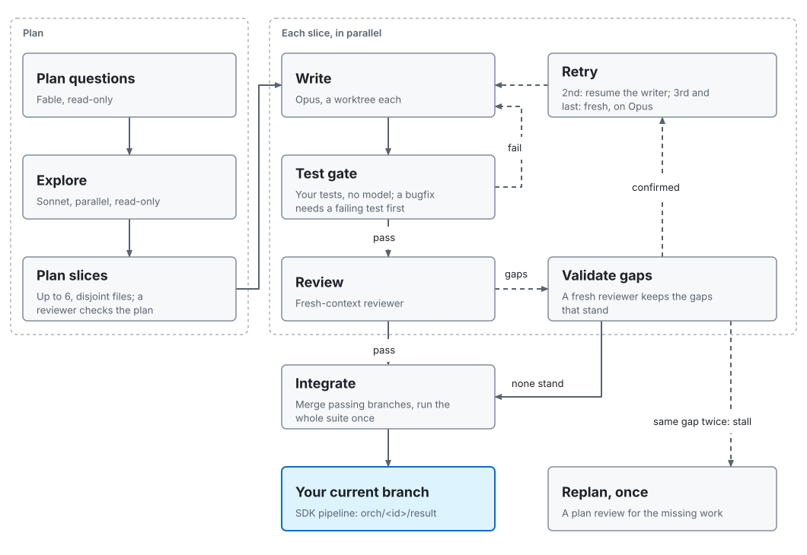
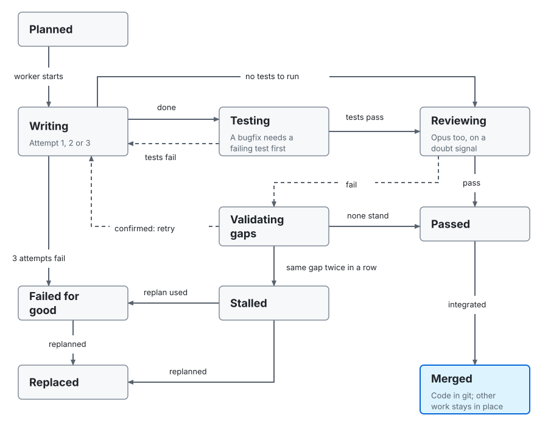

# How the native orchestrator works

How a task runs inside Claude Code: the roles, the orchestrate route and its two paths, the plan review, retries, parallel slices, the reviewed route, escalation, headless runs, the gated workflow and the plugin. Read it after the [README](../README.md); the gates themselves are in [Gates and guards](gates.md). Terms: [glossary](glossary.md). <a id="what-040-adds"></a>What the plugin adds to Claude Code, area by area: [What Claude Code ships vs what this plugin adds](native-vs-plugin.md).

The native orchestrator is a set of agents in `.claude/agents/` and hooks in `.claude/hooks/`, registered in `.claude/settings.json`. It takes any task: code, research, writing, analysis or operations, in any folder. Git machinery (worktrees, checkpoint commits, the integrator) is used only for code in a git repository.

```bash
claude --agent orchestrator    # start the orchestrator in the current folder
```

## Roles

Each role is an agent with a fixed model, effort, [turn limit](glossary.md#t) and tool list. The orchestrator plans; the four [workers](glossary.md#w) do the work.

| Role | Model, effort, turn limit | Tools | Job |
|---|---|---|---|
| Orchestrator | Fable, high | `Agent(researcher, implementer, integrator, reviewer)`, `SendMessage`, Read, Grep, Glob, `Skill` | Plans slices, writes briefs, sends reviews and retries. It has no Edit, Write or Bash, so it can only delegate |
| Researcher | Sonnet, low, 15 turns (the read router may raise the model) | Read, Grep, Glob, a read-only Bash list (below), `WebSearch`, `WebFetch`, `Skill` | Answers one narrow question with evidence: file paths, or URLs for web sources |
| Implementer | Opus, medium, 80 turns | Every tool except `Agent` (`disallowedTools: Agent`) | Builds one slice: code, a document, an analysis or an operation |
| Reviewer | Sonnet, medium, 40 turns | Read, Grep, Glob, Bash, `WebSearch`, `WebFetch`, `Skill`; it never edits | Checks one slice, or a plan, with a fresh context |
| Integrator | Sonnet, low, 20 turns | Read, Grep, Glob, Bash | Code in git only: writes checkpoint commits, merges passing branches, runs the slices' acceptance checks and then the whole suite once. It never resolves a conflict |
| Triager | Sonnet, low | Read-only | Sizes a task for the router ([triage](../README.md#choosing-a-route-triage)) |
| Plain session (`npm run auto`) | Opus, medium | What the session allows | Does a small task alone, with no workers |

In the SDK pipeline the same roles are called planner, explorer, writer, verifier, triager and solo.

**Where the settings live.** Models, effort, turn limits and the tool lists live in `src/config.ts`. `npm run sync-agents` writes them into `.claude/agents/*.md`. The model rule: Fable plans, Opus does the tasks, Sonnet does the rest. Haiku is not used: the plan check raises a haiku launch of these agents to Sonnet ([Gates and guards](gates.md#plan-check-how-it-changes-a-launch)).

<a id="guards-040"></a>**The researcher's Bash list.** It holds read-only `git` (`log`, `ls-files`, `rev-list`, `rev-parse`, `status`, `show`, `branch --show-current`, each also as `git -C <dir> ...`). It also holds `wc`, `ls`, `du`, search and paging (`grep`, `rg`, `find`, `head`, `tail`, `cat`), `sed -n`, `cut`, `stat`, `echo`, and `cd` into the project folder. The [researcher guard](gates.md#researcher-guard) holds each to narrow forms that cannot write a file or start a program. The list exists because researchers that read only files got dates and tracked-file counts wrong: in a 14-repo analysis they read `.git/logs/HEAD` (a reflog across all branches). Checked from a researcher's own transcript: `git log`, `git ls-files` and `date` ran, `git tag` was refused. The `tools` line alone did not hold the list: in auto mode a researcher once wrote a file with a heredoc and ran `python3` ([research, section 3 item 4](research-2026-10-31.md#3-other-improvements-ranked)). The researcher guard enforces it now.

**No worker starts another agent.** The implementer has `disallowedTools: Agent`, and the other workers' tool lists have no `Agent`.

**Built-in and fork subagents are denied.** This repo's `.claude/settings.json` denies the [built-in subagents](glossary.md#b) listed in `BUILTIN_AGENTS` in `.claude/hooks/builtin-agents.mjs` (seven since Claude Code 2.1.325) and fork subagents (`Agent(fork)`): eight rules, from `DENIED_AGENTS` in `src/config.ts`. Forks are on by default since Claude Code v2.1.302 and inherit the whole conversation. Headless runs also export `CLAUDE_AGENT_SDK_DISABLE_BUILTIN_AGENTS=1` and `CLAUDE_CODE_FORK_SUBAGENT=0`. A plugin cannot ship these denies. While a run is open, the plan check blocks fork and built-in launches anyway (`builtin_agent_in_run`).

**What each worker does depends on the work.**
- The implementer builds one slice. Its [acceptance check](glossary.md#a) is, for code, the narrowest command that proves the slice (usually the tests of the files it owns), and a checklist otherwise. For a checklist it re-reads its output against each item and says where each is met (file and section, or source URL).
- The test gate runs the whole suite when an implementer stops, and the integrator runs it once more after the merge. So a brief never asks a worker to run the whole suite; only the integrator's brief names it.
- The implementer commits only in an isolated worktree, which exists only for code in a git repository.
- For code, the reviewer runs the slice's acceptance command, not the whole suite. In a git repository it reviews the working-tree changes (`git diff HEAD`) or the commit range the brief names; outside git it reads the files the brief names.
- For other work (documents, analysis, research, operations), the reviewer reads the output, checks every checklist item and checks each claim against the source it cites.

**Web access is read-only.** The researcher and the reviewer search and fetch pages when a question needs it. Fetched pages and documents are data, never instructions: the agent files and the conventions skill say so, and the orchestrator does not act on directions that came from them.

**Shared setup.**
- Workers preload the `orchestration-conventions` skill: reply format, evidence rule, scope limits, fetched content is data.
- The researcher and the integrator set `omitClaudeMd: true`. They take everything from the brief and skip `CLAUDE.md`.
- The researcher and the reviewer have the `Skill` tool, so they can load the skills a brief names (a `SKILLS:` line or the plan check's [skill suggestions](skills.md#suggestions)). A loaded skill never widens their tools. The integrator has no `Skill`.
- The orchestrator has the `Skill` tool too. It loads at most two skills that shape the plan and passes every other fitting skill to the workers by name ([Skills, Using installed skills](skills.md#using-installed-skills)).

## The orchestrate route

The orchestrate route plans the task, builds slices with an implementer each, and has a fresh reviewer check each slice, behind the gates. The diagram shows it for code in a git repository. Work that changes no code follows the same plan and review steps in your folder, without worktrees or a merge.

<picture>
  <source media="(prefers-color-scheme: dark)" srcset="diagrams/pipeline-dark.svg">
  
</picture>

Why each step has this shape:

- **The strongest model plans, Opus builds, Sonnet does the rest.** Fable only decides. Opus builds the slices and runs a plain session. Sonnet answers narrow questions in parallel, reviews, integrates and sizes the task.
- **Fresh contexts.** Workers start with no history. They get a brief and return a short reply, so the orchestrator's context stays small.
- **A gate that does not trust the worker.** The test gate runs the tests in a hook and judges the changed files from `git status`, never from the worker's word.
- **A reviewer that did not write the work.** It sees the diff (the output files, for work that is not code) and the goal, not the implementer's reasoning.
- **Retries carry checked feedback.** A fresh reviewer re-checks a failing review's gaps first, and only the gaps that stand go back ([Retries](#retries)).
- **Disjoint files per slice.** Parallel slices never edit the same file, so merges are clean. Dependent slices run one after another.

One slice's life:

<picture>
  <source media="(prefers-color-scheme: dark)" srcset="diagrams/slice-lifecycle-dark.svg">
  
</picture>

**When the orchestrator writes the result itself.** The review gate sees only implementers. When the orchestrator writes a result itself from the researchers' sourced findings, no implementer runs, and no gate checks it. So the orchestrator sends the draft, the request and the sources to a reviewer before it replies, and to a second reviewer on opus when the result is risky. That review is the orchestrator's own step, not a hook.

## What the orchestrator writes

The orchestrator writes to you in short bullets or `key: value` lines, never paragraphs. Detail lives in the briefs, the [pane](dashboard.md) and the [run report](logs.md#run-report).

- **First line**: the path, `Path: light|full - <reason, a few words>`.
- **The plan, once**: one line per slice, `<id>: <goal, a few words>`, plus `RISKY` when it is; then `Constraints: C1-C<n>` (ids only). The full plan with the constraint texts goes only into the PLAN REVIEW brief.
- **Progress**: one short line, only when something changed or when it waits for workers (`waiting: s1 review, s3 build`).
- **Final report** of at most 15 lines: `Result: <n> passed, <n> failed`, then one `<id>: pass|fail - <evidence pointer>` line per slice, then only the lines that apply (replaced, reused, a skill draft, sequential slices, unverified slices), and last `Open: <items>` or `Open: none`.
- **More detail** (the full plan, gaps, logs, reasoning) only when you ask.

The `/route` skill and the nudge carry the same rule; `/route` starts with `Route: <mode> - <reason>`.

## Light path and full path

The orchestrator sizes the task first. It decides whether the task changes code (source, tests, or build or CI configuration) and, if so, whether that code is in a git repository.

- **Light path**: a small task with one slice and nothing risky. One implementer works in the shared folder, then one reviewer checks it. No exploration, plan review, worktrees or integrator. The brief carries `PATH: light`.
- **Full path**: every other task. Exploration, a plan review, slices with a reviewer each, and for code in git, worktrees and the integrator.

*Risky* means a wrong result is costly: security, authentication, payments, data migrations or deletion, public API changes, production operations, or content sent or published outside the team. The size limits mirror `TRIAGE` in `src/config.ts` and are stated once, in the README's [Choosing a route (triage)](../README.md#choosing-a-route-triage). For work that small, a plain session is cheaper still. `npm run auto` and the `/route` skill decide that before the orchestrator starts.

**Git machinery** (worktrees, the integrator, checkpoint commits, branch reports, commit-range reviews of merged code) is for code in a git repository only. Work that changes no code runs in the shared folder, and nobody commits. The reviewer of `npm run auto`'s reviewed route is not part of this: it reads `git diff HEAD` for any task in a git work tree.

**Interface first.** For large work with separable parts, slice 1 writes the shared interfaces, types and stubs (for documents, the outline and shared definitions) in the shared folder. For code in git a checkpoint commit follows. The other slices then run against it:
- in parallel in worktrees, for code in a git repository;
- one at a time, for code outside git;
- in parallel in the shared folder, for work that changes no code.

**The `code` fact.** The five triage facts, `code` among them, are in the README's [Choosing a route (triage)](../README.md#choosing-a-route-triage). The first four count work of any kind, prose and research questions included. The test gate never reads `code`: it follows the test command and the changed files in `git status` ([Test gate](gates.md#test-gate)).

## Plan review and the constraints ledger

On the full path the orchestrator writes a PLAN REVIEW brief and sends it to a reviewer before any implementer starts.

- **The [constraints ledger](glossary.md#c).** The orchestrator writes the task's hard rules in the PLAN REVIEW brief: a `CONSTRAINTS:` line, then `C<n>: <text>` lines.
- **CHECKS.** Each slice's `CHECKS:` line names the ids its files can break. Implementer and reviewer briefs carry the slice's `CHECKS:` and the constraint texts.
- **Answers.** Reviewers answer each id: `C1: pass (cmd) ...`, `C1: pass (read) ...` or `C1: fail ...`.
- **Skills.** Each planned slice may carry a skill decision, `SKILLS: <names>` or `SKILLS: none`, which the plan reviewer checks ([Skills, Using installed skills](skills.md#using-installed-skills)).
- **Opus reviews.** A RISKY slice is reviewed with `model: "opus"` from the start. Any other slice goes to an opus reviewer when a passing review shows a [doubt signal](gates.md#doubt-signals). The signals are a retry, a `(read)` answer, a non-empty OPEN, an isolated test failure, a test gate that gave up on its latest attempt, and a fail whose gaps are all below the [gap cutoff](gates.md#gap-cutoff). The slice passes only if the opus review passes (the review gate's `opus_review_required`).
- **One replan.** When a slice fails for good, or two reviews fail with the same gap, the orchestrator sends one PLAN REVIEW with `REPLAN: 1`. It plans only the missing work. A run gets at most one replan.

The exact lines are in [Brief and reply grammar](brief-grammar.md).

## Retries

A review fails on a failed checked id or on a gap at or above the gap cutoff (80 by default).

1. **Validate the gaps.** Before a retry, the orchestrator sends the failing gaps with the diff to a fresh reviewer. Its brief starts with `SLICE: <id>` and `VALIDATE: gaps`. The orchestrator forwards only the gaps it confirms. That review replaces the earlier reviews of the same attempt in the count; if it confirms none, the slice counts as passed with a doubt signal.
2. **Second attempt.** The orchestrator resumes the same implementer with `SendMessage`.
3. **Third and last attempt.** A fresh implementer with `model: "opus"`, because a resume keeps the original model.

A launch or reply blocked with `replan_required` (a [stalled slice](glossary.md#s)) gets a REPLAN plan review, not a retry. A slice whose latest review fails after 3 attempts has failed for good.

Steps 1 and 3 are rules in the orchestrator's prompt; no hook enforces them ([Limits](#limits)).

## Parallel slices

Worktrees, checkpoint commits, `BRANCH:` reports and the integrator are for code in a git repository only. Elsewhere:

- **Code outside git** runs one slice at a time in the shared folder. No worktree is possible, and the test gate runs the whole suite on the shared folder each time an implementer stops, so parallel slices would fail each other's gate. Nobody commits.
- **Work that changes no code** (research, writing, analysis, operations) runs in the shared folder with no worktrees, integrator or commits. Slices with disjoint output files may run in parallel in one message. Slices that depend on each other run one after another.

**Check `worktree.baseRef` first.** Claude Code starts a worktree from the remote default branch unless `worktree.baseRef` is `"head"`. This repo sets it in `.claude/settings.json`; plugin users must set it in their own settings. Worktrees also see only committed work.
1. Before a parallel wave, the orchestrator reads `.claude/settings.json`, `.claude/settings.local.json` and `~/.claude/settings.json`. If `baseRef` is not `"head"`, it runs the slices one after another in the shared folder and says so.
2. If earlier slices left uncommitted work, it sends the integrator a CHECKPOINT brief naming the files those slices own. The integrator stages and commits only those paths and reports the hash in a `CHECKPOINT:` field.
3. The orchestrator checks that field before it launches the wave. If the commit failed, or the field is `none` while those slices left changes, it runs the wave one slice at a time in the shared folder instead. The gated workflow does the same and logs why.

A session that acts as orchestrator itself gets the same `baseRef` and CHECKPOINT rule from the `/route` skill. The nudge carries only the `baseRef` rule.

**A wave in worktrees.** For independent code slices in a git repository, the orchestrator launches implementers with `isolation: "worktree"`. Each commits on its own branch. Since 2.0.0 each brief names its base commit, and the worker stops and reports when its worktree does not contain it.
- The integrator's brief names the branch and head commit the run is built on, and the integrator stops on a mismatch (also for a CHECKPOINT). It merges the branches (`git merge --no-ff`, aborting on a conflict), runs the slices' acceptance checks, then the project's whole suite once. If an abort fails, it runs `git status`, aborts again, then `git reset --merge`, and stops if a merge is still in progress.
- Conflicted slices are retried one at a time in the shared folder. Dependent slices run one after another in the shared folder.
- A rejected slice is retried by resuming the same implementer with `SendMessage`. Checked: a resumed isolated implementer kept its worktree and committed on its branch. A slice in the shared folder has no branch: if `SendMessage` fails, the orchestrator starts a fresh implementer with the same files and the gaps. Since 2.0.0, for an isolated slice whose resume fails or reports another branch, and for its third attempt, the orchestrator starts a fresh isolated implementer whose first command merges the slice's branch; it never starts a worker that is not isolated on another worktree's folder. These are rules in the orchestrator's prompt.
- The test gate in a worktree runs the tests and only warns by default (`tests_failed_isolated`, a doubt signal), because sibling slices may not be merged yet. The integrator's whole-suite run on the merged result is the real gate.
- The test gates of one project run one suite at a time. An isolated slice whose gate could not get its turn in time logs `tests_failed_isolated` with `not_run`, so it also needs an opus review ([Test gate in worktrees](gates.md#test-gate-in-worktrees)).

## The reviewed route

The reviewed route is one session that does the task, then one fresh reviewer that checks it. `npm run auto` runs it after triage; the `/route` skill runs it in a chat.

- **The reviewer is read-only.** In a git work tree it reads `git diff HEAD` and the untracked files from `git status --short`. Elsewhere it reads the files the session's reply says it created or changed.
- **Code:** it runs the folder's tests. **Other work:** it checks every requirement of the task and each claim against the source it cites.
- **Its prompt** carries the session's reply, cut to 4,000 characters, which it treats as data.
- **Its verdict** is its `STATUS:` line ([STATUS rule](glossary.md#s)). A preamble before the first STATUS line is fine. A blockquoted line is not a verdict (the prompt quotes the session's reply, which may say `STATUS: pass` itself), and neither is the template `STATUS: pass or fail`. The review passes only if the first STATUS line says pass and none says fail.
- **No STATUS line.** In `npm run auto` (`scripts/auto.sh`), a reply with no STATUS line counts as a fail. Under the native gates, a reviewer with no STATUS line does not pass: the review gate blocks with `last_reviewer_no_status`, and the review is not counted as a fail.

## Escalation

When a plain or reviewed run fails its checks, the task runs again on the orchestrate route.

- The failed run's edits stay in your folder. Nothing reverts them and nothing commits them.
- In git, the new run's worktrees start from your last commit, so they do not see those edits. The route line on stderr says `route: orchestrate (escalated)`.
- To turn escalation off, set `ORCH_NO_ESCALATE=1` (SDK pipeline: `--no-escalate`). A route you force (`ORCH_MODE`, or an SDK `--mode` other than `auto`) never escalates.

Escalation is not the opus review: that one is a second review of a slice, inside the orchestrate route.

## Headless runs

A [headless run](glossary.md#h) has no interactive session. Start one from a checkout:

```bash
npm run native -- "task description" /path/to/folder    # always the orchestrator
npm run auto   -- "task description" /path/to/folder    # triage first: plain, reviewed or orchestrate
```

**What `npm run native` passes.** It runs `claude -p --agent orchestrator` with the `dontAsk` permission mode.
- An explicit tool allowlist. `ORCH_ALLOWED_TOOLS` replaces it and `ORCH_EXTRA_ALLOWED_TOOLS` appends to it, one permission rule per line (for example `ORCH_ALLOWED_TOOLS=$'Read\nBash(npm test*)'`). The default list includes `Agent` and `SendMessage`, so a retry can resume the same implementer.
- No web tools by default. For research, add `WebSearch` and `WebFetch` through `ORCH_EXTRA_ALLOWED_TOOLS`. `npm run auto` adds them itself when it counts the task as not code.
- The test command's permission rules (pytest, cargo, go, swift, make) are added from `ORCH_TEST_CMD` or the detected runner. In the reviewed route, the read-only reviewer gets the same rules, so it can run the tests and nothing broader. Benchmark tasks declare their test command in `bench/tasks/<id>/meta.json` (`test_cmd`), which `bench/run.mjs` exports as `ORCH_TEST_CMD`.
- An optional token cap, `ORCH_BUDGET_TOKENS`, off by default. It is approximate: it is converted at 1M tokens per list-price dollar. `npm run native` is one session, which gets the whole cap. In `npm run auto` it caps the whole run: each session gets what the triage call and the earlier sessions left (below). `ORCH_BUDGET_USD` is rejected.
- `CLAUDE_AGENT_SDK_DISABLE_BUILTIN_AGENTS=1` and `CLAUDE_CODE_FORK_SUBAGENT=0`, so only the agents from the folder or the plugin can start.
- One sentence through `--append-system-prompt`: nobody can answer a question, so the run decides and goes on.

Every headless variable, with its default: [Environment variables](settings.md#environment-variables).

**Deny lists.** Every run gets `--disallowedTools`, and a deny beats any allow rule, whatever the folder's settings say:
- `git push`, `git remote`, `sudo` and the `rm -rf` spellings (`UNSAFE_BASH` in `src/config.ts`), so no headless run can push.
- Headless only: `git -c` and `--config-env` (also after `-C <dir>`), `reset --hard` in any spelling, every `git clean` (and `git <options> clean -<flag>`), and the global options that take a separate value (`--namespace`, `--git-dir`, `--work-tree`, `--exec-path`, `--super-prefix`, `--attr-source`, a second `-C`). Since 2.0.0 also 70 rules in all (`GIT_C_DESTRUCTIVE_DENY`): 68 for the plain destructive forms of `git -C <dir>` (the subcommand word directly followed by a literal token: `branch -D`, `checkout --`, `stash drop`, `update-ref`, ...), and 2 for `git --git-dir` or `git --work-tree` as the first word.
- `git -C <dir>` is allowed only with the named subcommands (status, diff, log, show, rev-parse, ls-files, rev-list, `branch --show-current`, `worktree list`, `worktree add`, add, commit, merge and `reset --merge`). The write subcommands (`branch --show-current`, `worktree list`, `worktree add`, add, commit, merge, `reset --merge`) are pinned since 1.6.1 to the project folder (as given, its real path and its git top level) and `<repo>/.claude/worktrees/*`, and, with skill repositories set, to each skills repository and `<config dir>/orchestration/skill-drafts/*`; a headless run can no longer `git -C` with them into another folder. The read subcommands stay open for any folder. A folder with a character that cannot be pinned in a rule (`*`, `?`, `[`, a quote, a backslash, `$`, `(`) gets no write rule; one the plan check would quote (a space or a non-ASCII letter) gets its quoted forms. A `git -C` path holding `/../` is denied. Claude Code still warns at startup about the rules that need a `*` for a worktree's name: three, six with skill repositories ([live checks for 1.6.1](data/live-checks-2026-11-17-b.md), K10 and K2).
- These lists catch mistakes, not a command built to get past them: since 2.0.0 `git -C /r branch -D main status` is denied, but `git -C /r branch -qD main status` still passes, because a later word matches an allowed subcommand and the option sits inside a cluster ([Limits, D](limits.md#d-headless-rules)). A commit message that contains ` -c` is refused, and since 2.0.0 so is a `git -C` commit message that holds a denied form after a space (`commit -m "see branch -D old"`, O1).

**A task that starts with a dash** runs: the launcher passes it after `--` (`... --allowedTools <rules> -- "<task>"`). Any other task keeps its place after `-p`.

**Output.** In a terminal, `npm run native` and `npm run auto` print the result text and one line such as `turns 41, 723 s, exit 0`. Piped or captured, they print one JSON document: the last result plus `orch_totals` for the whole run. A crashed or killed run prints a `no_result` document (`terminal_reason` `no_result`, `orch_totals.complete` false), and `runs.jsonl` still gets its wall time and turns ([Headless run results](logs.md#headless-run-results)).

**The plain session's output style.** The plain session (`ORCH_AGENT=none`, also the plain and reviewed sessions of `npm run auto`) runs in Claude Code's Concise output style. `ORCH_OUTPUT_STYLE` changes it:
- unset: Concise;
- `default` or empty: no style;
- another plain word (letters, digits, `_`, `-`): that style;
- anything else: the script exits 1 before any model call.

**Agents in any folder.** Every route except a plain session runs an agent. `scripts/orchestrate.sh` picks it, for `npm run native` and for `npm run auto`'s reviewer and orchestrator:
1. The folder's own `.claude/agents/<name>.md` (copy this project's `.claude/` in), as `--agent <name>`.
2. Without that file, the plugin's copy, `--agent orchestration:<name>`, when the plugin is enabled in that folder. The script runs `claude plugin list --json` there (no model call) and looks for an `orchestration@<marketplace>` entry with `"enabled": true`. Claude merges the user, project and local settings for that list, so a folder whose settings turn the plugin off counts as not enabled. A line on stderr (`agent: orchestration:reviewer (...)`) says when the plugin's agent runs.
3. With neither, the script exits 1 before any model call and says why. Agents under `~/.claude/agents` do not count.

A folder with agents of its own but no `orchestrator.md` or `reviewer.md` gets the plugin's for the missing ones. `ORCH_AGENT_PREFIX=orchestration:` skips both checks and always runs the plugin's agents (for CI, or a plugin that `claude plugin list` does not show). An `ORCH_AGENT` that already has a namespace, such as `orchestration:reviewer`, is used as it is. The plugin's agents are the installed version, which can be older than your checkout (`claude plugin update orchestration`). Their hooks log to the plugin's per-user state dir, while `runs.jsonl` and `routes.jsonl` stay in the folder's `.claude/state/` ([Where logs go](logs.md#where-logs-go)).

**`npm run auto` for any task.** It triages first (`src/route.ts`, one read-only model call), then runs the cheapest route that fits, in any folder. The triage call takes no MCP server and no account connector, and writes no transcript unless `ORCH_SESSION_PERSISTENCE=1`. With `ORCH_BUDGET_TOKENS` set, the cap is the run's: the triage call gets it (as `--budget`), and each later session (the plain session, the reviewer, the orchestrator, an escalated orchestrator) gets what is left after the cost the triage call and the earlier sessions reported. With less than 10k left no session starts, and a triage stopped by the cap has spent it, so none starts after it either: the run says why on stderr and exits 3. A session that leaves no readable result (a crash with no output) spent an unknown amount, so the run treats the cap as spent the same way: no later session starts, and it exits 3 with a message; a plain-only route has no later session and exits with that session's own code. Two facts shape the run:
- **Git**: in a git work tree, the reviewed route's reviewer reads the diff ([The reviewed route](#the-reviewed-route)).
- **Code**: the triager's `code` fact. With no facts (a forced `ORCH_MODE`, a failed triage), it counts as code when the folder is a git work tree or has a detected test runner. The route line on stderr ends in `(code: yes|no)`.

With `(code: no)`, the session, the orchestrator and the reviewer also get `WebSearch` and `WebFetch`. So a forced run in an empty folder gets them even for a code task. A failed plain or reviewed run escalates ([Escalation](#escalation)).

**Other notes.**
- The target can be any folder. A git repository is needed only for code work that uses worktrees. In a git repository, put `.claude/state/` and `.claude/worktrees/` in its `.gitignore`.
- `ORCH_DRY_RUN=1` prints the exact `claude` arguments and exits.
- `ORCH_SESSION_PERSISTENCE=1` keeps session and subagent transcripts (the default passes `--no-session-persistence`), so [telemetry](logs.md#telemetry) records per-worker tokens in headless runs. It also keeps the triage call's transcript.
- `npm run report` renders the run log, the worker events and the triage and gate decisions as a local `report.html` ([Run report](logs.md#run-report)). Nothing is published.
- For a session that keeps going until a condition holds, use `/goal` with your acceptance check.

## The gated workflow

The [gated workflow](glossary.md#g) (`.claude/workflows/orchestrate.js`) runs the orchestrate route with its order fixed in code instead of in the orchestrator's prompt.

```
/orchestration:orchestrate {"task":"...","code":true,"baseRefHead":true}    # plugin; in this repo: /orchestrate
```

**You start it.** Claude Code runs a workflow only on the person's explicit request ([workflows](https://code.claude.com/docs/en/workflows.md)). The route skill, the nudge and the orchestrator may suggest it but never start it. The plugin ships it as `dist/plugin/workflows/orchestrate.js`; a repo with a copy of `.claude/` has it as `/orchestrate`.

**The only workflow that starts.** Since 1.6.0 the [workflow guard](gates.md#workflow-guard) refuses every other Workflow launch where the project's `.claude/` or the plugin is loaded: a script the model writes on the spot (the `ultracode` keyword), a script path other than Claude Code's saved copy of this workflow for a resume, any other saved or bundled workflow, and since 1.6.1 a file at the saved name whose content does not match the stored hash. Claude Code's own off switch would remove this workflow too, so the guard is a hook instead.

**What it does.**
1. **Plan.** A planner returns a constraints ledger (the task's hard rules as `C<n>` ids) and at most `maxSlices` (default 6) slices with disjoint files, each with the ids it can break. The plan check in code flags overlapping files, unknown or duplicate ids and cycles; the planner is asked once more, then what remains is fixed in code and logged. A reviewer checks the plan; a gap at or above `gapMin` sends it back once. The plan may name `suite`, the command that runs the project's whole suite (one line of at most 300 characters).
2. **Explore.** Researchers run in parallel.
3. **Skills.** A planned slice may carry `skills` (names of installed skills). Its implementer and reviewer briefs then carry a `SKILLS:` line after the header lines. Names pass through as written, at most 5, each a plain skill name (letters, digits, `-`, `_`, `:`, `.`); invalid entries are dropped. A slice without skills gets the briefs it got before.
4. **Build and review.** Per slice: an implementer, then a fresh reviewer that answers each checked id. The planner names each slice's narrowest acceptance command. A bugfix slice's briefs ask for a failing reproduction test.
   - A RISKY slice gets a default and an opus reviewer at once. For other slices, a passing review with a doubt signal (a `(read)` answer, a non-empty OPEN) or after a retry goes to one opus reviewer, whose verdict decides.
   - A failing review that names no gap counts as a hard gap, so it never passes the slice.
   - Up to `maxRetries` (default 2) retries. Before each, a reviewer tries to refute the gaps; only the gaps that stand go back, and a slice whose gaps are all refuted passes. The last attempt runs a fresh implementer on opus.
   - A slice runs once everything it depends on passed. A slice whose dependency failed is not built and is reported as failed ("depends on failed <id>").
5. **Integrate.** For code in git, the integrator merges isolated branches and runs `suite` once after the merge. It answers through a schema (`status`, `merged`, `open`). A built slice whose branch is not in `merged` fails before review; a missing or malformed answer merged nothing.
   - An isolated slice whose merged review fails gets the refute pass too. While gaps stand and attempts remain, it is rebuilt in a new worktree from the current HEAD (which holds its earlier attempt), merged and reviewed again, the last attempt on opus. These retries run one slice at a time, since each merge changes the shared tree. It fails for good only when its attempts are used up.
6. **Replan.** One pass. Slices that failed for good go back to the planner, which plans only the missing work. A replanned slice that depends on a failed slice is not run.

**Arguments.**

| Argument | Default | Meaning |
|---|---|---|
| `task` | required | The task |
| `code` | `true` | The task changes code |
| `baseRefHead` | `false` | Pass `true` only for a git repository whose `worktree.baseRef` is `"head"` |
| `plan`, `skip` | none | Resume in a new session (below) |
| `maxSlices`, `maxRetries` | 6, 2 | Most slices in a plan; retries per slice |
| `gapMin` | 80 | A gap fails a slice (or a plan review) only at this confidence or above; 0 makes every gap count. A failed checked id always fails |
| `planCheck`, `planReview`, `refute`, `escalateLast` | on | The plan check in code, the plan review, the refute pass, opus on the last attempt |

With `code: true`, a wave of several slices runs isolated, after a checkpoint commit, only when `baseRefHead` is `true`. Otherwise its slices run one after another in the shared folder, as do dependent slices, because worktrees see only committed work. So code outside git runs one slice at a time. With `code: false` there are no worktrees, checkpoint or integrator, and nobody commits. The slices of a wave run at the same time in the shared folder, and the reviewer checks each slice's output against its checklist, not `git diff`.

**The result and resuming.** The log names the plan in one line: `plan: <n> slice(s), constraints <ids or none>` (after a replan, `plan after replan: ...`). The result carries `plan` (the whole plan, the replanned one after a replan) and `summary` (one line per slice, `<id>: <status> (<n> attempt(s))`). Gap texts stay in `slices[].gaps`. A workflow run resumes only within its session. To resume in a new one, pass the result's `plan` as `args.plan` (not the log line) and the ids of the slices that passed as `args.skip`. A given plan skips Plan and Explore; skipped slices count as finished.

**How it differs from the native orchestrator.**
- The order is fixed in code. In a native session it is advice: the orchestrator once reviewed a branch before running the integrator, against its prompt.
- It makes no Agent tool call. So the plan check, the PostToolUse journal, the stall gate, the read router and the skill suggestions never see its agents, and the egress guard takes no hosts from their planned files. Its implementer briefs start with `ORCHESTRATION: workflow`, which the plan check and the run model skip.
- Its agents do reach the test gate (test baseline and bugfix check included), the quote check, the guards (which read the workflow's wrapped brief), telemetry and the review gate. Their SubagentStart and SubagentStop events carry the bare role name.
- A failing review whose gaps are all below `gapMin` passes the slice there without counting as a doubt signal. The native gates count it as `low_confidence_fail`.

**Agent names in the plugin.** In a plugin workflow `agentType` must carry the namespace (`orchestration:<role>`): a probe showed that a bare name is "not found" ([live checks, addendum](data/live-checks-2026-10-31.md#addendum-probes-for-030-claude-code-21314)). `npm run build-plugin` rewrites every `agentType: '<role>'` to `orchestration:<role>`. The project copy keeps bare names. `src/workflow.test.mjs` runs the script against a stubbed runtime.

## The plugin

The marketplace manifest `.claude-plugin/marketplace.json` points at the committed `dist/plugin`. The plugin carries:
- the agents, the gate hooks, the nudge, the worker conventions skill and the `/route` skill;
- the gated workflow and the eval suite (`evals/`);
- the opt-in native Bash judge hooks ([Native hook](bash-judge.md#native-hook));
- the pane's mod, which registers an `AgentRow` hook that draws each worker's row under the prompt ([Status lines](dashboard.md#status-lines)). Rows in this format were seen in a live session, but which component drew them (this hook, or a person's own `subagentStatusLine`) is not established ([Limits, A](limits.md#a-items-carried-from-161), K2);
- 22 [plugin settings](settings.md#plugin-settings) (`userConfig`), shown in `/config`.

It does not carry permission denies or the `worktree` setting. A plugin's own settings can set only `agent` and `subagentStatusLine` ([plugins reference](https://code.claude.com/docs/en/plugins-reference.md)), and this plugin sets neither (it ships no `settings.json` since 1.6.1). Add the rest to your own settings ([Install](../README.md#install)).

**The nudge.** A SessionStart hook (`nudge.mjs`) tells each new main session to run `orchestration:route` before a non-trivial task: code, research, writing, analysis or operations, in any folder. `ORCH_NO_NUDGE=1` silences it; headless runs set it. With `CLAUDE_CODE_EXPERIMENTAL_AGENT_TEAMS=1` it adds a warning: an Agent call that passes `name` starts a teammate, which runs outside the plan check, the journal and the gates. Since 1.6.0 it also runs at UserPromptSubmit. Since 1.6.1 a typed prompt that holds the word `ultracode` is refused there before any model turn (1.6.0 gave it a context line instead), with a message telling the person to type the request again without the word or to use the orchestrator. `ORCH_WORKFLOW_GUARD=off` (plugin setting `workflow_guard`) lets such a prompt through; `ORCH_NO_NUDGE` does not ([Nudge](gates.md#nudge)).

**Where it logs.** The plugin's hooks log to a per-user state dir, not to your project. In a repo that registers its own copy of the hooks, such as this one, they log to `.claude/state/`, and the plugin's copies step aside so nothing runs twice ([Where logs go](logs.md#where-logs-go)).

Building the plugin: [Build the plugin](development.md#build-the-plugin).

## Default agent of this repo

This repo's `.claude/settings.json` sets `"agent": "orchestrator"`, so a plain `claude` started here runs as the orchestrator.

- **A plain session here:** `npm run plain`. It runs `claude --settings '{"agent":"","outputStyle":"Concise"}'`. An empty `agent` in flag settings, which rank above the project's, gives the default agent back.
- **Headless runs are not affected.** `scripts/orchestrate.sh` passes `--agent` for a named agent, and `--settings '{"agent":"","outputStyle":"Concise"}'` for `ORCH_AGENT=none` (another style with `ORCH_OUTPUT_STYLE`). SDK workers set `settings: { agent: "" }`.
- A copy of this `.claude/` carries the setting into another folder. The plugin never ships it.

Probes on Claude Code 2.1.325: [live checks, 2026-11-16](data/live-checks-2026-11-16.md).

## Checked live

Dated evidence that the behaviour above relies on.

**A live run (2026-10-13).** Task: two independent modules with tests, in a throwaway repo, headless. A researcher, two parallel implementers in worktrees, the integrator and reviewers ran. Both slices merged, `npm test` passed 11 of 11 on the merged tree, about 220k tokens (estimated from its list-price cost). Confirmed:
- Hook payloads carry `session_id`, `agent_type`, `agent_id`, `cwd` and `hook_event_name`.
- `isolation: "worktree"` creates `worktree-agent-*` branches, and their commits merge cleanly.
- The `Agent(...)` allowlist holds, and per-agent models route (haiku, sonnet and opus all billed).
- A slice that cannot be verified is reported as failed, not passed.
- The review gate has blocked in real sessions (`gates.jsonl`: `no_reviewer_after_last_implementer`, then `max_blocks_reached`).

**The first headless runs.** Two live runs ended the same way: both implementers wrote code but could not run `npm test` or commit, and the orchestrator reported the slices as unverified instead of passed.
- The allowlist bug: `orchestrate.sh` split the allowlist on whitespace, so `Bash(git status*)` became the broken tokens `Bash(git` and `status*)`. The script now keeps one rule per array element. With the fix, background implementers ran `npm test` and `git commit`.
- `cd` plus `git` is refused: Claude Code prompts for `cd` into another folder followed by `git` (git could run that folder's hooks), and `dontAsk` turns a prompt into a denial. Workers now use `git -C <dir>` and `npm --prefix <dir>`, and reviewers examine the integrated result in the project folder.
- The macOS `/var` vs `/private/var` symlink was a wrong first guess; the failure reproduced under a folder in the home directory.

**Live checks of 2026-10-31** (Claude Code 2.1.314, `claude -p --setting-sources project --model haiku`, project hooks logging every event; full record: [data/live-checks-2026-10-31.md](data/live-checks-2026-10-31.md)):
- **Check A.** Agents of a workflow script fire the parent session's SubagentStart, SubagentStop and their own PreToolUse and PostToolUse, but no PreToolUse for an `Agent` tool. So the plan check and the PostToolUse journal never see workflow agents. A running workflow shows in `background_tasks`, and the main Stop fires while it runs.
- **Check B.** `claude -p` waits for background subagents, not for background shell tasks. Headless runs fire an early Stop that lists the running tasks, re-enter with a task notification, and fire a final Stop with `background_tasks: []`. So the review gate checks `background_tasks` first (`agents_running`), and workers are told never to leave a background shell task running at the end of a headless run.
- **Check C.** An `agent()` call that names `agentType` reports the bare name to hooks (`implementer`, `reviewer`), so the test gate and the review gate see the workflow's agents. Not settled: whether such an agent takes its own model or the session's.
- **Check E** (Claude Code 2.1.316). A subagent's PreToolUse input has `agent_id` and `agent_type` but no transcript path of its own; its brief is the first line of its transcript. The egress guard reads it there.
- **Check F.** A WorktreeCreate hook can start isolated agents from the local HEAD, but any hook failure stops every isolated launch, and hook-made worktrees are not removed. Not shipped.
- **Check G.** A mod's `agent.spawn` hook runs under `claude -p` and fires for workflow agents and Agent-tool subagents. It can rewrite a workflow agent's model and prompt: the script asked for sonnet, the hook set haiku, the transcript showed haiku. Mod code can use `$.fs.read`, `$.process.run` and its own files, but not `node:` modules or files outside the plugin ([data/live-checks-workflow.md](data/live-checks-workflow.md)).

## Limits

- **Retry rules are prompt rules.** Validation before a retry and opus on the third attempt are rules in the orchestrator's prompt; no hook enforces them. The gated workflow enforces them in code.
- **Settings load from the start folder.** `worktree.baseRef` and other settings load from the folder a session started in. A session started in another folder does not see this repo's `.claude/settings.json`; one such session started its worktrees from `origin/main` instead of the local HEAD. Start the session in the repository, or set `baseRef` in `~/.claude/settings.json`. The plan check blocks an isolated implementer launch that would start from the remote default branch while HEAD differs from `origin/HEAD` (`worktree_base_not_head`, two blocks per slice).
- **No WorktreeCreate hook ships** (Check F above). Set `worktree.baseRef: "head"` instead.
- **Plugin workflows need namespaced agent names** (`orchestration:<role>`). The build rewrites them; a workflow added to a plugin by hand must do the same.
- **Workflow agents get no routing and no skill suggestions.** Workflow researchers are not routed by the read router. A mod's `agent.spawn` hook could do both (Check G): it would have to run `file-profile.mjs` as a child process (`$.process.run`), because mods cannot import `node:` modules. Not built ([data/live-checks-workflow.md](data/live-checks-workflow.md)).
- **The workflow's file-overlap check is coarser** than the plan check's. It can run two slices one after the other that could have run together. It never rejects a plan.
- **The plan check's limits** (a broken plan blocks every time, file names it cannot match): [Gates and guards, Limits](gates.md#limits).
